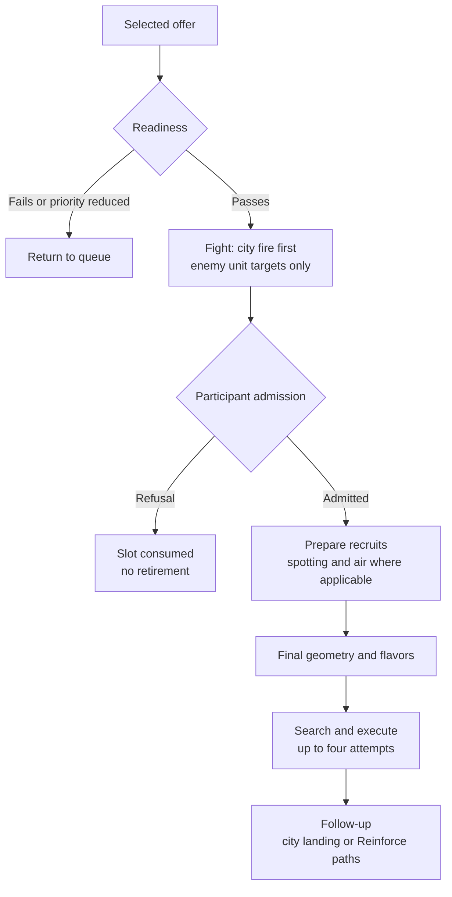

# Unit AI: Command Readiness and Execution

The [command loop](overview.md) checks the highest-priority offer before it can issue orders. A **readiness check** confirms recruitment, damage or reach without moving units; a passing offer executes one **command**. This page follows fights and reinforcement through those steps, then explains search preferences and how endangered recruits are recorded.

The implementation is in `civ5-dll/CvGameCoreDLL_Expansion2/CvTacticalOperationalLoop.cpp`, primarily `CheckFight`, `ExecuteFight`, `CheckReinforce`, `ExecuteReinforce` and `ExecuteEngagement`. See [recruitment](recruitment.md) for local and incoming unit selection and [value](value.md) for scoring. HP means hit points.

The diagram shows the common path. City fire can end a fight before admission; each command's preparation and follow-up rules appear below. After a command, the loop stops if the host has stopped, including when the DLL reaches GAMESTATE_OVER. Remaining offers do not execute. This rule applies whether or not a record is requested. The simulator also stops on any retained execution failure, including native mission failures that return without throwing. Records use `stopped` for every host stop and for exceptions, including exceptions from post-command threat rebuilding or estimation; the terminating command and its committed effects remain counted.

## Readiness checks

`CheckFight` checks the target, recruits and damage without issuing orders; Reinforce checks [reach](#reinforce-readiness) instead.

| Offer | Passing rule | Reason or exception |
| --- | --- | --- |
| Enemy unit | Living best defender on the target plot, then either an eligible city strike or native recruits with positive expected damage. | City fire passes immediately, even with no unit recruits. |
| Enemy city | Native recruits with positive expected city or garrison damage; at 1 HP or less, also a capturer or positive garrison damage. | No extra siege-progress check: the [attack fall share](value.md#city-allowance-and-fall-share) already discounts healing, and garrison damage has its own term. |
| Our city | An [endangered recruit](#city-defense), or a defender plus a visible enemy combat unit within 5 plots (search geometry reach). | No offensive damage check. Fast or long-range enemies can cause city danger while outside search geometry; waiting leaves recruits available elsewhere. |

**Native recruits** come from `FindUnitsWithinStrikingDistance`. The **damage test**, used again during [execution](#fight-execution), requires positive damage from `ComputeTotalExpectedDamage`; a city fight also accepts its separately reported garrison damage from counted attacks.

Each check records `passed`, or the first failed condition in this order. The Reinforce results come from its [readiness check](#reinforce-readiness):

| Result | Condition |
| --- | --- |
| Target gone | The plot is missing, a unit target's plot has no living best defender, for example after the target died or left, or our city's plot is no longer ours. |
| No recruits | Native recruitment finds no eligible unit of ours that can still act within striking distance. |
| No damage | The recruited units have no positive expected damage to the target unit, or to either the city or its garrison for a city fight. |
| No capturer | A city at 1 HP or less has neither positive expected garrison damage nor a recruited combat unit that is melee, has moves and an attack left, and has no capture prohibition. |
| No defenders | Our city has no defender and no endangered recruit. |
| No nearby enemy | Our city has defenders but no endangered recruit, and no visible enemy combat unit within 5 plots. |
| No reachable | Reinforce: no selected unit is left after the reach checks, so the offer turns inactive. |
| Reduced | Reinforce: a reach check shrank the selection and lowered its estimate; the offer returns at that estimate. |
| Passed | The applicable checks pass, including the immediate city-strike pass for a unit fight. |

Native recruitment reads the current tactical roster and its eligibility rules. **Available** means the unit passes `canUseNow`: moves left, unprocessed and not dying. Recruitment can include ranged units that can reach a firing position but only shoot next turn, and nearby units within 2 plots even when blocked. A pass can therefore lead to positioning. Support recruits such as generals contribute no damage. Endangered units added only during execution cannot make readiness pass; an endangered unit already in offensive recruitment contributes normally.

City fights use this damage check regardless of zone posture, native zone dominance or the native 13-turn siege-viability check. Their search aggression uses the separate posture-based risk blend. The capture-role test applies to the offensive recruits before endangered additions.

**Readiness examples.** These are supplied board states; priorities follow the [value rules](value.md).

| Case | Check | Execution or later result |
| --- | --- | --- |
| Spearman in our city's bombard range; no unit recruits | City fire supplies local damage and passes readiness. | Fire, then end on a kill, no recruits or no expected damage. Consumes one command slot and retires no overlap. |
| Ungarrisoned enemy city at 1 HP; ranged damage, no capturer | City-progress term is 0. If exposure keeps priority positive, fail `no capturer` and wait. | An available melee capturer moving into recruitment distance can wake it; recruitment, damage and capture checks run again. |
| Same city with a garrison the recruits can damage | Pass without a capturer. | Garrison damage justifies attacking. |

## Participant admission

**Participant admission** chooses which recruits may act, once per command after readiness. Enemy-unit city fire runs first, and its effects stand even if admission later refuses the offer. The host queries admission capability once for that command. The supplied simulator adapter rebuilds candidate inputs from our units and permitted geometry; native execution validates the admitted subset and records excluded recruits. If a native target, recruitment, damage or post-air gate skips admission or flavors, the command result reports that skip as confirmed feedback.

| Host or reply | Effective recruits | Effect |
| --- | --- | --- |
| DLL, absent admission capability, or explicit native admission | Native recruits or checked Reinforce selection | Preserve gathered air-sweep units for native's last-resort spotting. |
| Valid candidate subset | Only admitted recruits | Restricts spotting, greedy air, search, landing and marching. |
| Explicit empty subset with eligible candidates | None | Refused for the turn; consumes the command slot and retires no other offer. |
| No eligible candidates | None | Records `NO_ELIGIBLE`; closes as executed, including when the reply was empty. |
| Invalid membership | Native selection | Records an invalid reply and preserves native air-sweep recon. |

Only hosts with admission capability expand candidates and build preliminary search geometry for the callback. Native IDs, checked Reinforce values and effective admission remain available for records without repeating those queries.

Reinforce admission precedes its single spotter pass and path moves. Additional candidates must pass the same flood, alternative-target, safe embark and first-stop danger checks as the checked proposal. Failed additions are excluded. Admitted strength, discounted help, swing and missing capture role are recomputed without reranking the chosen offer. Native, requested and effective selections remain available for later records.

## Fight execution

`ExecuteFight` follows the native attack path, adding endangered recruits and the loop's search flavors (preferences used to score tactical plans). It first sets a **move label** (the action category recorded in tactical move and kill statistics). The zone's posture chooses the same label as its native routine, such as `AI_TACTICAL_STEAMROLL` in a Steamroll zone.

With no zone posture, fallback move labels (categories used in tactical statistics) are `AI_TACTICAL_SURGICAL_STRIKE` for enemy-city fights, `AI_TACTICAL_HEDGEHOG` for own-city fights and `AI_TACTICAL_ATTRITION` for enemy-unit fights. Own-city fights then continue in [city defense](#city-defense). Enemy fights follow this sequence:

1. **City strike**, for a unit target. Eligible cities fire first. A kill ends the command.
2. **Offensive recruitment.** Re-run native recruitment and the readiness [damage test](#readiness-checks) against the surviving target. With no recruit or a failed damage test, end the command after city fire.
3. **Endangered recruitment.** Add available units outside armies from the target's threat map. A city fight includes units threatened by the city and its garrison. Deduplicate both the endangered list and the combined search candidates. Units marked unnecessary by native's offensive estimate are initially left out of that candidate list; eligible endangered units can still enter through their threat entry.
4. **Admission.** Add recruited sweepers and, under air search, available carriers of recruited aircraft; apply [participant admission](#participant-admission). End if no admitted recruit remains.
5. **Spotter move.** Try to improve visibility using admitted offensive and endangered recruits, excluding held garrisons. Native admission also preserves sweepers for last-resort recon. If the target stays unseen, skip search.
6. **Aircraft.** Under air search, plan aircraft with the other units. Otherwise run native greedy sweeps and air strikes first. An air kill of a unit target skips search.
7. **Final search group and flavors.** Keep candidates still available after spotter and air actions, with aircraft included only under air search. A nonempty group runs `ExecuteEngagement`: gather geometry, blend flavors with the unit-fight or city-fight row, derive aggression, then search and execute with up to four attempts. Empty groups end without search.
8. **City follow-up.** After reaching the attack path for a city, delete its focus area if captured, then find embarked recruits within 4 plots and run the native landing operation when any are found.

Offensive recruitment can include a [held garrison](recruitment.md#candidates-and-selection), and search can move it; the preliminary spotter move excludes it.

## City defense

`ExecuteCityDefense` runs an own-city fight as one engagement. Its recruits come from the tactical roster under native's eligibility rule, `canUseForTacticalAI`, so operation and army units stay out. `GatherCityEndangered` collects the endangered recruits, and `GatherCityDefenders` collects the rest, skipping any unit already endangered:

| Recruit | Rule |
| --- | --- |
| Endangered | A non-air unit within 4 plots of the city that is on the turn's endangered list, or stands in a friendly city with positive live unit danger from `UnitDanger` at the [enemy roll](value.md#damage-rolls), including danger from city fall. |
| Defender | A land combat unit, or a sea one at a coastal city, within its [strike reach](recruitment.md#battlefield-estimate) by plain distance, including the held garrison on the city plot. This is the boundary where Reinforce candidates begin. Units covering a friendly civilian are left out, as native recruitment leaves them out. |
| Aircraft | Under air search, an aircraft whose range reaches the city from its base or from a plot its carrier can reach this turn, plus that carrier when it is available. Defenders need no ability to attack the city. |

Apply [admission](#participant-admission) to the combined recruits, then search with those admitted; endangered recruits receive [dispositions](#search-dispositions). The engagement uses the own-city kind row, no counterpart (native gives no civ modifier in our own zone) and `bTargetDistanceRelevant` false in both search and geometry gathering. This removes the penalty for ending farther from the city: a healthy spearman can hold while a wounded archer retreats. Enemy fights keep it on. There is no city fire, spotter move, separate air attack or capture follow-up; native high-priority fire, enemy-unit commands and the end-of-turn review keep those strikes.

## Reinforce readiness

`CheckReinforce` validates reach without issuing orders. A selection already checked since the last command passes immediately. Otherwise, a native step-finder flood (a reachability scan from the destination) uses the army-mixed path type and recruitment range.

A [held garrison](recruitment.md#candidates-and-selection) takes no path move, so it must be within search reach: 4 steps from the destination in its own domain (land or sea). `SearchReachPlots` uses the distance rules of `TacticalAIHelpers::UpdatePlotDistanceToTarget`. A land garrison separated by water fails until its player can embark. Other selected units must pass all of these checks:

- Its plot is in the flood.
- Native's alternative-target filter (`TacticalAIHelpers::GetTargetsInRange`) finds no target more than 4 plots from the destination. This filter runs at readiness because it scans each unit's reach.
- `CanMarch` finds a path with `MarchFlags` within recruit range, with safe embark for land units.
- Danger at the path's first-turn stop stays within native's limit: half the unit's remaining HP for attackers that are not siege units, otherwise 0.

A failing unit is excluded from this offer's selection for the rest of the turn. Selection and scoring repeat until every selected unit passes. If none remain, the result is `NO_REACHABLE` (no reachable recruits) and the offer becomes inactive. A lower estimate returns `REDUCED` (priority lowered by reach checks), and the offer returns to the queue at that estimate, becoming inactive if it is 0. Otherwise the check passes. Check flags clear after every command.

## Marching execution

`ExecuteReinforce` labels unit actions with `AI_TACTICAL_REINFORCE` and uses the checked selection that remains available. It calls `PositionUnitsAroundTarget` to perform these steps:

1. Move a spotter (a unit used to improve visibility), excluding held garrisons.
2. Run `ExecuteEngagement` for the units still available. Gather search geometry and resolve search preferences and aggression after the spotter move. Keep target distance relevant to search scoring, and use the target's owner as the counterpart (the player used for civilization modifiers), or none at our city.
3. After a successful search, leave units within four path steps of the target for later work, as native does (see [movement](../tactics/movement.md#execution)). Move every other unprocessed unit along a path through `CanMarch` and `MarchFlags`, then run the safety pass for army members.

The command record keeps the selection, whether the search ran, and whether a selected unit moved, meaning it changed plot or died.

## Flavors and aggression

The search resolves five [military flavors](../flavors/overview.md) (preferences on a 0 to 100 scale): RISK (willingness to accept danger), OCCUPATION (capturing cities), ATTRITION (damaging enemy forces), HOLD_CITY (defending cities) and HOLD_GROUND (controlling territory). Priority weights use the turn's mapped preferences. Each engagement uses the geographic blend below, so a civilization modifier can change search behavior without changing queue priority.

### Mapped flavors

`OPERATIONAL_VP_TERMS` maps Vox Populi flavors into the five military slots. Each term selects one named flavor and one input layer from the table below. For each military slot, start at 50 and sum the terms' weighted deviations from 50; the four layers supply inputs to those terms rather than four successive adjustments. Results are rounded and clamped to 0 to 100. A missing required flavor makes all five slots fall back to 50; any unmapped slot also gets 50.

| Input layer | What it reads |
| --- | --- |
| Active | The flavor as the flavor manager holds it now, mapped to the 0 to 100 scale. |
| Personality | The leader's base value, or the active custom value. |
| Intent | Neutral 50 plus the grand strategy's contribution, or the active custom value. |
| Strategy | The active strategies' contribution, centered on 50. |

Vox Deorum custom flavors enter these readings, allowing strategists to steer the mapped preferences. RISK falls back to `FLAVOR_OFFENSE` (native offense) when `FLAVOR_RISK` (dedicated risk) is missing, or its base personality value is 0 with no active custom risk. An active custom risk value supplies the player's preference.

### Geographic blend

`GatherSearchPlotZones` gathers the search geometry for the available candidates before the participant cap: visible plots around the target, extra room around enemies and the surroundings of accepted non-air units. Remote aircraft bases add no plots. Zone IDs 0 and −1 are omitted from the blend.

`BlendEngagementFlavors` retains the mapped search vector and resolves it in this order:

1. In each contributing zone, apply native civ, operation and zone modifiers to the mapped flavors, without search-intent defaults, then add that zone's posture row.
2. Average these vectors by their plot counts. With no contributing zone, start with the mapped flavors.
3. Add the command's kind row, clamp to 0 to 100 and round once.
4. Choose the **representative zone**, the zone with the most plots; ties go to the lower zone ID.

The function also calculates **aggression RISK** (the separate score used to choose search aggression). Each contributing zone starts at neutral 50, receives the same tactical modifiers using the game's flavor-scale conversion, then its posture's risk offset. Average these scores by plot count, including None and Withdraw zones, and add the command kind's risk offset before clamping and rounding once. With no valid zones, use 50 plus the kind offset. Player preferences still steer search scoring and priority; this separate calculation chooses aggression.

RISK always counts as set for danger scoring. **Aggression examples** use supplied geometry, neutral RISK 50 and no tactical modifiers; offsets come from the [posture and kind tables](reference.md#posture-rows-and-kind-rows).

| Command and geometry | Aggression RISK calculation | Level at default thresholds |
| --- | --- | --- |
| Unit fight: 60% Hedgehog, 40% Steamroll | `50 (neutral) + 0.6 (plot share) × (−15) (Hedgehog) + 0.4 (plot share) × 10 (Steamroll) + 0 (kind) = 45` | Medium |
| Enemy-city fight: same geometry | `45 (zone blend) + 10 (city kind) = 55` | Medium |
| Unit fight: all Withdraw | `50 − 30 (Withdraw) + 0 (kind) = 20` | Low; readiness still determines whether it can run. |
| Our city: all Hedgehog | `50 − 15 (Hedgehog) + 0 (own-city kind) = 35` | Low |

### Aggression levels

`AggressionFromRisk` maps aggression RISK (the posture-based score for search aggression) to a search level using the thresholds below. Retries keep that level and the original search flavors (preferences used to score tactical plans).

With default rows and no modifiers, single-zone unit fights resolve to Low for Attrition and Hedgehog, Medium for Exploit Flanks and Counterattack, and High for Steamroll. City fights and Reinforce still receive their kind offsets. Native city assaults choose aggression by melee count, and native positioning searches always use Low. The loop uses the same posture and kind calculation for these searches.

| Aggression RISK (score used to select search aggression) | Level with default thresholds |
| --- | --- |
| Below 40 | Low |
| 40 to 59 | Medium |
| 60 to 89 | High |
| 90 and above | Braveheart |

Final search geometry is rebuilt after spotting and greedy air from the units still able to act. The search-flavor callback receives that geometry and the native geographic blend with the command-kind row already included. Its reply replaces the five search preferences directly. Aggression keeps the separate neutral-RISK calculation, including tactical modifiers, posture and kind offsets once each. No posture offset is reapplied to the reply.

## Search dispositions

Each endangered recruit of an enemy or own-city fight receives a **disposition** from the rows counted as run across search attempts. `MarkDispositions` applies the same rule to both:

| Disposition | Rule |
| --- | --- |
| Placed | A move, attack, pillage or other action row counted as run. Finish, temporary finish, heal and wait rows count only in an attempt that completed. |
| Free | No qualifying row ran. Initial, restart and blocked rows do not place a unit; planned rows beyond a stopped attempt do not count. |

The native row counter includes a row whose precondition passed even when its outcome stopped replay. A unit omitted by the search or cut by its participant cap remains free under this rule. The native cap is 13, or 19 with air search enabled. Disposition records search placement; `canUseNow` independently determines whether a later command can recruit the unit. Spotter and greedy air effects precede search-row accounting.

**Disposition examples.** Supplied plans and execution outcomes:

| Recruit | Rows counted as run | Disposition |
| --- | --- | --- |
| Spearman moves before an attempt stops | Move ran | Placed |
| Archer's move follows the stop; retries never reach it | No qualifying row | Free |
| Spearman holds on a hill in a completed attempt | Completed hold | Placed, even if still available to heal |

Native replay processing (marking units finished after executing a plan) still applies. A successful replay processes finished ground and naval units unless they should heal and still have moves. Aircraft finishes process only aircraft that attacked and exhausted their attacks. Blocked units and units never reached by a plan remain available when their state permits.

Free endangered units (recruits with no qualifying search action) can join later commands. Units left unprocessed after the tactical turn pass to Homeland AI (the system for remaining unit tasks). Its `PlotMovesToSafety` normally moves military units when danger reaches remaining health, with a separate earlier border-clearing rule for siege units. The loop issues no withdrawal command of its own.
