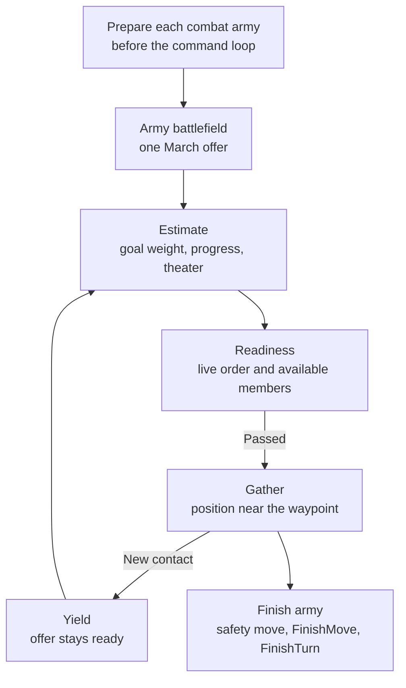

# Unit AI: Army March

An **Army March** moves a land, naval or combined combat army toward its operation. When `march.enabled` is nonzero, these armies compete for moves in the command loop. Gather chooses positions around the native waypoint, and a new enemy on the approach can interrupt the command.

| Stage | What it supplies | Function |
| --- | --- | --- |
| Prepare | Reserve recruitment, checkpoint cleanup, this turn's waypoint and corridor. | `PrepareArmy` in `civ5-dll/CvGameCoreDLL_Expansion2/CvTacticalOperationalLoop.cpp`. |
| Estimate | Goal weight, readiness gain, theater with the full army and the opening priority. | `EstimateArmyMarch`. |
| Check | Confirm the prepared order and find the members that can still act. | `CheckArmyMarch`. |
| Execute | Run Gather and move distant members toward the waypoint, yielding on new contact. | `ExecuteMarch`, `PositionUnitsAroundTarget`. |
| Finish | Safety moves, then the native move and stage transition. | `FinishPreparedArmies`, `CvAIOperation::FinishMove` and `FinishTurn`. |

## Enablement and turn integration

`CvTacticalAI::PlotOperationalArmyMoves` prepares an operation when all of these hold:

- The operational loop and `march.enabled` are on for the player. `IsMarchEnabled` also excludes barbarians.
- The operation has not already moved this turn.
- Its army type is land, naval or combined.

A prepared operation does not call `CvAIOperation::DoTurn` in the native pass. `PrepareArmy` runs the operation's prepare step, records the waypoint and corridor, and removes the army's units from the independent tactical roster. The command loop then owns the army's movement until the loop ends.

An operation that is not prepared follows the native path. That includes escorts, every operation when `march.enabled` is 0, and armies that already moved. With March off, no army battlefields exist, no formation members join Fight or Withdraw recruitment, and discovery stays on the opening tactical snapshot, so behavior is unchanged from the native pass. When March is on, a matching operation whose `PrepareArmy` fails gets no native pass: it is reported and killed.

At the end of the loop, `FinishPreparedArmies` handles every prepared army that remains:

| Condition | Result |
| --- | --- |
| Operation is gone. | Skipped. |
| Operation is aborted. | `ReleaseAllUnits`, then `Kill`. No `FinishMove` or stage transition. |
| Army is gone. | `SetToAbort(AI_ABORT_NO_UNITS)`, then `Kill`. |
| Operation is live. | `MoveArmyUnitsToSafety` on members that can still act, then `FinishMove`. When it returns true, `FinishTurn` applies the stage transition. |
| `FinishMove` returns false. | `Kill` the operation in the same pass. |

A host stop keeps the effects already committed and skips the remaining finishes. The prepared list is then cleared.

## Formation progress

At **muster**, which means the Recruiting or Gathering stage, the March scores arrival at the army's muster plot. In later stages it scores arrival at the army goal. The **waypoint** is `ComputeTargetPlotForThisTurn`, and the **corridor** is the step path from the army center to the goal that contains the waypoint. The corridor is rebuilt only when the waypoint or goal changes.

The **readiness gain** estimates progress from the shared corridor and the movement members have left. It ranks the offer without finding individual routes or predicting their stops. Any usable member can join Gather. A ship can take a route around land even if it increases the distance to the fleet.

## Goal weight and theater

`ArmyMarchGoalWeight` prices the operation's purpose:

| Operation | Goal weight `w_goal` |
| --- | --- |
| City attack, land, naval or combined | `weight.occupation` (1 at neutral OCCUPATION). |
| City defense, rapid response | `weight.holdCity` (1 at neutral HOLD_CITY). |
| Naval superiority | `weight.attrition` (1 at neutral ATTRITION). |
| Pillage enemy | `FlavorWeight(1, 1, gold flavor, false)`, which is 1 at neutral FLAVOR_GOLD and rises to 2 at 100. |
| Carrier group | 2. |
| Any other operation | 0, so no March offer. |

The carrier group chooses its deployment zone from the carrier's position, using nearby water when it is in port and a suitable water plot is available. Its destination does not affect where it measures from. March still uses the whole formation for movement and scoring.

The March reprices the target zone's theater with the whole formation. `OperationTargetZoneCity` finds the city in the operation target's zone. The local set and enemy strength are read at that city, with members not already in the local set added to local strength. A city of ours uses its own strength and the enemy strength against it. The operation enemy also counts as hostile at its own city during peacetime staging.

The result is stored twice:

| Value | Use |
| --- | --- |
| `fUnassistedTheater` | The theater without the army. Recorded for comparison and logs. |
| `fTheater` | The theater with the army. This is the `θ` in the priority. |

A March therefore gains from reinforcements twice: the same formation produces progress, and its strength can raise the target's theater.

## Priority

`priority = θ × R × w_goal × g`

| Part | Reads as |
| --- | --- |
| `θ` | The target zone's theater with the full army. |
| `R` | Ready-unit allowance, set by `march.readyUnits` (2). |
| `w_goal` | The operation's goal weight from the table above. |
| `g` | Estimated progress with the movement the army has left. |

For example, theater 0.5, readiness gain 1/6, goal weight 1 and ready-unit allowance 2 give priority 1/6. Risk enters Gather's tactical scoring and the danger check on fallback moves.

## Offer, readiness and execution

A combat army supplies one battlefield with center `OPERATIONAL_CENTER_ARMY`. Its only supported slot is the Reinforce slot, and its command kind is `OPERATIONAL_KIND_ARMY_MARCH`. It has no Fight or Withdraw slot.

| State | Enters when | Leaves when |
| --- | --- | --- |
| Ready | An opening or later estimate is positive | It reaches the top and is checked, executes, or yields. |
| Inactive | The estimate is nonpositive, or a failed check leaves it nonpositive | A later estimate is positive. |
| Executed | It runs as a command without provider refusal or yield | The turn ends. |
| Refused | The provider chooses an empty subset, the prepared order cannot be resolved, or a changed order cannot be rebuilt | The turn ends. |
| Dropped | The prepared order no longer exists | The turn ends. |
| Yielded | A new contact stops the move | It returns to Ready, and the command slot is spent. |

`EstimateArmyMarch` requires the prepared order, a live operation and army, a matching stage, target, muster and goal, the row's waypoint, at least one member that can act, a positive goal weight, and a positive readiness gain. Army rows are estimated after the city and unit battlefields, so the March reads their live theaters.

`CheckArmyMarch` re-resolves the order on the live board and collects the members who can act.

| Result | Condition |
| --- | --- |
| Target gone | The prepared order is missing. The offer drops. |
| No reachable | The operation, army or waypoint no longer matches, or no member can act. |
| Passed | The order still matches and at least one member can act. |

A March has no failure counter. A failed check makes the offer inactive, and a later estimate can return it to ready when the board changes.

`ExecuteMarch` first validates the order again. If the operation has aborted or `ShouldAbort` is true, or if its stage, target, muster or goal changed, it tries `UpdatePreparedWaypoint`. A new valid order declines this command and leaves the offer inactive for the next estimate. If no new order exists, `RemovePreparedOperation` releases the army, reports the result and kills the operation.

March uses Gather to find a plan:

1. Admit the checked selection. The native default keeps it; an empty provider subset refuses the command.
2. Move a spotter, excluding held garrisons.
3. Run the `Gather` search around the waypoint with the operation's enemy as counterpart and aggression capped at Low. Native movement rules govern legal destinations.
4. For members the search leaves far away, find an approach and check danger at the first-turn stop.
5. Record the moved units and the yield plot.

Naval and combined armies whose members are not all ocean-going avoid ocean. Gather and fallback moves can take detours without a distance veto.

**Yield.** March watches for new threats during spotting and after each action. A new enemy that can attack a member, a defender blocking the approach, or a city that can range strike a member can send control back to the queue. A yield spends its command slot. `ObserveMarchContacts` remembers contacts already seen so the same enemy does not yield the March twice.

The March command issues no safety move of its own. `FinishPreparedArmies` runs the army safety pass after all commands, then the native move finish and stage transition. See [operation stages](../operations/stages.md#standard-military-operations).

## Fighting and withdrawing with armies

A prepared army is not removed from every other command.

**Fights borrow members.** `BuildThreats` keeps two threat layouts. The Fight layout includes enrolled army members, while the Withdraw layout leaves them out. `UpdateFightArmies` marks a prepared formation for a battlefield when the battle is the operation's objective, such as its target-zone city, its own city, or a rapid-response cluster, or when the enemy threatens that formation. `FindFightRecruits` then offers those members alongside the ordinary tactical roster. Spent members still count as threats, but only a member that can act can join the search. A borrowed member uses its moves in the fight and keeps only its remaining movement for Gather.

**Withdraw can take a threatened formation.** When a prepared army is among the units threatened at a battlefield, `GatherWithdrawRecruits` adds every living member of that army to the candidates. The offer then becomes a **formation Withdraw**, which retreats the group with the formation rules instead of pulling single units:

| Rule | Formation Withdraw |
| --- | --- |
| Order | Lowest health share first, civilians last. |
| Stop | `FormationPathStop` keeps the group's shape. A stop above the first-stop danger limit is rejected when it is at least as dangerous as holding or as the member's current hit points. |
| Exposure | `ExposureSaved` compares the whole occupied board, so a retreat that exposes a neighbor is priced. |
| After moving | A moved formation member is marked processed, keeping its stop for the rest of the turn. Independent recruits are added to `withdrawnUnits` and may join a later Withdraw. |
| Admission | If the provider omits members, the remaining group re-checks its stops and the omitted members hold. |

The [Withdraw guide](withdrawal.md#formation-retreat) gives the full stop and exposure rules. An independent unit can still be pulled back on its own. As soon as one recruit belongs to a prepared army, the retreat is a formation move for that army.

## Shared target discovery

With March enabled, the loop discovers targets for every command, not only at the opening. `BuildBattlefields` still reads the tactical target snapshot. It then calls `SnapshotEnemies` and `DiscoverEnemyBattlefields` to add visible hostile combat units that are not invisible and visible enemy cities of players at war. Each unit or city is classified once, in map order, and duplicate owner and ID pairs are skipped.

After a command, `RefreshAfterCommand` rebuilds threats, syncs the army rows to their prepared waypoints, snapshots the board and diffs it. It discovers new enemies when the set of visible enemy units or cities changes. A target found mid-turn gets a new battlefield without reusing an existing row identity. Army rows themselves are fixed before the loop and never added mid-turn.
