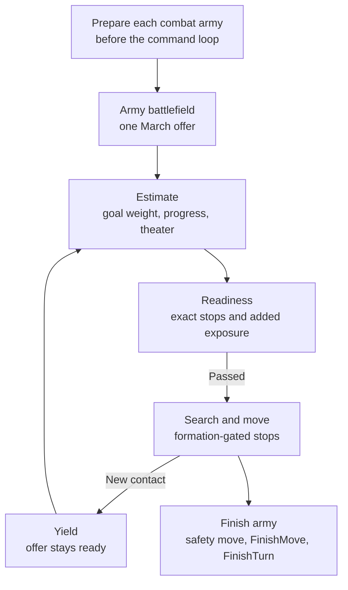

# Unit AI: Army March

An **Army March** is the operational command that moves a land, naval or combined combat army toward its operation. It replaces the native army movement pass for those armies while `march.enabled` (0, off) is nonzero. The command keeps a formation together, prices one turn of progress against the exposure it adds, and can yield when a new enemy appears on its route.

| Stage | What it supplies | Function |
| --- | --- | --- |
| Prepare | Reserve recruitment, checkpoint cleanup, this turn's waypoint and corridor. | `PrepareArmy` in `civ5-dll/CvGameCoreDLL_Expansion2/CvTacticalOperationalLoop.cpp`. |
| Estimate | Goal weight, readiness gain, theater with the full army and the opening priority. | `EstimateArmyMarch`. |
| Check | Exact first-turn stops and the exposure they add. | `CheckArmyMarch`. |
| Execute | Formation-gated search and moves, with a yield on a new contact. | `ExecuteMarch`, `PositionUnitsAroundTarget`. |
| Finish | Safety moves, then the native move and stage transition. | `FinishPreparedArmies`, `CvAIOperation::FinishMove` and `FinishTurn`. |

## Enablement and turn integration

`CvTacticalAI::PlotOperationalArmyMoves` prepares an operation when all of these hold:

- The operational loop and `march.enabled` are on for the player. `IsMarchEnabled` also excludes barbarians.
- The operation has not already moved this turn.
- Its army type is land, naval or combined.

A prepared operation does not call `CvAIOperation::DoTurn` in the native pass. `PrepareArmy` runs the operation's prepare step, records the waypoint and corridor, and removes the army's units from the independent tactical roster. The command loop then owns the army's movement until the loop ends.

An operation that is not prepared follows the native path. That includes escorts, every operation when `march.enabled` is 0, and armies that already moved. With March off, no army battlefields exist, no formation members join Fight or Withdraw recruitment, and discovery stays on the opening tactical snapshot, so behavior is unchanged from the native pass. When March is on, a matching operation whose `PrepareArmy` fails gets no native pass: it is reported and killed.

At the end of the loop, `FinishPreparedArmies` handles every prepared army that remains:

| Condition | Result |
| --- | --- |
| Operation is gone. | Skipped. |
| Operation is aborted. | `ReleaseAllUnits`, then `Kill`. No `FinishMove` or stage transition. |
| Army is gone. | `SetToAbort(AI_ABORT_NO_UNITS)`, then `Kill`. |
| Operation is live. | `MoveArmyUnitsToSafety` on members that can still act, then `FinishMove`. When it returns true, `FinishTurn` applies the stage transition. |
| `FinishMove` returns false. | `Kill` the operation in the same pass. |

A host stop keeps the effects already committed and skips the remaining finishes. The prepared list is then cleared.

## Formation progress

At **muster**, which means the Recruiting or Gathering stage, the March scores arrival at the army's muster plot. In later stages it scores arrival at the army goal. The **waypoint** is `ComputeTargetPlotForThisTurn`, and the **corridor** is the step path from the army center to the goal that contains the waypoint. The corridor is rebuilt only when the waypoint or goal changes.

Each member uses a cached route keyed by army row and unit. The cache is rebuilt when the unit's start plot or waypoint changes, and invalidated when a new enemy plot appears. A **first-turn stop** is the farthest cached node the unit's live movement can reach. `FormationPathStop` then walks the route forward while the stop keeps the formation sound.

| Formation rule | Detail |
| --- | --- |
| Center | The member nearest the mean of all member plots, with ties favoring the member nearer the army goal. |
| Tolerance | The operation's gather tolerance at the current center. |
| Stop test | Moving one member to the stop must not push any member farther from the new center than the larger of its current distance and the tolerance. |
| Combined armies | An embarked member must stop on water. |
| Check mode | The stop must also pass `canMoveInto` with destination and March flags, and multiple arrivals must fit the native stacking limit. |

Let `q(t) = 1 / (1 + t)` for travel time `t` in turns. The **readiness gain** `g` compares holding with one step along the route:

`g = ( mean over members [q(t_after) − q(t_before)] + q(T_move) − q(T_hold) ) / 2`

| Part | Reads as |
| --- | --- |
| `t_before` | Cached travel turns from the member's plot to the goal, or 0 when already within the goal radius. |
| `t_after` | Travel turns from its first-turn stop. A member with no legal stop holds, so `t_after = t_before`. Infinite travel gives no progress. |
| `T_hold`, `T_move` | The slowest member before and after the step, also including the projected formation center's corridor travel and the corridor tail beyond the waypoint, less the member arrival radius. |
| Muster wait | Only in Recruiting, when the formation still lacks enough units, `ArmyMarchRecruitmentWait` adds the later of a committed production arrival's turns to both `T_hold` and `T_move`. |
| `/ 2` | Averages individual progress and formation progress, so neither a single fast unit nor a fast center can carry the estimate alone. |

`g` is 0 when no member can move or no legal stop exists. A nonpositive `g` leaves the offer inactive.

**Progress example.** Three members each move from 2 turns of travel to 1, and the formation center does the same. `q(2) = 1/3` and `q(1) = 1/2`, so `g = ((1/2 − 1/3) + (1/2 − 1/3)) / 2 = 1/6 ≈ 0.1667`. If one member stays at 2 turns, its individual term is 0 and `T_move` stays at 2 turns, so `g = (1/9 + 0) / 2 = 1/18 ≈ 0.0556`, one third of the full gain.

## Goal weight and theater

`ArmyMarchGoalWeight` prices the operation's purpose:

| Operation | Goal weight `w_goal` |
| --- | --- |
| City attack, land, naval or combined | `weight.occupation` (1 at neutral OCCUPATION). |
| City defense, rapid response | `weight.holdCity` (1 at neutral HOLD_CITY). |
| Naval superiority | `weight.attrition` (1 at neutral ATTRITION). |
| Pillage enemy | `FlavorWeight(1, 1, gold flavor, false)`, which is 1 at neutral FLAVOR_GOLD and rises to 2 at 100. |
| Carrier group | 2. |
| Any other operation | 0, so no March offer. |

The March reprices the target zone's theater with the whole formation. `OperationTargetZoneCity` finds the city in the operation target's zone. The local set and enemy strength are read at that city, with members not already in the local set added to local strength. A city of ours uses its own strength and the enemy strength against it. The operation enemy also counts as hostile at its own city during peacetime staging.

The result is stored twice:

| Value | Use |
| --- | --- |
| `fUnassistedTheater` | The theater without the army. Recorded for comparison and logs. |
| `fTheater` | The theater with the army. This is the `θ` in the priority. |

A March therefore gains from reinforcements twice: the same formation produces progress, and its strength can raise the target's theater.

## Added exposure

The opening estimate prices no added exposure. The readiness check projects the exact first-turn stops and measures the change in capped exposure with `ExposureSaved`. A positive **added exposure** `A` is the net increase in exposure; a move that saves exposure has `A = 0`.

Each enemy threat at a battlefield nearby is weighted by the part that battlefield's own forces do not already cover. `ArmyMarchAttackerWeights` sets the weight to `1 − s⁺`, where `s⁺` is the fight's strength share when no positive Reinforce is ready, or the larger of that share and the Reinforce's projected share when one is. A city garrison inherits its city's weight.

The projection reallocates every changed plot's capped exposure over its projected occupants. That includes the moved members arriving at their stops, members left behind, and other friendly units that may take an attack instead. Attacks can move to a stayer, and a retreat can expose a neighbor, so `A` can be positive even when the army itself leaves danger.

## Priority

**Rule: one turn of formation progress at the operation's goal weight, less the risk of the exposure it adds.**

`priority = θ × max(0, R × w_goal × g − w_R × A / Z_T)`

| Part | Reads as |
| --- | --- |
| `θ` | The target zone's theater with the full army. |
| `R` | **Ready-unit allowance**, setting `march.readyUnits` (2). It converts one turn of progress into typical units of goal value. |
| `w_goal` | The operation's goal weight from the table above. |
| `g` | Readiness gain, between 0 and 1. |
| `w_R` | Risk weight, setting `weight.risk` (1 at neutral). |
| `A` | Added exposure in worth. `Z_T` is typical unit worth. |
| `max(0, ...)` | An exposure increase larger than the progress makes the offer inactive. |

### Running example inputs

| Input | Value | Source |
| --- | --- | --- |
| Typical unit worth `Z_T` | 400 | Supplied. |
| Risk weight `w_R` | 1 | Neutral RISK. |
| Ready-unit allowance `R` | 2 | Setting `march.readyUnits`. |
| Theater `θ` | 0.5 | Supplied; this is the value with the army. |
| Goal weight `w_goal` | 1 | Neutral occupation or hold-city weight. |
| Readiness gain `g` | 1/6 | Derived in [formation progress](#formation-progress). |
| Added exposure `A` | 40 worth | Supplied; `A / Z_T = 0.1`. |

### Worked priorities

| Case | Priority |
| --- | --- |
| Running inputs | `0.5 × max(0, 2 × 1 × 1/6 − 1 × 40/400) = 0.5 × (0.3333 − 0.1) = 0.1167` |
| Added exposure 300 worth | `0.5 × (0.3333 − 0.75) = 0`, inactive. |
| Carrier group, `w_goal = 2` | `0.5 × (0.6667 − 0.1) = 0.2833` |
| Unassisted theater 0.3, army raises it to 0.5 | The full result 0.1167; the unassisted value is not used. |
| No member can move | `g = 0`, so no offer. |
| A fight at the same theater with stake 0.2333 | Fight priority `0.5 × 0.2333 = 0.1167`. The tie goes to the fight, which holds the earlier offer slot. |

## Offer, readiness and execution

A combat army supplies one battlefield with center `OPERATIONAL_CENTER_ARMY`. Its only supported slot is the Reinforce slot, and its command kind is `OPERATIONAL_KIND_ARMY_MARCH`. It has no Fight or Withdraw slot.

| State | Enters when | Leaves when |
| --- | --- | --- |
| Ready | An opening or later estimate is positive | It reaches the top and is checked, executes, or yields. |
| Inactive | The estimate is nonpositive, or a failed check leaves it nonpositive | A later estimate is positive. |
| Executed | It runs as a command without provider refusal or yield | The turn ends. |
| Refused | The provider chooses an empty subset, the prepared order cannot be resolved, or a changed order cannot be rebuilt | The turn ends. |
| Dropped | The prepared order no longer exists | The turn ends. |
| Yielded | A new contact stops the move | It returns to Ready, and the command slot is spent. |

`EstimateArmyMarch` requires the prepared order, a live operation and army, a matching stage, target, muster and goal, the row's waypoint, at least one member that can act, a positive goal weight, and a positive readiness gain. Army rows are estimated after the city and unit battlefields, so the March reads their live theaters.

`CheckArmyMarch` re-resolves the order and rebuilds the stops with formation and stacking checks. It then prices added exposure and the priority again.

| Result | Condition |
| --- | --- |
| Target gone | The prepared order is missing. The offer drops. |
| No reachable | The prepared row's operation, army or waypoint no longer matches, no member has a legal stop, or the repriced priority is 0 and has not fallen. |
| Reduced | The exact stops and added exposure lower the priority. The offer returns ready at that estimate, or inactive at 0, without a failure count. |
| Passed | The priority is positive and has not fallen. |

A March has no failure counter. A failed check makes the offer inactive, and a later estimate can return it to ready when the board changes.

`ExecuteMarch` first validates the order again. If the operation has aborted or `ShouldAbort` is true, or if its stage, target, muster or goal changed, it tries `UpdatePreparedWaypoint`. A new valid order declines this command and leaves the offer inactive for the next estimate. If no new order exists, `RemovePreparedOperation` releases the army, reports the result and kills the operation.

The checked stop for each selected unit is the only move the March tries:

1. Admit the checked selection. The native default keeps it; an empty provider subset refuses the command.
2. Move a spotter, excluding held garrisons, under the formation gate.
3. Run the engagement with the March kind row, the `Gather` search purpose, target distance relevant, the operation's enemy as counterpart, and aggression capped at Low.
4. After a successful search, move every unprocessed member that is still more than four path steps from the waypoint to its checked stop. A failed search moves every unprocessed member. A member with no checked stop holds.
5. Record the moved units and the yield plot.

The move uses `ExactMarchFlags` plus `ArmyMarchRouteFlags`. Flags disable path stop nodes, keep a unit in its native domain when possible, apply the civilian stacking and danger rules, and require safe embark for land units. Naval and combined armies whose members are not all ocean-going also avoid ocean. `ExecuteMoveToPlot` can still refuse a stop.

**Yield.** The formation gate watches for new enemy contacts during spotting and after each action. A March yields when a new enemy can attack a formation member, an enemy on the approach route can defend, or an enemy city can range strike a member. The command ends at that contact plot and spends its command slot. The offer returns ready, so a later estimate can route around the contact or decide to fight it. `ObserveMarchContacts` remembers contacts already seen, so the same enemy does not yield the March twice.

The March command issues no safety move of its own. `FinishPreparedArmies` runs the army safety pass after all commands, then the native move finish and stage transition. See [operation stages](../operations/stages.md#standard-military-operations).

## Fighting and withdrawing with armies

A prepared army is not removed from every other command.

**Fights borrow members.** `BuildThreats` keeps two threat layouts. The Fight layout includes enrolled army members, while the Withdraw layout leaves them out. `UpdateFightArmies` marks a prepared formation for a battlefield when the battle is the operation's objective, such as its target-zone city, its own city, or a rapid-response cluster, or when the enemy threatens that formation. `FindFightRecruits` then offers those members alongside the ordinary tactical roster. Spent members still count as threats, but only a member that can act can join the search. A borrowed member uses its moves in the fight, and the March check recomputes its stop from the new position.

**Withdraw can take a threatened formation.** When a prepared army is among the units threatened at a battlefield, `GatherWithdrawRecruits` adds every living member of that army to the candidates. The offer then becomes a **formation Withdraw**, which retreats the group with the formation rules instead of pulling single units:

| Rule | Formation Withdraw |
| --- | --- |
| Order | Lowest health share first, civilians last. |
| Stop | `FormationPathStop` keeps the group's shape. A stop above the first-stop danger limit is rejected when it is at least as dangerous as holding or as the member's current hit points. |
| Exposure | `ExposureSaved` compares the whole occupied board, so a retreat that exposes a neighbor is priced. |
| After moving | A moved formation member is marked processed, keeping its stop for the rest of the turn. Independent recruits are added to `withdrawnUnits` and may join a later Withdraw. |
| Admission | If the provider omits members, the remaining group re-checks its stops and the omitted members hold. |

The [Withdraw guide](withdrawal.md#formation-retreat) gives the full stop and exposure rules. An independent unit can still be pulled back on its own. As soon as one recruit belongs to a prepared army, the retreat is a formation move for that army.

## Shared target discovery

With March enabled, the loop discovers targets for every command, not only at the opening. `BuildBattlefields` still reads the tactical target snapshot. It then calls `SnapshotEnemies` and `DiscoverEnemyBattlefields` to add visible hostile combat units that are not invisible and visible enemy cities of players at war. Each unit or city is classified once, in map order, and duplicate owner and ID pairs are skipped.

After a command, `RefreshAfterCommand` rebuilds threats, syncs the army rows to their prepared waypoints, snapshots the board and diffs it. It invalidates cached March paths for newly seen enemy plots and discovers new enemies only when the set of visible enemy units or cities changed. A target found mid-turn gets a new battlefield without reusing an existing row identity. Army rows themselves are fixed before the loop and never added mid-turn.
