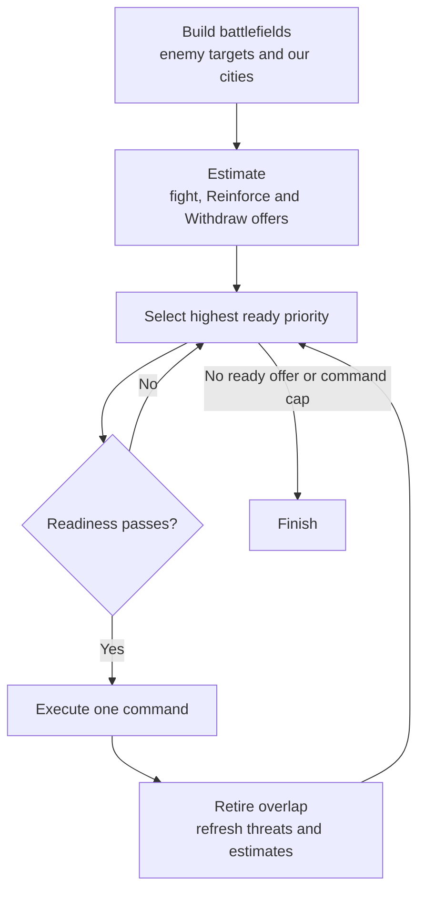

# Unit AI: Commands

The **operational loop** coordinates combat, reinforcement and withdrawal across the map during a player's turn. It replaces the zone-by-zone combat pass of [military tactics](../tactics/overview.md), giving higher-priority work access to shared units first. This developer guide describes the DLL (dynamic-link library) implementation, enabled for non-barbarian players by `VOX_TACTICAL_OPERATIONAL_LOOP` (0, off by default).

| Term | Meaning |
| --- | --- |
| **Battlefield** | One enemy unit, enemy city or city of ours, with separate fight, Reinforce and Withdraw offers. |
| **Offer** | A proposed action with a queue state and an **estimate**, its queue priority. A fight attacks an enemy or defends our city; **Reinforce** brings distant units toward the center; **Withdraw** pulls local units back toward a friendly city. |
| **Readiness check** | Confirms suitable recruits, damage or reach before issuing orders. |
| **Command** | One passing offer's execution. Each offer runs at most once per turn, even when it finds no action. |
| **Engagement** | Tactical search and execution, including retries. A fight can end after city fire; a Reinforce or Withdraw command can also march units along paths. |
| Our, native, HP | The acting player; existing Vox Populi behavior; hit points. |

Start with the command loop below, then follow the part you need to audit:

| Guide | Question it answers |
| --- | --- |
| [Value and priorities](value.md) | What does each formula mean, what are its units and bounds, and how large are its terms? |
| [Recruitment](recruitment.md) | Which units count as local or incoming, how is strength measured, and who gets selected? |
| [Reinforcement priorities](reinforcement.md) | How much does bringing the selected units add, and how does travel reduce that benefit? |
| [Withdrawal priorities](withdrawal.md) | When is pulling local units back worth more than fighting, and where do they go? |
| [Readiness and execution](execution.md) | Can the offer run, what orders does it issue, and how are search preferences chosen? |
| [Settings and reference](reference.md) | Where are the defaults, records, source files and copies of native functions? |

The implementation is primarily in `civ5-dll/CvGameCoreDLL_Expansion2/CvTacticalOperationalLoop.h` and `.cpp`, with shared scoring in `CvTacticalOperationalValue` and weight settings in `CvTacticalOperationalWeights`.

## Shared callbacks

The simulator can supply an **operational provider** through host callbacks; `CvTacticalOperationalLoop` owns their timing and execution. Requests carry decision identities and state revisions.

| Decision | When | DLL's native choice |
| --- | --- | --- |
| Command choice | Before each readiness check, including after a failed check | Highest ready priority, with the [queue tie breaks](#command-loop). |
| Participant admission | After readiness, before recruits act | Gathered fight recruits, the checked Reinforce selection, or the Withdraw recruits. A provider can retain this selection or request a candidate subset. See [admission and refusal](execution.md#participant-admission). |
| Search flavors | After spotting and greedy air, using the final geometry | Geographic flavor blend plus command-kind row. See [search preferences](execution.md#geographic-blend). |

The simulator's supplied adapter builds a separate menu from the acting player's permitted knowledge. It maps selected objectives to live battlefields and walks ranked replies through these readiness checks, stopping at the first pass. Missing mappings and failed checks are execution feedback. Native decoding keeps the queue above, including when the supplied reply delegates to native. The [simulator provider guide](../../../../../../vox-deorum-rl/docs/operations/providers.md) owns the observation boundary and recovery limits.

## Turn integration

The loop's copy of `ProcessDominanceZones` keeps the surrounding native passes in order:

1. Global high priority: healing, operation armies and garrisons.
2. Emergency purchases in every zone.
3. The [command loop](#command-loop), through `RunCommandLoop`, for fights, Reinforce and Withdraw.
4. Deferred garrison holds, global middle and low priority passes, then the review of unassigned units.

Battlefield reinforcement replaces the regular zone reinforcement pass. The loop also omits zone posture routines and zone target extraction. Global passes still handle camps, civilians, improvements and other target types. Units left unprocessed can pass to Homeland AI (the system for remaining unit tasks) as usual. Barbarians keep native scheduling.

## Command loop

`RunCommandLoop` owns the turn's action queue. It builds the initial estimates, executes one ready offer at a time, and uses each command's result to update the remaining work:

| Stage | Rule |
| --- | --- |
| Build | Resolve settings, **mapped flavors** (player preferences on military scales), **weights** (relative importance of benefits) and **reference scales** (normalization values). Build battlefields and threat maps, which attribute damage to enemy units and cities. |
| Estimate | A [battlefield estimate](recruitment.md#battlefield-estimate) shares the local scan, theater and **stake** (combined fight benefits) needed by open offers. Closed cities still refresh theater. Positive estimates become ready, nonpositive estimates inactive; waiting fights also need a helpful change. Invalid targets drop every open offer. |
| Select | Highest ready estimate first. Ties favor own-city fights, enemy-city fights, enemy-unit fights, then Reinforce, then Withdraw; further ties favor lower plot index, then build order. Stop with no ready offer or at the command cap. |
| Check | Check only the selected offer. A failed fight check makes it waiting or skipped at the failure limit. Reinforce goes inactive when its target is gone or no recruit passes reach. Withdraw goes inactive or skipped at the failure limit if it cannot find a group with positive priority. A reduced offer competes again at its lower priority without using a failure attempt and is inactive at zero. A passing offer executes at its checked estimate. |
| Record and retire | Close the offer even if it ended before search or found no action. Explicit refusal consumes the slot without retiring other offers. Rebuild threats, then apply the [overlap rules](#overlapping-offers). |
| Refresh | Compare the board before and after the command, add newly captured own-city battlefields, re-estimate open offers and apply the [wake rule](#wake-rule). Resume selection. |

The command cap, `iMaxCommands` (64), includes refused commands. Failed readiness checks consume no slots, and search retries belong to the same command. Every open offer is re-estimated after every command, including distant offers, without native recruitment, path or readiness checks. A closed fight still refreshes its stake while its Reinforce or Withdraw remains open.

The loop separates facts fixed for the turn from values refreshed after commands:

| Fixed for the turn | Refreshed after each command |
| --- | --- |
| Weights and reference scales | Fight stakes and open-offer priorities |
| City battlefields' theater importance and every battlefield's ground term | Theater contest, threat maps and reinforcement selections |
| Original enemy battlefields and their zone and near-city flags | Surviving unit targets' plots and newly captured own-city battlefields |
| Readiness failure limit | Reinforcement check flags are cleared so reach can be checked again |

### Offer states

A fight offer uses these states:

| State | Enters when | Leaves when |
| --- | --- | --- |
| Ready | An opening or later estimate is positive, with any waiting requirement satisfied | It reaches the top and is checked. |
| Inactive | Its estimate is nonpositive | A later estimate is positive. |
| Waiting | A readiness check fails below the failure limit | A helpful command change wakes it and its new estimate is positive, or re-estimation drops its target. |
| Skipped | It reaches `readiness.maxFailures` failures, default 3 | The turn ends. |
| Retired | An executed unit fight covers it under the overlap rule | The turn ends. |
| Executed | It runs as a command without provider refusal | The turn ends. |
| Refused | A provider chooses an empty subset from nonempty eligibility | The turn ends; the command slot is consumed and no other offer is retired. |
| Dropped | Re-estimation finds the target unit gone, or its city lost by its recorded owner or no longer ours | The turn ends. |

A Reinforce offer uses these states:

| State | Enters when | Leaves when |
| --- | --- | --- |
| Ready | An opening, later or reduced check estimate is positive | It reaches the top and is checked: executes, is refused, turns inactive, or returns ready at a reduced estimate. |
| Inactive | Its estimate is nonpositive, or its check leaves no selected unit or reduces the estimate to 0 | A later estimate is positive. |
| Retired | Another battlefield's executed Reinforce moved a unit, and its enemy-strength tally `T` counted this battlefield's target | The turn ends. |
| Executed | It runs as a command without provider refusal | The turn ends. |
| Refused | A provider chooses an empty subset from nonempty eligibility | The turn ends; the command slot is consumed and no other offer is retired. |
| Dropped | Re-estimation finds the target unit gone, or its city lost by its recorded owner or no longer ours | The turn ends. |

A Withdraw offer uses these states:

| State | Enters when | Leaves when |
| --- | --- | --- |
| Ready | An opening, later or reduced check estimate is positive, which requires an endangered recruit | It reaches the top and is checked: executes, is refused, turns inactive, or returns ready at a reduced estimate. |
| Inactive | Its estimate is nonpositive, including when no recruit is endangered, `withdraw.enabled` is 0, or the battlefield is our city. A failed check below the limit also makes it inactive. | The next re-estimation makes it ready when its estimate is positive. |
| Skipped | A failed check reaches `readiness.maxFailures` failures, default 3 | The turn ends. |
| Retired | An executed Reinforce that moved a unit at the same battlefield while the Withdraw is open | The turn ends. |
| Executed | It runs as a command without provider refusal, whether or not a unit moved | The turn ends. |
| Refused | A provider chooses an empty subset from nonempty eligibility | The turn ends; the command slot is consumed and no other offer is retired. |
| Dropped | Re-estimation finds the target unit gone, or its city lost by its recorded owner or no longer ours | The turn ends. |

The offer exists only at enemy battlefields with `withdraw.enabled` nonzero. Our cities and a disabled switch keep an inactive Withdraw slot with estimate 0 all turn, so every battlefield records three offers.

A waiting fight keeps its refreshed estimate and cumulative failure count. Waking it preserves the count and applies no priority discount. Readiness determines whether the fight can execute; the current estimate determines its priority. A reinforcement or Withdraw offer never waits, so it is never woken; a Reinforce offer also never counts failures. When `EstimateFight` finds a target gone, every open offer at that battlefield drops together.

## Battlefields

`FindTacticalTargets` scores the native targets and merges the naval list. When the option is enabled, it copies that list into `m_OperationalTargets` (the turn's target snapshot) immediately before `SortTargetListAndDropUselessTargets` suppresses nearby enemy-unit targets. Native consumers continue to use the filtered list. `CleanUp` clears the snapshot.

`BuildBattlefields` reads the snapshot after the high-priority pass and emergency purchases. Each surviving hostile combat unit or enemy city supplies one battlefield. Unit targets use the plot's best defender, following native selection. Duplicate owner/unit IDs and duplicate city plots are removed. A city captured earlier in the turn gets no enemy battlefield. `GroundSide` determines hostility, including barbarians and players at war with us.

`AddOwnCityBattlefield` adds one battlefield per city of ours, including safe cities whose offers can become inactive at the first estimate. It uses the city plot's land zone. If that zone is unknown, it uses the city's water zone, identified by the negative city ID. Zone data is read without refreshing because the zone map cannot be rebuilt mid-turn.

Fight, Reinforce and Withdraw offers keep separate states. Executing any offer refreshes the other open offers' estimates along with the rest of the queue.

The battlefield stores its build-order ID, center type, target owner and unit or city ID, plot index and zone ID. It also records these facts for the turn:

| Fact | Rule |
| --- | --- |
| Theater importance | A city battlefield fixes its own importance: city value divided by `Z_C` (city scale), capped at 1. A fight at an enemy target uses its target zone's city, which can be ours or an enemy's; an own-city fight uses its own city. A unit battlefield stores no importance: it remembers its zone city's plot for the turn and reads that city's current theater, so the link survives a capture during the turn, and a cityless zone uses the theater floor. The [theater multiplier](value.md#theater-multiplier) `θ` combines importance with contest, which is refreshed after every command. |
| `ΔG(t)` (ground recovered by removing target unit t) | Local ground score with the target present minus the score with it removed, in plot weight. |
| Near our city | Native `GetCityDistanceInPlots` is below 4 at build time. For major civilizations this means within 3 plots of our nearest city. Minors use half the plot distance to their capital, rounded down, so their exemption reaches 7 plots. |

The turn's enemy battlefields stay fixed. A newly revealed enemy can enter danger calculations, city strength and search geometry immediately; it receives an independent battlefield in the next turn's snapshot. Re-estimation follows a surviving target unit's current plot, while its original zone, ground term and near-city flag stay fixed; its theater comes from the remembered zone city. A dead unit or a city lost by its recorded owner drops every open offer of that battlefield. Each estimate pass handles city battlefields first, then unit battlefields. A city battlefield with every offer closed still refreshes its theater each pass, with no stake, because unit fights in its zone read it.

A city we capture during the turn becomes an own-city battlefield when the command that took it ends. It uses the city's current value and zone; the turn's weights, scales and other battlefields stay as they were. The captured city's enemy-city offer drops under the rule above.

## Overlapping offers

A search centered on one enemy can attack surrounding enemies. After an enemy-unit command runs its search with at least one candidate, `RetiresFight` retires open enemy-unit fights within 2 plots of its target in compatible zones. Opposite zone-ID signs are incompatible: positive land zones and negative water zones do not overlap. Different zones of the same domain can overlap.

These offers are exempt:

- A fight whose target has positive threat damage against our units outside friendly cities and armies. Its own search can recruit those endangered units. Spent units still sustain this exemption.
- A fight marked near our city at build time, using the [native city-distance rule](#battlefields).
- Every enemy-city and own-city fight. These commands also retire no unit fights.

The loop rebuilds threats after execution, before the overlap pass, so a unit moved into danger by the command can protect its attacker's offer. A Withdraw's local peer closure runs earlier, immediately after the command, and reads only whether a selected unit moved or died. Ready, inactive and waiting offers can be retired; executed, refused, retired, skipped and dropped offers are closed. A fight retires other fights only after a search with a nonempty group, whether or not the search found or completed a plan; a Reinforce retires on movement, and a Withdraw closes its own peers on movement. Commands ending after city fire, visibility failure or greedy air retire no fights.

**Reinforce retirement** uses the enemies counted in the executed offer's last estimate. If at least one selected unit changed plot or died, retire the open reinforcement offer of every other enemy battlefield whose target contributed to `T` (enemy strength). Ready and inactive offers can be retired. Our cities' reinforcement offers are exempt; a command with no such unit change retires nothing.

**Withdraw closure** is local: a Withdraw and a Reinforce close each other at their battlefield only when one moves a unit, with the own-city and disabled-switch exemptions in the [Withdraw closing rules](withdrawal.md#closing-the-battlefield). Other battlefields are not retired directly, but their offers can change when the loop re-estimates them.

Apart from that peer rule, retiring an offer leaves its battlefield's other offers intact. Reinforcement commands retire only reinforcement offers, and fights retire only fights.

The examples below use the [value guide's running inputs](value.md#running-example-inputs): town value 15, city scale `Z_C = 40`, typical unit worth `Z_T = 400`, 100 maximum unit HP and neutral weights. Killing a unit earns its [destroyed value](value.md#destroyed-value): its whole living value, 60% of full-health worth plus 40% scaled by remaining HP.

**Near-city example.** Supplied: a full-health town, equal enemy and local strength, killable targets at 20 HP, and no ground, relief or exposure. Theater is `0.2 (floor) + 0.8 (room) × 15/40 (city importance) × 0.5 (contest at parity) = 0.35`.

| Target | Living value destroyed | Priority `θ × value / Z_T` | After the catapult search |
| --- | --- | --- | --- |
| Scout, worth 100 | `100 (worth) × (0.6 (retained share) + 0.4 (health share) × 20/100 (HP)) = 68` | `0.35 (θ) × 68 / 400 (Z_T) = 0.0595` | If it survives 2 plots from our town, its fight stays open even within 2 plots of the catapult. |
| Catapult, worth 500 | `500 × (0.6 + 0.4 × 20/100) = 340` | `0.35 × 340 / 400 = 0.2975` | Checked first. |

**Waiting-offer example.** Supplied: a cityless zone, full-health killable targets 1 plot apart, far from our cities, with no threat damage or other stake terms.

| Offer | Priority | Sequence and result |
| --- | --- | --- |
| Catapult, worth 500 | `0.2 (cityless θ) × 500 (living value) / 400 (Z_T) = 0.25` | Fails readiness first and waits. |
| Spearman, worth 400 | `0.2 × 400 / 400 = 0.2` | Its search runs next and retires the nearby waiting catapult fight. |

## Wake rule

`SnapshotBoard` and `DiffBoard` compare visible hostile-unit identities and plots, city-battlefield owners and our living units' plots before and after each command. `WakesFight` wakes a waiting offer after these helpful changes:

| Change | Distance test |
| --- | --- |
| A visible enemy unit disappears, moves or becomes visible | Its old or new plot is within the turn's largest native land/sea striking-distance scan (`base moves × 4`) of the target, or within 5 plots of our city. |
| A city battlefield changes owner | Its plot is within that same reach. |
| A unit of ours arrives at a new plot and remains available | It is within its own native striking distance (`base moves × 4`) of the target, or within its [strike reach](recruitment.md#battlefield-estimate), base moves plus ranged attack range, of our city. Aircraft and port-changing ships pass this distance test automatically. |
| Our city's re-estimate finds an endangered recruit | Always wakes that own-city fight. |

Native striking distance uses `baseMoves(false) × 4`. The turn's scan takes the largest value among our living land and sea units at turn build. A moved unit uses its own native striking distance at an enemy target and its strike reach at our city. These are distance tests; waking returns a positive-estimate fight to ready so its full readiness check can run again.

Damage to an enemy or city still standing, and our units merely spent, damaged or lost, do not wake fights. Enemy disappearance from visibility also counts as a snapshot change. A helpful change leaves the offer waiting if its refreshed estimate is nonpositive. Other commands add no failures while a fight waits.

**Blocker example.** Use the waiting-offer example's worths and priorities, but put the targets 3 plots apart (outside the 2-plot retirement radius) on neutral land. Supplied local damage is 100 HP for each full-health target, enough to kill; the spearman blocks the only approach to the catapult.

| Event | Catapult fight's result |
| --- | --- |
| Priority 0.25 beats the spearman's 0.2, but recruitment fails | Waiting, with 1 failure. |
| Another command only spends or damages our units | Still waiting; no new failure. |
| Spearman command kills the blocker within the wake scan | Ready if its refreshed estimate is positive; recruitment can now use the open path. |
| Later checks fail after helpful wakeups | Skipped on failure 3, from `readiness.maxFailures` (3). |
