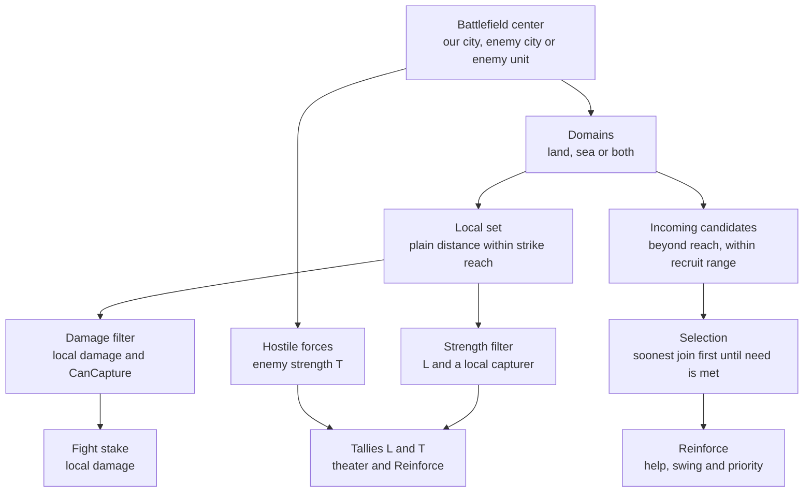

# Unit AI: Command Recruitment

**Recruitment** tells the [command loop](overview.md) which units are local and which can arrive through Reinforce. A **local set** supplies strength and damage estimates; **incoming candidates** supply the reinforcement selection.

The implementation is in `civ5-dll/CvGameCoreDLL_Expansion2/CvTacticalOperationalLoop.h` and `.cpp`; the stage table names its entry points.

| Stage | Function | Produces | Feeds |
| --- | --- | --- | --- |
| Scan | `GatherLocalSet` | A strength list, plus a damage list when a stake is needed. | Tallies and local damage. |
| Tally | `LocalStrength`, `LocalCityStrength`, `EnemyCenterStrength`, `EnemyCityStrength` | Local friendly strength `L` and enemy strength `T`. | [Theater](value.md#theater-multiplier) and Reinforce. |
| Candidates | `GatherReinforceCandidates` | Incoming units with travel and join turns. | Selection. |
| Selection | `SelectReinforcement` | `need`, the selection, help and the capture role. | [Reinforce priority](reinforcement.md#reinforce-priority). |

## Battlefield estimate

`EstimateBattlefield` shares one local scan between fight and Reinforce estimates, computing the strength and stake the open offers need without pathfinding.

| Step | Rule |
| --- | --- |
| Scan | `GatherLocalSet` builds the local set for the center's domains. |
| Fight | `EstimateFight` computes the [stake](value.md#fight-priority). At an enemy city or unit it simulates local damage; at our city it reads the loop's copy of native city danger at the [enemy roll](value.md#damage-rolls). |
| Reinforce | `EstimateReinforce` selects incoming units and scores the share of the fight priority they swing ([swing](reinforcement.md#swing)). |

| Ordering rule | Why |
| --- | --- |
| City battlefields run before unit battlefields. | A unit fight reads its zone city's theater, which the city pass refreshes first. |
| A city with both offers closed still refreshes its theater, with no stake. | Unit fights in its zone read that theater. |
| An open Reinforce keeps the fight estimate running after the fight executed. | Selection needs the fight's current `L`, `T` and priority as its baseline. |
| Reinforce estimation stops when its offer is no longer open. | There is nothing left to score. A closed [gate](reinforcement.md#reinforce-priority) also skips the candidate scan. |

The **local set** holds our units near enough to count at the center. Define `R_s` (**strike reach**) as `max(1, m) + rng`, where `m` is base moves and `rng` is attack range, 0 for a melee unit. `d` is plain plot distance. Land and sea units use `R_s`; an aircraft uses its range from its base, and it never counts toward `L` or becomes a candidate.

| Filter | Keeps | Feeds |
| --- | --- | --- |
| **Strength filter** | Land and sea units in the center's domains within `R_s`. Spent units and army members count. Aircraft and ranged units of the other domain do not. A unit that passes `IsCapturer`, spent or not, sets the local capturer flag. | `L` in the [strength tallies](#strength-tallies). |
| **Damage filter** | Units on the tactical roster that can still attack: usable by the tactical AI and not out of attacks (`canUseForTacticalAI`, `!isOutOfAttacks`), not covering a friendly civilian, not a unit whose default AI is `UNITAI_DEFENSE_AIR`, and not an embarked ranged unit. Aircraft and ranged units of either domain qualify. At a city, `CanStrikeCity` also drops units flagged `isNoCapture` and ranged units whose expected damage misses native's minimum (`min(best defender HP / 20, 3)`, using 0 HP when no defender is present). | [Local damage](value.md#destroyed-value) at an enemy city or unit, and the city's local `CanCapture` test for the [attack fall share](value.md#city-allowance-and-fall-share). |

Readiness can recruit every unit the damage filter counts, because the filter applies the recruitment rules that need no pathfinding. [Readiness and execution](execution.md#readiness-checks) owns those checks.

**Domains.** The center sets them.

| Center | Domains | Effect |
| --- | --- | --- |
| Our or enemy city | Land always, sea too when coastal. | Melee units, the strength filter and candidates must match a domain. |
| Enemy unit | The domain of its plot. | Same rule. |
| Any center | A ranged unit may fire across domains. | It joins the damage filter without counting toward `L` or becoming a candidate in the other domain. |

A melee land unit beside a water target and a melee ship near an inland target stay out of the local set. [City defense](execution.md#city-defense) uses the same `R_s` for land and sea defenders added beyond endangered units.

Native **striking distance**, the wider `m × 4` scan, prefilters offensive recruitment and feeds the [wake rule](overview.md#wake-rule).

**Local and incoming example.** All unit stats, distances, health and `R_r = 10` (recruit range, supplied; `GetRecruitRange()` in play) are supplied. All units pass the remaining eligibility filters unless a row says otherwise. The center is an enemy coastal city, so land and sea both apply and `L` accepts either domain.

| Unit and supplied inputs | `R_s` | Strength filter (`L`) | Damage filter | Incoming |
| --- | --- | --- | --- | --- |
| Land swordsman, 2 moves, 3 plots, has attack | `max(1, 2) + 0 = 2` | No: `d = 3 > 2` | No | Yes: beyond reach, within `R_r` |
| Land archer, 2 moves, range 2, 4 plots, has attack | `2 + 2 = 4` | Yes: land domain, `d = 4` | Yes: attack available | No: local |
| Land archer, same plot, already attacked | 4 | Yes: spent units count | No: out of attacks | No: local |
| Land archer, 2 moves, range 2, 6 plots, has attack | 4 | No: `d = 6 > 4` | No | Yes: within `R_r` |
| Sea melee ship, 3 moves, 4 plots, has attack | `3 + 0 = 3` | No: `d = 4 > 3` | No | Yes |
| Sea ranged ship, 3 moves, range 2, 5 plots, has attack | `3 + 2 = 5` | Yes: sea domain, `d = 5` | Yes | No |
| Bomber, range 6 from its base, 6 plots, has attack | `R_s` not used | No: air is never in `L` | Yes: range reaches the center | No: air is not a candidate |

Local and incoming sets do not overlap; failed filters can leave a unit in neither.

**Cross-domain and own city.** The same land archer (2 moves, range 2, full health, supplied) at these centers.

| Center | `d` | `R_s` | Result |
| --- | --- | --- | --- |
| Enemy ship, sea domain | 4 | 4 | Local damage; no `L`; not incoming. |
| Enemy ship, sea domain | 5 | 4 | Neither: out of reach and not a candidate in the sea domain. |
| Our city | 4 | 4 | City defender in [city defense](execution.md#city-defense); not an incoming candidate. |
| Our city | 5 | 4 | Incoming candidate: beyond reach, land domain. |

## Strength tallies

**Strength** starts from native strength, which native methods return at 100 times the displayed scale and with their damage modifier applied, then multiplies by the remaining health share.

`str(u) = B_u × R_u / M_u`

| Symbol | Meaning | Scale |
| --- | --- | --- |
| `B_u` | Native strength of unit `u`. | 100 times the displayed scale. |
| `R_u`, `M_u` | Remaining and maximum HP. | HP. |
| `str(u)` | Strength used in every tally and candidate. | Same as `B_u`. |

| Source | Native value before health scaling |
| --- | --- |
| Unit | `UnitStrength`: maximum attack strength, or maximum ranged strength for a ranged unit, from the quick estimate without adjacency. |
| Enemy unit against our city | `UnitStrengthAgainstCity`: quick attack or ranged strength against the city plot, keeping city and terrain modifiers. |
| City | `CityStrength`: the city's strength value, which already counts its garrison. |

A wounded unit takes two reductions: native's damage modifier and the explicit health share. Pressure and parity use ratios, so the examples use convenient values such as 100.

| Tally | Rule |
| --- | --- |
| `L` (**local strength**) | `LocalStrength`: the sum of `str(u)` over the [strength filter](#battlefield-estimate). At our city, `LocalCityStrength` adds `CityStrength`. |
| `T` (**enemy strength**) at our city | `EnemyCityStrength`: approach-list units by `UnitStrengthAgainstCity`, plus visible units that native danger finds able to attack the city plot, each counted once. |
| `T` at an enemy center | `EnemyCenterStrength`: visible hostile land or sea units within 4 plots in the center's domains, by `UnitStrength`, plus hostile cities within 4 plots. A city at 0 HP still contributes with 1 HP, and a revealed center city counts even when fogged. A city's strength already includes its garrison, which is excluded from the unit tally. |

Counted enemies feed [Reinforce retirement](overview.md#overlapping-offers): an executed Reinforce retires another enemy battlefield when its target lies in the executed estimate's counted set. Our cities' own offers are exempt.

**Strength example.** All inputs are supplied and use a convenient scale: a unit at 40 of 100 HP with native strength 100; our city with strength value 1000 at 150 of 250 HP and local units totaling 100; a hostile city with strength value 1000 at 150 of 250 HP. `B_city` is a city's strength value, and `R_c` and `M_c` are its remaining and maximum HP.

| Quantity | Calculation | Value |
| --- | --- | --- |
| Unit | `100 (B_u) × 40/100 (R_u/M_u)` | 40 |
| Our city `L` | `1000 (B_city) × 150/250 (R_c/M_c) + 100 (local units)` | 700 |
| Hostile city in `T` | `1000 (B_city) × 150/250 (R_c/M_c)` | 600 |

## City approach lists

`BuildThreats` builds **approach lists** initially and after every command, assigning each visible hostile land or sea combat unit to our nearest city by path steps.

`d_path <= 2 × m + rng` for a ranged unit, and `d_path <= 2 × m + 1` for a melee unit. `d_path` is path steps from the native city-distance cache.

| Rule | Detail |
| --- | --- |
| Assignment | `GetClosestCityByPathLength` picks the nearest city by path steps. |
| Hidden units | Invisible units such as undetected submarines are excluded. |
| Path cache | Routes around impassable plots and may embark, but ignores movement costs and intervening units. A knight 2 plots away behind mountains can be excluded while a spearman with a longer real journey is included. |
| Minor civilizations | City-states have no path-length cache and use plain plot distance to their nearest city. |
| Direct attackers | The list does not bound `T`: a visible unit that native danger finds able to attack the city also joins `T`, even when assigned to a nearer city. |

## City defense recruits

`GatherCityEndangered` reads the turn's [endangered units](value.md#exposure) and adds units in a friendly city that face danger; `GatherCityDefenders` adds other eligible defenders. The [city-defense table](execution.md#city-defense) defines both groups, including garrisons, aircraft and carriers. Endangered recruits contribute [defensive exposure](value.md#own-city-stake) even when the city faces no damage.

## Candidates and selection

`GatherReinforceCandidates` reads the tactical roster. `R_r` is **recruit range**, `GetRecruitRange()` in play. The filters below follow native recruitment except where noted.

| Filter | Rule |
| --- | --- |
| Availability | On the tactical roster, able to act now (`canUseNow`), a combat unit, outside an army. Generals, admirals and civilian sappers fail the combat test. |
| Domain | Land or sea, matching the center's domains. |
| Distance | Beyond `R_s` and within `R_r`, by plain plot distance. |
| Held garrison | A garrison left unprocessed by the high-priority pass qualifies only within `min(R_r, 4)` plots (`TACTICAL_COMBAT_MAX_TARGET_DISTANCE` is 4). It joins the search but takes no path move, so [Reinforce readiness](execution.md#reinforce-readiness) must confirm the search can reach it. |
| Carriers | Excluded; they have special moves. |
| Enemy city | Must pass `CanStrikeCity`, which drops units flagged `isNoCapture` and ranged units below native's minimum expected damage. Our cities have no such filter. |
| Enemy-dominated zone | Siege units are excluded. Our cities have no dominance gate. |
| Healing | Units that should heal given the destination's territory are excluded. |
| Donor zones | A unit from another zone stays if its zone is friendly or withdrawing, if it is embarked, or if it is a land unit in a safe city. Otherwise its zone keeps it. |
| Rejection | A unit that fails this offer's reach check stays excluded from this offer for the rest of the turn. Other battlefields can still select it. |

Travel time discounts incoming help. **Travel example** (2 base moves, distances 4 and 5, strength 100; all supplied).

| Quantity | Calculation | Example |
| --- | --- | --- |
| Travel turns `τ` | `max(1, ceil(d / max(1, m)))` | Distance 4: 2 turns. Distance 5: 3 turns. |
| Join turns `j` | `max(1, τ − 1)` | Travel 2: join 1. Travel 3: join 2. |
| Discounted help | `str(u) / j` | Strength 100: 100 at join 1, 50 at join 2. |

Selection uses `need = max(0, r × T − L)`. `r` is the desired friendly/enemy ratio (setting `reinforce.strengthRatio`, 1). `S` is the full strength of the selected units, and `help = Σ str(u) / j` is their discounted strength.

Selection sorts by `j`, then `τ`, then unit ID, and takes candidates until `S` meets `need`. Discounted help sets the [swing](reinforcement.md#swing). There is no two-unit minimum; native requires two friendly units in total.

At an enemy city, selection fills the **capture role**: if neither a local strength-filter unit nor a selected unit can capture, the first remaining capturer in selection order joins, even when `need` is 0. Its discounted strength counts in help; no capturer records a missing role. `IsCapturer` means a living land melee combat unit outside armies with no capture prohibition, regardless of current moves or attacks.

**Native comparison.**

| Aspect | This loop | Native `PlotReinforcementMoves` |
| --- | --- | --- |
| Scope | One selection per battlefield. | One per dominance zone. A coastal city has separate land and sea zones; the loop combines them. |
| Capture | A role unit fills a missing capturer at an enemy city. | A melee-only mode when friendly overall and ranged dominance lacks friendly melee strength. |
| Covering civilians | Excluded with no side effect. | Pushes a skip mission and marks the unit processed. |
| Distance | Plain plot distance for reach and travel. | A step-finder flood within recruit range. |

Other differences follow the [readiness rules](execution.md#reinforce-readiness).
