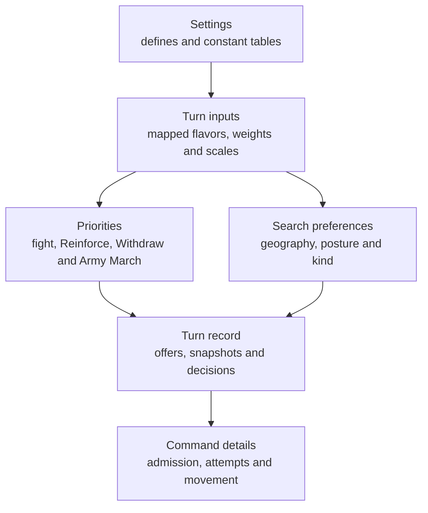

# Unit AI: Command Settings and Reference

Use this reference to tune or inspect the [command loop](overview.md). It lists recorded fields, configuration defaults and the source files that own them. [Value and priorities](value.md) explains how the numbers combine; [execution](execution.md#flavors-and-aggression) explains the search preference blend. HP means hit points.

## Settings

`GetOperationalSettings` fills a settings struct for the player from game defines and constant tables. The DLL runs those defaults. The simulator can replace settings per player. Table changes require editing their source and rebuilding; the row tables have compile-time size checks.

| Setting | Default | Source |
| --- | --- | --- |
| `VOX_TACTICAL_OPERATIONAL_LOOP` | 0 | `NewCustomModOptions.xml` |
| Command cap, `iMaxCommands` | 64 | `VOX_OPERATIONAL_MAX_COMMANDS` |
| Medium, High, Braveheart aggression RISK (score choosing search aggression) thresholds | 40, 60, 90 | `VOX_OPERATIONAL_AGGRESSION_MEDIUM_RISK`, `VOX_OPERATIONAL_AGGRESSION_HIGH_RISK`, `VOX_OPERATIONAL_AGGRESSION_BRAVEHEART_RISK` |
| Posture and kind offsets | Tables below | `CvTacticalOperationalLoop.cpp` |
| Priority weights, slopes and constants | [Weights file](#weights-file) | `CvTacticalOperationalWeights.cpp` |
| `march.enabled` | 1 when the operational loop is on | `CvTacticalOperationalWeights.cpp` |
| `march.readyUnits` | 2 | `CvTacticalOperationalWeights.cpp` |

The game defines are in `(1) Community Patch/Database Changes/Defines/CoreDefineChanges.sql`. The mod option is in `(1) Community Patch/Database Changes/NewCustomModOptions.xml`, both under `civ5-dll/`.

## Posture rows and kind rows

**Posture rows** (offsets for a zone's tactical stance) are applied before the geographic average. **Kind rows** (the base of the [command offset](execution.md#command-offset) for the active command type) are added afterward, with the situation offsets for fights and Reinforce. All entries are flavor points. RISK accepts danger, OCCUPATION favors capturing cities, ATTRITION favors damaging enemies, HOLD_CITY favors city defense, and HOLD_GROUND favors territorial control.

| Posture | RISK | OCCUPATION | ATTRITION | HOLD_CITY | HOLD_GROUND |
| --- | --- | --- | --- | --- | --- |
| None | 0 | 0 | 0 | 0 | 0 |
| Withdraw posture | −30 | −20 | 0 | +10 | −10 |
| Attrition | −20 | 0 | +20 | 0 | 0 |
| Exploit flanks | −10 | 0 | +10 | 0 | 0 |
| Steamroll | +10 | +5 | +15 | −10 | −10 |
| Surgical city strike | 0 | +15 | −5 | −10 | −10 |
| Hedgehog | −15 | −15 | +10 | +20 | 0 |
| Counterattack | −10 | −10 | +15 | 0 | +20 |

| Active command kind | RISK | OCCUPATION | ATTRITION | HOLD_CITY | HOLD_GROUND |
| --- | --- | --- | --- | --- | --- |
| Unit fight, city fight, own-city fight | 0 | 0 | 0 | 0 | 0 |
| Reinforce | 0 | 0 | 0 | 0 | 0 |
| Withdraw | −20 | −30 | −10 | −20 | −10 |
| Army March | −30 | −20 | 0 | 0 | 0 |

Posture rows follow native values except that Hedgehog uses −15 for RISK (willingness to accept danger), compared with native's −10. Fights and Reinforce leave everything to their situation offsets. The Withdraw row lowers the objectives so moving away beats fighting and leans cautious; the Army March row stays cautious and is not drawn into cities on the way. Both run on their kind row alone. These are search flavor offsets; the priority weights in the next section resolve separately. A Withdraw posture zone contributes its posture row to a search in proportion to its share of the search plots. An enemy-center Reinforce offer is gated out when its zone is in the Withdraw posture; fights and Withdraw offers still run there if they pass their own gates.

## Weights file

`CvTacticalOperationalWeights.h` and `.cpp` hold the tunable numbers. Names in the tables are also the names for simulator overrides. `ResolveOperationalWeights` turns base weights and mapped flavors into the turn's weights through `FlavorWeight` in the value file.

| Setting | Default | Scaling or use |
| --- | --- | --- |
| `weight.attrition` | 1 | Increases with ATTRITION (damaging enemy forces); scales target and garrison destroyed value. |
| `weight.occupation` | 1 | Increases with OCCUPATION (capturing cities); scales the city allowance at an enemy city. |
| `weight.holdCity` | 1 | Increases with HOLD_CITY (defending cities); scales the city allowance at our city and city relief in unit fights. |
| `weight.holdGround` | 0.05 | Increases with HOLD_GROUND (controlling territory); scales unit-target ground and turns its plot weight into typical units. |
| `weight.risk` | 1 | Decreases with RISK (willingness to accept danger); scales exposure. |
| `slope.RISK`, `slope.OCCUPATION`, `slope.ATTRITION`, `slope.HOLD_CITY`, `slope.HOLD_GROUND` | 1 each | Exponent slope for each flavor's weight. |
| `floor.theater` | 0.2 | Theater in a zone without a contested city; the rest up to 1 is what a contested city can add. |
| `theater.steepness` | 2 | Exponent on both strengths in theater pressure. |
| `city.units` | 3 | Size of a city fight in typical units; this is `C` (city allowance). |
| `readiness.maxFailures` | 3 | Truncated to an integer and floored at 1 for the failure limit. |
| `reinforce.strengthRatio` | 1 | `r` (desired strength ratio): with `T` (enemy strength) and `L` (local friendly strength), need is `max(0, rT − L)`, and selection stops once full strength covers it. Selection and the enemy-center parity gate use `r`; the score reads the resulting selection. |
| `withdraw.enabled` | 1 | Nonzero lets enemy-unit and enemy-city battlefields offer Withdraw. A disabled switch keeps the slot inactive all turn. |
| `exposure.split` | 1 | Nonzero scales fight exposure by the strength share; 0 counts fight exposure in full. Withdraw uses its own removable exposure and the stored strength share either way. |
| `camp.nearPlots` | 5 | A camp within this many plots of our nearest city counts at full value. Beyond that, the distance discounts its bounty. |
| `flavor.focusSpan` | 40 | How far the [focus offset](execution.md#focus-offset) can raise OCCUPATION, ATTRITION and HOLD_CITY together. |
| `flavor.riskSpan` | 30 | The largest move of the [risk offset](execution.md#risk-offset), up or down. |
| `flavor.softener` | 1 | Typical units added to each offset's denominator, so a fight with little at stake moves the flavors little. |

`march.enabled` and `march.readyUnits` are constants beside these weights in the same table. The first gates live discovery, army preparation and the March behavior described in [Army March](march.md); the second is `R` in the [Army March priority](value.md#army-march-priority).

Enemy-unit stakes use attrition, risk, hold-ground and hold-city (city relief); enemy-city stakes use occupation, attrition and risk. Own-city stakes use hold-city and risk. The simulator's settings template requires a positive reinforcement strength ratio; overrides use the supported table names.

### Weight curve

`weight = base × 2^(slope × deviation / 50)`

| Part | Reads as | Scale or range |
| --- | --- | --- |
| `base` | Configured weight at neutral preference, from the table above. | Weight; hold-ground converts plot weight to typical units. |
| `slope` | Sensitivity to preference, setting `slope.<flavor>` (1). | Exponent multiplier. |
| `deviation` | `flavor − 50` for ordinary weights; `50 − flavor` for RISK, so accepting danger reduces exposure's weight. | −50 to +50 for a **mapped flavor** (player preference on the military scale) from 0 to 100. |
| `50` | Distance from neutral preference to either end of the scale. | Flavor points. |

**Weight examples.** Use base 1 and slope 1 from the default attrition and risk settings. Flavor is the supplied input.

| Flavor | Ordinary weight | Risk weight |
| --- | --- | --- |
| 0 (minimum) | `1 (base) × 2^(1 (slope) × (0 − 50)/50) = 0.5` | `1 × 2^((50 − 0)/50) = 2` |
| 50 (neutral) | `1 × 2^0 = 1` | 1 |
| 100 (maximum) | `1 × 2^((100 − 50)/50) = 2` | `1 × 2^((50 − 100)/50) = 0.5` |

Multiplying all stake weights by the same positive factor preserves ordering.

### Shared value constants

The value parameters are separate constants in `CvTacticalOperationalValue.h`:

| Parameter | Default |
| --- | --- |
| `unitKillShare` (`q`, share of unit worth retained until death) | 0.6 |
| `gradeSeniorityPerLevel` (worth premium per level above the first) | 0.1 |
| `gradeUpgradeDiscount` (share of a ready upgrade's worth gain) | 0.5 |
| `groundResourceWeight` (strategic or luxury resource weight) | 1 |
| `groundOceanWeight` (ocean weight adjustment) | −0.25 |
| `groundShallowWaterWeight` (coast and lake weight adjustment) | −0.2 |
| `groundImprovementWeight` (ordinary improvement's work value) | 0.1 |
| `groundGreatPersonImprovementWeight` (great person improvement's work value) | 0.25 |
| `groundBonusResourceWeight` (bonus resource's work value) | 0.15 |
| `groundBlockadeShare` (plot stake lost or credited through blockade) | 0.5 |
| `groundCreditShare` (share of excess weight credited for hostile land) | 0.5 |
| `groundCreditFloor` (weight threshold for crediting hostile land) | 1 |

These parameters affect both the shared value functions and the simulator's grade. `unitKillShare` sets both the living value of our units and the destroyed value of enemy units, so damage to either side is valued the same way.

## Records

`RunCommandLoop` fills the shared `SOperationalTurnRecord` when its caller supplies one. Records copy computed values without repeating danger, strength or path queries. Only the simulator's evaluated actor builds a trace; other active actors retain total-only timing.

| Record | Contents |
| --- | --- |
| `offers` | Battlefield, kind, target, owner and zone, once per slot, including gated slots. A camp row uses its plot index as the target and has no owner. |
| `steps` | Opening estimate at step 0, then one step per post-command estimate. A command ends its step; the final end reason is `noReadyOffer`, `commandCap` or `stopped`. A host failure, game over or exception closes the last step as `stopped`, including post-command threat or estimate failures. |
| Snapshot | Ready rank, offer slot, state, estimate, theater multiplier, importance, pressure, contest, damage level, swing (1 for fights and Withdraw), exposure share, removable exposure `X` (raw worth), Withdraw share, chosen withdrawal destinations and nonzero stake terms (the battlefield's fight stake). An Army March adds its goal weight, readiness gain and theater without the army. Each term retains value and weighted contribution. Resolved weights appear once per pass. Missing terms mean zero value and contribution. |
| Event | Ordered check, update, provider refusal or terminating command, with before/after state and estimate. A check that changes another slot's estimate or state adds an update event for that slot. A refusal retains its terminating command with a READY-to-REFUSED transition and adds a separate refusal event. Count commands once, including refusals, and count skips from checks ending at the failure limit. Reduced Reinforce and Withdraw checks return to the current queue, or turn inactive at estimate 0. A missing target makes a Reinforce inactive without a reach failure. An Army March yield records its contact plot and leaves the offer ready for the next estimate. |
| Closed state | Target gone, city lost, retired, failure limit, provider refusal or execution. A closed row carries forward its snapshot with the new state, reason and rank. Executed and refused offers include the matching command's checked values. A Withdraw that reaches its failure limit records the estimate and exposure from its final check. |
| `commands` | Step and command identity, checked priority, prior failures, admission and search decisions, the search's [situation values and offsets](execution.md#command-offset), selected and moved unit IDs where tracked, endangered-unit dispositions, and retirements. A camp claim uses the existing target plot and moved-unit fields. A Withdraw combines attempts across destinations and retains the first search's decision or the first invalid reply. An Army March retains its operation, army, forecast and any yield plot. City-fire-only commands remain present. |
| `checks`, `vSkipped`, `bCommandCap` | Readiness and count inputs, preserving the loop's failure accounting. |
| Settings and turn inputs | Complete settings compared with the same build's defaults, mapped flavors, resolved weights and fixed scales. The simulator writes settings once per start, and inputs once per evaluated-player pass. |

The trace writes every offer slot in the opening step, then complete replacement rows only when recorded scalars change. Rows are keyed by battlefield and offer slot. Reconstruct a step by replacing rows in the preceding estimate snapshot. An empty snapshot keeps that table. Events describe queue transitions within a step and do not alter this baseline. New offers add rows and closed offers remain present.

Snapshots carry no unit lists. Camp value contributes to the aggregate stake; the six recorded fight terms stay the same. To confirm a camp clear, match the command plot and moving unit to the native `CAMP` gold transaction. Rollout writing and host integration belong to the simulator documentation.

### Performance counters

The loop's `ClockNs` host seam reads the performance counter used by `cvStopWatch`; the simulator supplies a steady clock. Timing never changes a decision. The DLL caches the performance-counter frequency.

| Scope | Counters and meaning |
| --- | --- |
| Whole call | Exclusive stages `setupNs`, `estimateNs`, `selectNs`, `readinessNs`, `executeNs`, `retireNs`, `recordNs` and `otherNs` sum to `totalNs`. The remainder is computed signed and clamped at zero, with a debug assertion against stage overlap. Times are nanoseconds. |
| Step | Estimate, readiness and execution time, including partial stages when an exception stops the pass. |
| Estimates | Force-tally and danger-read counts and time. `dangerReads` and `dangerReadNs` count actual unit danger evaluations and city cache misses; city cache hits do not count. |
| Readiness | Reinforce reach checks and Army March order and roster checks. The latter is timed by `armyMarchCheckNs`. |
| Execution | Commands, provider admission/flavor time, city fire, spotting, greedy air, marching and search time. Army March positioning is timed by `armyMarchMoveNs`. Nested subtotals belong to their parent stage. |
| Engagement | Counted once even with retries. Host-specific attempts and search time are described below. |
| Tactical log | With game and AI logging enabled and no supplied record: step-indexed messages and a final pass summary of time, commands, checks, estimates and searches. |

DLL `attempts` counts each native search iteration, including empty results, and `searchNs` times `FindBestUnitAssignments`. Simulator `attempts` counts provider decisions, and `searchNs` sums provider decision time, matching rollout `counts.searchNs`. Compare search costs within the same host.

With no record and logging off, the DLL skips all timers, including danger-read timers. The simulator times only the whole call for other active actors; the evaluated actor also retains stage timers and its trace. Rollout `operationalAllActorTotalNs` covers active slots, excluding background slots.

## Search purposes

A search request's **purpose** labels its command and territory; retries keep the same label. Search preferences come from the [geographic blend](execution.md#geographic-blend) and the [command offset](execution.md#command-offset).

| Purpose | Command or territory |
| --- | --- |
| `CityAttack` | Enemy-city fight. |
| `CityDefense` | Own-city fight. |
| `Reinforce` | Reinforcement. |
| `Withdraw` | Withdrawal. |
| `Gather` | Army March formation search. |
| `BattleFriendly` | Enemy-unit fight in our team's zone. |
| `BattleNeutral` | Enemy-unit fight in unowned territory, or another team's zone whose owner is not at war with us. |
| `BattleEnemy` | Enemy-unit fight in enemy territory. |

## Code

The source is in `civ5-dll/CvGameCoreDLL_Expansion2`.

| Source | Owns |
| --- | --- |
| `CvTacticalOperationalLoop.h` and `.cpp` | Turn integration and scales; settings, mapped flavors and posture and kind offsets; battlefields, threats, offer scoring and selection; readiness, execution, geographic preference blending, aggression and records. |
| `CvTacticalOperationalWeights.h` and `.cpp` | Named weight and constant tables and `ResolveOperationalWeights`. |
| `CvTacticalOperationalValue.h` and `.cpp` | Shared unit, city, exposure and ground values, reference scales and strength, ordinary camp bounty, upgrade premium and flavor weight curve. |
| `CvTacticalSearchShared.h` | Declarations exposing the native search globals used by the copies. |

### Estimation and selection

| Task | Functions and data |
| --- | --- |
| Local set | `EstimateBattlefield` calls `GatherLocalSet`, which uses `StrikeReach` and `CanStrikeCity` to fill `SOperationalLocalSet`. Eligible fighters join the sweep list if they can sweep from their current plot. With air search on, those fighters enter the damage filter if they pass any required city strike check. |
| Air exchanges | `PlanAirExchanges` takes the attacking player and starting damage estimates from the caller. With air strikers and visible interceptors, it plans [sweeps and interceptions](value.md#city-allowance-and-fall-share) and ranks strikes by damage before interception. A strike keeps its assigned interceptor even if it fails the starting attack test and leaves the use available. |
| Enemy-city damage | `StartCityDamage` records the starting garrison. `ProjectCityAttackDamage` estimates each hit before interception, and `SimulateCityAttack` adds accepted hits to `SOperationalCityDamage`. `ExpectedCityHeal` supplies healing and `AttackFallShare` resolves progress. |
| Strength | `LocalStrength` and `LocalCityStrength` read the strength filter; `EnemyCenterStrength` counts opposition. |
| Incoming selection | `GatherReinforceCandidates`, `TravelTurns`, `IsCapturer` and `SelectReinforcement` fill `SOperationalCandidate` and `SOperationalReinforce`. |
| Reinforce lifecycle | `CheckReinforce` checks reach, `RetryReinforce` clears temporary rejections after relevant board changes, and `RetiresReinforce` applies overlap retirement. |
| Withdraw lifecycle | `EstimateWithdraw` gathers recruits and estimates exposure saved. `CheckWithdraw` finds destinations by domain and projects the first-turn stops. See [Withdraw readiness and execution](withdrawal.md#readiness-and-execution). |
| March execution | `ExecuteMarch` admits a checked group once and runs positioning by destination. A fogged camp uses its safe path stops without a search. |
| Camp claims | `FindCampClaimant` asks the native harassment finder for one unit, limited to independent roster units outside armies and held garrisons. `EstimateCampClaim` prices the trip; `ExecuteCampClaim` admits one unit and issues one move. |
| Army March prepare | `CvTacticalAI::PlotOperationalArmyMoves` calls `PrepareArmy`, which runs `PrepareMove`, records the waypoint and corridor through `ComputeTargetPlotForThisTurn`, and removes members from the independent roster. `RefreshPreparedArmies` settles aborted orders after each command. |
| Army March estimate | `EstimateArmyMarch` calls `ArmyMarchGoalWeight`, `ArmyMarchReadinessGain`, `EstimateArmyMarchTheater` and `ArmyMarchPriority`. Army rows estimate after city and unit battlefields. |
| Army March check | `CheckArmyMarch` validates the order. Gather uses the participants collected at estimate time, and actual moves enforce stacking. |
| Army March finish | `FinishPreparedArmies` runs `MoveArmyUnitsToSafety` on members that can act, then `FinishMove`, then `FinishTurn` when the move progressed. |
| Queue ranking | `OperationalOfferBefore` shares the estimate, kind, plot and stable build-order comparison between native selection and sorted snapshot ranks. |

### Native integration

| Integration point | Purpose |
| --- | --- |
| `CvTacticalAI::ProcessDominanceZones` | Option branch at entry. |
| `FindTacticalTargets` and cleanup | Preserve and clear the pre-suppression target snapshot. |
| `TacticalAIHelpers::ExecuteUnitAssignments` | Optional counter of action rows counted as run. |
| `CvTacticalAI::ComputeTotalExpectedDamage` | Optional garrison-damage output for every counted attack, retained across a garrison's death. |
| `CvTacticalAI.h`, `CvDangerPlots.h`, `CvPlayer::GetDangerPlots` | Friend access and a non-const danger accessor. |

### Simulator host seams

The simulator extracts the loop, weights and value source from the DLL and supplies its own definitions for host-specific members.

| Member | Host responsibility |
| --- | --- |
| `GroundPlotWeight` | DLL reads revealed resource types; simulator supplies its plot data. |
| `BeginCommand`, `EndCommand` | Empty in the DLL; simulator work boundaries for each command in its battlefield's zone. |
| `ClockNs`, `IsHostStopped` | Monotonic host clock and retained stop status: game over in the DLL, any execution failure in the simulator. |
| Provider routing callbacks | Command choice, optional admission and final search flavors. See [shared callbacks](overview.md#shared-callbacks). |
| `SearchAndExecute` | DLL native search or simulator provider, with resolved flavors, aggression, the target-distance flag and the withdraw flag derived from the purpose. |

## Copies of native functions

Each copy's source comment names its native original or the copy it follows, so a Vox Populi update can be compared against it. Copies need explicit upkeep when upstream behavior changes.

| Copy | Native original | Change |
| --- | --- | --- |
| `ProcessDominanceZones` | `CvTacticalAI::ProcessDominanceZones` | The [turn integration order](overview.md#turn-integration). |
| `ExecuteEngagement` and `SearchAndExecute` | `TacticalAIHelpers::FindAndExecuteBestUnitAssignments` | Gather geometry, blend flavors and derive aggression before calling native `FindBestUnitAssignments`. Pass the caller's target distance flag and derive the withdraw flag from the purpose, and cap the aggression of a Withdraw at Low. Keep flavors across up to four attempts and report rows counted as run. |
| `GatherSearchPlotZones` | Plot gathering in `FindBestUnitAssignments` | Count geometry by zone, leaving out remote air bases and zone IDs 0 and −1. Take the caller's target distance flag. |
| `ExecuteFight` | `ExecuteDestroyEnemyUnits`, `ExecuteAttackWithUnits`, and the capture follow-up of `ExecuteCaptureCityMoves` | Add endangered recruits, exclude held garrisons from spotting and use the loop's engagement flavors. City fights use the shared offensive readiness rules. Own-city fights branch to `ExecuteCityDefense` after the move label. |
| `RetiresFight` | Suppression geometry in `SortTargetListAndDropUselessTargets` | Apply distance and zone compatibility after execution, with exposure and near-city exemptions. |
| `ExpectedCityHeal` | City heal in `CvCity::doTurn` | Estimate the heal without applying it, assume the city took damage this turn (no tripling), and ignore whether it is currently damaged. |
| `SimulateCityAttack` | City case of `CvTacticalAI::ComputeTotalExpectedDamage`, for one attacker | Apply the planned interceptor to the caller's `ProjectCityAttackDamage` estimate for the current city and garrison state, then test whether the attack counts. Credit hits on a replacement garrison as city damage only. A suicidal attack leaves the garrison unchanged, and a defender predicted to die cannot return. |
| `RawUnitAttackDamage` | Unit case of `CvTacticalAI::ComputeTotalExpectedDamage`, for one attacker | Return a quick estimate before interception, with [our roll](value.md#damage-rolls) for the hit and the enemy roll for damage to the attacker. |
| `AirStrikeChance` | `AdjustAirAttackDamageForInterception` | Use the planned interceptor to weigh the chance the strike lands and the damage the attacker is expected to take. Interception damage takes the [enemy roll](value.md#damage-rolls). A strike with no assigned interceptor counts in full. |
| `LocalUnitDamage` | `FindCitiesWithinStrikingDistance` and the unit case of `ComputeTotalExpectedDamage` | Count available city fire at [our roll](value.md#damage-rolls) without changing the native move list. Skip planned sweepers, reuse the starting air hits, and apply the planned interceptor before the attack test. Keep the three largest qualifying melee hits, with ties by unit ID. |
| `DoDamageMath` | `CvUnitCombat::DoDamageMath` | Scale the random range by a scoped expected roll (`operationalExpectedRollPer200`, default 100 out of 200, or 0.5, which reproduces native's expected roll). The loop sets it only around its own estimates, never across calls that fill native caches. |
| `GetDangerByThreat` | Unit overload of `CvDangerPlotContents::GetDanger` | List each enemy unit's and city's damage contribution. It differs from native in three intended ways: the [enemy roll](value.md#damage-rolls) for the attacker's damage, with our unit's retaliation at our roll for the suicide check; city danger from the loop's own city-danger copy; and the garrison exposure threshold at the actual city-fall point instead of native's 50 HP margin. |
| `GetCityDangerByThreat` | City overload of `CvDangerPlotContents::GetDanger` | Supply own-city danger for defense and relief. It copies the city overload, adds the per-threat damage list, and runs at the [enemy roll](value.md#damage-rolls), with our interceptor's hit at our roll. |
| `GatherReinforceCandidates` | Candidate filters in `CvTacticalAI::PlotReinforcementMoves` | The [candidate and selection rules](recruitment.md#candidates-and-selection), with the [enemy-center gates](reinforcement.md#reinforce-priority). |
| `CanMarch` and `MarchFlags` | Far-out path flags and danger limit in `CvTacticalAI::PositionUnitsAroundTarget` | Safe embark for land units in place of native's two no-embark rules; first-stop danger at half remaining HP for attacking non-siege units, otherwise 0. The Withdraw call sets its `bWithdraw` flag to accept the [wider first-stop test](withdrawal.md#readiness-and-execution), and a formation Withdraw also passes its live army route for the ocean and formation limits. |
| `SearchReachPlots` | One domain of `TacticalAIHelpers::UpdatePlotDistanceToTarget` | The flood stops at 4 steps. |
| `WithdrawDestination` | The `SearchReachPlots` flood of one domain of `TacticalAIHelpers::UpdatePlotDistanceToTarget` | Flood from the battlefield or the first endangered recruit, stop at the recruit range, and pick the closest friendly city, which must be coastal for a sea domain. Ties go to the lower plot index. |
| `PositionUnitsAroundTarget` | `CvTacticalAI::PositionUnitsAroundTarget` | `ExecuteMarch` calls it for each destination. Reinforce spots before search; Withdraw skips spotting and uses its [retreat rules](withdrawal.md#readiness-and-execution); a formation Withdraw replays its checked stops. Army March spots, runs Gather, and checks first-turn danger on approaches for units that are still far away. The army safety pass runs after the loop. All three skip held garrisons for spotting and path moves. |
