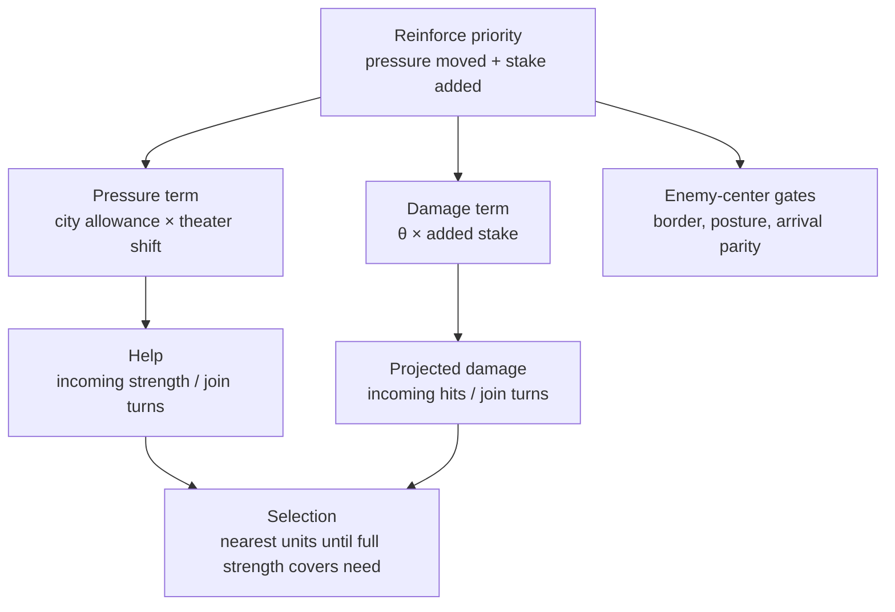

# Unit AI: Reinforcement Priorities

Each [battlefield](overview.md#battlefields) has a **Reinforce offer** to bring distant units toward its center. Its **priority** is what those units would change in our favor on arrival, in the same units as [fight priority](value.md#fight-priority), so marches and fights share one queue.

| Stage | What it supplies | Reference |
| --- | --- | --- |
| Recruit | Local and enemy strength, the selected incoming units and their join turns. | [Recruitment](recruitment.md#candidates-and-selection) |
| Score | Help, projected damage and the two terms. Rescored after every command, together with the theater. | `ScoreReinforcement`, `EstimateReinforce` and `ProjectCityShares` in `civ5-dll/CvGameCoreDLL_Expansion2/CvTacticalOperationalLoop.cpp`. |
| Check and execute | Actual paths, available recruits and march orders. | [Reinforce readiness](execution.md#reinforce-readiness) |

## Shared values and scales

Strength uses the [strength tallies](recruitment.md#strength-tallies); value, weights and the theater use the [fight-priority scales](value.md#shared-values-and-scales).

| Symbol | Meaning | Scale or range |
| --- | --- | --- |
| `L` (**local strength**) | Our units near the center, from the [local set](recruitment.md#battlefield-estimate). At our city it includes the city's own strength. | Native strength × remaining health share. Only ratios matter, so examples use strengths such as 100. |
| `T` (**enemy strength**) | Hostile units and cities near the center. At an enemy city it includes the city. | Same scale as `L`. |
| `r` (**desired ratio**) | Setting `reinforce.strengthRatio` (1): the friendly/enemy strength ratio selection aims for. | Positive; 1 means parity. |
| `need` | `max(0, r × T − L)`: full strength selection tries to add. | Strength, at least 0. |
| `S` | Selected units' full strength, including any capture-role and extension units. | Strength. |
| `j` (**join turns**) | `max(1, travel turns − 1)`, from the [distance estimate](recruitment.md#candidates-and-selection). | Whole turns, at least 1. |
| `help` | Sum over selected units of strength / `j`: strength discounted by how long it takes to join. | 0 to `S`. |
| `h` (**incoming hit**) | Damage one selected unit's simulated attack deals to the target, from its current plot. Divided by its `j` before it counts. | HP. |
| `θ`, `θ⁺` | Current [theater multiplier](value.md#theater-multiplier), and the **arrival theater**: the same formula with `help` added to our side. Defined in [pressure term](#pressure-term). | Theater floor (0.2) to 1. |
| `V`, `V⁺` | The fight's current [stake](value.md#fight-priority), and the **projected stake** with the selected units' discounted damage added. | Typical units. |
| `C` | City allowance, setting `city.units` (3). | Typical units. |
| `Z_T`, `Z_C` | Typical unit worth, and city scale (our most valuable city's value). | Worth; city value. |
| `w_C`, `w_O`, `w_A`, `w_G` | Hold-city, occupation, attrition and hold-ground weights. | 1 at neutral preferences. |

## Running example inputs

Examples use these inputs unless they state their own. Results are rounded only for display.

| Input | Value | Source |
| --- | --- | --- |
| Desired ratio `r` | 1 | Setting `reinforce.strengthRatio`. |
| Local strength `L`; enemy strength `T` | 100; 150 | Supplied. |
| Need | `1 (r) × 150 (T) − 100 (L) = 50` | Derived. |
| City allowance `C` | 3 | Setting `city.units`. |
| Typical worth `Z_T`; city scale `Z_C` | 400; 40 | [Value guide's running inputs](value.md#running-example-inputs). |
| Theater floor; room above it | 0.2; `1 − 0.2 = 0.8` | Setting `floor.theater`. |
| Pressure exponent | 2 | Setting `theater.steepness`. |
| Retained share; health share | 0.6; 0.4 | Setting `unitKillShare`; [living unit value](value.md#shared-values-and-scales). |
| Preference weights | All 1 | Neutral preferences. |
| Maximum HP (hit points) | Units 100; cities 250 | Value guide's running inputs. |
| Expected city heal `H` | 20 HP | Value guide's running inputs. |
| Ground, exposure and city relief | 0 | Supplied. |
| Border and posture gates | Open | Supplied. |

## Reinforce priority

**Rule: the theater pressure the march moves, plus the stake its damage adds.**

`priority = w × C × |θ⁺ − θ| + θ × (V⁺ − V)`

| Part | Reads as |
| --- | --- |
| **Pressure term** | How far help shifts the zone city's theater (`θ⁺` against `θ`), valued at the full city allowance `C` × the city weight `w` (`w_C` at our city, `w_O` at an enemy city). |
| **Damage term** | Stake the incoming damage adds to the fight (`V⁺ − V`) × the current theater, as a fight priority would count it. |

Each term applies only where the fight depends on it:

| Destination | Pressure term | Damage term |
| --- | --- | --- |
| Our city | `w_C × C × (θ − θ⁺)`: help lowers the contest of value we may lose. | None: our city's stake comes from native danger, which our damage does not change. |
| Enemy city | `w_O × C × (θ⁺ − θ)`: help raises the contest of value we may gain. | Added city progress and garrison destruction. |
| Enemy unit | None: pressure belongs to the zone city's own fight and Reinforce. | Added destruction, ground and city relief. |

| Gate | Our city | Enemy unit or city |
| --- | --- | --- |
| Border | None. | Destination zone must be ours or adjacent to ours, by the turn's initial zone data. |
| Posture | None. | Withdraw gives priority 0. |
| **Arrival parity** | None: defending is never optional. | **Arrival ratio** `(L + S) / T` below 1 gives priority 0, even when `r < 1`. Uses full strength, since the whole stack must survive once it arrives. |
| No selection | Priority 0. | Priority 0. |

These gates apply only to Reinforce; the battlefield's fight keeps its own priority.

## Pressure term

Help enters the zone city's [theater multiplier](value.md#theater-multiplier) through its pressure, so each added unit is worth less once our side already dominates, with no separate cap.

`θ = 0.2 (floor) + 0.8 (room above floor) × i × c`, with `c = 1 − (1 − p) × (1 − δ)` and `p = A² / (A² + D²)`

| Part | Reads as |
| --- | --- |
| `i` (**importance**) | `min(1, city value / Z_C)`: how much the zone city matters against our best city. Unchanged by the march. |
| `δ` (**damage level**) | `lost HP / maximum HP` of the zone city. Unchanged by the march. |
| `A`, `D` (**attackers**, **defenders**) | At our city, `A = T` and `D = L`. At an enemy city, `A = L` and `D = T`. |
| `p` (**pressure**) | `A² / (A² + D²)`: attacker share of fighting power; the exponent 2 is `theater.steepness`. 0 with no attackers, 0.5 at parity. |
| `c` (**contest**) | `1 − (1 − p) × (1 − δ)`: how likely the city changes hands. |
| `p⁺`, `θ⁺` | Pressure and theater with `help` added to our side: to `D` at our city, to `A` at an enemy city. |

Only `p` changes, so the shift reduces to:

| Destination | Theater shift | Bound as help grows without limit |
| --- | --- | --- |
| Our city | `θ − θ⁺ = 0.8 (room) × i × (1 − δ) × (p − p⁺)` | `p⁺` falls to 0: `0.8 × i × (1 − δ) × p` |
| Enemy city | `θ⁺ − θ = 0.8 (room) × i × (1 − δ) × (p⁺ − p)` | `p⁺` rises to 1: `0.8 × i × (1 − δ) × (1 − p)` |

The `(1 − δ)` factor means a battered city gains less from pressure: its damage keeps it contested.

**Pressure examples.** Each city receives help 100.

| City | `i`; `δ` | `p` now | `p⁺` with help 100 | `θ` | `θ⁺` | Pressure term `3 (C) × shift` |
| --- | --- | --- | --- | --- | --- | --- |
| Our town (15), full health, running strengths | `15 / 40 (Z_C) = 0.375`; 0 | `150² (A = T) / (150² + 100² (D = L)) = 0.692308` | `150² / (150² + (100 + 100 (help))²) = 0.36` | `0.2 + 0.8 × 0.375 × 0.692308 (c) = 0.407692` | `0.2 + 0.8 × 0.375 × 0.36 (c⁺) = 0.308` | `3 × (0.407692 − 0.308) = 0.299077` |
| Our capital (40) at 125 of 250 HP, running strengths | `40 / 40 = 1`; `125 / 250 = 0.5` | 0.692308 | 0.36 | `c = 1 − 0.307692 (1 − p) × 0.5 (1 − δ) = 0.846154`; `θ = 0.876923` | `c⁺ = 1 − 0.64 (1 − p⁺) × 0.5 = 0.68`; `θ⁺ = 0.744` | `3 × (0.876923 − 0.744) = 0.398769`: higher importance, halved by damage |
| Enemy city (20) at 125 of 250 HP, our `L = 0`, its `T = 100` | `20 / 40 = 0.5`; 0.5 | 0: no attackers (`A = L = 0`) | `100² (A⁺ = 0 + 100) / (100² + 100² (D = T)) = 0.5` | `c = 1 − 1 × 0.5 = 0.5`; `θ = 0.4` | `c⁺ = 1 − 0.5 × 0.5 = 0.75`; `θ⁺ = 0.5` | `3 × (0.5 − 0.4) = 0.3`, before any damage |

## Our city

An own-city Reinforce scores only the pressure term.

**Selection example.** Our town worth 15 at full health, with need 50 from the running inputs. These candidates pass recruitment; the spearman has the lower unit ID in its tie with the horseman.

| Candidate | Strength | Travel turns | `j` | Help | Selected |
| --- | --- | --- | --- | --- | --- |
| Spearman | 100 | 2 | `max(1, 2 − 1) = 1` | `100 (strength) / 1 (j) = 100` | Yes; full strength 100 covers need 50. |
| Horseman | 50 | 2 | 1 | 50 | No; tie broken by unit ID, then selection stops. |
| Knight | 100 | 3 | `max(1, 3 − 1) = 2` | `100 / 2 = 50` | No; need already covered. |

The selection's help is 100, so the priority is the town's row in the [pressure examples](#pressure-term): `1 (w_C) × 3 (C) × (0.407692 (θ) − 0.308 (θ⁺)) = 0.299077`.

**Help curve** at the same town: `θ = 0.407692` throughout, and `θ⁺ = 0.2 + 0.8 × 0.375 (i) × p⁺` at full health.

| Selection | Help | `p⁺ = 150² / (150² + (100 + help)²)` | `θ⁺` | Priority `3 × (0.407692 − θ⁺)` |
| --- | --- | --- | --- | --- |
| None | 0 | 0.692308, unchanged | 0.407692 | 0 |
| Knight alone | `100 / 2 (j) = 50` | 0.5 | 0.35 | 0.173077 |
| Spearman | 100 | 0.36 | 0.308 | 0.299077 |
| Supplied large group | 400 | 0.082569 | 0.224771 | 0.548765 |
| Unlimited | | 0 | 0.2 (floor) | `3 × 0.8 × 0.375 × 0.692308 (p) = 0.623077`, the bound |

## Projected damage

Both enemy centers continue the fight's local damage simulation to find what the selected units add.

| Step | Rule |
| --- | --- |
| 1. Simulate | Each selected unit attacks in selection order, including the role unit, from its current plot, under the fight's [local damage rules](value.md#city-allowance-and-fall-share): native quick attack simulation, accumulated damage, suicide test. The result is its hit `h`. At a city, a unit failing `CanStrikeCity` has `h = 0` but still counts toward strength. |
| 2. Discount | Add `h / j` to the local damage, splitting city and garrison parts as the simulation did. |
| 3. Value | Apply the fight's stake rules to the projected damage with the same remaining HP, expected heal and starting garrison. The result is `V⁺`. Exposure is unchanged, so it cancels in `V⁺ − V`. |
| 4. Extend if needed | If the fight is not already a kill or capture and `V⁺` does not rise above `V`, try the [damage extension](recruitment.md#candidates-and-selection). An extension that finds no benefit leaves its added candidates free. |

## Enemy unit

An enemy-unit Reinforce scores the destroyed value its damage adds, plus the matching rise in ground and city relief.

`V⁺ − V = w_A × (K_t⁺ − K_t) / Z_T + (k_t⁺ − k_t) × (w_G × ΔG(t) + w_C × C × f_def × a_t)`

| Part | Reads as |
| --- | --- |
| `K_t`, `K_t⁺` | [Destroyed value](value.md#destroyed-value) of the target from local damage, and from local plus discounted incoming damage. Jumps to the target's whole living value once damage reaches its remaining HP. |
| `k_t`, `k_t⁺` | **Damage share** `min(1, damage / remaining HP)`, before and after the incoming damage. |
| `ΔG(t)` | [Ground](value.md#ground-value) recovered by removing the target. |
| `C × f_def × a_t` | The target's part of our city's danger, its [city relief](value.md#city-relief). 0 away from our cities. |

**Knight example.** A full-health enemy knight worth 700 (`F`), 100 HP, in a cityless zone, so `θ = 0.2` (floor, `i = 0`). Local units deal it 30. One swordsman of strength 100 is selected; arrival ratio `(100 (L) + 100 (S)) / 150 (T) = 1.33` passes parity. Baseline `V = 700 (F) × 0.4 (health share) × 30/100 (damage / maximum HP) / 400 (Z_T) = 0.21`. Each row varies the swordsman's hit `h` and join turns `j`.

| Swordsman `h`; `j` | Projected damage `30 + h / j` | `V⁺` | `V⁺ − V` | Priority `0.2 (θ) × (V⁺ − V)` |
| --- | --- | --- | --- | --- |
| 0 (its attack fails the suicide test); 1 | 30 | 0.21 | 0 | 0, unless the extension finds an attacker |
| 45; 2 | `30 + 45 / 2 = 52.5` | Nonlethal: `700 × 0.4 × 52.5/100 / 400 = 0.3675` | `0.3675 − 0.21 = 0.1575` | 0.0315 |
| 45; 1 | `30 + 45 / 1 = 75` | `700 × 0.4 × 75/100 / 400 = 0.525` | 0.315 | 0.063 |
| 70; 1 | `30 + 70 = 100`, reaching its 100 remaining HP | Lethal: `700 × (0.6 (retained share) + 0.4 × 100/100 (remaining / maximum HP)) / 400 = 1.75` | 1.54 | 0.308 |

| Boundary | Priority |
| --- | --- |
| Local units already deal 100, so `V = 1.75` | 0 for any `h`: nothing is left to add. |
| Selection of strength 25 only | 0: arrival `(100 (L) + 25 (S)) / 150 (T) = 0.83` fails parity. |

## Enemy city

An enemy-city Reinforce adds both terms: pressure on the city, and the city progress and garrison destruction its damage adds.

`V⁺ − V = w_O × C × (f_att⁺ − f_att) + w_A × (K_g⁺ − K_g) / Z_T`

| Part | Reads as |
| --- | --- |
| `f_att`, `f_att⁺` | [Attack fall share](value.md#city-allowance-and-fall-share) from local damage, and from local plus discounted incoming damage: `max(0, min(damage, R − 1) − H) / R`, or 1 when damage reaches remaining HP `R` and a capturer is available. |
| `K_g`, `K_g⁺` | [Garrison destroyed value](value.md#garrison-destroyed-value) of the starting garrison, before and after. |

| Capture case | Treatment and reason |
| --- | --- |
| Baseline | Counts an available local `CanCapture` attacker or a local strength-filter unit passing `IsCapturer`, which needs no current-turn availability. Counting a capturer that is spent, off the tactical roster or covering a civilian keeps the march from earning capture credit the zone already has for a later turn. |
| Incoming capturer | Satisfies the projected capture requirement; bringing one can earn capture credit without adding damage. |

**City examples.** The full-health enemy city worth 45 from the [worked priorities](value.md#worked-priorities), 250 HP, no garrison, with 50 local damage. Two units are selected, and each row varies how hard each one hits (`h`, the same for both) and how soon they join (`j`, the same for both).

| Input | Value | Source |
| --- | --- | --- |
| `L`; `T` | 100; 100 | Supplied. |
| Desired ratio `r` | 2 | Supplied override, so both units are needed. |
| Selection | Two units of strength 50 each, one a capturer | Supplied. |
| Need | `2 (r) × 100 (T) − 100 (L) = 100` | Derived. |
| Arrival ratio | `(100 (L) + 100 (S)) / 100 (T) = 2`, parity passes | Derived. |
| `i`; `δ` | `min(1, 45 / 40 (Z_C)) = 1`; 0 (full health) | Derived. |
| `p` | `100² (A = L) / (100² + 100² (D = T)) = 0.5` | Derived. |
| `θ` | `0.2 (floor) + 0.8 (room) × 1 (i) × 0.5 (c = p at full health) = 0.6` | Derived. |
| Baseline `f_att` | `(50 (local damage) − 20 (H)) / 250 (R) = 0.12` | Derived. |

**Pressure term**, which depends only on `j`:

| `j` | Help | `p⁺` | `θ⁺` | Pressure term `3 (C) × (θ⁺ − 0.6 (θ))` |
| --- | --- | --- | --- | --- |
| 1 | `50 / 1 + 50 / 1 = 100` | `200² (A⁺ = 100 (L) + 100 (help)) / (200² + 100² (D)) = 0.8` | `0.2 + 0.8 × 0.8 = 0.84` | 0.72 |
| 2 | `50 / 2 + 50 / 2 = 50` | `150² / (150² + 100²) = 0.692308` | `0.2 + 0.8 × 0.692308 = 0.753846` | 0.461538 |

**Damage term and priority:**

| `h` per unit; `j` | Projected city damage `50 + 2 (units) × h / j` | `f_att⁺ = (damage − 20 (H)) / 250 (R)` | Damage term `0.6 (θ) × 3 (C) × (f_att⁺ − 0.12)` | Priority: pressure + damage |
| --- | --- | --- | --- | --- |
| 0 (no candidate for the extension); 1 | 50 | 0.12, unchanged | 0 | `0.72 + 0 = 0.72`: the march still adds pressure |
| 10; 1 | 70 | 0.2 | 0.144 | 0.864 |
| 40; 2 | 90 | 0.28 | 0.288 | `0.461538 + 0.288 = 0.749538` |
| 40; 1 | 130 | 0.44 | 0.576 | 1.296 |
| 100; 1 | 250, reaching `R` | 1: capture, with the incoming capturer | 1.584 | 2.304 |

**March against fight**, taking the row where each unit hits for 40 and joins next turn (`h = 40`, `j = 1`):

| Offer | Priority | Reads as |
| --- | --- | --- |
| The city's fight now | `0.6 (θ) × 3 (C) × 0.12 (f_att) = 0.216` | What local units can do this turn. |
| The march | `0.72 (pressure term) + 0.576 (damage term) = 1.296` | What the two units add once they arrive. |
| The fight after they arrive | `0.84 (θ⁺) × 3 (C) × 0.44 (f_att⁺) = 1.109` | The fight priority with their strength and damage counted. The march can exceed it because pressure is credited at the full city allowance, while the fight only counts this turn's progress. |
