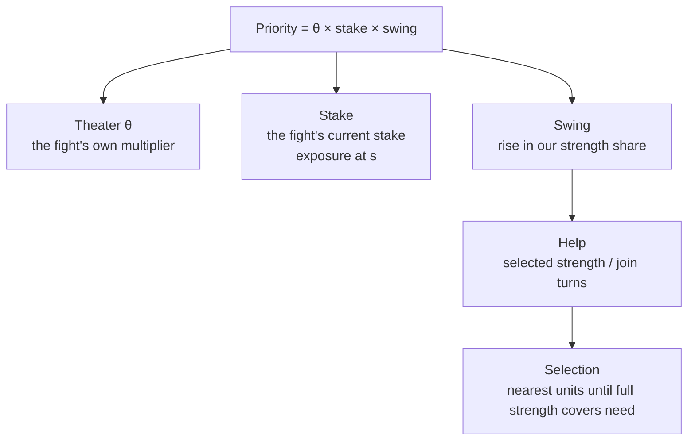

# Unit AI: Reinforcement Priorities

Each [battlefield](overview.md#battlefields) has a **Reinforce offer** to bring distant units toward its center. Its **priority** is the battlefield's [fight priority](value.md#fight-priority) times the share of the outcome the arriving units swing, so marches and fights compete in one queue on one base. At an enemy battlefield the offer shares the field with a [Withdraw](withdrawal.md); a Withdraw that moves a unit closes this offer for the rest of the turn.

| Stage | What it supplies | Reference |
| --- | --- | --- |
| Recruit | Local and enemy strength, the selected incoming units and their join turns. | [Recruitment](recruitment.md#candidates-and-selection) |
| Score | Swing and priority. Rescored after every command, together with the fight's stake and theater. | `EstimateBattlefield` in `civ5-dll/CvGameCoreDLL_Expansion2/CvTacticalOperationalLoop.cpp`. |
| Check and execute | Actual paths, available recruits and march orders. | [Reinforce readiness](execution.md#reinforce-readiness) |

| Part | Fight | Reinforce |
| --- | --- | --- |
| `θ` | The zone's current theater. | The same value. |
| Stake | What local units can change this turn. | The same value. |
| Share | Already inside the stake, from damage. | **Swing**, from strength: 0 to 1. |
| Peer offer | The battlefield's Withdraw counts its own removable exposure over all recruits. | Excluded by that Withdraw once it moves a unit. |

## Shared values and scales

Strength uses the [strength tallies](recruitment.md#strength-tallies); stake, weights and the theater come from the [value page](value.md#fight-priority).

| Symbol | Meaning | Scale or range |
| --- | --- | --- |
| `L` (**local strength**) | Our units near the center, from the [local set](recruitment.md#battlefield-estimate). At our city it includes the city's own strength. | Native strength × remaining health share. Only ratios matter, so examples use strengths such as 100. |
| `L_R` (**adjusted local strength**) | Reinforce's local tally after released local units enter its candidate pool. It equals `L` when no local units are released. | Same scale as `L`. |
| `T` (**enemy strength**) | Hostile units and cities near the center. At an enemy city it includes the city. | Same scale as `L`. |
| `r` (**desired ratio**) | Setting `reinforce.strengthRatio` (1): the friendly/enemy strength ratio selection aims for. | Positive; 1 means parity. |
| `need` | `max(0, r × T − L_R)`: full strength selection tries to add. | Strength, at least 0. |
| `S` | Selected units' full strength, including any role unit. | Strength. |
| `j` (**join turns**) | `max(1, travel turns − 1)`, from the [distance estimate](recruitment.md#candidates-and-selection). | Whole turns, at least 1. |
| `help` | Sum over selected units of strength / `j`: strength discounted by how long it takes to join. | 0 to `S`. |
| `s` (**fight share**) | Our share of fighting power at the center now, `L² / (L² + T²)`. The fight counts its target's exposure at `s`, and a [Withdraw](withdrawal.md#withdraw-priority) keeps `s⁺` at or above this share. At a city battlefield it matches the theater's [pressure](value.md#theater-multiplier) at an enemy city and `1 − pressure` at ours. | 0 to 1; 0.5 at parity. |
| `s_R` (**Reinforce start**) | Reinforce's own starting share, `L_R² / (L_R² + T²)`, after local units enter its candidate pool. It equals `s` when no local units are released. | 0 to 1. |
| `s_h` (**projected share**) | `(L_R + help)² / ((L_R + help)² + T²)`: Reinforce's share once the selected help joins from `s_R`. | 0 to 1. |
| `θ` | Current [theater multiplier](value.md#theater-multiplier) of the destination's zone. | Theater floor (0.2) to 1. |
| Stake | The battlefield fight's current [stake](value.md#fight-priority), with exposure at `s`. | Typical units. |

## Running example inputs

Examples use these inputs unless they state their own. Results are rounded only for display.

| Input | Value | Source |
| --- | --- | --- |
| Desired ratio `r` | 1 | Setting `reinforce.strengthRatio`. |
| Local strength `L`; enemy strength `T` | 100; 150 | Supplied. |
| Need | `1 (r) × 150 (T) − 100 (L) = 50` | Derived. |
| Selection | One spearman of strength 100, `j = 1` | Supplied; its full strength covers need 50. |
| Help | `100 (strength) / 1 (j) = 100` | Derived. |
| Strength share `s` | `100² (L) / (100² + 150² (T)) = 0.307692` | Derived. |
| Swing | `0.64 (s_h) − 0.307692 (s_R) = 0.332308` | Derived in [swing](#swing); with no local units released, `s_R = s`. |
| City allowance `C`; city scale `Z_C` | 3; 40 | [Value page's running inputs](value.md#running-example-inputs). |
| City maximum HP; expected heal `H` | 250 HP; 20 HP | Value page's running inputs; healing reduces non-capturing city progress. |
| Unlisted exposure, ground and garrison terms | 0 | Supplied, so each example isolates its named stake. |
| Theater floor; room above it | 0.2; 0.8 | Setting `floor.theater`. |
| Strength exponent | 2 | Setting `theater.steepness`. |
| Stakes and fight priorities | As computed on the value page | Named in each example. |
| Gates | Open | Supplied. |

## Reinforce priority

**Rule: the fight's priority, times the share of the outcome the march swings.**

`priority = θ × stake × swing`

| Part | Reads as |
| --- | --- |
| `θ × stake` | The battlefield's fight priority, unchanged. Help goes where a fight is already worth something, in proportion to it. |
| [`swing`](#swing) | How far the selected units move our strength share, 0 to 1. |

| Property | Why it holds |
| --- | --- |
| A march never outranks the fight it joins. | Priority is fight priority × swing, and swing is at most 1. |
| A fight local units already win needs no rule. | Its fight has the higher priority, runs first and removes the target, which drops both offers. |
| More danger to a city never lowers the pull. | Danger raises both `θ` and the stake. |

| Gate | Our city | Enemy unit or city |
| --- | --- | --- |
| Border | None. | Destination zone must be ours or adjacent to ours, by the turn's initial zone data. |
| Posture | None. | Withdraw posture gives priority 0. |
| **Short selection** | None: defending is never optional, so partial help still counts. | Candidates run out before full strength covers need, so `(L_R + S) / T < r`: priority 0. The stack must hold once it arrives. |
| No selection | Priority 0. | Priority 0. |

These gates apply only to Reinforce; the battlefield's fight and Withdraw keep their own priorities.

## Swing

The **swing** is the rise in our strength share when help joins.

`swing = s_h − s_R`, with `s_R = L_R² / (L_R² + T²)` and `s_h = (L_R + help)² / ((L_R + help)² + T²)`

| Part | Reads as |
| --- | --- |
| `s_R` (**Reinforce start**) | Our share of fighting power from `L_R`, squared per Lanchester's square law with the theater's exponent (`theater.steepness`, 2). When a fight has released local units into the candidate pool, `L_R` is below the fight's `L`, so the swing starts from a lower share than the fight's exposure uses. 1 with no enemy strength. |
| `L_R`, `T` | The battlefield's tallies after released local units enter the candidate pool. At a city they are the theater inputs; at a unit they are centered on the target. `L_R = L` when no local units are released. |
| `s_h − s_R` | Each added unit is worth less once our side dominates, so no separate cap is needed. As help grows without limit the swing approaches `1 − s_R`. |

The fight's exposure and the Withdraw's `s⁺` read the fight's share `s`, which the released candidate pool does not change.

**Swing curve** at the running strengths, `s_R = s = 0.307692` because no local units are released.

| Selection | Help | `s_h = (100 (L_R) + help)² / ((100 + help)² + 150² (T))` | Swing `s_h − 0.307692 (s_R)` |
| --- | --- | --- | --- |
| None | 0 | 0.307692, unchanged | 0 |
| A knight of strength 100, `j = 2` | `100 (strength) / 2 (j) = 50` | `150² / (150² + 150²) = 0.5` | 0.192308 |
| The spearman, `j = 1` | 100 | `200² / (200² + 150²) = 0.64` | 0.332308 |
| Supplied large group | 400 | `500² / (500² + 150²) = 0.917431` | 0.609739 |
| Unlimited | | 1 | `1 − 0.307692 (s_R) = 0.692308`, the bound |

## Selection

Native selection is described in full under [recruitment](recruitment.md#candidates-and-selection). After its reach check, it becomes the native admission proposal. An optional provider can retain it or admit a candidate subset before spotting or marching. Added candidates pass the same reach checks; failures stay excluded. The admitted group determines help, swing and any missing capture role without changing the chosen command's checked priority. See [participant admission](execution.md#participant-admission).

| Step | Rule |
| --- | --- |
| 1. Filter | Candidates beyond strike reach and within recruitment range. At an enemy city a candidate must also pass `CanStrikeCity`, so strength that cannot hurt the city is never counted. |
| 2. Cover need | Sort by join turns, travel turns, then unit ID, and select until full strength `S` meets `need`. |
| 3. Role unit | Enemy city only: if no local or selected unit can capture, the nearest remaining capturer joins, even when need is 0. Its strength counts in help. |

**Selection example.** Need 50 from the running inputs. The spearman has the lower unit ID in its tie with the horseman.

| Candidate | Strength | Travel turns | `j` | Help | Selected |
| --- | --- | --- | --- | --- | --- |
| Spearman | 100 | 2 | `max(1, 2 (travel) − 1) = 1` | `100 (strength) / 1 (j) = 100` | Yes; full strength 100 covers need 50. |
| Horseman | 50 | 2 | 1 | 50 | No; tie broken by unit ID, then selection stops. |
| Knight | 100 | 3 | `max(1, 3 (travel) − 1) = 2` | `100 / 2 (j) = 50` | No; need already covered. |

## Worked priorities

Every row uses the running strengths and the spearman, so the swing is 0.332308, unless the row states its own.

| Destination | `θ` | Stake | Priority `θ × stake × swing` |
| --- | --- | --- | --- |
| Our capital at 25 of 250 HP, danger above 25 | `0.2 + 0.8 × 0.969231 (c) = 0.975385` | `3 (C) × 1 (f_def) = 3` | `0.975385 (θ) × 3 (stake) × 0.332308 (swing) = 0.972` |
| Our capital at 200 of 250 HP, danger 80 | `0.2 + 0.8 × 0.753846 (c) = 0.803077` | `3 (C) × 0.4 (f_def) = 1.2` | `0.803077 (θ) × 1.2 (stake) × 0.332308 (swing) = 0.320` |
| Our capital at full health, the enemy still two turns out, no danger this turn | `0.2 + 0.8 × 0.692308 (c = p) = 0.753846` | 0 | 0: no danger yet, so no fight to join |
| Our capital, no enemy strength | 0.2 | 0 | 0: need is 0, nothing is selected |
| Large enemy city (45) at 125 of 250 HP, 50 local damage | `0.2 + 0.8 × 0.653846 (c) = 0.723077` | `3 (C) × 0.24 (f_att) = 0.72` | `0.723077 (θ) × 0.72 (stake) × 0.332308 (swing) = 0.173` |
| Same city at full health | `0.2 + 0.8 × 0.307692 (c = p) = 0.446154` | `3 (C) × 0.12 (f_att) = 0.36` | `0.446154 (θ) × 0.36 (stake) × 0.332308 (swing) = 0.053` |
| Enemy city (20) at half HP, `L = 0`, `T = 100`, one unit of strength 100 at `j = 1` | 0.4 | 0: no local units | 0: a new battlefield, left to armies |
| Knight worth 700 threatening our archer, 45 local damage, cityless zone, running strengths (`L = 100`, `T = 150`) | 0.2 (theater floor) | `0.315 (destruction) + 0.76 (archer exposure) × 0.307692 (s) = 0.548846` | `0.2 (θ) × 0.548846 (stake) × 0.332308 (swing) = 0.036` |
| That knight alone, 30 local damage | 0.2 | 0.21 | `0.2 (θ) × 0.21 (stake) × 0.332308 (swing) = 0.014` |
| That knight, no local damage | 0.2 | 0 | 0: no local units can hurt it |
| That knight, only a unit of strength 25 in range | 0.2 | 0.21 | 0: `(100 (L) + 25 (S)) / 150 (T) = 0.83` is below `r = 1`, a short selection |

**Help curve** at our capital with 200 HP: fight priority `0.803077 (θ) × 1.2 (stake) = 0.963692`.

| Selection | Swing | Priority `0.963692 (fight priority) × swing` |
| --- | --- | --- |
| None | 0 | 0 |
| Knight alone (help 50) | 0.192308 | 0.185 |
| Spearman (help 100) | 0.332308 | 0.320 |
| Supplied large group (help 400) | 0.609739 | 0.588 |
| Unlimited | 0.692308 | 0.667, the bound |

## Withdraw at the same battlefield

A [Withdraw](withdrawal.md) at the same battlefield competes with this offer for the turn; a Withdraw or Reinforce that moves a unit closes the other, with the own-city and disabled-switch exemptions in the [Withdraw closing rules](withdrawal.md#closing-the-battlefield).

The Reinforce priority reserves nothing for that peer offer: it is the fight's priority times its swing, while the Withdraw counts its own removable exposure. A ready Reinforce never raises the Withdraw priority; the [Withdraw priority](withdrawal.md#withdraw-priority) explains how `s⁺` combines them.

## Marches against fights

The offers above, ranked together as the queue sees them.

| Offer | Priority | Reads as |
| --- | --- | --- |
| Fight: our capital at 25 HP | `0.975385 (θ) × 3 (stake) = 2.926` | The defense itself comes first. |
| March to that capital | 0.972 | The strongest march: a third of its fight. |
| Fight: our capital at 200 HP | `0.803077 (θ) × 1.2 (stake) = 0.964` | |
| Fight: large enemy city at half HP | `0.723077 (θ) × 0.72 (stake) = 0.521` | |
| Fight: kill a full-health knight worth 700 | `0.2 (θ) × 1.75 (stake) = 0.350` | A sure kill outranks every march except a capital about to fall. |
| March to our capital at 200 HP | 0.320 | |
| March to the large enemy city at half HP | 0.173 | A top-up of a siege under way. |
| Fight: the knight with 30 local damage | `0.2 (θ) × 0.21 (stake) = 0.042` | |
| March toward that knight | 0.014 | |
