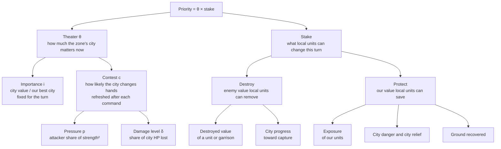
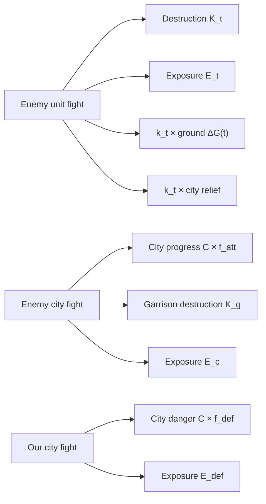

# Unit AI: Command Value and Priorities

The [command loop](overview.md) gives every fight offer a **priority** (the code's **estimate**, stored in `fEstimate`). The highest ready priority gets the next readiness check, so priority decides which fights get shared units first.

| Stage | Meaning | Example: an enemy worth 700 at 30 of 100 HP that local units can kill |
| --- | --- | --- |
| Raw value | Unit worth adjusted for remaining health. | `700 (worth) × (0.6 (retained share) + 0.4 (health share) × 30/100 (remaining HP)) = 504` |
| Normalized quantity | Unit value / typical unit worth `Z_T`, so every unit and city quantity is in **typical units**. | `504 / 400 (typical worth) = 1.26` typical units |
| Weighted term | Quantity × preference weight; the terms sum to the stake. | `1.26 × 1 (neutral attrition weight) = 1.26` |
| Queue priority | Stake × theater `θ`. A ranking score: uncapped and not a probability. | `0.2 (cityless theater) × 1.26 = 0.252` |

| Fixed for the turn | Fixed when the battlefield is built | Refreshed after each command |
| --- | --- | --- |
| Reference scales, weights, city theater importance | Ground `ΔG(t)` | Health, local damage, garrisons, threats, theater contest, open-offer priorities |

## Shared values and scales

`CvTacticalOperationalValue.h` and `.cpp` define these values for both loop priorities and the simulator's outcome grade. Pure functions work on numbers; adapters read native units, cities and plots.

| Value | Rule |
| --- | --- |
| Base unit worth | Geometric mean of unit power and production cost, each floored at 0. The DLL uses native unit power. The simulator and its grade use an effective power of 3,000 for the Atomic Bomb. |
| `F` (unit worth) | Base worth × `1 + 0.1 (per level) × max(0, level − 1)`, plus the ready-upgrade premium for our units only. Read by `OurUnitWorth`. |
| Ready-upgrade premium | `0.5 × max(0, upgrade base worth − current base worth)` when `CanUpgradeRightNow(true)` passes (technology and project prerequisites met; gold, territory, embarkation and class limits not checked). Added before the health share. |
| `q` (**retained share**) | Setting `unitKillShare` (0.6): the share of worth kept at any health and lost only by dying. The rest, `1 − q` (0.4), is the **health share**. |
| **Living unit value** | `F × (q + (1 − q) × remaining HP / maximum HP)`: `F` at full health, `0.8F` at half, toward `0.6F` near death. |
| `E(u, d)` (value unit `u` loses to incoming damage `d`) | Whole living value if `d` reaches remaining HP; otherwise `F × (1 − q) × d / maximum HP`; 0 for `d ≤ 0`. |
| City value | `getEconomicValue` as seen by us, or population when that is not positive. |
| `Z_T` (**typical unit worth**) | Mean base worth of the **reference types** (`ReferenceUnitScales`): per unit class, our civilization's own type with combat strength, known prerequisite technology, unknown obsolete technology and a production cost. City-state gifts and policy-unlocked types are excluded; supply, gold, cities and resources do not matter. 0 with no reference type. |
| `Z_C` (**city scale**) | Our most valuable city's value; with no city of ours, the most valuable city of living, non-barbarian players at war with us; else 0. Used only by theater. |
| `C` (**city allowance**) | Setting `city.units` (3): a city fight's size in typical units. |
| Nonpositive scale | Any term divided by a scale ≤ 0 contributes 0. |

`BuildTurn` assembles the turn's scales and logs them as "Operational loop scales".

**Upgrade and scale example** (own inputs): a level-3 unit, base worth 400, ready upgrade to base worth 600, half health.

| Value | Calculation | Result |
| --- | --- | --- |
| Worth with level premium | `400 (base) × (1 + 0.1 × (3 (level) − 1))` | 480 |
| Ready-upgrade premium | `0.5 × (600 (upgrade base) − 400 (base))` | 100 |
| Full-health worth `F` | `480 + 100` | 580 |
| Living value | `580 × (0.6 (retained share) + 0.4 (health share) × 0.5 (HP fraction))` | 464 |
| In typical units, typical worth 250 | `464 / 250 (Z_T)` | 1.856 |
| City scale, cities worth 40 and 20 | The more valuable city | `Z_C = 40` |

### Damage rolls

Every damage estimate on this page sets its random roll by the turn's mapped RISK flavor `ρ` (willingness to accept danger, 0 to 100), the same preference behind `w_R`. A cautious player plans for the rolls that are worst for us; a bold one plans for the average, which is what native projections (`DoDamageMath` with the random roll off) use.

`damage roll = default damage + s × random range`, before native's strength ratio and modifiers.

| Roll share `s` | RISK 0 | RISK 50 | RISK 100 | Used for |
| --- | --- | --- | --- | --- |
| **Our roll** `s_us = 0.5 × ρ / 100` | 0 (worst) | 0.25 | 0.5 (average) | Local damage on a unit `D_t` (city fire included), on a city `D_c`, and on its garrison `D_g`. A low roll counts a kill or capture only when damage overflows the threshold, so overflow reads as more certain. |
| **Enemy roll** `s_enemy = 1 − 0.5 × ρ / 100` | 1 (best) | 0.75 | 0.5 (average) | Danger to our units (`d`, `d_t`), city danger behind `f_def` and `a_t`, and the damage our attacker takes in the suicide test. |

**Roll example** (own inputs): equal strength, default damage 20, random range 10, so a roll deals `20 + s × 10`. Units are worth 400 with `M = 100`; `Z_T = 400`. Each cell gives the damage, then the term.

| Case | RISK 0 | RISK 50 | RISK 100 (native's expected roll) |
| --- | --- | --- | --- |
| Our one hit on an enemy at 22 HP | 20, nonlethal: `400 (F) × 0.4 (health share) × 20/100 (D_t / M) / 400 (Z_T) = 0.08` | 22.5, lethal: `400 × (0.6 (retained share) + 0.4 × 22/100 (R_t / M)) / 400 = 0.688` | 25, lethal: 0.688 |
| Our two hits on that enemy | 40, lethal: 0.688 | 45, lethal: 0.688 | 50, lethal: 0.688 |
| An enemy hit on our archer at 28 HP | 30, lethal: `400 × (0.6 + 0.4 × 28/100) / 400 = 0.712` | 27.5, nonlethal: `400 × 0.4 × 27.5/100 / 400 = 0.11` | 25, nonlethal: `400 × 0.4 × 25/100 / 400 = 0.10` |

## Running example inputs

All examples use these supplied inputs unless they state their own. Unlisted ground and exposure are 0; results are rounded only for display.

| Input | Value | Source |
| --- | --- | --- |
| Typical unit worth `Z_T` | 400 | Supplied. |
| City allowance `C` | 3 | Setting `city.units`. |
| Our cities | Values 40, 15 and 35 | Supplied. |
| City scale `Z_C` | 40 | Our most valuable city. |
| Retained share `q` | 0.6 | Setting `unitKillShare`. |
| Health share `1 − q` | 0.4 | Lost in proportion to HP lost. |
| Theater floor | 0.2 | Setting `floor.theater`; the room above it is `1 − 0.2 = 0.8`. |
| Preference weights | All 1, except hold-ground `w_G` 0.05 | Neutral mapped flavors, default bases (`weight.holdGround` 0.05) and slopes. |
| Roll shares | Our roll 0.25; enemy roll 0.75 | Neutral RISK (50). Examples supply damage and danger directly. |
| Maximum HP (hit points) `M` | Units 100; cities 250 | Supplied. |
| Expected city heal `H` | 20 HP | Supplied. |

## Theater multiplier

A **theater** is the zone around one city. Every fight in the zone shares its multiplier, which grows with the **city value that may change hands**.

`θ = floor.theater + (1 − floor.theater) × i × c`

| Part | Reads as |
| --- | --- |
| `floor.theater` (0.2) | What every fight keeps, city or no city. |
| `1 − floor.theater` (0.8) | Room above the floor, so `θ` tops out at 1. |
| `i` (**importance**) | `min(1, city value / Z_C)`: 1 for a city as valuable as our best, 0 with no city. Relative to our best city, so independent of empire size. A fight at an enemy target uses its target zone's city, which can be ours or an enemy's; an own-city fight uses its own city. City battlefields fix it for the turn; a unit fight reads its remembered zone city's current theater. |
| `c` (**contest**) | `1 − (1 − p) × (1 − δ)`: 0 for an unpressured, undamaged city; near 1 for an outnumbered, battered one. Refreshed after every command. |
| Not included | Operation-target and focus-area bonuses. |

| Contest input | Formula | Reads as |
| --- | --- | --- |
| `p` (**pressure**) | `A² / (A² + D²)` | Attacker share of fighting power, from the city-centered [strength tallies](recruitment.md#strength-tallies) described below. Squared per Lanchester's square law; the exponent is setting `theater.steepness` (2). 0 with no attackers, 0.5 at parity. |
| `δ` (**damage level**) | `lost HP / maximum HP` | 0 at full health, near 1 about to fall. |
| `(1 − p) × (1 − δ)` | | Safety: a city is safe only if both unpressured and undamaged. |

| City | Attackers `A` | Defenders `D` | `θ` measures |
| --- | --- | --- | --- |
| Ours | Enemy strength `T` | Our local strength `L`, city included | Value we may lose |
| Enemy | Our local strength `L` | Enemy strength `T`, city included; a revealed city counts even when fogged | Value we may gain |

`A` and `D` are the **theater inputs**: the tallies computed with the zone's city as the center, the same ones its city fight reads. Every fight in the zone shares them, including unit fights. A unit battlefield's own `L` and `T` are centered on the target and feed only its Reinforce; reading those instead would give fights in one zone different multipliers.

**Pressure curve.**

| Attackers / defenders | `p` at exponent 2 | Calculation | `p` at exponent 3 |
| --- | --- | --- | --- |
| One third | 0.10 | `1² / (1² + 3²)` | 0.04 |
| Half | 0.20 | `1² / (1² + 2²)` | 0.11 |
| Equal | 0.50 | `1² / (1² + 1²)` | 0.50 |
| Double | 0.80 | `2² / (2² + 1²)` | 0.89 |
| Triple | 0.90 | `3² / (3² + 1²)` | 0.96 |

**Theater examples.** `Z_C = 40`.

| Theater | `i = value / 40` | `p` | `δ` | `c = 1 − (1 − p)(1 − δ)` | `θ = 0.2 + 0.8 × i × c` |
| --- | --- | --- | --- | --- | --- |
| Cityless zone | 0 | | | | 0.2 |
| Our best city (40), no enemies, full health | 1 | 0 | 0 | 0 | 0.2 |
| Our best city, full health, enemy at half our strength | 1 | 0.2 | 0 | `1 − 0.8 × 1 = 0.2` | 0.36 |
| Our town (15) at half HP, enemy at 1.5 times our strength | 0.375 | `1.5² / (1.5² + 1²) = 0.69` | 0.5 | `1 − 0.31 × 0.5 = 0.85` | 0.45 |
| Our best city, full health, enemy at triple our strength | 1 | 0.9 | 0 | `1 − 0.1 × 1 = 0.9` | 0.92 |
| Enemy city (20), full health, we have two thirds of its strength | 0.5 | `2² / (2² + 3²) = 0.31` | 0 | 0.31 | 0.32 |
| Enemy city (20) at half HP, none of our units nearby | 0.5 | 0 | 0.5 | `δ = 0.5`, still pulls Reinforce | 0.40 |
| Enemy capital (45) at 20% HP, we have double its strength | 1 (capped) | 0.8 | 0.8 | `1 − 0.2 × 0.2 = 0.96` | 0.97 |

## Fight priority

**Rule: enemy value local units can destroy this turn, plus our value they can protect this turn.** A **term** is a normalized quantity × a preference weight; a **stake** sums a fight's terms. All terms are in typical units, so destroying 500 of enemy worth and protecting 500 of ours count the same at neutral weights. A stake of 0 makes the fight inactive.

**Enemy unit fight**, target `t`:

`stake = w_A × K_t / Z_T + w_R × E_t / Z_T + k_t × (w_G × ΔG(t) + w_C × C × f_def × a_t)`

| Term | Formula | Reads as |
| --- | --- | --- |
| **Destruction** | `w_A × K_t / Z_T` | Enemy value local units and city fire can remove from the target ([destroyed value](#destroyed-value) `K_t`) × attrition weight. |
| **Exposure** | `w_R × E_t / Z_T` | Value of our units the target can hurt before our next turn ([exposure](#exposure) `E_t`) × risk weight. Counted in full: the search can also protect by moving our units away. |
| **Ground** | `k_t × w_G × ΔG(t)` | Territory recovered if the target is removed ([ground](#ground-value) `ΔG(t)`) × hold-ground weight × damage share, since it pays off only on removal. |
| **City relief** | `k_t × w_C × C × f_def × a_t` | Target's part `a_t` ([relief share](#city-relief)) of our city's danger `C × f_def` × hold-city weight × damage share. 0 away from our cities. |

**Enemy city fight**, current garrison `g`:

`stake = w_O × C × f_att + w_A × K_g / Z_T + w_R × E_c / Z_T`

| Term | Formula | Reads as |
| --- | --- | --- |
| **City progress** | `w_O × C × f_att` | City allowance × progress toward capture this turn ([attack fall share](#city-allowance-and-fall-share) `f_att`) × occupation weight. Healing reduces only this term; capture earns it in full. |
| **Garrison destruction** | `w_A × K_g / Z_T` | [Garrison value](#garrison-destroyed-value) our hits destroy × attrition weight. Kept separate because native combat splits hits between city and garrison. |
| **Exposure** | `w_R × E_c / Z_T` | Value of our units the city and garrison can hurt × risk weight. Keeps the fight active when both damage terms are 0. |

**Our city fight:**

`stake = w_C × C × f_def + w_R × E_def / Z_T`

| Term | Formula | Reads as |
| --- | --- | --- |
| **City danger** | `w_C × C × f_def` | City allowance × closeness to falling before our next turn ([defense fall share](#city-allowance-and-fall-share) `f_def`) × hold-city weight. |
| **Exposure** | `w_R × E_def / Z_T` | Value at risk of the city's endangered recruits × risk weight. See [own-city stake](#own-city-stake). |

**Symbols.**

| Symbol | Meaning | Scale or range |
| --- | --- | --- |
| `K_t`, `K_g` | Destroyed value of the target unit or current garrison. | Worth, 0 to the unit's living value. |
| `k_t` (**damage share**) | `min(1, local damage on the target / its remaining HP)`. | 0 to 1; 1 means a kill is possible. |
| `E_t`, `E_c`, `E_def` | Exposure attributed to the target, to the city plus garrison, or to our city's endangered recruits. | Worth, nonnegative. |
| `ΔG(t)` | Ground recovered by removing `t`. | Plot weight, about 1 per ordinary plot. |
| `a_t` | Relief share. | 0 to 1. |
| `C` | City allowance, setting `city.units`. | 3 typical units. |
| `f_att`, `f_def` | Attack or defense fall share. | 0 to 1. |
| `w_A`, `w_G`, `w_R`, `w_O`, `w_C` | Attrition, hold-ground, risk, occupation and hold-city weights, from `ResolveOperationalWeights` via the [flavor curve](reference.md#weights-file) `base × 2^(slope × (flavor − 50) / 50)` (`50 − flavor` for risk). Search preferences resolve separately per engagement. | 1 at neutral, 0.5 to 2 across preferences; `w_G` 0.05 at neutral, 0.025 to 0.1. |
| `Z_T` | Typical unit worth. | Worth, fixed for the turn. |

## City allowance and fall share

The city allowance `C` (stored as `fCityUnit`, 3 typical units) is the largest unweighted city term. The **fall share**, 0 to 1 and not a probability, scales it.

| Input | Meaning | Unit or range |
| --- | --- | --- |
| `R` | City HP remaining, floored at 1. | HP |
| `D_c` | Scored damage to the city, after garrison absorption. | HP |
| `H` (**expected heal**) | City heal on its owner's next turn, per native `CvCity::doTurn`: 0 if blockaded by land and water; else base heal + building defense bonus + population (Vox Populi) + defense process bonus. The undisturbed tripling is left out, since we damaged the city. Attack share only. | HP |
| **Available capturer** | A damage-filter unit passing `CanCapture`: melee, moves and an attack left, no capture prohibition. Same distance approximation as local damage; search confirms capture. Without one, useful damage stops at `R − 1`, since bombardment leaves 1 HP. | Yes or no |
| City danger | The loop's copy of native city danger (`GetCityDangerByThreat`), from visible enemies before our next turn, at the [enemy roll](#damage-rolls). Defense share only. | HP |

| Case | Fall share | Reads as |
| --- | --- | --- |
| Attack: realizable city damage reaches `R` and a capturer is available | `f_att = 1` | Capture possible; healing no longer matters. |
| Attack: otherwise | `f_att = max(0, min(D_c, R − 1) − H) / R` | Damage capped at leaving 1 HP, minus healing, over remaining HP. Damage at or below `H` earns 0, though the garrison term can still pay. |
| Defense | `f_def = min(1, city danger / R)` | No heal and no capturer: the defender plans for the [enemy roll](#damage-rolls). |

With forecast readiness enabled, a checked fight scores **realizable damage + √(damage rejected for lack of reach)**. The loop takes the square root once for the target unit, city, or starting garrison. Only realizable damage can earn a kill or capture. Before a reach check, the opening estimate uses the local damage projection. For example, if readiness rejects all 77 projected city damage, the fight scores 8.775 HP before healing. A city expected to heal 14 HP still earns zero progress.

**Local damage on a city** is what the [damage filter](recruitment.md#battlefield-estimate) of the local set deals in native quick attack simulations (`GetSimulatedDamageFromAttackOnCity`) at [our roll](#damage-rolls):

- **Position:** each unit attacks from its current plot; ranged units and aircraft use ranged damage.
- **Order:** ascending unit ID, each starting from the city and garrison damage of earlier attackers (`ComputeTotalExpectedDamage`).
- **Suicide test (city targets):** the [readiness check's](execution.md#readiness-checks) test, with the [enemy roll](#damage-rolls) for the damage our attacker takes. An attack is dropped when the attacker takes more than it deals to city and garrison combined (looser above half health). A dropped attack leaves the simulated garrison untouched, though native lets it still wound or kill the garrison. Unit targets instead use native's unit-case test from the readiness check, with the [enemy roll](#damage-rolls) for the attacker's self damage.
- **Totals:** city damage, already net of absorption, sums into `D_c`; `iGarrisonDamage` sums into `D_g`.
- **Replacement:** once the garrison is predicted to die, later hits use its replacement, if any, which absorbs nothing; a defender predicted to die never returns. `D_g` belongs to the starting garrison. Re-estimation reads the current garrison again.

**Attack-share examples.** `H = 20`, `C = 3`, neutral occupation weight.

| `R` | `D_c` | Capturer | `f_att` | Term `3 (C) × f_att` |
| --- | --- | --- | --- | --- |
| 250 | 50 | Either | `(50 − 20 (H)) / 250 = 0.12` | 0.36 |
| 125 | 50 | Either | `(50 − 20) / 125 = 0.24` | 0.72 |
| 40 | 50 | Yes | 1 (capture possible) | 3.00 |
| 40 | 50 | No | `(39 (R − 1) − 20) / 40 = 0.475` | 1.425 |
| 10 | 15 | No | `max(0, 9 (R − 1) − 20) / 10 = 0` | 0 |
| 250 | 15 | Either | `max(0, 15 − 20) / 250 = 0` | 0 |

## Destroyed value

**Destroyed value** `K_t` is the enemy unit value our local units and available city fire can remove this turn, valued exactly as we value damage to our own units. City fire alone can therefore keep a unit fight active.

| Case | Formula | Reads as |
| --- | --- | --- |
| Realizable damage below `R_t` | `K_t = F × (1 − q) × min(D_t, R_t) / M` | Scored damage earns health value up to the HP the target has left. |
| Realizable damage reaches `R_t` | `K_t = F × (q + (1 − q) × R_t / M)` | Whole living value: retained share (0.6) plus the health share left. |

| Symbol | Meaning |
| --- | --- |
| `F` | Target's full-health worth, no ready-upgrade premium. |
| `M`, `R_t` | Target's maximum and remaining HP. |
| `D_t` (**local damage on a unit**) | Available city fire plus what the [damage filter](recruitment.md#battlefield-estimate) of the local set deals to the target. Cities that can strike fire first, as in [execution](execution.md#fight-execution): each of our cities that `FindCitiesWithinStrikingDistance` finds able to strike the target adds its `rangeCombatDamage`, and a city that has already fired this turn adds nothing. Damage-filter units follow in ascending unit ID, each simulated on its own from the target's current state with no damage carried from earlier attackers, as native's unit case does; at most three melee units join, and native's unit worth test from the [readiness check](execution.md#readiness-checks) decides the suicide check. City fire and hits both take [our roll](#damage-rolls). |

**One target at each damage level.** Worth 700, `M = 100`, cityless zone, no other terms.

| `R_t` | `D_t` | `k_t` | `K_t` | Term `K_t / Z_T` | Priority `θ × term` |
| --- | --- | --- | --- | --- | --- |
| 100 | 0 | 0 | 0 | 0 | 0, inactive |
| 100 | 30 | `30 / 100 (R_t) = 0.3` | Nonlethal: `700 (F) × 0.4 (health share) × 30/100 (D_t / M) = 84` | `84 / 400 (Z_T) = 0.21` | `0.2 (cityless θ) × 0.21 = 0.042` |
| 100 | 60 | 0.6 | `700 × 0.4 × 60/100 = 168` | 0.42 | 0.084 |
| 30 | 20 | `20 / 30 = 0.67` | `700 × 0.4 × 20/100 = 56` | 0.14 | 0.028 |
| 30 | 40 | 1 | Lethal: `700 × (0.6 (retained share) + 0.4 × 30/100 (R_t / M)) = 504` | 1.26 | 0.252 |
| 100 | 100 | 1 | Lethal: `700 × (0.6 + 0.4 × 100/100) = 700` | 1.75 | 0.350 |

**Scale in typical units**, independent of army size. Full-health target, neutral weight.

| Target worth / `Z_T` = `r` | Kill term `r` | 30-damage term `r × 0.4 (health share) × 30/100` |
| --- | --- | --- |
| 0.5 | 0.50 | 0.06 |
| 1 | 1.00 | 0.12 |
| 1.75 (the knight) | 1.75 | 0.21 |

## Exposure

**Exposure** is the value our units could lose to incoming danger before our next turn.

| Step | Formula | Reads as |
| --- | --- | --- |
| 1. Value at risk of our unit `u` | `E(u, d)`: `F_u × (1 − q) × d / M` if nonlethal; whole living value if `d ≥ R_u` | Same two cases as destroyed value. |
| 2. Allocation to each threat | `E(u, d) × d_t / max(d, sum of attributed damage)` | Split by each enemy's damage `d_t`. Fog, terrain and improvement danger has no enemy, so its part goes to no one. |
| 3. **Attack cap** | Keep the threat's largest allocations, as many as its attacks per turn | One attack can hurt one unit, so a one-attack enemy keeps only its most valuable victim. |

| Symbol | Meaning |
| --- | --- |
| `F_u`, `M`, `R_u` | Our unit's worth (with any ready-upgrade premium), maximum HP, remaining HP. |
| `d`, `d_t` | The loop's copy of native per-threat danger to the unit (`GetDangerByThreat`), in HP, at the [enemy roll](#damage-rolls). `d` sums the threats, and `d_t` is one threat's part. |
| `E_t` | A threat's kept allocations, summed. |
| `E_c` | Same for a city: bombardment counts as one attack, plus the garrison's kept allocations. |
| Scanned units | `BuildThreats`: our living, non-air combat units outside friendly cities and armies, spent and processed units included. |
| **Endangered units** | Scanned units with a positive threat entry. They exempt the attacker's fight from overlap retirement, stay endangered when the attack cap drops their allocation, and are filtered for availability at execution. |

**Exposure examples.** Archers worth 400, `M = 100`.

| Situation | Step 1: value at risk | Steps 2 and 3: kept by the threat | Term `/ 400 (Z_T)` |
| --- | --- | --- | --- |
| A full-health archer faces 30 from a swordsman | `400 (F_u) × 0.4 (health share) × 30/100 (d / M) = 48` | 48 | 0.12 |
| Three such archers, swordsman has 1 attack | 48 each | 48 (1 attack keeps 1) | 0.12 |
| Same, swordsman has 2 attacks | 48 each | `2 (attacks) × 48 = 96` | 0.24 |
| Each archer faces 25 from the swordsman and 5 from a scout | 48 each (`d` = 30) | Swordsman `48 × 25/30 = 40`; scout `48 × 5/30 = 8` | 0.10; 0.02 |
| One archer faces 10 enemy plus 30 unattributed damage | `400 × 0.4 × 40/100 (d / M) = 64` | `64 × 10/40 (d_t / d) = 16` | 0.04 |
| An archer at 40 HP faces 40 or more from one enemy | Lethal: `400 × (0.6 (retained share) + 0.4 × 40/100 (R_u / M)) = 304` | 304 | 0.76 |
| A 1-attack knight can kill that archer or deal 30 to a full-health spearman worth 400 | 304 and 48 | 304 (keeps the larger) | 0.76 |

**Destruction and exposure together.** That knight is worth 700 at full health and local units can deal it 45.

| Stake term | Calculation | Value |
| --- | --- | --- |
| Destruction | `700 (F) × 0.4 (health share) × 45/100 (D_t / M) / 400 (Z_T)` | 0.315 |
| Exposure | `304 (archer kept by the attack cap) / 400` | 0.760 |
| Stake | `0.315 + 0.760` | 1.075 |
| Priority | `0.2 (cityless θ) × 1.075`; the search then chooses to attack the knight, retreat the archer or hold the spearman | 0.215 |

## City relief

**City relief** credits an enemy unit with its share of our city's danger, ranking the enemies around a threatened city by how much each contributes to its fall.

`relief term = k_t × w_C × C × f_def × a_t`

| Part | Reads as |
| --- | --- |
| `C × f_def` | Our city's danger, the same quantity as in the [own-city stake](#own-city-stake). |
| `a_t` (**relief share**) | `d_t / max(city danger, sum of attributed danger)`, `d_t` being the city danger attributed to this unit. Shares sum to at most 1. Only units in one of our cities' zones with positive attributed danger have one. |
| `k_t` | Damage share: a kill removes the unit's whole part; wounding earns part credit. |
| `w_C` | Hold-city weight. |

**Siege example.** Our capital (40) has 200 of 250 HP, faces 80 city danger from two enemies, using the loop's copy of native city danger (`GetCityDangerByThreat`) at the [enemy roll](#damage-rolls), and the enemy matches our local strength.

| Quantity | Calculation | Value |
| --- | --- | --- |
| `f_def` | `80 (danger) / 200 (R)` | 0.4 |
| City danger `C × f_def` | `3 (C) × 0.4` | 1.2 |
| `p` | Equal strength | 0.5 |
| `δ` | `50 (lost HP) / 250 (maximum HP)` | 0.2 |
| `c` | `1 − 0.5 (1 − p) × 0.8 (1 − δ)` | 0.6 |
| `θ` | `0.2 + 0.8 × 1 (i) × 0.6 (c)` | 0.68 |

| Fight | Destruction `K_t / 400 (Z_T)` | Relief `k_t × 1.2 × a_t` | Stake | Priority `0.68 (θ) × stake` |
| --- | --- | --- | --- | --- |
| Catapult worth 300, full health, causes 50 of the 80, local units can kill it | `300 (living value) / 400 = 0.75` | `1 (k_t) × 1.2 × 50/80 (a_t) = 0.75` | 1.50 | 1.020 |
| Our capital's own fight | | 1.2 (whole city danger) | 1.20 | 0.816 |
| Swordsman worth 600, full health, causes 30 of the 80, local damage 40 | `600 × 0.4 (health share) × 40/100 / 400 = 0.24` | `0.4 (k_t = 40/100) × 1.2 × 30/80 (a_t) = 0.18` | 0.42 | 0.286 |
| Scout worth 150, full health, causes no danger, local units can kill it | `150 / 400 = 0.375` | 0 (`a_t` = 0) | 0.375 | 0.255 |

## Garrison destroyed value

With absorption on, damage left after flat city damage reduction splits as garrison damage `= hit × (2 × garrison maximum HP) / (city maximum HP + 2 × garrison maximum HP)` (native integer rounding), the city taking the rest. `GetSimulatedDamageFromAttackOnCity` supplies both parts.

The garrison term is `w_A × K_g / Z_T`:

| Case | `K_g` | Reads as |
| --- | --- | --- |
| City can be captured | Garrison's whole living value | Capture kills it. |
| `D_g` below the garrison's remaining HP | `F × (1 − q) × D_g / M` | Health share of its worth, by HP removed. |
| `D_g` reaches its remaining HP | Garrison's whole living value | The hits kill it. |

`D_g` is the simulated damage absorbed by the starting garrison: replacements add nothing, no living garrison gives 0, and city healing never reduces this term.

**Absorption example.** City maximum HP 250; garrison worth 400, maximum HP 100. A 45-damage hit splits into `D_c = 25` and `D_g = 20`.

| Quantity | Calculation | Value |
| --- | --- | --- |
| `K_g`, garrison at 100 HP | `400 (F) × 0.4 (health share) × 20/100 (D_g / M)` | 32 |
| Garrison term | `32 / 400 (Z_T)` | 0.08 |
| `K_g`, garrison at 15 HP | Lethal (`D_g` 20 ≥ 15): `400 × (0.6 (retained share) + 0.4 × 15/100 (remaining / M))` | 264 |
| Garrison term | `264 / 400` | 0.66 |
| City progress, full health, heal 20 | `3 (C) × (25 (D_c) − 20 (H)) / 250 (R)` | 0.06 |
| Stake with the dying garrison | `0.06 + 0.66` | 0.72 |
| City progress with heal 25 | `3 × max(0, 25 − 25) / 250`; the garrison term is unchanged | 0 |

## Ground value

`GroundWeight` gives each plot a weight for occupation and blockade, starting at 1:

| Contribution | Weight |
| --- | --- |
| Plot defense | Defense / 100. City plots use 100; others use terrain and feature defense plus an unpillaged improvement's nonnegative defense. Can be negative; no overall minimum. |
| Revealed strategic or luxury resource | +1 |
| Ocean | −0.25 |
| Coast or lake | −0.2 |
| Improvement on a **workable plot** (a city plot or within its owning city's work range) | +0.1, or +0.25 for a great person improvement, even when pillaged |
| Revealed bonus resource on a workable plot | +0.15 |

`GroundStake` caps each plot's contribution and `AddGroundPlot` applies it:

| Plot | Stake | Ground score |
| --- | --- | --- |
| Ours, or our city | Full weight | Lost when a hostile holder occupies it; half lost when a hostile neighbor blockades it and no friendly or neutral unit holds it. |
| Hostile city | Full weight | Credited once our side holds it. `GroundAround` reads live owners and never sees this; the simulator's grade freezes owners and credits the full weight. |
| Other hostile land | Half the weight above 1, floored at 0 | Credited when our side holds it; half when we blockade it and no hostile or neutral unit holds it. |
| Everything else, including hostile water | 0 | None. |

| Concept | Rule |
| --- | --- |
| Our side (`GroundSide`) | Teammates, master/vassal teams and their allied minors; hostility takes precedence. |
| Presence (`PlotPresence`) | Cities and living military holders; aircraft and embarked units add none. |
| Blockade | A military unit on a neighboring plot, same landmass, native domain, outside a city. Cities and garrisons do not blockade. |

`TargetGround` computes `ΔG(t) = ground score with target − ground score without it`:

| Part | Meaning | Scale |
| --- | --- | --- |
| Ground score | `GroundAround`: lost minus credited weight over owned plots at the target and its same-landmass neighbors. | Plot weight |
| `ΔG(t)` | What removing only this target recovers, no cap. 0 when another hostile unit keeps the occupation or blockade. Freeing one ordinary plot gives 1 and ending its blockade 0.5, however much land we own, so empire size does not dilute it. | Plot weight |
| `w_G` | Hold-ground weight, setting `weight.holdGround` (0.05) at neutral. It turns plot weight into typical units: freeing one ordinary plot counts as a twentieth of killing a typical unit, so ground breaks ties between fights without outweighing unit loss. | Typical units per plot weight |

**Ground example.** A full-health enemy spearman worth 400 occupies our iron mine on a workable hill and alone blockades three empty plots of ours (two open, one hill). Local units can kill it.

| Step | Calculation | Result |
| --- | --- | --- |
| Recover the mine | `1 (base) + 0.25 (hill defense) + 1 (iron) + 0.1 (improvement)` | 2.35 |
| End three blockades | `0.5 (blockade share) × (1 + 1 + 1.25 (hill))` | 1.625 |
| `ΔG(t)` | `2.35 + 1.625` | 3.975 |
| Ground term | `1 (k_t) × 0.05 (w_G) × 3.975` | 0.19875 |
| Stake | `400 (living value) / 400 (Z_T) + 0.19875`; on plain hostile land it would be 1.00 | 1.19875 |
| Same spearman, local damage 30 only | Ground `0.3 (k_t = 30/100) × 0.05 × 3.975 = 0.0596` + destruction `400 × 0.4 (health share) × 30/100 / 400 = 0.12` | 0.1796 |
| A killable spearman that only blockades one open plot | Ground term `1 (k_t) × 0.05 × 0.5 (blockade share) × 1 (open plot)` | 0.025 |

## Own-city stake

An own-city fight values the city and nearby endangered recruits it can protect.

`stake = w_C × C × f_def + w_R × E_def / Z_T`

| Part | Reads as | Scale or range |
| --- | --- | --- |
| `f_def = min(1, city danger / R)` | [Defense fall share](#city-allowance-and-fall-share): damage due before our next turn divided by the city's remaining HP `R`. | 0 to 1. |
| `E_def` | Value at risk (step 1 of [exposure](#exposure)) of the city's [endangered recruits](recruitment.md#city-defense-recruits), each once with no attack cap, since the fight protects all of them. A garrison whose city can fall counts at its whole living value. Counts even with no city danger. | Unit value, divided by typical unit worth `Z_T` in the stake. |
| `w_C`, `w_R` | Hold-city and risk weights. | Preference multipliers. |
| `C` | City allowance, setting `city.units` (3). | Typical units. |

Theater pressure uses the [strength tallies](recruitment.md#strength-tallies), which look up to two turns ahead; Reinforce records the same tallies.

**Own-city example.** Our capital: `i = 40/40 = 1`; 200 of 250 HP, so `δ = 0.2`; no exposed recruits.

| Enemy vs our strength | `p` | `c = 1 − (1 − p) × 0.8 (1 − δ)` | `θ = 0.2 + 0.8 × c` | Danger | `f_def = danger / 200 (R)` | Stake `3 (C) × f_def` | Priority |
| --- | --- | --- | --- | --- | --- | --- | --- |
| None | 0 | 0.2 | 0.36 | 0 | 0 | 0 | 0, inactive |
| Equal | 0.5 | 0.6 | 0.68 | 80 | 0.4 | 1.2 | 0.816 |
| Triple | 0.9 | 0.92 | 0.936 | 200 or more | 1 (capped) | 3.0 | 2.808 |

## Worked priorities

Running example inputs throughout; `θ = 0.2 + 0.8 × i × c` with `c = 1 − (1 − p)(1 − δ)`.

| Offer | Theater | `θ` | Stake | Priority |
| --- | --- | --- | --- | --- |
| Border city (20) at 5 of 250 HP, no garrison, capturer present, we have double its strength | `i = 0.5`; `p = 0.8`; `δ = 245/250 = 0.98`; `c = 1 − 0.2 × 0.02 = 0.996` | 0.598 | `3 (C) × 1 (capture) = 3.00` | 1.795 |
| Large city (45), full health, no garrison, 50 local damage, equal strength | `i = 1` (capped); `p = 0.5`; `δ = 0`; `c = 0.5` | 0.600 | `3 × (50 (D_c) − 20 (H)) / 250 (R) = 0.36` | 0.216 |
| Same city at half health | `i = 1`; `p = 0.5`; `δ = 0.5`; `c = 0.75` | 0.800 | `3 × (50 − 20) / 125 (R) = 0.72` | 0.576 |
| Full-health spearman worth 400 near our full-health capital, enemy at a third of our strength, local units can kill it | `i = 1`; `p = 0.1`; `δ = 0`; `c = 0.1` | 0.280 | `400 (living value) / 400 (Z_T) = 1.00` | 0.280 |
| Same spearman, local damage 30 | Same | 0.280 | `400 × 0.4 (health share) × 30/100 / 400 = 0.12` | 0.034 |
| Knight worth 700 at 30 HP, cityless, local units can kill it | No city | 0.200 | `700 × (0.6 + 0.4 × 30/100) / 400 = 1.26` | 0.252 |
| Full-health 1-attack swordsman worth 600 beside three full-health archers worth 400, cityless; 50 local damage on it, 30 danger to each archer | No city | 0.200 | Destruction `600 × 0.4 × 50/100 / 400 = 0.30` + exposure `400 × 0.4 × 30/100 / 400 = 0.12` (1 archer, attack cap) = 0.42 | 0.084 |

**Preferences.**

| Change | Weight | Effect |
| --- | --- | --- |
| Mapped ATTRITION (damaging enemy forces) to 80 | `w_A = 2^((80 − 50) / 50) ≈ 1.5157` | Knight: `0.2 (θ) × 1.26 × 1.5157 = 0.382` |
| Mapped OCCUPATION (capturing cities) to 70 | `w_O = 2^((70 − 50) / 50) ≈ 1.3195` | Border city: `0.598 (θ) × 3 × 1.3195 = 2.369` |

**City or units first** at the large city, full health, `θ = 0.6`. The search of whichever runs can still attack either target.

| Fight | Stake | Priority |
| --- | --- | --- |
| Swordsman worth 600 at 50 HP, local units can kill it | `600 × (0.6 + 0.4 × 50/100) / 400 = 1.20` | 0.720 |
| The city with 50 local damage | `3 × (50 − 20 (H)) / 250 = 0.36` | 0.216 |
| The city with 150 local damage | `3 × (150 − 20) / 250 = 1.56` | 0.936, the siege runs first |
| The city with 20 local damage or less | 0, inactive unless it threatens our units | 0 |
