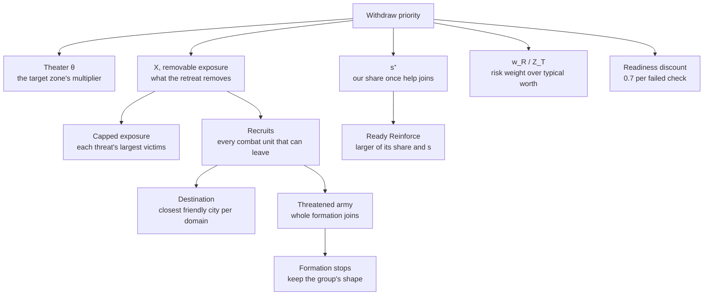

# Unit AI: Withdrawal Priorities

The **Withdraw offer** pulls our combat units at an enemy battlefield back toward the closest friendly city. It competes with fights and Reinforce on the same priority scale, loses ties to both, and exists at enemy battlefields with at least one endangered recruit. Own-city battlefields have no Withdraw. When a threatened prepared army is among the recruits, the same offer becomes a **formation Withdraw** and retreats the group with the army's formation rules.

A fight and a Withdraw count different exposure pools. The fight counts its target's exposure at `s`, the share its own strength can protect. The Withdraw counts `X`, the exposure a retreat removes across all recruits, and scales it by `1 − s⁺`. Either offer can rank first.

| Stage | What it supplies | Reference |
| --- | --- | --- |
| Recruit | The target's victims, the local strength set, combat units sharing their tiles, and a threatened prepared army's members. | [Withdraw recruits](recruitment.md#withdraw-recruits) |
| Score | `X`, `s⁺` and priority. Rescored after every command and whenever Reinforce changes. | `EstimateWithdraw` in `civ5-dll/CvGameCoreDLL_Expansion2/CvTacticalOperationalLoop.cpp`. |
| Search | The retreat weights in the plot score, the search purpose and the path step. | [Withdraw search](#withdraw-search) |
| Check and execute | Destinations, the march rule, admission and path moves. | [Readiness and execution](#readiness-and-execution) |

| Part | Fight | Reinforce | Withdraw |
| --- | --- | --- | --- |
| Priority | `θ × stake` | `θ × stake × swing` | `θ × w_R × X / Z_T × (1 − s⁺) × 0.7^n` |
| Strength share | `s` inside the exposure term | Swing from the share | `1 − s⁺` over its own removable exposure `X` |
| Units | Local set | Incoming selection | Every combat unit at the battlefield that can leave, plus a threatened prepared army's members |
| Direction | At the center | Toward the center | Toward a friendly city |

## Shared values and scales

| Symbol | Meaning | Scale or range |
| --- | --- | --- |
| `X` (**removable exposure**) | The exposure the retreat removes, from [removable exposure](#removable-exposure). | Worth, at least 0; divided by `Z_T` in the priority. |
| `s` (**strength share**) | The fight's share of fighting power at the battlefield, from [strength share](value.md#strength-share). | 0 to 1; 0.5 at parity. |
| `s⁺` | The larger of the fight's share `s` and the Reinforce's projected share `s_h` ([swing](reinforcement.md#swing)) while a positive Reinforce selection is ready; the fight's `s` otherwise. A released pool's lower Reinforce start does not enter. Stored as `fWithdrawShare`, so a ready Reinforce never raises the Withdraw priority. | 0 to 1. |
| `w_R` | Risk weight, setting `weight.risk` (1) at neutral. | 0.5 to 2. |
| `Z_T` | Typical unit worth. | Worth, fixed for the turn. |
| `θ` | The zone's current [theater multiplier](value.md#theater-multiplier). Unit battlefields read their zone city. | Theater floor (0.2) to 1. |
| **Capped exposure** | A threat's largest allocations to a set of victims, up to its attacks per turn. | Worth. |

## Running example inputs

The examples use the [value page's running inputs](value.md#running-example-inputs) unless a row states its own. Results are rounded only for display.

| Input | Value | Source |
| --- | --- | --- |
| Typical unit worth `Z_T` | 400 | Supplied. |
| Risk weight `w_R` | 1 | Neutral RISK. |
| Cityless theater `θ` | 0.2 | Setting `floor.theater`; no city in the zone. |
| Archer worth, maximum HP | 400, 100 | Supplied. |
| Value at risk, 30 danger on a full-health archer | `400 × 0.4 (health share) × 30/100 / 400 = 0.12` | [Exposure](value.md#exposure). |
| Value at risk, lethal danger on an archer at 30 HP | `400 × (0.6 (retained share) + 0.4 × 30/100) / 400 = 0.72` | [Exposure](value.md#exposure). |
| Gates | Open | Supplied. |

## Withdraw priority

**Rule: the exposure the retreat removes, times the part that our strength and ready help do not cover.**

`priority = θ × w_R × X / Z_T × (1 − s⁺) × 0.7^n`

| Part | Reads as |
| --- | --- |
| `θ × w_R / Z_T` | The theater, risk weight and scale the fight uses, so both offers share one priority scale. |
| `X / Z_T` | The net exposure the group saves, in typical units. |
| `1 − s⁺` | The part our strength cannot protect. When the enemy has triple our strength and no help is coming, it is 0.9; when help brings parity, it is 0.5. A lower projection leaves the fight's share in place, so help never raises the priority. |
| `0.7^n` | Discount for the offer's `n` failed readiness checks this turn: full priority before any failure, 70% after one, and 49% after two. |

| Gate | Rule |
| --- | --- |
| Own city | No offer. An own-city battlefield keeps an inactive Withdraw slot with estimate 0. |
| No endangered recruit | At least one endangered recruit is required. Healthy recruits can also add to removable exposure and take part in the retreat. |
| No destination | A domain with recruits but no friendly city in reach gets −1; its recruits leave the estimate at [readiness](#readiness-and-execution). |
| Setting `withdraw.enabled` (1) | 0 turns every Withdraw offer off and keeps its slot inactive all turn. |

## Removable exposure

**Removable exposure** `X` is the net reduction in danger attributed to known enemies. The opening estimate omits the recruits' current exposure without finding paths. Readiness compares holding the current plots with taking the legal first-turn stops. A unit without a stop stays where it is. Execution repeats the comparison if admission changes the group.

`X = max(0, Σ (capped exposure while holding − capped exposure after the moves))`

Known direct hits on a shared tile go to the defender the game would choose. Area damage still reaches the other units on that tile. An embarked swordsman can take area damage while a warship escorts it, and can take the direct hit if the warship leaves. Units on other tiles keep their claims on the same attacker's limited attacks.

Worth appears in the allocation cells and in the `X` (worth) column; the last column divides it by `Z_T`.

| Part | Reads as |
| --- | --- |
| Holding | The threat's recorded `fExposure`, already capped at its attacks per turn. |
| After moving | The same cap applied to the projected occupants of affected tiles and the unchanged victims. |
| Formation Withdraw | The comparison covers the whole occupied board, so an attack that moves to a stayer or to a neighbor is priced, and `X` can fall even when the recruits themselves leave danger. |
| Unattributed danger | Fog, terrain and improvement damage belongs to no threat and stays out of `X`. |
| Overlapping battlefields | Two Withdraws can count the same exposure initially. The higher estimate is checked first and can drop below the other after projection. A unit that moves or dies is excluded from later Withdraws that turn. |

| Threat | Example opening allocations | `X` (worth) | `X / Z_T` |
| --- | --- | --- | --- |
| 1-attack knight | Archer at `0.72` (worth 288) that is not a recruit; spearman at `0.10` (worth 40) that is. The cap keeps the archer's 288; the stayer keeps 288. | 0 | 0 |
| 1-attack knight | Archer at `0.72` (288) is a recruit; spearman at `0.10` (40) stays. Stays: 40. | `288 − 40 = 248` | `0.72 − 0.10 = 0.62` |
| 2-attack swordsman | Two recruits at `0.12` (48) each and a stayer at `0.30` (120). All victims keep `120 + 48 = 168`; the stayer keeps 120. | `168 − 120 = 48` | `0.42 − 0.30 = 0.12` |
| Two threats | Each counts separately, so both appear in the sum even when they hit the same recruit. | Sum of both | Sum of both |

## Recruits

A **recruit** is every combat unit of ours at the battlefield that can still leave; [Withdraw recruits](recruitment.md#withdraw-recruits) lists the source and eligibility rules. The [gates](#withdraw-priority) require at least one endangered recruit.

A recruit's value at risk is its contribution to `X` only when no staying victim takes its place under the attack cap.

| Unit at a knight's battlefield | Recruit? | Its value at risk |
| --- | --- | --- |
| Archer at 30 HP that the knight can hit for 40 | Yes | Its 0.72 |
| Full-health spearman 2 plots away that nothing reaches | Yes, it leaves with the others | 0 |
| Crossbow 4 plots from the knight, within its own strike reach of it, that only an enemy catapult reaches | Yes | Its share of the catapult's capped exposure |
| Spearman covering our worker | Yes; the worker stays | Its own exposure |
| Archer that fired and has no movement left | No | 0 |
| Swordsman inside our city | No: the city holds it | 0 |
| Unit that already withdrew this turn | No | 0 |
| Member of a prepared army the knight threatens | Yes: its whole living formation joins and the offer becomes a [formation Withdraw](#formation-retreat) | Its own exposure |
| Member of a prepared army that is not threatened here | No | 0 |
| Army member inside a friendly city | No: the city holds it | 0 |

An army is threatened at a battlefield when one of its members is a victim in the Fight threat layout there. The Withdraw layout leaves enrolled members out, so `GatherWithdrawRecruits` reads the threat from the Fight layout and the independent recruiting pool from the Withdraw layout.

## Destination

`WithdrawDestination` searches for friendly cities within recruit range, separately for land and sea. It is computed in `CheckWithdraw` and stored in `aiWithdrawDestination`: index 0 for land, 1 for sea, −1 when unset.

| Rule | Detail |
| --- | --- |
| Start | The battlefield plot when it suits the domain; otherwise the domain's first endangered recruit, or its first recruit when none is endangered. |
| Friendly | A same-team city, a city whose team grants us open borders, or a city-state whose territory we have permission to enter, for example through friendship. The first two also qualify for the search's friendly-city bonus. |
| Domain | Land and sea get one destination each. A sea destination must be a coastal city that the naval flood reaches. |
| Ranking | Shortest path, with one step added for a city that grants territory access but does not qualify for the friendly-city bonus. Equal scores prefer a city with the bonus, then the lower plot index. |
| Missing | A domain with no reached friendly city gets −1. |

**Example.** Our border city is seven path steps away. A city-state that grants access through friendship wins if it is five steps away. At six steps, our border city wins because the search recognizes it as shelter.

## Withdraw search

Each destination gets one search with the purpose `Withdraw`. Land and sea recruits heading for the same port search together. The retreat objective sits in the plot score, the value that orders candidate moves and replaces each unit's provisional score in a completed plan. The search passes `bTargetDistanceRelevant = false` so the pull home becomes a scored term and units can step sideways. The constants are named `TACTICAL_WITHDRAW_*` in `CvTacticalAI.cpp`.

The search covers plots within 5 steps of the destination, within 2 of enemies found there and within 1 of each unit. A candidate plot more than 6 path steps from the destination, or outside that set, is skipped, so a unit with no candidate left gets no search move and is left to the path step.

### Weights

Score points, with the tenfold weight on damage and bonuses applied.

| Term | Fight search | Withdraw search | Why |
| --- | --- | --- | --- |
| Enemy distance at 1 / 2 / 3 / 4 or more plots | Peaks at 120 on the unit's own line. | First line `0 / 80 / 120 / 120`; every other line `0 / 30 / 80 / 120`. Plain distance for land and sea, with no line-of-sight filter. | The first line gains most from breaking contact and nothing beyond three plots. Other units, which the search treats as the third line here, keep gaining out to four plots. |
| Destination distance | Exploration only, 40 per step beyond four plots. | `−w × min(max(steps − 2, 0), 12)` in the plot score, at most 360 for the first line and 480 for other lines. An unreachable plot or a missing target counts as 12. | The pull counts in the final ranking, lets a unit step sideways out of danger, and stops pulling within two plots. The weaker first-line pull keeps the first line behind the others, on the enemy side. |
| Flat 120 below minimum HP and for explorers | Applies. | Off. | It removes any reason for a wounded unit to move away. |
| Flat 120 inside a friendly city | Applies. | Applies while the position has visible enemies. Without enemies the native escort table scores the plot as in a fight search. | The city is the sanctuary. |
| Skirmisher +30 at one plot, melee +50 beside a nearly dead city | Applies. | Off. | Both pull units back in. |
| An attack that does not kill or capture | 10 per HP dealt, focus bonus up to 250. | `3/10` of the damage and of the focus bonus separately, each rounded down before the tenfold scale: 25 damage is 7, or 70 points; 25 damage plus a 25 focus bonus is 7 + 7, or 140 points. | A parting shot is worth less than two steps of retreat. |
| An attack that kills or captures | Full. | Full. | A kill removes a threat. |
| Damage taken | −10 per HP. | −10 per HP. | A melee trade now needs better than three to one. |
| Healing in place | 10 per HP. | 10 per HP on a plot with zero danger; on a plot with danger, half that, rounded down. | A unit that reached safety may stop and heal. A threatened unit gets too little to beat a real retreat. |
| Aggression level | From RISK. | Capped at Low. | No risky melee. |
| Progress test | Units reached their line distance. | A kill, a ranged or melee attack, a heal, or a positive sum of [positioning changes](../simulation/scoring.md#completed-plan-score). | Gains include danger, enemy distance and the pull home. A retreat can lose as much as it gains if it exposes a nearby friendly. |
| Turn-end danger, isolation doubling, cover, adjacent friend, terrain, frontline city, home ground, moves left, trade, captures, camps, citadels, pillage | As today. | Unchanged. | Kept out to limit the change. |

In a Withdraw, a unit with a legal shot still gets the staying and healing candidates, so it may fire or stay and heal.

### Enemy distance

Distance 0 reads as 1, so a plot with an enemy on it scores as 1. The first row applies to a unit whose assigned movement strategy is the first line (`MS_FIRSTLINE`). Every other unit uses the other row, including ranged, siege and wounded melee units and a skirmisher the fight search would call first line.

| Line | 1 plot | 2 plots | 3 plots | 4 or more |
| --- | --- | --- | --- | --- |
| First line | 0 | 80 | 120 | 120 |
| Other lines | 0 | 30 | 80 | 120 |

### Destination term

`penalty = w × min(max(steps − 2, 0), 12)`

| Part | Reads as |
| --- | --- |
| `steps` | Path length to the destination from `GetPlotDistanceToTarget`. An unreachable plot or a missing target reads as 12. |
| `steps − 2` | The first two steps are free, which matches the ring-2 arrival of the path step. |
| `w` | 30 for the first line, 40 for other lines, so the 12-step cap is worth 360 or 480. |

The penalty is subtracted, so a plot closer to the city ranks higher.

### Worked examples

Units are not alone, mapped flavors are neutral, and enemies stand off our land. The Withdraw kind row sets RISK to 30 (50 − 20), so the danger penalty is about 1.32 times the scaled danger, and ATTRITION to 40 (50 − 10), so unit damage scores 0.871 times its HP. Smaller terms are ignored.

| Case | Stay | Retreat | Chosen |
| --- | --- | --- | --- |
| Archer at 60 HP, danger 30 (penalty 66), enemy adjacent, healthy target | Shoot 25: `22 (25 × 0.871) × 3/10 = 6` HP, 60 points | 2 steps to zero danger, enemy distance 1 to 3: `66 danger removed + 80 destination + 80 distance = 226` | Retreat |
| Same, target at 30 HP | `22 × 3/10 = 6` damage and `25 × 3/10 = 7` focus, 130 points | 226 | Retreat |
| Same, target at 25 HP, the shot kills | `220 damage + 250 focus + 130 kill (15 × 0.871) = 600` | 226 | Kill |
| Swordsman at 100 HP, danger 20 (penalty 26), adjacent | Deal 30, take 20: `70 (26 (30 × 0.871) × 3/10) − 200 = −130` | 2 steps, enemy distance 1 to 3: `26 danger removed + 60 destination + 120 distance = 206` | Retreat |
| Same swordsman already 3 plots from the enemy, no danger | 0 | 2 more steps: `60`; the archer beside it gains `80 destination + 40 distance = 120` | Both move; the archer goes first when plots or movement are short |
| Spearman at 70 HP on a zero-danger plot, 6 steps from the city, no enemy within 4 plots | Heal 10: `100` | Walk 2 steps: `60` | Heal |
| Wounded archer at 40 HP, danger 30, every other plot unreachable or more dangerous | Heal 10 with danger: `50` | None available | Heal in place |
| Same archer with a route to zero danger | Heal 10 with danger: `50` | `99 danger removed + 80 destination + 80 distance = 259` | Retreat |

### Path step after the search

After a successful search, a recruit the search used stays where it is when its plot has no danger, which keeps a chosen safe heal. The path step marches the rest: recruits the search did not use, and used recruits still on a plot with danger. After a failed search it marches every eligible recruit, as before.

## Formation retreat

A Withdraw becomes a **formation Withdraw** as soon as one recruit belongs to a prepared army. `GatherWithdrawRecruits` then adds every living member of each threatened army to the candidates, and `GetWithdrawStops` plans the group with the formation's route and stacking rules.

| Step | Formation Withdraw |
| --- | --- |
| Recruits | A threatened prepared army's members join. The usual filters still apply: the member must be able to move, outside a friendly city, not a held garrison and not already withdrawn. |
| Order | Stops are planned lowest health share first, civilians last. |
| Stop | `CanMarch` supplies the first-turn candidate, then `FormationPathStop` walks it back along the last path until the group keeps its shape. The stop must also fit the native stacking limit, and an embarked member must stop on water. |
| Danger | `WithdrawStopDanger` reads the plot's projected occupants, including the group's own arrivals. A stop above the first-stop danger limit is rejected while it is at least as dangerous as holding or at least as dangerous as the member's current hit points. |
| Exposure | `ExposureSaved` compares the whole occupied board when the formation projects stops. A retreat that exposes a neighbor is priced. |
| Search | The group searches under the `Withdraw` purpose with target distance off and aggression capped at Low. |
| After moving | A moved member is marked processed and keeps its stop for the rest of the turn. It also joins `turn.withdrawnUnits`. |
| Admission | The native default keeps the checked group. If the provider omits members, `GetWithdrawStops` re-plans the remaining detachment and the omitted members hold. |

The first-stop danger limit is half the member's current hit points for an attacking non-siege unit, and 0 otherwise. That is the same limit a fight's march uses.

## Readiness and execution

`CheckWithdraw` finds a city for each recruit domain and compares holding with the first-turn stops it can reach. It issues no orders. A host using a permitted objective menu can request a Withdraw directly, so the check also guards against a disabled Withdraw or an own-city battlefield.

| Result | Condition |
| --- | --- |
| Target gone | The target plot is missing. |
| No recruits | No units qualify, Withdrawal is disabled, or the battlefield is our city. |
| No reachable | The checked group cannot save enough exposure to get a positive priority. This uses a readiness failure. |
| Reduced | The comparison lowers the priority but leaves it positive. The offer returns to the queue without a failure. |
| Passed | The projected moves save exposure and the priority has not fallen. |

A failed check adds one failure and makes the offer inactive, or skipped at `readiness.maxFailures` (3). A later re-estimation can return an inactive offer to ready. It recalculates the priority from the current board and applies the accumulated failure discount, so a fight that opens a route can still enable a retreat. A reduced check counts no failure.

**March rule.** From farther away, a retreat aims within two tiles of the city. From two tiles away it aims within one; from one tile away it aims for the city. Readiness and the path step use the same rule. The first stop must advance and stay within native's danger limit, or have danger below both the current plot's danger and the unit's hit points. A formation Withdraw replaces the per-unit ring target with the group's [checked formation stops](#formation-retreat) and the danger comparison above.

`ExecuteMarch` admits and scores the whole group before it issues a move. An unchanged group keeps the checked score. If the provider leaves units out, it scores them where they stand; an empty group records zero. Withdraw then follows the Reinforce path with these differences:

| # | Deviation | Why |
| --- | --- | --- |
| 1 | Admit from the checked recruits. Temporarily clear any processed flag that would prevent a recruit from using its remaining movement. Restore the saved flags when the command ends. | A recruit without a legal first stop stays put. Processing gained during execution stays. |
| 2 | No spotter move. | The destination is friendly territory. |
| 3 | After the search, send every recruit that was not processed, or is still on its starting plot with movement left, but after a successful search leave a recruit the search used on a plot with no danger where it is. | The search now plans the retreat. The path step still moves recruits the search did not reach and rescues anyone it left exposed, and a chosen heal in safety stands. |
| 4 | Order path moves by lowest health share first, civilians last. | Damaged units get the first chance to march. The search keeps its own order. |
| 5 | Use the [march rule](#readiness-and-execution). | A retreat may accept a stop that native refuses while staying is worse. |
| 6 | A formation replays each checked stop exactly with the March flags, and re-plans the remaining detachment after an admission subset. | Members keep the group's shape, and an omitted member holds instead of taking a new single-unit route. |

Admitted units headed to the same city share one search, even when they come from different domains. If land units head inland and ships head for a port, each city gets its own search. Every search uses the `Withdraw` purpose with target distance off and aggression capped at Low. The command merges their attempts and movement into one [record](reference.md#records).

## Closing the battlefield

A non-refused Withdraw adds the selected units that left their plot or died to `turn.withdrawnUnits`; a formation member that moved is also marked processed. A recruit that stayed put can join a later Withdraw at another battlefield.

| Event | Effect on this battlefield | Other battlefields |
| --- | --- | --- |
| Withdraw moved or lost a unit | Its open fight and Reinforce retire. | No direct retirement. |
| Withdraw moved nobody | Its fight and Reinforce stay open; the Withdraw itself is executed. | No direct retirement. |
| Reinforce executed and moved a unit | Its open Withdraw retires, unless the battlefield is our city or `withdraw.enabled` is 0. | Open Reinforce offers at the enemy battlefields counted in its strength estimate retire. Our cities' offers are exempt. |
| Either offer refused | The other offers stay as they were. | Unchanged. |

A Withdraw that moved or lost a unit retires only its own battlefield's fight and Reinforce. Fights at other targets, including the own-city fight of the same zone, are not retired directly and can still attack this enemy. This closure happens immediately after the command, before threats are rebuilt. The next re-estimation rebuilds threats and scores every open offer, so another fight drops when the Withdraw search killed its target, and any priority can still change.

## Native withdraw

Native runs `PlotWithdrawMoves` and `ExecuteWithdrawMoves` for a zone in the **Withdraw posture**, with no search. The command and the posture share a name but differ in scope.

| Topic | Native | Loop Withdraw |
| --- | --- | --- |
| Trigger | The zone posture. | A priority from endangered recruits. |
| Who | Roster units in the zone, minus healthy units fresh from an operation, and in non-friendly zones citadels and quiet plots of our territory. A garrison leaves only if its city is about to fall. | Combat-unit recruits as above; garrisons and units in cities stay. |
| Escorts | No rule: a unit covering a civilian leaves like the others. | The same. |
| Order | Ranged first, then slower units, melee last. | The search's order, then damaged units first in the path step. |
| Destination | Per unit: the neighboring zone with the best hospitality score divided by travel turns plus one, aiming at its center; without one, a minor civilization heads for its capital and a major for its closest city by path length. | One per domain: the closest friendly city by path. |
| Move | A safe path near the target, else the safest plot in reach. | The search, then path moves; `ExecuteMoveToPlot` falls back to the safest plot in reach when the path aborts. |

## Example situations

### A. One archer, one knight

An archer at 30 HP faces lethal danger from a full-health 1-attack knight worth 700. Local damage on the knight is 50, so destruction is `700 × 0.4 (health share) × 50/100 / 400 = 0.35` and the archer's exposure is 0.72.

| Our strength vs enemy | `s` | Fight `0.2 × (0.35 + 0.72 × s)` | Withdraw `0.2 × 0.72 × (1 − s)` | Runs first |
| --- | --- | --- | --- | --- |
| One third | 0.1 | `0.2 × (0.35 + 0.072) = 0.084` | `0.2 × 0.72 × 0.9 = 0.130` | Withdraw |
| Equal | 0.5 | `0.2 × (0.35 + 0.36) = 0.142` | `0.2 × 0.72 × 0.5 = 0.072` | Fight |
| Triple | 0.9 | `0.2 × (0.35 + 0.648) = 0.200` | `0.2 × 0.72 × 0.1 = 0.014` | Fight |
| One third, local units can also kill the knight | 0.1 | `0.2 × (1.75 (kill) + 0.072) = 0.364` | 0.130 | Fight: the kill removes the danger |

### B. Three archers, three swordsmen

Each 1-attack swordsman worth 600 threatens one archer, and all three archers are in the selected swordsman's local strength set. Local damage on the target swordsman is 50, so destruction is `600 × 0.4 × 50/100 / 400 = 0.30`. The fight counts one threatened archer (`E_t = 48` worth, or `E_t / Z_T = 0.12`); the Withdraw counts all three: `X = 3 × 48 = 144` worth, or `X / Z_T = 0.36`.

| Case | `s` | Fight at one swordsman | Withdraw at that swordsman | Runs first |
| --- | --- | --- | --- | --- |
| Full-health archers, 30 danger each, enemy triple | 0.1 | `0.2 × (0.30 + 0.12 × 0.1) = 0.0624` | `0.2 × 0.36 × 0.9 = 0.0648` | Withdraw, by 0.0024 |
| Same, equal strength | 0.5 | `0.2 × (0.30 + 0.06) = 0.072` | `0.2 × 0.36 × 0.5 = 0.036` | Fight |
| Archers at 30 HP, lethal, enemy triple | 0.1 | `0.2 × (0.30 + 0.72 × 0.1) = 0.074` | `0.2 × 3 × 0.72 × 0.9 = 0.389` | Withdraw, well ahead |
| Lethal, equal strength | 0.5 | `0.2 × (0.30 + 0.36) = 0.132` | `0.2 × 2.16 × 0.5 = 0.216` | Withdraw |
| Lethal, enemy triple, a ready Reinforce brings parity (`s⁺ = 0.5`) | 0.1 | 0.074 | `0.2 × 2.16 × 0.5 = 0.216` | Withdraw, lower than without help |
| Lethal, enemy triple, two archers already fired and have no movement left | 0.1 | 0.074 | `0.2 × 1 × 0.72 × 0.9 = 0.130` | Withdraw, too late for those two |
| Lethal, enemy triple, two archers were processed earlier but still have movement left | 0.1 | 0.074 | 0.389 | Withdraw; all three qualify, and the search and paths decide which move |
| No archer is threatened | | `0.2 × 0.30 = 0.060` | 0, inactive | Fight |

### C. Enemy city

At an enemy city `s` is the pressure `p` of the city's theater. Our hits do not beat the city's heal in the first row, and the city deals 30 to one full-health archer, so `X / Z_T = E_c / Z_T = 0.12`.

| Case | `θ` | `s` | Fight | Withdraw | Runs first |
| --- | --- | --- | --- | --- | --- |
| City (20), full health, we have two thirds of its strength; our hits do not beat its heal; it deals 30 to one full-health archer | `0.2 + 0.8 × 0.5 (i) × 0.307692 (p) = 0.323077` | 0.307692 | `0.323077 × 0.12 × 0.307692 = 0.012` | `0.323077 × 0.12 × 0.692308 = 0.027` | Withdraw ranks first |
| Large city (45) at half health, equal strength, 50 local damage (progress 0.72), same archer | 0.8 | 0.5 | `0.8 × (0.72 + 0.12 × 0.5) = 0.624` | `0.8 × 0.12 × 0.5 = 0.048` | Fight: the siege keeps nearly its whole priority |

### D. Our city

An own-city battlefield has no Withdraw. Its fight uses the same split, so the exposure part halves at equal strength while city danger keeps its full value. At our capital at 200 of 250 HP with danger 80, `C × f_def = 1.2`; three threatened archers give `E_def / Z_T = 117.12 / 400 = 0.2928` ([decay example](value.md#city-defense-exposure)). The stake is `1.2 + 0.2928 × 0.5 = 1.3464` at parity, and `1.2 + 0.2928 × 0.1 = 1.22928` when the enemy has triple our strength.

The city's own priority is `0.68 (θ) × 1.3464 (stake) = 0.915552 ≈ 0.916` at parity. A nearby fight that kills a full-health knight worth 700 adds a destruction term of `700/400 = 1.75` typical units, scoring `0.68 × 1.75 = 1.19` at the same `θ` when the fight's other terms are zero, so the kill can outrank the city.

## Ordering against fights

- A Withdraw loses ties to every fight and to Reinforce.
- A fight that can kill or capture keeps most of its rank; the split lowers only its exposure part. Example A's last row and example C's second row show this.
- The fight counts its target's exposure at `s`, while the Withdraw counts `X` over all recruits and weights it by `1 − s⁺`. The pools can differ in either direction: a larger recruit group or a smaller covered share raises the Withdraw, while a kill, capture or a target the fight can protect raises the fight. Examples A and B show each offer winning.
- A ready Reinforce can lower the Withdraw through `s⁺`, which is the larger of the fight's share and the Reinforce's projected share. Help that is already coming makes an immediate retreat less urgent, but a projected share below the fight's share changes nothing.
