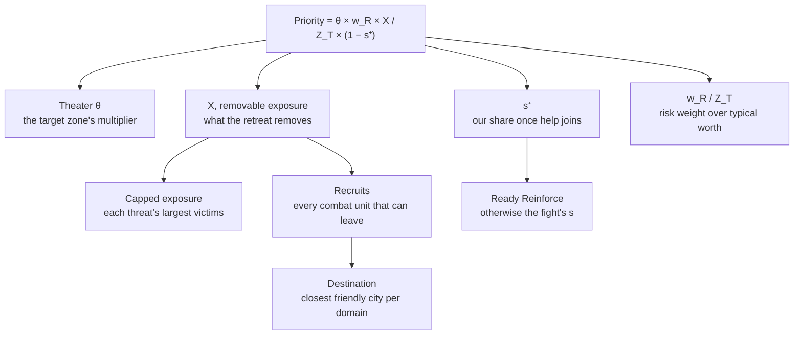

# Unit AI: Withdrawal Priorities

The **Withdraw offer** pulls our combat units at an enemy battlefield back toward the closest friendly city. It loses ties to fights and Reinforce, and it exists only where local units are losing ground. Own-city battlefields have no Withdraw.

The offer completes the exposure split introduced in [strength share](value.md#strength-share): each fight counts the exposure its own strength can protect, and the Withdraw competes for the rest.

| Stage | What it supplies | Reference |
| --- | --- | --- |
| Recruit | The target's victims, the local strength set and each recruit's danger. | [Withdraw recruits](recruitment.md#withdraw-recruits) |
| Score | `X`, `s⁺` and priority. Rescored after every command and whenever Reinforce changes. | `EstimateWithdraw` in `civ5-dll/CvGameCoreDLL_Expansion2/CvTacticalOperationalLoop.cpp`. |
| Check and execute | Destinations, the march rule, admission and path moves. | [Withdraw readiness](execution.md#withdraw-readiness) |

| Part | Fight | Reinforce | Withdraw |
| --- | --- | --- | --- |
| Priority | `θ × stake` | `θ × stake × swing` | `θ × w_R × X / Z_T × (1 − s⁺)` |
| Strength share | `s` inside the exposure term | Swing from the share | `1 − s⁺`, what help does not cover |
| Units | Local set | Incoming selection | Every combat unit at the battlefield that can leave |
| Direction | At the center | Toward the center | Toward a friendly city |

## Shared values and scales

| Symbol | Meaning | Scale or range |
| --- | --- | --- |
| `X` (**removable exposure**) | The exposure the retreat removes, from [removable exposure](#removable-exposure). | Worth, at least 0; divided by `Z_T` in the priority. |
| `s` (**strength share**) | The fight's share of fighting power at the battlefield, from [strength share](value.md#strength-share). | 0 to 1; 0.5 at parity. |
| `s⁺` | `s` once Reinforce help joins, or `s` when no help is ready. Reads `reinforce.fShareWithHelp` while a positive Reinforce selection is ready, and is stored as `fWithdrawShare`. | 0 to 1. |
| `w_R` | Risk weight, setting `weight.risk` (1) at neutral. | 0.5 to 2. |
| `Z_T` | Typical unit worth. | Worth, fixed for the turn. |
| `θ` | The zone's current [theater multiplier](value.md#theater-multiplier). Unit battlefields read their zone city. | Theater floor (0.2) to 1. |
| **Capped exposure** | A threat's largest allocations to a set of victims, up to its attacks per turn. | Worth. |

## Running example inputs

The examples use the [value page's running inputs](value.md#running-example-inputs) unless a row states its own. Results are rounded only for display.

| Input | Value | Source |
| --- | --- | --- |
| Typical unit worth `Z_T` | 400 | Supplied. |
| Risk weight `w_R` | 1 | Neutral RISK. |
| Cityless theater `θ` | 0.2 | Setting `floor.theater`; no city in the zone. |
| Archer worth, maximum HP | 400, 100 | Supplied. |
| Value at risk, 30 danger on a full-health archer | `400 × 0.4 (health share) × 30/100 / 400 = 0.12` | [Exposure](value.md#exposure). |
| Value at risk, lethal danger on an archer at 30 HP | `400 × (0.6 (retained share) + 0.4 × 30/100) / 400 = 0.72` | [Exposure](value.md#exposure). |
| Gates | Open | Supplied. |

## Withdraw priority

**Rule: the exposure the retreat removes, times the part of the strength share that help does not cover.**

`priority = θ × w_R × X / Z_T × (1 − s⁺)`

| Part | Reads as |
| --- | --- |
| `θ × w_R / Z_T` | The same theater, risk weight and scale the fight uses, so a Withdraw and a fight at one battlefield are directly comparable. |
| `X / Z_T` | The exposure the whole recruit group takes with it, in typical units. |
| `1 − s⁺` | The part our strength cannot protect. When the enemy has triple our strength and no help is coming, it is 0.9; when help brings parity, it is 0.5. |

| Gate | Rule |
| --- | --- |
| Own city | No offer. An own-city battlefield keeps an inactive Withdraw slot with estimate 0. |
| No endangered recruit | Priority 0. Healthy recruits still leave once any one recruit is in danger. |
| No destination | A domain with recruits but no friendly city in reach adds no destination. A check with no destination for any recruit returns no recruits. |
| Setting `withdraw.enabled` (1) | 0 turns every Withdraw offer off. |

## Removable exposure

**Removable exposure** `X` is what each threat loses when the recruits leave. For every threat that reaches at least one recruit:

`X = Σ (capped exposure over all victims − capped exposure over the victims that stay)`

| Part | Reads as |
| --- | --- |
| All victims | The threat's recorded `fExposure`, already capped at its attacks per turn. |
| Victims that stay | The same cap applied after the recruits are removed. A threat with more attacks than staying victims keeps only what it can still hit. |
| Threats with no recruit | Add nothing. |
| Unattributed danger | Fog, terrain and improvement damage belongs to no threat and stays out of `X`. |
| Overlapping battlefields | Two Withdraws can count the same `X` once each. The higher one runs first, and its moved or lost units are then excluded from every later Withdraw that turn, so a lower one can take only what remains. |

| Threat | Victims and allocations | `X` |
| --- | --- | --- |
| 1-attack knight | Archer at 0.72 that is not a recruit; spearman at 0.10 that is. All victims keep 0.72; the stayer keeps 0.72. | 0 |
| 1-attack knight | Archer at 0.72 is a recruit; spearman at 0.10 stays. Stays: 0.10. | `0.72 − 0.10 = 0.62` |
| 2-attack swordsman | Two recruits at 0.12 each and a stayer at 0.30. All victims keep `0.30 + 0.12 = 0.42`; the stayer keeps 0.30. | `0.42 − 0.30 = 0.12`, the second attack's only remaining victim |
| Two threats | Each counts separately, so both appear in the sum even when they hit the same recruit. | Sum of both |

## Recruits

A **recruit** is every combat unit of ours at the battlefield that can still leave. Endangered units set the priority; they are not the only ones that go.

| Condition | Rule |
| --- | --- |
| Source set | The target's victim list plus the [local strength set](recruitment.md#battlefield-estimate). At an enemy city, the garrison's victims too. |
| Roster | On the tactical roster when the loop started, since processed units leave the live roster. |
| State | Ours, alive, a land or sea combat unit, outside an army, with movement left. |
| Place | Outside a friendly city and not a held garrison. |
| Repeat | Not already moved or lost in a Withdraw this turn. |
| Own city | None. |

| Unit at a knight's battlefield | Recruit? | Adds to `X` |
| --- | --- | --- |
| Archer at 30 HP that the knight can hit for 40 | Yes | Its 0.72 |
| Full-health spearman 2 plots away that nothing reaches | Yes, it leaves with the others | 0 |
| Crossbow 4 plots away that only an enemy catapult reaches | Yes | What the catapult loses by its leaving |
| Spearman covering our worker | Yes; the worker stays | Its own exposure |
| Archer that fired and has no movement left | No | 0 |
| Swordsman inside our city | No: the city holds it | 0 |
| Unit that already withdrew this turn | No | 0 |

## Destination

`WithdrawDestination` floods from the battlefield with the recruit range as its limit, in the recruit's domain, and takes the friendly city with the shortest path. When the battlefield plot does not suit the domain, the flood starts from the domain's first endangered recruit, or its first recruit when none is endangered. It is computed in `CheckWithdraw` and stored in `aiWithdrawDestination`: index 0 for land, 1 for sea, −1 when unset.

| Rule | Detail |
| --- | --- |
| Start | The battlefield plot when it suits the domain; otherwise the domain's first endangered recruit, or its first recruit when none is endangered. |
| Friendly | Our city, or a friend's city whose territory our units may enter. |
| Domain | Land and sea get one destination each. A sea destination must be coastal, so it lies on the same body of water. |
| Ties | Lower plot index. |
| Missing | A domain with no reached friendly city gets −1, and recruits of that domain stay out of the command. |

**Example.** A battlefield 5 plots inside enemy land has our border city 7 path steps away and an allied city-state 4 steps away. The Withdraw heads for the city-state.

## Readiness and execution

`CheckWithdraw` finds the destinations and accepts the offer when one endangered recruit can take a first step toward its destination without issuing orders.

| Result | Condition |
| --- | --- |
| Target gone | The target plot is missing. |
| No recruits | No recruit, or no recruit has a destination. |
| No reachable | No endangered recruit with a destination can march toward it, or the path's first stop is the unit's own plot. |
| Reduced | Recruits in a domain without a destination leave the estimate, and a lower estimate returns to the queue. |
| Passed | At least one endangered recruit can march. |

A failed check adds one failure and makes the offer inactive or skipped at `readiness.maxFailures` (3). A Withdraw never waits and never runs forecast readiness.

**March rule.** A path passes when its first-turn stop stays within native's danger limit, or when the stop's danger is below both the current plot's danger and the unit's hit points. Staying is usually worse than that stop, and a lethal stop is still refused.

`ExecuteWithdraw` follows the Reinforce path with these deviations:

| # | Deviation | Why |
| --- | --- | --- |
| 1 | Before admission, clear the processed flag of every recruit. Restore it by ID on every exit, including a refused admission. | A unit an earlier command spent is skipped by admission, the search and the path step, yet it may still have movement left. |
| 2 | No spotter move. | The destination is friendly territory. |
| 3 | After the search, send every recruit that was not processed, or is still on its starting plot with movement left. | The search has no retreat objective and may finish a unit in place. |
| 4 | Order path moves by lowest health share first, civilians last. | Damaged units claim the plots nearest the destination. The search keeps its own order. |
| 5 | Use the [march rule](#readiness-and-execution). | A retreat may accept a stop that native refuses while staying is worse. |

The admitted units split by domain, land first. Each group runs `PositionUnitsAroundTarget` with the Withdraw kind and its destination, which searches and then marches units along paths. The command record notes the selected units and those that changed plot or died.

## Closing the battlefield

A non-refused Withdraw adds the selected units that left their plot or died to `turn.withdrawnUnits`. A recruit that stayed put can join a later Withdraw at another battlefield.

| Event | Effect on this battlefield | Other battlefields |
| --- | --- | --- |
| Withdraw moved or lost a unit | Its open fight and Reinforce retire. | Unchanged. |
| Withdraw moved nobody | Its fight and Reinforce stay open; the Withdraw itself is executed. | Unchanged. |
| Reinforce executed and moved a unit | Its open Withdraw retires. | Unchanged. |
| Either offer refused | The other offers stay as they were. | Unchanged. |

Fights at other targets, including the own-city fight of the same zone, stay open and can still attack this enemy.

## Native withdraw

Native runs `PlotWithdrawMoves` and `ExecuteWithdrawMoves` for a zone in the **Withdraw posture**, with no search. The command and the posture share a name but differ in scope.

| Topic | Native | Loop Withdraw |
| --- | --- | --- |
| Trigger | The zone posture. | A priority from endangered recruits. |
| Who | Roster units in the zone, minus healthy units fresh from an operation, and in non-friendly zones citadels and quiet plots of our territory. A garrison leaves only if its city is about to fall. | Combat-unit recruits as above; garrisons and units in cities stay. |
| Escorts | No rule: a unit covering a civilian leaves like the others. | The same. |
| Order | Ranged first, then slower units, melee last. | The search's order, then damaged units first in the path step. |
| Destination | Per unit: the neighboring zone with the best hospitality score, aiming at its center; fallback the closest own city. | One per domain: the closest friendly city by path. |
| Move | A safe path near the target, else the safest plot in reach. | The search, then path moves; `ExecuteMoveToPlot` falls back to the safest plot in reach when the path aborts. |

## Example situations

### A. One archer, one knight

An archer at 30 HP faces lethal danger from a full-health 1-attack knight worth 700. Local damage on the knight is 50, so destruction is `700 × 0.4 (health share) × 50/100 / 400 = 0.35` and the archer's exposure is 0.72.

| Our strength vs enemy | `s` | Fight `0.2 × (0.35 + 0.72 × s)` | Withdraw `0.2 × 0.72 × (1 − s)` | Runs first |
| --- | --- | --- | --- | --- |
| One third | 0.1 | `0.2 × (0.35 + 0.072) = 0.084` | `0.2 × 0.72 × 0.9 = 0.130` | Withdraw |
| Equal | 0.5 | `0.2 × (0.35 + 0.36) = 0.142` | `0.2 × 0.72 × 0.5 = 0.072` | Fight |
| Triple | 0.9 | `0.2 × (0.35 + 0.648) = 0.200` | `0.2 × 0.72 × 0.1 = 0.014` | Fight |
| One third, local units can also kill the knight | 0.1 | `0.2 × (1.75 (kill) + 0.072) = 0.364` | 0.130 | Fight: the kill removes the danger |

### B. Three archers, three swordsmen

Each 1-attack swordsman worth 600 threatens one archer. Local damage on the target swordsman is 50, so destruction is `600 × 0.4 × 50/100 / 400 = 0.30`. The fight counts one threatened archer (`E_t = 0.12`); the Withdraw counts all three (`X = 0.36`).

| Case | `s` | Fight at one swordsman | Withdraw at that swordsman | Runs first |
| --- | --- | --- | --- | --- |
| Full-health archers, 30 danger each, enemy triple | 0.1 | `0.2 × (0.30 + 0.12 × 0.1) = 0.062` | `0.2 × 0.36 × 0.9 = 0.065` | About equal |
| Same, equal strength | 0.5 | `0.2 × (0.30 + 0.06) = 0.072` | `0.2 × 0.36 × 0.5 = 0.036` | Fight |
| Archers at 30 HP, lethal, enemy triple | 0.1 | `0.2 × (0.30 + 0.72 × 0.1) = 0.074` | `0.2 × 3 × 0.72 × 0.9 = 0.389` | Withdraw, well ahead |
| Lethal, equal strength | 0.5 | `0.2 × (0.30 + 0.36) = 0.132` | `0.2 × 2.16 × 0.5 = 0.216` | Withdraw |
| Lethal, enemy triple, a ready Reinforce brings parity (`s⁺ = 0.5`) | 0.1 | 0.074 | `0.2 × 2.16 × 0.5 = 0.216` | Withdraw, lower than without help |
| Lethal, enemy triple, two archers already fired and have no movement left | 0.1 | 0.074 | `0.2 × 1 × 0.72 × 0.9 = 0.130` | Withdraw, too late for those two |
| Lethal, enemy triple, an earlier fight moved two archers and left them with movement | 0.1 | 0.074 | 0.389 | Withdraw, all three move |
| No recruit in danger | | Unchanged | 0, inactive | Fight |

### C. Enemy city

At an enemy city `s` is the pressure `p` of the city's theater. Our hits do not beat the city's heal in the first row, and the city deals 30 to one full-health archer, so `X / Z_T = E_c / Z_T = 0.12`.

| Case | `θ` | `s` | Fight | Withdraw | Runs first |
| --- | --- | --- | --- | --- | --- |
| City (20), full health, we have two thirds of its strength; our hits do not beat its heal; it deals 30 to one full-health archer | 0.32 | 0.31 | `0.32 × 0.12 × 0.31 = 0.012` | `0.32 × 0.12 × 0.69 = 0.026` | Withdraw: the archer leaves bombard range |
| Large city (45) at half health, equal strength, 50 local damage (progress 0.72), same archer | 0.8 | 0.5 | `0.8 × (0.72 + 0.12 × 0.5) = 0.624` | `0.8 × 0.12 × 0.5 = 0.048` | Fight: the siege keeps nearly its whole priority |

### D. Our city

An own-city battlefield has no Withdraw. Its fight uses the same split, so the exposure part halves at equal strength while city danger keeps its full value. At our capital at 200 of 250 HP with danger 80, `C × f_def = 1.2`; three threatened archers give `E_def / Z_T = 0.293` ([decay example](value.md#city-defense-exposure)). The stake is `1.2 + 0.293 × 0.5 = 1.347` at parity, and `1.2 + 0.029 = 1.229` when the enemy has triple our strength. The city danger term dominates in both, so a threatened city still outranks the fights around it.

## Ordering against fights

- A Withdraw loses ties to every fight and to Reinforce.
- A fight that can kill or capture keeps most of its rank; the split lowers only its exposure part. Example A's last row and example C's second row show this.
- When the fight and the Withdraw count the same exposure, the fight runs first and protects its part. Only an outgunned fight, where `1 − s` is large, gives way to the Withdraw.
- A ready Reinforce lowers the Withdraw through `s⁺`: help that is already coming makes an immediate retreat less urgent.
