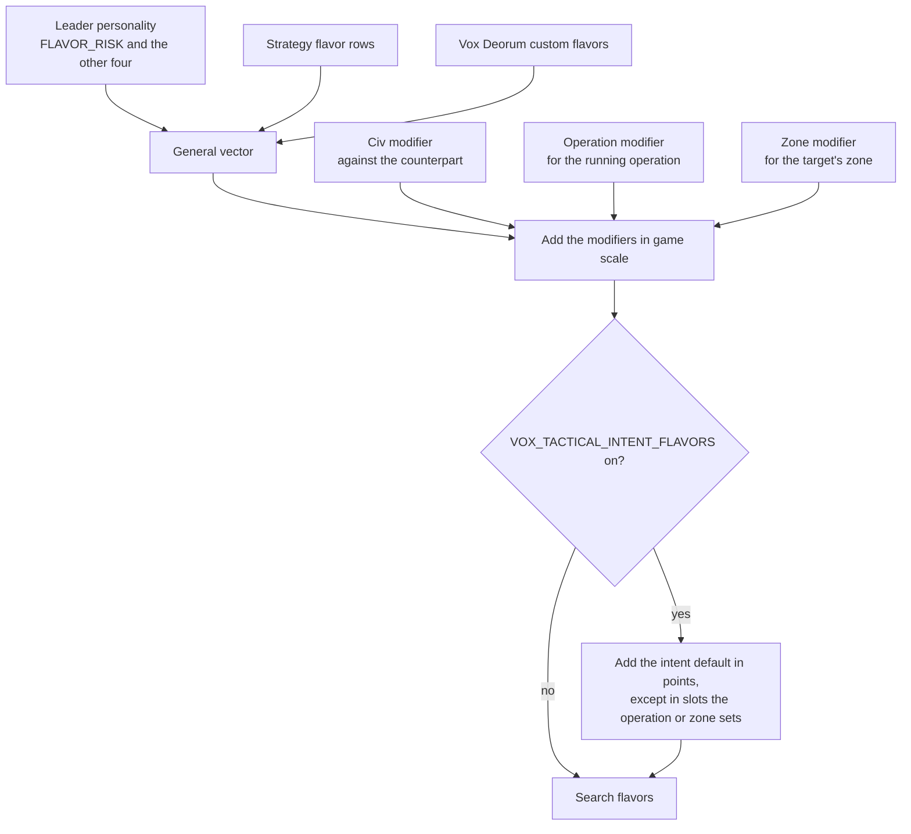

# Unit AI: Military Tactical Flavors

**Military tactical flavors** are five 0 to 100 dials that change how [tactical simulation](../simulation/overview.md) judges a plan. They don't add new moves or remove safety checks. They change how much the search cares about cities, enemy units, its own cities and territory, and danger. As a result, a different plan can win among the moves the search would already consider.

This page is part of the [Unit AI guide](../overview.md). It explains where a search's flavors come from and what they leave unchanged. [Scoring](scoring.md) explains how the flavors change search scores, with the weight curve, RISK thresholds, extreme values, and worked examples.

Every flavor is neutral at 50. A search with all five at 50 and RISK unset keeps stock scoring.

Each search gets its own flavors in three layers:

1. The player's **general vector**, from the leader's personality, the active strategies, and Vox Deorum custom flavors.
2. **Modifiers** set against the civ being fought, for the running operation, or for the target's dominance zone.
3. An optional **intent default** for the kind of search, behind a mod option that is off by default.

The code lives under `civ5-dll/CvGameCoreDLL_Expansion2`:

- `CvTacticalAI.cpp` and `CvTacticalAI.h` hold the `STacticalFlavors` struct, the resolution helpers in `TacticalAIHelpers`, the scoring terms, and the intent table.
- `CvFlavorManager` holds the conversion between the 0 to 100 scale and the game scale.
- `CvMilitaryAI`, `CvAIOperation`, and `CvTacticalAnalysisMap` hold the civ, operation, and zone modifiers.

## The five flavors

| Flavor | Question it answers | Higher value means |
| --- | --- | --- |
| **RISK** | How much danger and loss will we accept? | More risk-taking: fewer HP needed to hold the line, one loss allowed in large groups, less weight on danger, and a more tolerant turn-end HP-versus-danger check |
| **OCCUPATION** | How much do cities matter as targets? | City damage and captures count more |
| **ATTRITION** | How much does damaging enemy units matter? | Unit damage and kills count more |
| **HOLD_CITY** | How much should units guard our threatened cities? | Units hold friendly frontline cities and focus attacks on enemies threatening friendly cities in the search area |
| **HOLD_GROUND** | How much should units hold friendly ground? | Units stand on good ground at home, are pulled less into enemy territory, and value hits on enemies standing on our land |

## Where a search's flavors come from

Both search callers, the coordinated engagement and the ranged opportunity attack, resolve the flavors once through `TacticalAIHelpers::ResolveSearchFlavors` and pass them to every retry. A caller that passes no flavors gets the player's general vector.

### The general vector

`TacticalAIHelpers::GetGeneralTacticalFlavors` builds one value per slot:

| Part | RISK | The other four |
| --- | --- | --- |
| Default | 10 x the leader's `FLAVOR_RISK`, read with the grand strategy applied. A leader without `FLAVOR_RISK` uses its offense instead (see the note after this table). | 50 |
| Strategy change | The active strategies' change to the flavor, applied in game scale | Same |
| Custom flavors | While active, the custom value replaces the default, and the strategy change still applies. A leader without `FLAVOR_RISK` keeps following its offense. | Same |

Vox Deorum's options SQL only adds the five flavor types, and no leader gets a `FLAVOR_RISK` row. When a leader has no `FLAVOR_RISK` (or the database has no such type), the DLL starts RISK from 10 x the leader's offense, read with the grand strategy applied, which is the stock rule (see [RISK thresholds](scoring.md#risk-thresholds)). It reads offense at runtime because the game randomizes each leader's personality flavors at the start: a copy made in SQL would be randomized on its own and drift from the offense the game actually uses. Strategy rows on `FLAVOR_RISK` still move RISK from that start. Leader rows are detected by a nonzero base personality, since the game never randomizes a zero flavor.

A strategy or Vox Populi data row can name one of the five flavors to move it, the same way strategies move any other flavor.

### The game scale

Strategy rows, custom flavors, and modifiers all work in the **game scale**, the signed scale the game uses for flavor changes. `CvFlavorManager` converts with a fixed 101-entry table, `FLAVOR_GAME_SCALE`, which is Vox Deorum's exponential custom flavor mapping: 50 maps to 0, and 0 and 100 map to -300 and +300. Small moves near 50 are fine-grained, and moves near the ends are coarse.

- `FlavorToGameScale` reads the table.
- `FlavorFromGameScale` finds the nearest entry, with ties going toward 50.
- `ShiftFlavor` moves a 0 to 100 value by a game-scale change, so the same change moves a neutral flavor further than one near an end.

| Start | +40 in game scale | -40 in game scale |
| ----- | ----------------- | ----------------- |
| 50    | 71                | 29                |
| 80    | 86                | 72                |

### Modifiers

Modifiers are signed game-scale changes, one per slot. The three scopes add up first, then shift the general vector once.

| Scope | Stored in | Lasts | Set by |
| --- | --- | --- | --- |
| Civ | `CvMilitaryAI`, one row per other player | Saved with the game until changed | Lua: `Player:SetTacticalFlavorModifiers(otherPlayer, { FLAVOR_RISK = 40, ... })`. Listed slots are replaced and others are kept. `Player:GetTacticalFlavorModifiers(otherPlayer)` returns the nonzero slots. |
| Operation | `CvAIOperation` | Saved for the operation's life | C++ producers only |
| Zone | `CvTacticalAnalysisMap`, by zone ID | Until the zones are rebuilt, since zone IDs change then | C++ producers only |

Values are clamped to -1000 to 1000. Reading a player's general vector from Lua goes through `Player:GetCustomFlavors`.

Which modifiers a search picks up:

- **Civ.** The counterpart is the owner of the target's dominance zone if we are at war with it, otherwise the owner of the target plot if we are at war with it. The search applies our row against that counterpart. The lookup runs only while the player has any civ modifier.
- **Operation.** The innermost operation the player is running when the search starts. Operation turns are tracked as they run, so this is the same operation the search reports as its parent.
- **Zone.** The zone that contains the target plot.

### Intent defaults

With the `VOX_TACTICAL_INTENT_FLAVORS` mod option on, each search also adds a default for its **search intent**, the purpose label each caller passes, such as a city assault or a reinforcement move. The defaults are in 0 to 100 points, added after the modifiers and clamped to 0 to 100. The default stands in for an operation or zone that has no say of its own, so in any slot where the operation or zone modifier is set (nonzero), that modifier wins and the slot's intent default is skipped. A civ modifier doesn't do this, since it describes the enemy rather than the kind of fight. The defaults live in one table, `TACTICAL_INTENT_FLAVOR_DEFAULTS` in `CvTacticalAI.cpp`, with one row per intent and one column per flavor. Edit the numbers there. The build fails if a search intent is added without a matching row.

### When RISK counts as set

RISK always sets the [thresholds](scoring.md#risk-thresholds). It also weighs the danger penalty and scales the turn-end safety threshold, but only when it is **set**, meaning something beyond the leader default moved it:

- a strategy or custom flavor changed the general RISK,
- a civ, operation, or zone modifier changes RISK,
- the applied intent default changes RISK, or
- a caller such as the simulator pins RISK.

Without this rule, every leader whose offense isn't 5 would score danger differently from stock.

## Cost

Flavors are on the search's hot path, so the neutral case stays close to free:

- A neutral weight returns the term without arithmetic.
- Resolution runs once per engagement. With no modifiers and the mod option off, it costs a few checks beyond reading the general vector. A cached count skips the civ lookup when no civ modifier exists.
- City threat budgets are prepared once per search only when there is a local friendly city and a root enemy, and only above neutral HOLD_CITY. Scoring reuses cached integer budgets; searches with no actual threat skip bonus lookups.

## What flavors don't change

- **Hard gates.** Death-trap checks, edge-of-vision checks, the melee trade veto, and the final extreme-danger block remain, with their stock exceptions for frontline cities and citadels. A flavor can make a plot more attractive, but it can't make a forbidden plot legal.
- **Aggression.** The caller's [aggression level](../simulation/overview.md#entry-points-and-aggression) still decides which attacks are allowed and how much provisional danger is tolerated.
- **What the search explores.** Search bounds, the 13-unit limit, duplicate pruning, and replay don't change.

## The simulator

The tactical simulator in `vox-deorum-rl` extracts this code from the DLL source instead of keeping copies: the conversion table and its helpers, the intent table, the resolution helpers, the RISK thresholds, and every scoring term. The capture records each search's final vector, whether RISK was set, the counterpart, and the modifiers in force, so simulated searches resolve the same way.
