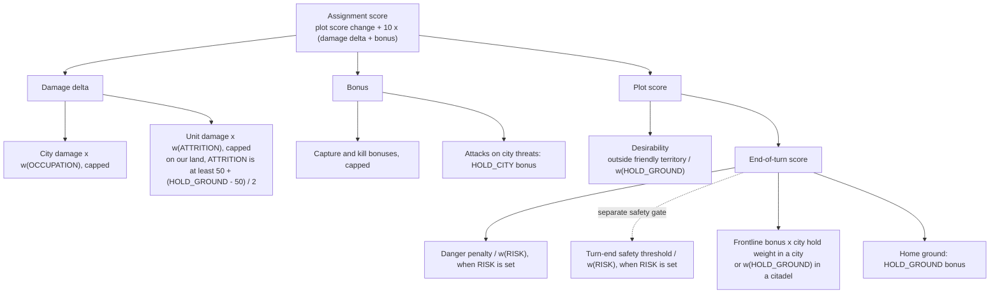
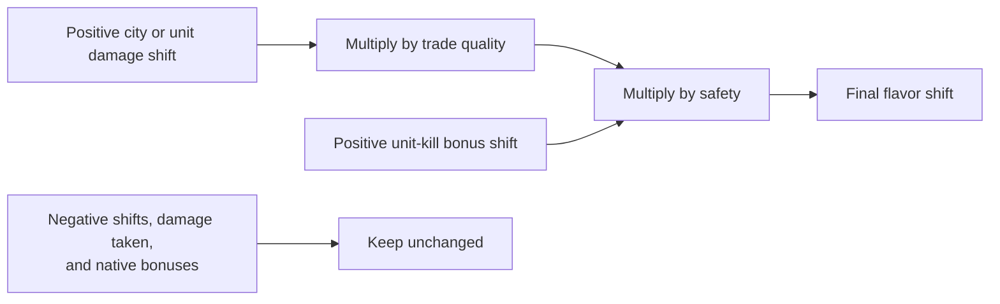

# Unit AI: Military Tactical Flavors: Scoring

The five [military tactical flavors](overview.md) weight tactical attacks and positions. This guide covers their score effects, RISK thresholds, and worked examples. The scoring terms and intent table live in `CvTacticalAI.cpp` and `CvTacticalAI.h` under `civ5-dll/CvGameCoreDLL_Expansion2`; `CvFlavorManager` supplies the game-scale conversion. See the [flavors overview](overview.md) for definitions and resolution.

## How flavors change scoring

### The weight curve

The search turns each flavor into a weight once, at the root position, and every child position copies it:

`weight = 2 ^ (strength x (flavor - 50) / 50)`

| Flavor value         | 0    | 25   | 50  | 75   | 100 |
| -------------------- | ---- | ---- | --- | ---- | --- |
| Weight at strength 1 | 0.5  | 0.71 | 1   | 1.41 | 2   |
| Weight at strength 2 | 0.25 | 0.5  | 1   | 2    | 4   |

- **Strength** sets how far the extremes reach. Live play uses 1; the simulator can set it per slot.
- **Neutral is exact.** A weight of exactly 1, including RISK while unset, returns every term untouched with no rounding.
- **Rounding.** Weights are stored in thousandths, and scaled terms round half away from zero.
- **Three ways a weight applies.** A term can be multiplied by the weight, divided by it (an inverse term), or get a **bonus** of (weight - 1) x a base value. A bonus is zero at 50 and negative below it.

### Where the weights land

Damage and bonuses count ten times as much as plot score in the [assignment score](../simulation/scoring.md). To keep a large hit at a high weight from saturating the 16-bit score, each attack term may change by at most 500 through its flavor, before the x10. This cap is `TACTICAL_FLAVOR_ATTACK_SHIFT_LIMIT`.

### Attacks: `ScoreAttackDamage`

| Part | Stock rule | Flavored rule |
| --- | --- | --- |
| City damage | As forecast | x w(OCCUPATION), change capped at 500, with the positive shift faded by [trade quality and safety](#positive-attack-shifts) |
| Unit damage | As forecast | x w(ATTRITION), change capped at 500, with the positive shift faded the same way. On an enemy land unit standing on a plot our team owns, ATTRITION is read as max(ATTRITION, 50 + (HOLD_GROUND - 50) / 2), so HOLD_GROUND 100 counts as ATTRITION 75, HOLD_GROUND 50 lifts a low ATTRITION to neutral, and the two never stack |
| City capture bonus | +100 | x w(OCCUPATION), capped. The bonus keeps its full shift, but the city and garrison damage on a capture still fades |
| Unit kill bonus | +15 | x w(ATTRITION), capped, with the same HOLD_GROUND rule on our land, and faded by safety alone |
| Attacks on city threats | None | HOLD_CITY above 50 rewards damage to enemies that threaten friendly cities in the search area. Each enemy gets one credit budget; both that budget and the extra bonus per attack are capped at 500. |
| Damage taken, focus fire, kill effects, melee trade veto | As stock | Same, unscaled |

#### Positive attack shifts

A flavor above 50 lifts a damage score according to trade quality and post-attack safety:

| Factor | Rule, clamped to 0 to 1 |
| --- | --- |
| **Trade quality** | Damage dealt minus damage taken (taken floored at 0), divided by damage dealt. |
| **Safety** | 1 minus k x danger / post-attack HP squared. Uses the same RISK-adjusted k as [turn-end safety](#positions-scoreplotforcombatunitmove-and-scorecombatunitturnend). Land and sea attacks measure danger on the target plot after an advancing kill, otherwise on the attack plot. Aircraft use zero turn-end danger, so their safety factor is 1. |

Neutral attacks keep stock scores. The fade applies even with BRAVEHEART aggression or a frontline city. It reads immediate exposure with raw danger, without turn-end cover halving or the edge floor, so it can undervalue mobile ranged hit-and-retreat attacks. The single-enemy condition lowering k to 12 is read before the attack here and after it at turn end.

#### Friendly-city threat budgets

HOLD_CITY rewards damage to enemies that can threaten friendly cities:

| Stage | Rule |
| --- | --- |
| Prepare | Only above neutral HOLD_CITY, with a friendly-team city and an enemy in the root tactical plots. Reuse possible-attacker lists and estimate each relevant enemy/city pair once, using native quick damage, current garrison, and no interception. |
| Budget | Each enemy gets (weight - 1) times its strongest predicted city hit, capped at 500. There is no city-ring reward or extra kill premium. |
| Credit an attack | Reward the fraction of search-root remaining HP removed. Subtract cumulative credit before the hit from credit after it, so split hits, kills, and overkill cannot claim the same budget twice. |
| Reuse | Candidate scoring uses cached values and integer arithmetic. No actual threat means no bonus lookups. No city-distance map is needed; minor civs use the same rule. |

### Positions: `ScorePlotForCombatUnitMove` and `ScoreCombatUnitTurnEnd`

| Part | Stock rule | Flavored rule |
| --- | --- | --- |
| Desirability with enemies present | Line-distance table, or a flat 12 in a friendly city or when HP is below the minimum HP | With HOLD_GROUND above 50, a land unit's positive desirability on a plot outside our territory is divided by w(HOLD_GROUND). The minimum HP comes from RISK. |
| Danger penalty | Danger relative to HP, flattened, adjusted for experience, doubled when alone | Divided by w(RISK) when RISK is set |
| Turn-end safety threshold | `ScoreCombatUnitTurnEnd` rejects an end-turn plot when HP squared is below k x danger, with k 42, 23 after a kill or when the unit has no safe plot to flee to, or 12 for a kill while one enemy is counted | When RISK is set, k becomes k x 1000 / w(RISK), so at strength 1 a RISK of 100 halves k and a RISK of 0 doubles it; unset RISK or a RISK of 50 keeps k exactly. The stock exemptions for a frontline city or citadel and BRAVEHEART aggression, and the other gates, are unchanged. `canProbablyEndTurnAfterAssignment` runs the same check, so the effect applies there too |
| Frontline bonus | Base +67 in a city or our own citadel within two plots of an enemy, or +33 in the weaker case; friendly-team cities also add garrison value below | In a friendly-team city, x w(HOLD_CITY) at 50 or above, and x HOLD_CITY / 50 below it, so the whole bonus fades linearly to nothing at 0. A city captured during the search keeps the stock bonus. In an own citadel, x w(HOLD_GROUND) |
| Terrain defense | Defense modifier / 5 | Same, unscaled |
| Home ground | None | A land unit ending on a plot our team owns gets a HOLD_GROUND bonus on 5 + defense / 5. Below 50 the base is just 5, so a low flavor never makes cover look worse. |
| Other terms | Friendlies, air cover, hiding, enemy citadels, domain, city distance, moves left | Same, unscaled |

#### Friendly-city garrison value

A land unit in a friendly-team frontline city adds two terms before HOLD_CITY scales the combined bonus:

| Term | Value |
| --- | --- |
| City strength | `GetGarrisonStrengthScore` values the unit's added city strength relative to the city's strength without a garrison. |
| Protection | The positive reduction in danger penalty compared with the unit's safest available plot outside cities, using the same danger curve. |

A city projected to fall even with the unit inside loses the frontline bonus and its related safety exemptions. [Garrison timing](../tactics/engagements.md#garrisons) determines whether the unit joins a zone search.

## RISK thresholds

`TacticalAIHelpers::SetSearchRiskThresholds` sets two values once per search:

| Value | Rule | What it controls |
| --- | --- | --- |
| **Loss allowance** | 1 when RISK is 70 or more and more than six units take part, otherwise 0 | A finished plan can leave this many units, plus one per enemy killed, on unacceptable plots, if those units are below median experience. |
| **Minimum HP** | 50 - RISK / 5 | A unit below this HP stops following the line-distance table, so danger and the other terms decide where it stands. |

| RISK                                 | 0   | 30  | 50  | 70  | 100 |
| ------------------------------------ | --- | --- | --- | --- | --- |
| Loss allowance (more than six units) | 0   | 0   | 0   | 1   | 1   |
| Minimum HP                           | 50  | 44  | 40  | 36  | 30  |

With the default RISK of 10 x offense, these match stock Vox Populi: one loss when offense is above 6, and a minimum HP of 50 - 2 x offense.

## Values at the extremes

At strength 1. "Bonus" terms are zero at 50.

| Flavor | Term | Stock value | At 0 | At 100 |
| --- | --- | --- | --- | --- |
| RISK (set) | Danger penalty | -60 for example | -120 | -30 |
| RISK (set) | Turn-end rejection threshold | k 42 for example | k 84 | k 21 |
| OCCUPATION | City damage | As forecast | Half | Double, change at most 500 |
| OCCUPATION | City capture bonus | +100 | +50 | +200 |
| ATTRITION | Unit damage | As forecast | Half | Double, change at most 500 |
| ATTRITION | Unit kill bonus | +15 | +8 | +30 |
| HOLD_CITY | Frontline base bonus in our own city, before garrison value | +67, or +33 | None | +134 or +66 |
| HOLD_CITY | Friendly city threat, full budget earned | None | None | Up to +500 per enemy; total extra attack bonus up to +500 |
| HOLD_GROUND | Frontline bonus in our own citadel | +67, or +33 | +34 or +17 | +134 or +66 |
| HOLD_GROUND | Home ground, 25% hill | None | -3 | +10 |
| HOLD_GROUND | Desirability 12 outside our territory | 12 | 12 | 6 |
| HOLD_GROUND | Unit damage on our land, ATTRITION 0 | As forecast, as ATTRITION 50 | x 0.71, as ATTRITION 25 | x 1.41, as ATTRITION 75 |

### Example: choosing a target

An archer can shoot a city for 20 damage or an adjacent spearman for 25. Neither shot kills.

| Flavors        | City shot | Spearman shot | Choice                      |
| -------------- | --------- | ------------- | --------------------------- |
| All 50 (stock) | 20        | 25            | Spearman                    |
| OCCUPATION 100 | 40        | 25            | City                        |
| ATTRITION 0    | 20        | 13            | City                        |
| ATTRITION 100  | 20        | 50            | Spearman, by a wider margin |

### Example: holding a hill at home

A unit could end its turn on a 25% hill in our territory with a danger penalty of 60, or retreat.

|                 | HOLD_GROUND 0 | 50  | 100 | 100, with RISK 100 set |
| --------------- | ------------- | --- | --- | ---------------------- |
| Danger penalty  | -60           | -60 | -60 | -30                    |
| Terrain defense | +5            | +5  | +5  | +5                     |
| Home ground     | -3            | 0   | +10 | +10                    |
| Net on the hill | -58           | -55 | -45 | -15                    |

HOLD_GROUND makes holding friendly ground more attractive without making danger smaller. RISK is the dial that discounts danger.
