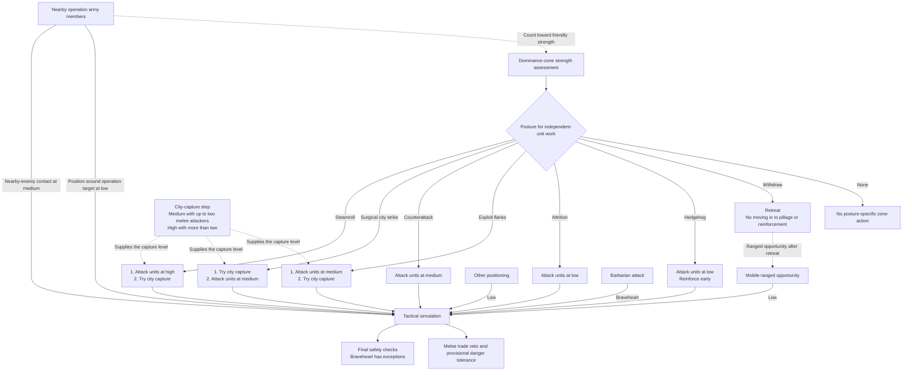
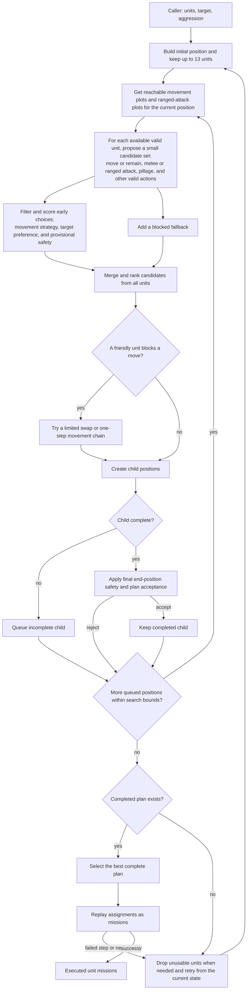

# Unit AI: Military Tactical Simulation

**Tactical simulation** plans a coordinated current-turn action for nearby units and one target plot. [Military tactics](military-tactics.md) supplies the group, target, and aggression level; the simulation searches hypothetical outcomes, selects the best complete plan, and replays it as real missions.

This page has two related jobs. Read [coordinated combat search](#coordinated-combat-search) to change attacks, positioning, acceptance, or support. Read [pathfinding policy](#pathfinding-policy) to change which routes and end-of-turn plots any AI movement may use. The same pathfinder supports both jobs, but combat search consumes reachable plots while pathfinding policy supplies them.

The relevant code is in `civ5-dll/CvGameCoreDLL_Expansion2`, primarily `CvTacticalAI.cpp`, `CvTacticalAI.h`, `CvAStar.cpp`, and `CvUnit.h`.

The maintained VD 5.2 branch includes selected tactical and military fixes from VP 5.4.7, covering support coordination, score overflow protection, combat forecasts, and tactical crashes. Indirect-fire position queries use the requested distance ring, and known-visibility counts saturate to keep heavily observed plots visible to the AI. Naval garrison scoring uses the 5.2 combined city/canal attack option.

## Coordinated combat search

A **position** is a hypothetical battle state: simulated unit locations and moves, expected damage, killed enemies, freed plots, and the actions taken so far. `CvTacticalPosition` stores it. An **assignment** is one recorded move, attack, special action, or end-state for one unit. The search extends positions one action at a time and reuses unchanged state, allowing a preallocated pool of positions to cover a run (6,000 per search, 10,000 with [air search](#air-search)).

A unit that finishes the selected plan is committed and processed under the shared [operation lifecycle control state](operation.md#control-state). A unit the simulation blocks remains available to later Tactical passes.

### Entry points and aggression

Aggression is supplied by the caller rather than chosen inside the simulation. A [zone posture](military-tactics.md#postures-and-local-combat) selects the independent units' action order and aggression for attacks on units. City capture chooses its own level. Nearby operation army members contribute to the zone's friendly strength and can therefore change its posture, but they do not inherit that posture. The operation supplies their movement target: positioning around it uses low aggression, while a nearby-enemy contact fight uses medium.

The corresponding entry points are `ExecuteAttackWithUnits` for zone and barbarian combat, `PositionUnitsAroundTarget` for gathering, reinforcement, and defense, and `CheckForEnemiesNearArmy` for army contact. `PerformRangedOpportunityAttack` uses low-aggression simulation when movement or post-attack repositioning is possible; otherwise it chooses a direct ranged attack without simulation. An enemy-unit target records the last aggression used against it and is retried only when a later pass raises the level.

Aggression controls the melee counter-damage trade veto and provisional danger tolerance. The veto applies only when a melee attack takes counter-damage and has a safe reachable alternative. It scales expected damage dealt by the friendly-to-enemy force balance, database damage weight, and level multiplier without changing normal attack scoring. It rejects a non-killing attack when the scaled trade is unfavorable and projected HP or danger crosses the level's threshold. Ranged attacks take zero simulated counter-damage, so they skip the veto, but completed plans still face final end-position safety checks.

| Level | Melee trade multiplier | Veto trigger for an unfavorable non-killing trade |
| --- | --- | --- |
| None | Not applicable | Not used by a current simulation entry point. |
| Low | 0.7x | HP below 40 or danger above maximum HP. |
| Medium | 1.1x | HP below 20 or danger above maximum HP. |
| High | 2.3x | Danger above maximum HP. The literal HP threshold is -5, so there is no practical HP floor. |
| Braveheart | 4.2x | Danger above maximum HP. The literal HP threshold is 0, so there is no survivable HP floor. |

Within this block, every non-Braveheart level rejects an attack below three projected HP, including a killing attack. Braveheart bypasses that veto and the final extreme-danger block, but retains adjacent-enemy death-trap and limited-visibility edge checks.

The RISK [military tactical flavor](military-tactical-flavors.md) can allow one casualty for large groups and sets the HP threshold below which wounded units stop following preferred-line positioning scores. Higher RISK takes more risk. By default it is 10 x the leader's offense, which keeps the stock thresholds. Final danger validation still applies.

### Search procedure

The initial position includes the target area, nearby enemies, and participating units. It filters duplicate or inactive units and units stacked outside their native domain, except in cities. Each retained unit receives a movement strategy from its default [UnitAI role](concepts.md#unitai-roles) and attack range: first line, second line, third line, support, or embarked. The strategy defines its preferred enemy distance. The [reachable-plots query](#reachable-plots) supplies movement candidates.

At most 13 units enter the search (19 with [air search](#air-search)). If more are available, it keeps the units with the best single moves and blocks the rest for later passes. It begins with broad, best-first expansion, then drives promising lines to completion through narrower depth-first expansion. Difficulty settings bound branches, choices per unit, and completed positions. A blocked assignment leaves the unit unprocessed, keeping its remaining actions available for later Tactical work.

Equivalent sibling states are discarded, so action order does not create duplicate plans. A simulated move that reveals a new enemy records a restart, ending that branch and requiring a fresh run with current information.

The danger cache in `CvTacticalAI.h` matches the defender, plot, previous damage, and a hash of the unit damage ledger. `SUnitIDValueContainer::GetHash` counts each entry once, including after promotion to vector storage. Damage is grouped into five-point bins, and cache matching remains approximate because it compares hashes rather than exact entries.

### Scoring

The simulation uses a **heuristic score** to favor useful damage, valuable actions, and good positioning. Higher scores rank better, but a plan must also pass the [acceptance checks](#acceptance-and-replay). The score does not estimate victory probability.

Each `STacticalAssignment` stores a plot score, contextual bonus, damage delta, and the previous plot score for that unit. `SetScore` combines them as:

`assignment score = new plot score - old plot score + 10 * (damage delta + bonus)`

Score components and the combined assignment score are clamped to the signed 16-bit range when updated, preventing large penalties from wrapping into rewards. s

| Term | How it earns points |
| --- | --- |
| Damage delta | `ScoreAttackDamage` credits city and unit damage, then subtracts damage received. Unit damage is capped at remaining HP; city damage permits limited overkill. The forecast includes approximations for flanking, support, splash, and repeat attacks. Healing from actions such as pillaging can also contribute positively. |
| Bonus | A direct unit kill adds 15 and city capture adds 100, before the 10× weight. Other terms reward focus fire, kill effects, civilian captures, pillaging, and clearing barbarian camps. Ranged attacks also favor the requested target and movement left to disengage. |
| Plot score | `ScorePlotForCombatUnitMove` combines `10 * plot desirability + danger adjustment + small location and movement preferences`. Only the change from the unit's previous plot score enters its assignment score. |

For example, an attack that deals 30 damage, receives 10, earns a 15-point kill bonus, and improves its plot score by 20 contributes `20 + 10 * (30 - 10 + 15) = 370`. This simplified example excludes other contextual bonuses.

With enemies present, the land desirability table peaks at 12: first-line units prefer adjacency or a killing advance onto the enemy plot, second-line units prefer distance 2, and third-line units prefer distance 3. Naval units have a separate table. Without enemies, desirability uses distance to the tactical target. City proximity and remaining movement provide small preferences. Attack candidates include the score of the unit's resulting location.

Intermediate movement applies provisional danger penalties. `ScoreCombatUnitTurnEnd` evaluates final positions using danger relative to remaining HP, an experience adjustment, and a larger penalty for isolation. Nearby friendlies, terrain, air cover, and citadels can improve the result. Unsafe plots can be rejected outright.

`CvBasePosition::UpdateScore` caches a position total as `10 * (cumulative damage delta + cumulative bonuses) + sum of stored unit plot scores`. **The cached total lags plot updates:** it sums the stored entries before replacing the acting unit's entry. Completion also appends finish assignments and adds unused-unit plot bonuses without refreshing the total. The final ranking therefore does not fully reflect the final plot evaluations.

The queue explores shallower generations first, then deeper ones later. Within a generation it prefers the last-round heuristic: unscaled bonus and damage delta, plus new plot score, minus the old assignment plot score and any prior stored plot score. This separate accumulator can subtract the prior plot value twice. Accepted completed positions are ranked by cached total, then fewer assignments, then lower position ID.

[Military tactical flavors](military-tactical-flavors.md) can scale selected damage, bonus, and end-of-turn terms, weaken the pull into enemy territory, add terms for guarding cities and holding friendly ground, and, when RISK is set, change how much the danger penalty weighs. At their neutral value of 50, with RISK unset, they leave these rules unchanged.

### Acceptance and replay

A position completes when all starting enemies are dead or all units have exhausted their options. The final safety check permits limited casualties, with one allowance per enemy killed and a bias toward protecting experienced units. If there is no kill, restart, or great-person power use, the plan must improve more units' distance to their preferred line than it worsens. Ties consider movement toward the target, attacks in place, and healing.

Provisional danger screening becomes more permissive at higher aggression, but final safety does not scale from Low through High. Every level retains adjacent-enemy death-trap and limited-visibility edge checks; the edge check skips city plots, so a lone siege unit can still capture a city at the edge of vision. Braveheart alone bypasses the remaining extreme-danger block, while frontline land cities and friendly citadels have specific exemptions. A non-killing melee attack also fails if a safer reachable retreat exists and it would leave the unit too weak or too exposed.

`ExecuteUnitAssignments` replays the selected hypothetical plan against the real game. Each step verifies expected unit positions and target state, then verifies the result because combat may differ from the forecast. Replay ignores ordinary danger stopping because the plan has already evaluated danger, but it stops for a newly revealed enemy. A failed check, interrupted move, or restart triggers a new search. The wrapper retries up to four times, dropping unusable units when planning cannot find a complete position.

### Support placement

Great Generals, Great Admirals, and siege towers stay outside the main combat search. Attack recruitment admits civilian support that can reach within two plots of the target, and army contact searches retain civilian support even when it has no attack target of its own. Once a combat plan wins, `AddSupportMoves` searches support positions along the selected combat tree and inserts support moves before attacks.

An intermediate move must add new relevant coverage: generals aid land attackers, admirals aid naval attackers, and siege towers improve city attacks. Waiting is allowed without adding coverage. Support search and replay use the available support-unit count to group waits before advancing to the next attack. Duplicate pruning also compares combat states. A friendly defender's projected damage incurs a support danger penalty only above two-thirds of its maximum HP; support units still face final safety checks.

Each checkpoint retains the last attack added by its combat position, including its plots and attacker domain. Finish rows, bundled stay-put rows, and restart markers cannot hide that attack from aura scoring. A final attack bundled with another unit's stay-put action can still score differently from the same actions in separate positions, because final-position safety and placement rules apply at different points.

### Air search

**Air search** plans bombers, fighters, and missiles in the same search as ground and naval units. It is the Vox Deorum mod option `VOX_TACTICAL_AIR_SEARCH` (`NewCustomModOptions.xml`, `CustomMods.h`, `CustomMods.cpp`), off by default. With it off, `ExecuteAttackWithUnits` keeps its greedy `ExecuteAirSweep` and `ExecuteAirAttack` passes before the search and nothing below applies. Every native edit is marked `// Vox Deorum:` and gated by the option, so a later Vox Populi pull request can follow if an evaluation shows air search is better.

| Area | Behavior with air search on |
| --- | --- |
| Participants | Bombers, missiles, and fighters become `MS_AIR` units. They act from their base plot, never occupy or score an end-of-turn plot, and strike enemy plots within `GetRange()` of the base (`GetAirTargetPlots`). `FindUnitsWithinStrikingDistance` and `FindAirUnitsToAirSweep` recruit an aircraft that could act from a plot its carrying ship reaches this turn (`GetCargoLaunchPlots`), and `ExecuteAttackWithUnits` adds the ship. Only launch plots the search can move the ship to count: within 5 tiles of the target and no farther from it than the ship already is. Fighters are recruited for every attack, even one with no bomber or missile. When no ground unit can spot an unseen target, `ExecuteSpotterMove` still sweeps with a fighter for recon; that fighter is then out of attacks and stays out of the search. |
| Assignments | `A_AIRSWEEP` is new. A strike is `A_RANGEATTACK` or `A_RANGEKILL`, and standing down is `A_FINISH_TEMP`. `addAvailableUnit` admits the aircraft; `getPreferredAssignmentsForAirUnit` proposes its rows. It scores every strike and sweep in one scratch row and gives only the kept options rows of their own, so an aircraft with a hundred targets in range cannot exhaust the shared assignment pool (2,000 rows per expansion). |
| Cap and pool | One cap of 19 (`GetTactSimMaxUnits`) covers land, sea, and air together, with each group of interchangeable aircraft counted once (`dropSuperfluousUnitsWithAircraft`). The position pool allows 10,000 positions (`setUsableSize`). |
| Interceptors | Each position tracks interceptions used and lost bases (`SInterceptorState`). `GetBestInterceptorInPosition` ranks interceptors with the game's own rule (`CvPlot::GetInterceptorValue`, which `CvPlot::GetBestInterceptor` also uses), against that state and the damage already dealt. A strike's landing chance and losses come from the same rule as the live estimate (`GetAirStrikeChance`). Interception and sweep damage use the HP both sides are expected to have left in the plan (`CvUnit::GetInterceptionDamage` with assumed damage). Every strike and sweep spends one interception of the interceptor it faces, as the game does even when the interception fails (`applyAirInterception`). The visible interceptors near each target and each aircraft's targets are cached for the search. A carrier's launch plots are cached for one recruitment or one search, since moves executed in between can open or close its routes. |
| Certain and uncertain damage | Every attack in `ScoreAttackDamage` has a landing chance (`GetAirStrikeChanceInPosition`). It is below 100% only for a strike an interceptor may stop, and such a strike is uncertain. The attack earns its damage, capped at the HP expected to be left after earlier uncertain strikes, times its landing chance. Kills read only the certain HP and need a sure landing, so a strike is `A_RANGEKILL` only when certain. Every kill bonus is weighted by the landing chance and by the chance the target is still alive (`uncertainKillChance`), so two strikes on one target never count more than one kill. An uncertain strike writes its expected damage to a second record (`uncertainDamage`) that no kill decision reads. |
| Sweeps | A sweep scores the damage it trades with the interceptor it engages. Its ranking value, the interception damage the remaining aircraft avoid afterwards, is added through `RankScore()` at every pruning and ordering stage but never to a plan score. It is kept in damage points, so it weighs the same as damage in both the per-move ranking and the open-position heap. The sweeper's own group mates count toward that value. |
| Endangered missiles | A missile whose city is in danger of falling or whose carrying ship is projected to die (`IsAirBaseEndangered`, the rule `ShouldRebase` uses) gets a bonus on every strike, so it fires before an equal missile on a safe base and takes targets a safe missile would skip. Planes get no such bonus because they can rebase. |
| Groups | Aircraft with the same owner, type, base, promotions, HP, moves, and attacks made are interchangeable. Only the lowest-ID member that has not acted gets rows (`isAirGroupLeader`), and its stand-down also stands down the rest of the group in ID order. |
| Carriers | A ship that moves takes its cargo along (`moveCargoWithCarrier`). A ship an aircraft depends on stays with it under the cap, and a loaded ship scores danger for all the aircraft aboard, including ones the search does not track, minus the ones the plan spends. `recordCarrierCargo` counts the untracked cargo before the first scoring and again after the cap drops units. |
| Lost bases | Sinking an enemy ship scores its visible aircraft. Sinking it, by a strike or in melee, or capturing a city removes those aircraft from the interceptor state (`markBasesLostForKill`). |
| Spent aircraft | A fired missile, or an aircraft whose predicted damage kills it, leaves the available units (`removeSpentAircraft`). |
| Equivalence | Two positions are equivalent only if their interceptor states and both damage records match too (`airStateEquals`). |
| Execution | `ExecuteUnitAssignments` strikes with a move mission, flies `A_AIRSWEEP` only when an interceptor is present, skips rows of aircraft that died earlier, and leaves an aircraft that did not act unprocessed so patrols can use it. Strict strike postconditions stay as they are. |

With air search on, aircraft are left out of the support search. Their final positions are not counted (`CvSupportPosition::initFromTacticalPosition`), and their strikes are not support checkpoints, so no general or admiral moves to back a strike that gets no bonus (`IsSupportCheckpointAttack`, used by both checkpoint selection and the merge in `AddSupportMoves`). When aircraft are the only combat units, there is nothing on the map to support, so `AddSupportMoves` plans no support moves. `PerformRangedOpportunityAttack` sends every aircraft to its stationary branch, a native greedy pick that never reaches the one-unit search or the learned policy. In stock data this is no change, because only an aircraft that can move after attacking ever took the search branch, and none can. Aircraft therefore reach the learned policy only through the coordinated attack search.

## Pathfinding policy

The pathfinder in `CvAStar.cpp` receives each caller's path type, turn and movement limits, optional zone-of-control exceptions, and move flags from `CvUnit.h`. Those inputs turn route finding into policy: they state what the unit may risk, ignore, or refuse.

The open list orders nodes by total cost, then heuristic cost. `PrNodeIsBetter` in `CvAStarNode.h` resolves remaining ties by ascending Y, ascending X, then normal nodes before stop nodes at the same plot. This makes equal-cost choices reproducible across heap implementations.

| Policy | Effect |
| --- | --- |
| Abort in danger | Rejects unsafe near-term stops and makes combat danger more expensive. Civilians use stricter limits. |
| Stop for a new enemy | Interrupts movement as soon as an additional enemy becomes visible, so the simulation can re-plan. |
| Safe embarkation | Allows embarkation only onto a zero-danger plot. |
| Ignore danger | Removes danger costs for calculations that are themselves computing danger. |
| Approximate target | Accepts a plot near the target, optionally only in the unit's native domain. |
| Avoid enemy territory | Refuses enemy-owned plots unless the unit already stands there. |
| Maximize exploration | Prefers steps that reveal unseen plots. |
| Assume the map is revealed | Lets the AI recognize dead ends rather than march into unknown ones. |
| Selective zone-of-control exception | Ignores control from enemy units the simulation has already planned to kill. |
| Hypothetical reachability | Can ignore control, enemies, or stacking for questions such as where an enemy could reach. |

Other flags cover narrower movement rules, including no embarkation, no ocean, worker visibility, escorted-civilian stacking, and canal planning.

### Reachable plots

A **reachable-plots query** runs pathfinding without a destination and returns every plot reachable within the caller's turn and remaining-movement limits. The query inherits the caller's policy, so combat search, danger evaluation, and army contact checks all receive legal candidate plots. When a simulated kill frees a plot, the next query ignores that dead unit's zone of control.

### Danger in path cost

For AI units, end-of-turn path cost penalizes risky water, foreign or unowned territory, poor terrain, and unknown plots. Its main cost is projected danger relative to the unit's current health. Near-term stops in high danger become increasingly expensive; later stops matter less because they will be re-planned. Civilians and embarked units receive stronger penalties and can be rejected outright by the abort-in-danger policy.

The danger model uses pathfinding to estimate hostile reach. Its own searches ignore danger, and the pathfinder refreshes danger before ordinary searches. This separation prevents danger evaluation, pathfinding, and tactical simulation from recursing into each other. Within one search, the pathfinder computes a plot's end-turn danger once and reuses it for every route that ends a turn there.
