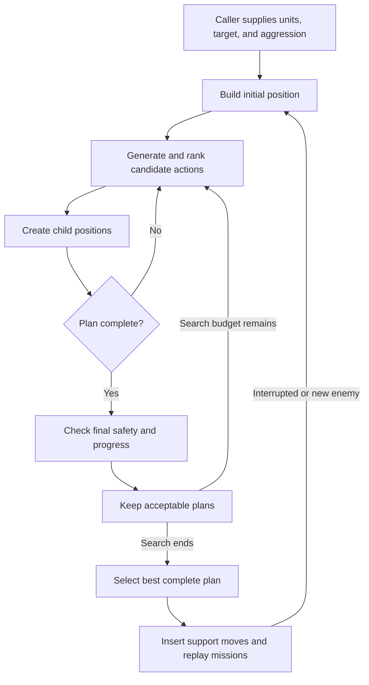

# Unit AI: Military Tactical Simulation

**Tactical simulation** chooses a coordinated plan for nearby units to carry out this turn. [Military tactics](military-tactics.md) supplies the units, target plot, and aggression level. The simulation tries sequences of actions, checks whether their final positions are acceptable, and replays the best complete plan as real missions.

The main flow is:

1. Build a hypothetical battle state from the participating units and nearby enemies.
2. Explore moves, attacks, and other actions, updating that state after each choice.
3. Select a complete plan that passes the safety and progress checks.
4. Insert support-unit moves, then execute the plan. Re-plan if execution reveals an enemy or diverges from the forecast.

[Coordinated combat search](#coordinated-combat-search) covers this process. [Air search](#air-search) adds aircraft to it when enabled. [Pathfinding policy](#pathfinding-policy) explains how the shared pathfinder supplies reachable plots and controls movement risk, both inside and outside combat search.

The source files are under `civ5-dll/CvGameCoreDLL_Expansion2`:

| File | Responsibility |
| --- | --- |
| `CvTacticalAI.cpp` and `CvTacticalAI.h` | Search state, action scoring, plan acceptance, support placement, and replay. |
| `CvTacticalAirSearch.cpp` and `CvTacticalAirSearch.h` | The air search: air targets, launch plots, interception, air scoring and the option cut, and aircraft and carrier state. `CvTacticalAI.h` includes the header. |
| `CvTacticalSearchShared.h` | The search internals of `CvTacticalAI.cpp` that the air scorers use. Only the two tactical source files include it. |
| `CvAStar.cpp` and `CvUnit.h` | Pathfinding policy and movement flags. |

## Coordinated combat search

A **position** (`CvTacticalPosition`) is a hypothetical battle state. It records unit locations, remaining moves, expected damage, killed enemies, freed plots, and the actions taken so far. An **assignment** (`STacticalAssignment`) records one unit's move, attack, special action, or decision to stop acting.

The search builds a tree of positions by adding assignments. Child positions reuse unchanged state from their parents, and a preallocated pool holds up to 6,000 positions per search. A unit committed by the selected plan becomes processed under the shared [operation lifecycle control state](operation.md#control-state). A unit assigned a blocked fallback remains available to later Tactical passes.

### Search procedure

The initial position contains the target area, nearby enemies, and participating units. It removes duplicate or inactive units and units stacked outside their native domain, except in cities. Each retained unit gets a movement strategy based on its default [UnitAI role](concepts.md#unitai-roles) and attack range: first line, second line, third line, support, or embarked. The strategy defines its preferred distance from enemies.

At most 13 units enter the normal search. If more are available, it keeps those with the best single moves and blocks the rest for later passes. [Air search](#air-search) raises the cap and the position-pool limit.

For each position, the search queries [reachable plots](#reachable-plots) and possible ranged targets, then proposes a small set of actions per available unit. These include moving or staying, attacking, pillaging, other valid special actions, and a blocked fallback. Scores and provisional safety checks narrow the choices. A friendly unit blocking a move can trigger a limited swap or one-step movement chain.

The search starts with broad, best-first expansion, then follows promising lines more deeply with fewer choices. Difficulty settings bound branches, choices per unit, and completed positions. Equivalent sibling states are discarded so permutations of the same actions do not consume the search budget. A simulated move that reveals a new enemy ends that branch with a restart marker.

If no acceptable complete plan exists, the wrapper can drop unusable units and retry. [Acceptance and replay](#acceptance-and-replay) describes when a plan succeeds and how retries work.

### Entry points and aggression

The caller chooses aggression. For independent units, the [dominance-zone posture](military-tactics.md#postures-and-local-combat) determines the order of work and aggression against enemy units:

| Posture | Local combat work |
| --- | --- |
| None | No posture-specific zone action. |
| Withdraw | Retreat; allow a ranged opportunity afterward. Do not move in to pillage or reinforce. |
| Hedgehog | Attack units at Low; reinforce early. |
| Attrition | Attack units at Low. |
| Exploit flanks | Attack units at Medium, then try city capture. |
| Counterattack | Attack units at Medium. |
| Surgical city strike | Try city capture, then attack units at Medium. |
| Steamroll | Attack units at High, then try city capture. |

City capture uses Medium with up to two melee attackers and High with more than two. Nearby operation army members count toward zone friendly strength and can affect the posture. Their own work follows the operation target: positioning uses Low, and contact with nearby enemies uses Medium. Other positioning and mobile ranged opportunities use Low; barbarian attacks use Braveheart.

The corresponding functions are:

- `ExecuteAttackWithUnits` for zone and barbarian combat.
- `PositionUnitsAroundTarget` for gathering, reinforcement, and defense.
- `CheckForEnemiesNearArmy` for army contact.
- `PerformRangedOpportunityAttack` for ranged opportunities. It uses simulation when movement or post-attack repositioning is possible; otherwise it chooses a direct ranged attack.

An enemy-unit target records the last aggression used against it. A later pass retries it only at a higher level.

Aggression changes provisional danger tolerance and a **melee trade veto**. When a melee attack takes counter-damage and the unit has a safe reachable alternative, the veto compares damage dealt with damage received. It scales damage dealt by the friendly-to-enemy force balance, the database damage weight, and the multiplier below. An unfavorable non-killing trade is rejected when either threshold is crossed:

| Level | Trade multiplier | Reject an unfavorable trade when… |
| --- | --- | --- |
| Low | 0.7× | Projected HP is below 40 or danger exceeds maximum HP. |
| Medium | 1.1× | Projected HP is below 20 or danger exceeds maximum HP. |
| High | 2.3× | Danger exceeds maximum HP. The HP threshold is -5. |
| Braveheart | 4.2× | Danger exceeds maximum HP. The HP threshold is 0. |

Within this veto block, every level except Braveheart also rejects an attack below three projected HP, even if it kills the target. The multipliers affect this decision only; they do not change ordinary attack scores. Ranged attacks without counter-damage skip the veto. Final-position safety checks still apply as described below. No current simulation entry point uses the None aggression level.

The RISK [military tactical flavor](military-tactical-flavors.md) can allow one casualty for a large group and changes the HP threshold below which wounded units stop following preferred-line positioning scores. Higher RISK accepts more risk. Its default is ten times the leader's offense, preserving the stock thresholds. Final danger validation still applies.

### Scoring

Scores rank useful damage, valuable actions, and good positioning. A high score still needs to pass the [acceptance checks](#acceptance-and-replay).

An assignment combines three terms:

`assignment score = new plot score - old plot score + 10 * (damage delta + bonus)`

| Term | What it measures |
| --- | --- |
| Damage delta | `ScoreAttackDamage` credits damage dealt and subtracts damage received. Unit damage is capped at remaining HP; city damage permits limited overkill. Forecasts approximate flanking, support, splash, and repeat attacks. Healing, such as from pillaging, can also add value. |
| Bonus | A direct unit kill adds 15 and city capture adds 100, before the 10× weight. Other bonuses cover focus fire, kill effects, civilian captures, pillaging, and barbarian camps. Ranged attacks also favor the requested target and movement left to disengage. |
| Plot score | `ScorePlotForCombatUnitMove` combines ten times plot desirability, a danger adjustment, and small location and movement preferences. Only the change from the unit's previous plot score enters the assignment score. |

For example, dealing 30 damage, receiving 10, earning a 15-point kill bonus, and improving the plot score by 20 contributes `20 + 10 * (30 - 10 + 15) = 370`, before other contextual bonuses. Score components and the combined assignment score are clamped to the signed 16-bit range so large penalties cannot wrap into rewards.

**Positioning.** With enemies present, the land desirability table peaks at 12. First-line units prefer adjacency or a killing advance onto the enemy plot; second-line units prefer distance 2; third-line units prefer distance 3. Naval units use a separate table. Without enemies, desirability follows distance to the tactical target. City proximity and remaining movement add small preferences. Attacks include the score of the resulting location.

**Danger.** Intermediate moves receive provisional danger penalties. `ScoreCombatUnitTurnEnd` checks final positions against remaining HP, adjusts for experience, and penalizes isolation more heavily. Nearby friendlies, terrain, air cover, and citadels can improve the result. Unsafe plots can be rejected outright.

**Search order and final ranking.** The queue prefers shallow generations early and deeper ones later. Within a generation it uses a last-round heuristic based on damage, bonuses, and plot-score changes. Accepted complete positions are ranked by cached total score, then fewer assignments, then lower position ID.

Two implementation details matter when debugging rankings:

- `CvBasePosition::UpdateScore` caches `10 * (cumulative damage delta + cumulative bonuses) + sum of stored unit plot scores`. It sums the plot entries before replacing the acting unit's entry, so the total lags that update. Completion adds finish assignments and unused-unit plot bonuses without refreshing the total.
- The queue's separate last-round heuristic uses unscaled damage and bonuses. It subtracts both the assignment's old plot score and any prior stored plot score, so it can subtract the previous plot value twice.

[Military tactical flavors](military-tactical-flavors.md) can scale selected damage, bonus, and end-of-turn terms, reduce the pull into enemy territory, reward guarding cities and holding friendly ground, and change the danger penalty through RISK. At neutral values of 50, with RISK unset, these adjustments leave the rules unchanged.

### Acceptance and replay

A position completes when all starting enemies are dead or all units have exhausted their options. It then has to pass two checks:

1. **Safety:** final positions permit limited casualties, with one allowance per enemy killed and a bias toward protecting experienced units.
2. **Progress:** without a kill, restart, or great-person power use, the plan must improve more units' distance to their preferred line than it worsens. Ties consider movement toward the target, attacks in place, and healing.

Final safety does not become more permissive from Low through High. Every level checks adjacent-enemy death traps and the edge of known visibility. The visibility-edge check skips cities, allowing a lone siege unit to capture a city there. Braveheart bypasses the remaining extreme-danger block. Frontline land cities and friendly citadels also have specific exemptions.

After [support placement](#support-placement), `ExecuteUnitAssignments` replays the selected plan. Each step checks expected unit positions and target state, issues the mission, and checks the result against the forecast. Replay ignores ordinary danger stopping because planning has already evaluated danger, but stops for a newly revealed enemy.

A failed check, interrupted move, or restart triggers a new search from the current game state. The wrapper tries up to four times and can drop unusable units when planning finds no complete position.

### Support placement

Great Generals, Great Admirals, and siege towers have a separate search after the combat plan is selected. `AddSupportMoves` follows the selected combat tree and inserts support moves before attacks so the relevant aura is present.

Attack recruitment admits civilian support that can reach within two plots of the target. Army contact searches retain it even without an attack target of its own. During support planning, a move must add useful coverage: generals help land attackers, admirals help naval attackers, and siege towers help city attacks. Waiting needs no new coverage. Support units still face final safety checks; a friendly defender's projected damage adds a support danger penalty only above two-thirds of its maximum HP.

The search uses attack **checkpoints** to decide when coverage matters. Each checkpoint retains the combat position's last attack, its plots, and attacker domain, even when finish or stay-put assignments follow it. The available support-unit count determines how waits are grouped before the next attack, and duplicate pruning compares combat states too.

A final attack bundled with another unit's stay-put action can score differently from the same actions in separate positions: final-position safety and placement rules run at different points.

### Air search

The default-off `VOX_TACTICAL_AIR_SEARCH` mod option lets bombers, fighters, and missiles join the coordinated search. This allows a plan to move a carrier, sweep an interceptor, and strike with aircraft in sequence with ground and naval attacks. With the option off, `ExecuteAttackWithUnits` uses the greedy `ExecuteAirSweep` and `ExecuteAirAttack` passes before combat search.

The option is declared in `NewCustomModOptions.xml`, `CustomMods.h`, and `CustomMods.cpp`. The air code lives in `CvTacticalAirSearch.cpp`: helpers, scorers, the option cut, and the position's air state. `CvTacticalAirSearch.h` declares the helpers and the interceptor state a position keeps, and the position's air members stay in `CvTacticalAI.h` with the rest of the class. `CvTacticalAI.cpp` keeps short calls into the air code where the main search adds units, expands positions, and applies assignments. It shares the search internals the scorers need through `CvTacticalSearchShared.h`. `CvPlot::GetInterceptorValue`, the interceptor eligibility and ranking rule that live combat and the search share, stays in `CvPlot.cpp` beside `GetBestInterceptor`.

#### Recruitment and actions

Aircraft use the `MS_AIR` strategy. They act from a base and have no end-of-turn plot score. A strike uses `A_RANGEATTACK`, or `A_RANGEKILL` for a certain kill; a sweep uses `A_AIRSWEEP`; standing down uses `A_FINISH_TEMP`.

Recruitment considers both the current base and eligible plots the carrying ship can reach this turn. If an aircraft needs that ship to move, the search recruits the ship too. Launch plots must fit the search area and its approach-to-target restrictions (`GetCargoLaunchPlots`). Once the ship moves in a simulated plan, its aircraft launch from the new plot, including for source-dependent combat modifiers.

`GetAirTargetPlots` uses the game's strike-validity check from the assumed launch plot through `CanAirUnitStrikeFrom`. Fighters are recruited even when no bomber or missile joins the attack. If an unseen target first needs a fighter sweep for reconnaissance, `ExecuteSpotterMove` performs it before search; the fighter has then spent its attack and stays out of the plan.

#### Interception and uncertain damage

Each position tracks used interceptions, damage, and lost air bases, keyed by unit ID, which is unique across players. `GetBestInterceptorInPosition` selects among visible interceptors using the game's ranking rule, adjusted for what the plan has already done. Strike and sweep damage use both sides' projected HP. Every engagement spends an interception, even if interception fails.

The search keeps two damage records:

| Record | Purpose |
| --- | --- |
| Certain damage | Updates HP used for kill decisions. A planned kill requires enough damage and a strike with a sure landing. |
| Uncertain damage | Stores expected damage from strikes an interceptor may stop. It affects later damage rewards without allowing the search to assume the target is dead. |

`ScoreAttackDamage` caps damage at the HP expected to remain after earlier uncertain strikes, then weights it by the landing chance. Kill bonuses also account for landing chance and the chance the target is still alive, preventing repeated rewards for the same kill.

For example, a strike that would deal 40 damage to a unit with 30 HP, but has a 50% landing chance, receives credit for 15 expected damage. The search keeps the target alive so later actions cannot rely on that kill.

Sinking a ship or capturing a city removes its aircraft from the interceptor state. A ship sunk inside a city that holds still takes its cargo down, as the game kills a transport's cargo wherever it dies. Sinking an enemy ship also scores its visible aircraft cargo. Killing a city's garrison by air leaves the city hostile, targetable, and exerting zone of control. A later capture does not count that garrison again.

#### Why a sweep can be worth choosing

A sweep earns a plan score for the damage it trades with its interceptor. Its main benefit may come from helping later strikes, so it also gets a separate **ranking bonus**: the best improvement in strike value available to each remaining aircraft, including the sweeper's interchangeable group mates. That improvement includes both a better landing chance and lower interception losses. Strike value comes from the strike scorer itself, so a missile gains nothing against a city with no unit in it.

`RankScore()` uses this bonus when pruning and ordering choices. The bonus never enters the final plan score, so the search must actually follow the sweep with useful actions to realize that value. `GetAirSweepPlots` offers one sweep per distinct interceptor covering an enemy plot in range, using the covered plot nearest the tactical target.

A missile at a base likely to be lost gets a strike bonus under the same danger rule as `ShouldRebase`. This encourages firing it before it is destroyed. Reusable aircraft get no such bonus because they can rebase. Fired missiles and aircraft predicted to die leave the available-unit list.

#### Keeping the search bounded

Aircraft with the same owner, type, base, promotions, HP, moves, and attacks made are interchangeable. Only the lowest-ID available member proposes actions. Standing that member down also stands down the rest of the group in ID order. The expansion loop adds each combo move through `addAssignmentsWithAirGroups`, which applies the one or two rows and then this group rule, so the rule lives in one place.

| Limit | With air search enabled |
| --- | --- |
| Participants | 19 land units, sea units, and aircraft groups combined; each aircraft group counts once. A group that depends on carrier movement must fit together with its carrier. |
| Positions | Up to 10,000 positions per search. |
| Assignments | The shared pool has 3,000 rows per expansion. Each aircraft leader keeps at most the per-unit choice limit plus a stand-down action, regardless of how many targets it can reach. |

`getPreferredAssignmentsForAirUnit` scores each candidate once into reusable scratch rows outside the pool, then copies only the retained choices into the pool. `getUnitsToDropWithAircraft` enforces the participant cap. Carrier danger includes all aircraft aboard, even those outside the search, except cargo the plan has already spent.

Equivalent-position pruning compares interceptor state and damage records as well as the normal combat state (`airStateEquals`). These records survive expansion so later comparisons can still use them. Target and interceptor candidates are cached during search; carrier reach is cached only for one recruitment or search because executed moves can change routes.

#### Support and execution

Aircraft receive no support-placement moves: their final positions and strikes are omitted from support checkpoints. A plan with only aircraft needs no support search.

Replay issues `MISSION_RANGE_ATTACK`, which `CvUnit::PushMission` validates and converts to a move mission for aircraft. A sweep runs only if an interceptor is present. Replay skips aircraft that died earlier and leaves aircraft that did not act unprocessed so later patrol work can use them. Strike result checks still apply.

`PerformRangedOpportunityAttack` handles aircraft through its stationary, greedy branch. They reach the learned policy only through coordinated attack search.

## Pathfinding policy

The pathfinder in `CvAStar.cpp` serves combat search and other AI movement. Callers supply a path type, turn and movement limits, optional zone-of-control exceptions, and movement flags from `CvUnit.h`. These inputs define which routes and stopping plots are allowed and how risk affects their cost.

| Policy | Effect |
| --- | --- |
| Abort in danger | Rejects unsafe near-term stops and increases combat danger costs. Civilians use stricter limits. |
| Stop for a new enemy | Interrupts movement when an additional enemy becomes visible, allowing re-planning. |
| Safe embarkation | Allows embarkation only onto a zero-danger plot. |
| Ignore danger | Removes danger costs from searches that are themselves computing danger. |
| Approximate target | Accepts a plot near the target, optionally only in the unit's native domain. |
| Avoid enemy territory | Refuses enemy-owned plots unless the unit already stands there. |
| Maximize exploration | Prefers steps that reveal unseen plots. |
| Assume the map is revealed | Lets the AI recognize dead ends in unexplored terrain. |
| Selective zone-of-control exception | Ignores control from enemies the simulation has already planned to kill. |
| Hypothetical reachability | Can ignore control, enemies, or stacking to answer questions such as where an enemy could reach. |

Other flags cover no embarkation, no ocean, worker visibility, escorted-civilian stacking, and canal planning.

The open list orders nodes by total cost, then heuristic cost. `PrNodeIsBetter` in `CvAStarNode.h` breaks remaining ties by ascending Y, ascending X, then normal nodes before stop nodes at the same plot. Equal-cost choices are therefore reproducible across heap implementations.

### Reachable plots

A **reachable-plots query** runs pathfinding without a destination. It returns every plot reachable within the caller's turn and remaining-movement limits, subject to the supplied policy. Combat search uses these plots as movement candidates; danger evaluation and army contact checks use the same mechanism with their own policies.

When a simulated kill frees a plot, subsequent queries can ignore that dead unit's zone of control.

### Danger in path cost

For AI units, end-of-turn path cost penalizes risky water, foreign or unowned territory, poor terrain, and unknown plots. Its main cost is projected danger relative to current health. High-danger stops in the near future cost more; later stops matter less because they will be re-planned. Civilians and embarked units receive stronger penalties and can be rejected outright by the abort-in-danger policy.

Danger evaluation itself uses pathfinding to estimate hostile reach. Those searches ignore danger, while ordinary pathfinding refreshes danger before searching. This prevents danger evaluation, pathfinding, and tactical simulation from recursing into each other. Within one search, the pathfinder computes each plot's end-turn danger once and reuses it for routes ending a turn there.
