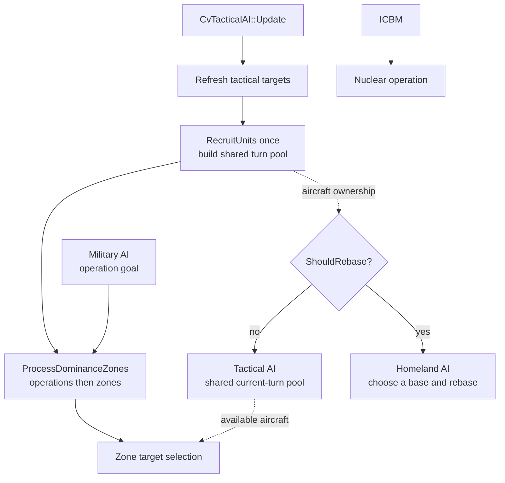
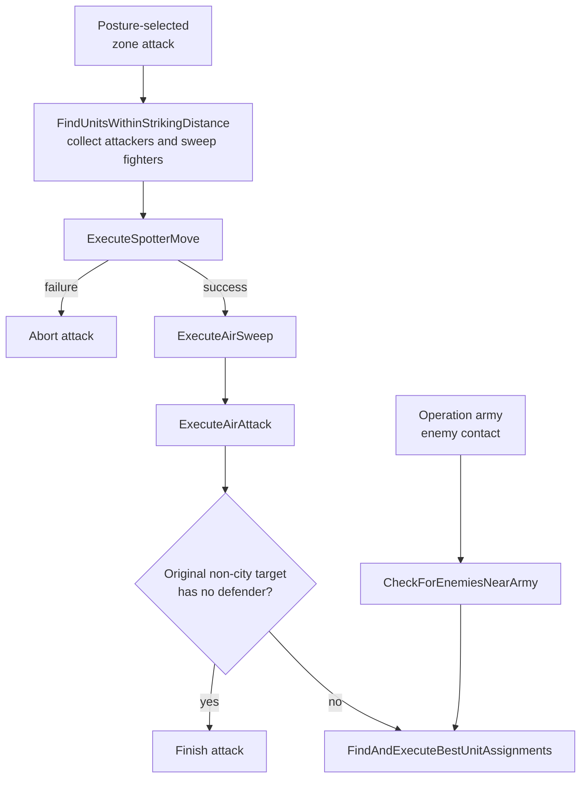

# Unit AI: Military Tactics

**Military tactics** turns the visible map into this turn's military missions. It moves persistent-operation armies first, assigns local combat and support to **independent units**, then leaves eligible units for Homeland AI. An independent unit is a movable, unprocessed combat-capable unit with no Army ID.

This page owns Tactical AI's turn order, postures, priorities, and specialized moves. [Operation lifecycle](operation.md#operation-lifecycle) defines shared claims and Tactical-to-Homeland handoff. [Military campaign](military-campaign.md) defines targets, army goals, muster points, and muster cities; [military organization](military-organization.md) defines formation slots, Army IDs, recruitment, stages, and release. [Shared concepts](concepts.md#dominance-zones) defines dominance zones. Coordinated combat search and pathfinding policy are in [military tactical simulation](military-tactical-simulation.md).

The relevant code is in `civ5-dll/CvGameCoreDLL_Expansion2`, primarily `CvTacticalAI.cpp`, `CvTacticalAnalysisMap.cpp`, `CvAIOperation.cpp`, `CvHomelandAI.cpp`, and `CvUnit.cpp`.

## Tactical turn order

`CvTacticalAI::Update` refreshes visibility, focus areas, and [tactical targets](#tactical-targets); recruits current-turn units; then processes army movement, zone combat, reinforcement, global priorities, and review. Eligible remaining units pass to Homeland AI.

## Tactical targets

A **tactical target** is a plot worth acting on this turn. `FindTacticalTargets` rebuilds the list once per turn, before units are recruited, by scanning every plot the player has revealed. Each target records its type, its dominance zone, and a **target score** that sets its place in the list. Zone passes act on the targets near one zone, and global passes sweep one type across the whole map.

| Target | When it is listed | Target score |
| --- | --- | --- |
| Enemy city | A city of a team we are at war with. | 100, or 20 for barbarians |
| Enemy combat unit | The enemy defender on a plot without a city, visible now or remembered from last turn. Minor civs list barbarians only next to their territory. | 50, adjusted below |
| Enemy civilian | An unprotected enemy civilian, classed as high or low priority. | 25 |
| Barbarian camp, goody hut | A revealed, unowned camp (major civs and barbarians), or a revealed goody hut (not minor civs). | 100 if visible, otherwise 50, minus the path distance to our nearest city |
| Citadel, improvement, resource | An unpillaged improvement on a plot of a team we are at war with, or a city-connection route there outside enemy-dominated zones. | 5 to 100 by kind |
| Trade unit | A visible enemy trade unit. | 35 |
| Blockade point | Enemy water within three plots of an enemy city, where no enemy can attack. Only the best ten are kept, plus any on improved plots. | Blockade score |
| Friendly city | One of our cities with a positive land or sea border score. | Border score |
| Bastion, improvement to defend | Strong or choke-point land on our border, and strategic resource improvements of our border cities. | Terrain defense (tripled at a choke point), or 1 |

The list is then ordered:

1. Each enemy unit target gains 1 for every friendly combat unit within three plots in its domain, and 5 minus its distance to our nearest city when that is positive.
2. All targets are sorted by target score, highest first. Equal scores keep map scan order, which follows plot index.
3. Walking the sorted list, an enemy unit target is dropped when an enemy unit target already kept in the same domain, with an equal or higher score, lies within two plots. Targets within three plots of one of our cities are never dropped. A search around the kept target already covers its neighbors.

Enemy unit targets score only a little above 50, so map order often decides which of them comes first. The score does not consider a target's health, its value, or the damage our units could deal to it.

### Zone targets

Before a zone's posture routine runs, `ExtractTargetsForZone` keeps the targets valid for the zone's domain that lie in the zone or within five plots of its center, in list order. A target near a zone border can therefore belong to several zones. Global passes extract every target.

Posture routines walk this list one target type at a time, so enemy units and cities never compete in one order: the posture decides which type goes first. Each attempt records an aggression level on the target, whether or not an attack happens, and the walk skips a target already tried at the requested level or higher. A unit attempt records the level it searched at, so a unit target shared by two zones is retried only at a higher level. A city attempt always records High, even when its search runs at Medium, so each city is tried once per turn.

## Operation army movement

`PlotOperationalArmyMoves` calls each persistent operation's `DoTurn` during the global high-priority pass of `ProcessDominanceZones`, after frontline healing and before garrison work and the per-zone posture loop. Land, naval, and combined armies use `PlotArmyMovesCombat`; escorted civilian armies use the escort path. Recruiting and gathering armies move around their muster point, while moving armies follow their army goal.

Operation state and the current turn target control army behavior; zone posture controls the independent-unit behavior in the next section. Both tables record the routine, behavior, and simulation aggression for their path. `PositionUnitsAroundTarget` is also used by non-army positioning passes.

| Army phase or condition | C++ routine | Behavior | Simulation and aggression |
| --- | --- | --- | --- |
| No reachable step path | `PlotArmyMovesCombat` | Record `AI_ABORT_LOST_PATH` for the operation. | None |
| Enemy units can attack the army | `CheckForEnemiesNearArmy`, called by `PlotArmyMovesCombat` | Fight with the army and nearby friendly attackers, as described in [army contact](#army-contact). A fight holds the army at its center of mass this turn; a vetoed fight lets the operation continue. | Medium |
| Gather, advance, or hold formation | `ExecuteGatherMoves` → `PositionUnitsAroundTarget` | Move formation members toward the muster point, operation target, or current turn target, subject to reachable-plot and danger checks. | Initial simulation: Low. Subsequent positioning does not simulate. |
| Unprocessed army member still in danger | `PositionUnitsAroundTarget` | Try to move the member to a safe healing plot or, failing that, the safest reachable plot. Finish its turn. | No new combat simulation |
| Pre-move army maintenance | `CvArmyAI::UpdateCheckpointTurnsAndRemoveBadUnits` | Release members that are unfit to continue before moving the army. | None |
| Escort replacement | `SwitchEscort` | Temporarily swap a blocked escort for a suitable nearby defender. | None |

`CvArmyAI::RemoveUnit` can return a surviving, movable member to the current-turn independent-unit pool. It receives posture work only if its zone has not already been processed. [Military organization](military-organization.md#membership-and-release) lists the removal triggers and operation effects.

## Postures and local combat

Tactical AI refreshes a **posture**, a current-turn strategy for each dominance zone, then processes zones in [zone order](#zone-order). Territory, overall and ranged dominance, melee balance, and city danger choose the posture; water zones use naval strengths. After extracting the [zone's targets](#zone-targets), `ProcessDominanceZones` dispatches the posture routine that selects the local work and aggression passed to the [tactical simulation](military-tactical-simulation.md#entry-points-and-aggression).

| Territory | Dominance and local condition | Posture |
| --- | --- | --- |
| Wilderness | Any | Exploit flanks |
| Enemy | City in danger of falling | Surgical city strike |
| Enemy | Enemy dominant, or ranged-heavy force facing much stronger enemy melee | Withdraw |
| Enemy | Friendly dominant | Steamroll |
| Enemy | Even, friendly ranged dominant, enemy melee stronger | Attrition |
| Enemy | Even, friendly ranged dominant, enemy melee no stronger | Steamroll |
| Enemy | Even, without friendly ranged dominance | Exploit flanks |
| Enemy | Other, such as no units visible | Attrition |
| Neutral | Enemy dominant with friendly ranged dominance | Attrition or exploit flanks according to enemy melee strength |
| Neutral | Enemy dominant without friendly ranged dominance | Withdraw |
| Neutral | Other | Attrition with friendly ranged dominance, otherwise exploit flanks |
| Friendly | Enemy dominant | Hedgehog |
| Friendly | Other | Counterattack |

| Zone posture | C++ routine | Behavior | Simulation and aggression |
| --- | --- | --- | --- |
| None | No routine | Do no posture-specific work. | None |
| Withdraw | `PlotWithdrawMoves` → `ExecuteWithdrawMoves` | Retreat toward the neighboring zone with a city in the unit's domain that has the best hospitality score for the travel time, or else toward the nearest city by path (the capital for minor civs). Take a ranged opportunity shot after a successful withdrawal when possible; if no safe route exists, pillage in place when worthwhile and move to the safest reachable plot. | No posture attack; the ranged opportunity exception uses Low when simulated. |
| Hedgehog | `PlotHedgehogMoves` | Attack enemy units, then call `PlotReinforcementMoves` for early reinforcement before attacks in other zones. | Low |
| Attrition | `PlotAttritionAttacks` | Attack enemy unit targets in target order. No city capture. | Low |
| Exploit flanks | `PlotExploitFlanksMoves` | Search around each enemy unit target, then try city capture with the units still available. | Unit attacks: Medium. City capture: melee-count rule. |
| Counterattack | `PlotCounterattackMoves` | Attack enemy unit targets in target order. | Medium |
| Surgical city strike | `PlotSurgicalCityStrikeMoves` | Try city capture first, then search around each enemy unit target with the units still available. | City capture: melee-count rule. Unit attacks: Medium. |
| Steamroll | `PlotSteamrollMoves` | Search around each enemy unit target, then try city capture with the units still available. | Unit attacks: High. City capture: melee-count rule. |

Each step is a separate search around its own target plot, taken in [target order](#zone-targets). Units that remain movable and unprocessed can join later steps, including after partial use. A unit target can also be settled by city fire alone before any search runs. The search can attack any enemy in its area, cities included, so the order decides which target gets first claim on units, not which damage is valued. The city-capture rule is independent of posture: `ExecuteCaptureCityMoves` uses Medium with up to two non-ranged recruits and High with more. Civilian support units, such as Great Generals on field command, count toward that number.

Nearby army members affect the friendly strength used to calculate a zone's posture, and the zone attack and city capture paths never recruit them. Reinforcement positioning, including Hedgehog's early call, does not check Army IDs, so it can move an army member that operation movement left unprocessed. Otherwise the operation's goal controls army movement, and zone dominance affects an army only through the [army contact](#army-contact) veto.

Neighboring zones can refine the posture of a zone with a city after it is chosen:

- A naval Steamroll zone becomes Exploit flanks when a neighboring land zone is enemy-dominated and has more ranged strength than our ships.
- A zone outside friendly territory becomes Withdraw when a neighbor in the same domain is our territory, is enemy-dominated, and has no city in danger of falling.

### Zone order

Zones run from highest to lowest **zone value**, which `PrioritizeZones` in `CvTacticalAnalysisMap.cpp` computes as a base value times a multiplier.

| Part | Rule |
| --- | --- |
| Base | 1. When the zone has a city that can reach the zone's area, add the square root of that city's economic value as a percentage of the most valuable zone city, then apply the city factors. |
| City factors | x3 in a focus area. x2 when visible. A visible city that has lost more than a tenth of its hit points multiplies again by ten times its damage share, rounded down, so half damage gives x5. x2 when it is an operation target or a [preferred attack target](military-campaign.md#attack-targets). A city-state whose ally we are at war with resets the base to 1. |
| Land zone | x3 |
| Multiplier | Enemy dominance: 8 in our territory, 1 in enemy territory. Even dominance with more than one enemy unit: 4 in our or enemy territory. Friendly dominance: 8 in enemy territory, 1 in ours. Otherwise 1. |
| War state | For major civs, a further x4 in enemy territory while winning all wars, or in our territory while losing all wars. |

## Independent units and priorities

Routine Tactical recruitment accepts movable, unprocessed combat, ranged, air, and combat-support units with no Army ID. It excludes delayed-death units, explorers, carrier-role ships, and nuclear-role units. Tactical AI does not process human units; Homeland AI handles automated human units.

| Priority | Main work |
| --- | --- |
| Global high | In order: heal frontline units, move operation armies, then [garrison work](#garrisons) in threatened cities. |
| Zone combat | Emergency purchase, then posture-directed local work. |
| Reinforcement | Hold deferred garrisons, then [reinforce eligible city zones](#tactical-reinforcement) with remaining units. |
| Global middle | Air patrol, camps and goody huts, civilian attacks, bastions, safety, healing, pillage, trade plunder, and blockade. |
| Global low | Guard improvements, escort embarked units, and move exposed remaining units. |
| Review | Final safety move, then pass eligible units to Homeland AI. |

## Tactical reinforcement

`PlotReinforcementMoves` redistributes available units around a zone's city. `ProcessDominanceZones` calls it for every zone after all posture attacks and deferred garrison work, before global middle-priority moves. Hedgehog also calls it immediately after its own attacks, so it can claim units before later zones fight and before deferred garrisons are held. That zone is considered again in the regular reinforcement pass. Coastal cities have separate land and water zone calls.

The destination must have a city and must not be withdrawing. A city belonging to another team needs enemies in its zone. A zone already dominant in both overall and ranged strength is skipped unless it lacks melee strength, in which case ranged recruits are excluded. An enemy-dominated zone also needs a neighboring zone owned by the player.

Recruitment scans plots using the city's mixed-army pathfinder and `GetRecruitRange` limit, including units already in the destination zone. This scan permits unrevealed plots and foreign territory; individual movement paths are checked later. Recruits must pass the normal Tactical eligibility checks and match the zone's land or sea domain. It generally leaves units in other contested zones, with exceptions for withdrawing zones, embarked units, and land units in cities that are not in danger of falling. It also excludes units needing healing, Great Generals and Admirals, civilian sappers, siege units entering enemy-dominated zones, and units with attack targets more than four plots from the destination city. A unit covering a friendly civilian stays and is processed. Reinforcement proceeds only when the zone's existing units plus incoming recruits total at least two.

This plot scan has no Army ID exclusion. An eligible army member left unprocessed by operation movement can participate. Tactical reinforcement preserves formation membership; [army reserve recruitment](military-organization.md#recruitment) fills formation slots at setup and during Recruiting. Ordinary operations stop reserve scans on entering Gathering; later losses can leave slots open or cause an abort, while direct assignment paths have their own rules.

`PositionUnitsAroundTarget` executes the reinforcement:

1. Try to reveal the destination with a spotter, then run coordinated search at Low aggression with the Reinforce intent. Nearby combat can therefore occur during reinforcement.
2. Move remaining distant units toward the city, aiming within two plots, with ordinary combat units before siege and civilian support. Approach moves check paths, embarkation safety, and danger at the first-turn path endpoint. Attack-capable units other than city-bombard units tolerate danger up to half their current hit points; other units require zero danger. Units sent through the approach move are marked processed.
3. Leave nearby unprocessed independent units available for later work after a successful search. Remaining army members receive safety handling and finish their turn.

Army gathering and movement use this same positioning routine with the Gather intent. [Army contact](#army-contact) can first borrow nearby attackers for a fight without adding them to the army. These routines compete with other passes for available units and can search enemies already considered elsewhere that turn.

## Search engagements

A **search engagement** is one call to the [coordinated combat search](military-tactical-simulation.md#coordinated-combat-search) with a list of units, a target plot, and an aggression level. Tactical AI never plans all of its units together. Each engagement starts from a target that one pass has already chosen, and only the units that pass collected for that target take part. Later passes can reuse units that still have movement and remain unprocessed; processed or exhausted units are unavailable.

### When an engagement runs

| Caller | When it runs | Participants | Aggression |
| --- | --- | --- | --- |
| Zone unit attack (`ExecuteDestroyEnemyUnits`) | A posture routine picks the next enemy unit from its [zone targets](#zone-targets) that has not been tried at this aggression yet. Cities in range fire first, and a kill ends the attack. The search runs only if [striking-distance recruitment](#who-a-zone-attack-recruits) finds a unit and the recruits are expected to deal damage. | Striking-distance recruits. | From the [posture](#postures-and-local-combat). |
| City capture (`ExecuteCaptureCityMoves`) | A posture routine tries each enemy city target. It skips a city whose land and water zones are each missing or enemy-dominated, unless it is in danger of falling; a city the recruits cannot bring down within 13 turns of its healing; and a city down to its last hit point when no recruit is a melee unit to take it. | Striking-distance recruits for the city plot. | Medium with up to two non-ranged recruits, High with more. |
| [Army contact](#army-contact) (`CheckForEnemiesNearArmy`) | Enemy units can attack an operation army moving in `PlotArmyMovesCombat`. | The contact group: army members and our units that can attack the threatening enemies. | Medium |
| Positioning (`PositionUnitsAroundTarget`) | Army gathering, zone reinforcement, and barbarian camp clearing. Reinforcement runs only when the zone would hold at least two friendly units. | The caller's own unit list. | Low |
| Barbarian attack | The [barbarian ladder](#barbarian-priorities) uses the zone unit attack and city capture paths. | Striking-distance recruits. | Braveheart for unit attacks. City capture keeps its melee-count rule. |
| Ranged opportunity | Many passes, described in [ranged opportunity searches](#ranged-opportunity-searches). | One unit. | Low |

### Who a zone attack recruits

`FindUnitsWithinStrikingDistance` builds the participant list for zone unit attacks and city capture from the [current-turn pool](#independent-units-and-priorities). A unit qualifies when all of these hold:

- It is still usable by Tactical AI, so not processed by an earlier pass this turn.
- It is not a barbarian guarding a camp, a unit that cannot capture when the target is a city, a defense fighter, or a unit covering a friendly civilian.
- It is no farther than four times its base moves from the target. Units that can change port, and aircraft under the air search, are checked by their own range instead.
- It can act on the target this turn:
  - A ranged unit can strike from where it stands, or reach a plot in range this turn without embarking. It must also be expected to deal meaningful damage, or it is left out.
  - A melee unit can get adjacent this turn.
  - A civilian support unit, such as a Great General, can get within two plots this turn.
- A melee or support unit within two plots of the target joins even when it cannot act, so the search can move it out of the way.

The search keeps at most 13 of the recruits and blocks the rest. Blocked and unused units stay available to later passes.

### Army contact

**Army contact** is the search `CheckForEnemiesNearArmy` runs for a land, naval, or combined operation army. Escort armies never run it. It runs during [operation army movement](#operation-army-movement), before garrisons and every zone, once per army per turn. Armies go in the order their operations were created. It does not use the [tactical target](#tactical-targets) list.

1. **Contact group.** An army member joins when it can act, has at least half its hit points, and either has a target in range or can be attacked where it stands. Civilian members only need to meet the first two conditions. For each enemy unit that can attack a member, every unit of ours that can attack that enemy joins too, whether it belongs to a zone, a garrison, or another army.
2. **Trigger and target.** Only enemy units that can attack the group count, so an army that could attack but faces no threat does not fight. The target is the threatening enemy plot nearest the group's center of mass.
3. **Trim and veto.** Units seven or more plots from the center of mass are dropped. The fight is skipped when the zone of the city nearest the target is enemy territory and enemy-dominated.
4. **Search.** One search at Medium aggression with the `ArmyContact` search intent.

The fight runs before any zone, so a passing army can consume actions or process units a zone would have used. Helpers keep their existing formation membership.

### Units that engagements leave out

Tactical AI runs only for players whose units the AI controls. A human player's units never enter a tactical search. For that player only Homeland AI runs, and it moves automated units such as auto-explorers and workers.

These units of an AI player are never recruited into the current-turn pool, so no tactical search includes them:

| Unit | Why |
| --- | --- |
| Unit whose current role is explorer, carrier, or nuclear | Tactical AI never recruits these roles. The exclusion follows the unit's current UnitAI role, not its type. Economic AI moves units on and off exploration duty as recon needs change, so a scout taken off exploration is recruited like any combat unit, while a borrowed unit on exploration duty is not. |
| Delayed-death unit | It is about to be removed. |
| Aircraft that should rebase | Homeland AI owns it this turn (see [air operations](#air-operations)). |

These units are in the pool but are skipped by [striking-distance recruitment](#who-a-zone-attack-recruits), so zone attacks and city capture leave them out. Other searches can still include them:

| Unit | Why zone attacks skip it | Searches it can still enter |
| --- | --- | --- |
| Operation army member | It moves with its army. | Army contact and army gathering. |
| Garrison of a border, blockaded, or exposed city | The [garrison pass](#garrisons) marks it processed before zone work. | Army contact earlier in the turn, and its own ranged opportunity search. |
| Unit processed by an earlier pass | Healing, an earlier engagement, or another move already used its turn. | Only the ones that ran before. |
| Unit with nothing in reach | No target-driven pass selects it. | Reinforcement positioning, ranged opportunity searches, and Homeland AI's opportunity attacks. |
| Ranged unit not expected to deal meaningful damage | The damage check leaves it out. | Positioning and ranged opportunity searches. |
| Defense fighter: an aircraft whose unit type's default UnitAI role is air defense, such as a fighter | It is reserved for interception and sweeps, so it is never recruited as a striker. | Sweep recruitment picks sweep-capable fighters for the same attack. In stock play they sweep greedily before the search. Under the air search they join it. |
| Unit covering a friendly civilian | It stays with the civilian. | None while it covers. |

### Garrisons

Garrisons are recruited into the current-turn pool like other independent units, and they stand inside their city's zone. What keeps a threatened city's garrison out of engagements is timing. `PlotGarrisonMoves` runs in the global high-priority pass, before any posture work:

1. Every friendly city fires at its best target, as a safety net.
2. Each city that is a border city, has a blockaded plot, or is exposed to an enemy then handles its garrison. The garrison takes an opportunity attack and is marked processed with a skip mission, whatever the threat. The threat only decides whether that attack may move: movement is allowed when fewer than two enemies threaten the city and the player has more than one city. A threatening enemy is one adjacent to the city, or two plots away and able to reach the city this turn. Without movement, a ranged garrison shoots from the city or steps out and back, and a melee garrison attacks an adjacent enemy only when the attack would not kill it, since a kill would carry it out of the city.
3. When such a city needs a garrison and has none or a weak one, it moves in a better one, preferring ranged land units. The new garrison also takes an opportunity attack and is marked processed.
4. After every city, naval units in those cities upgrade if they can, or take an opportunity attack with movement allowed. These units stay available to later passes.

From then on, every zone search that turn skips these garrisons: zone unit attacks, city capture, and reinforcement positioning all require a unit that is not yet processed. They fire alone, before the planned attacks of that turn, and the zone's searches treat them as part of the board, never as actors. Two exceptions remain:

- **Army contact runs earlier.** Army moves come before the garrison pass, and [army contact](#army-contact) also takes nearby non-army units that can attack the enemy, so a garrison can join an army's fight before it is marked processed.
- **Interior cities.** Their garrisons skip this pass and stay in the pool for zone attacks. Two native comments, in `FindUnitsWithinStrikingDistance` and `PlotGarrisonMoves`, say garrisons are never recruited into the pool and are used in zone attacks. Neither matches the current code.

### Ranged opportunity searches

A **ranged opportunity search** is a one-unit search on the unit's own plot. `PerformRangedOpportunityAttack` runs it, and `PerformOpportunityAttack` passes ranged units to it. It applies these rules:

- The unit must be able to attack at range, move, and not be dying.
- Movement is turned off for aircraft and for a land garrison whose city needs a garrison: one under siege, or exposed to an enemy outside the early expansion phase.
- With movement allowed, the search may end the unit anywhere. With movement off, a unit that can move after attacking still runs the search, but must end on its starting plot, so it can step out, shoot, and step back. Any other unit takes the best single stationary shot at a unit, without a search.

It runs without first checking that an enemy is in range, so many calls find nothing to shoot. Movement is off unless the caller allows it.

| Caller | Who it covers | Movement |
| --- | --- | --- |
| Garrison pass | Garrisons, new garrisons, and naval units in threatened cities. | See [garrisons](#garrisons). |
| Homeland opportunity attacks (`CvHomelandAI::PlotOpportunityAttacks`) | Every remaining non-air combat unit that Tactical AI handed over. | Allowed, except for a land garrison its city needs. |
| Withdraw posture | A unit after a successful withdrawal. | Off |
| Move to a plot (`ExecuteMoveToPlot`) | A unit that is already at its destination, or reaches it this turn with moves left. Gathering, garrison, and other moves use it. | Off |
| Safety and healing | A retreating ranged unit, and a fast unit firing before it flees to heal. | Off, keeping the moves it needs to flee. |
| Escort, blockade, and trade plunder | A naval escort beside an embarked unit, a blockading ship, and a trade raider after their moves. | Off for escorts and raiders, allowed for blockades. |
| Cover | A defender pinned in place to shield a retreating unit. | Off |
| Barbarians | Camp defenders and roaming units. | Off for camp defenders, allowed for roaming. |

The search uses Low aggression and the `RangedOpportunity` search intent for [flavor defaults](military-tactical-flavors.md).

## Air operations

Air control is split by job. [Military campaign](military-campaign.md) creates persistent operation goals; Tactical AI executes operation movement, including carrier movement. Aircraft aboard a carrier are assigned independently to Tactical or Homeland AI. This section covers conventional fighters, bombers, and missiles. ICBMs follow the [operational nuclear path](military-campaign.md#nuclear-campaigns).

`CvTacticalAI::Update` calls `RecruitUnits` once per turn, after refreshing targets and before operation or zone processing. Neither campaigns nor zones call it. Later target collectors select from the resulting shared pool.

For aircraft, `RecruitUnits` requires `canUseForTacticalAI`, then applies `ShouldRebase`. That check returns true when a city may fall, a carrier is projected to die, or a healing aircraft is at a dangerous base. In wartime, a fighter remains Tactical when an enemy aircraft is nearby or `GetBestAirSweepTarget` finds a target. A bomber or conventional missile remains Tactical only when an `ENEMY_COMBAT_UNIT` target is within range. A city alone does not qualify. At peace, conventional aircraft go to Homeland. This assigns ownership; it does not promise a rebase or patrol mission.

### Zone attacks and target selection

A **zone attack** is an attack on a posture-selected target during `ProcessDominanceZones`. Aircraft are not attached to persistent zones, so its target collector can use one for any reachable assignment, including one in a different zone. An air strike can select an enemy combat unit or city within three plots of the requested target.

The operation-contact branch bypasses `ExecuteAttackWithUnits`: it sends eligible land and naval participants directly to the simulator and launches no sweep or strike missions. Thus campaign goals can bring a carrier into an operation, but immediate army contact does not enlist its aircraft through this path.

[Operation completion and cleanup](operation.md#completion-abort-and-cleanup) release deployed army members for independent zone work. Before release, a later zone attack can still use independent aircraft against the same enemies. Available bombers or missiles can trigger that attack even without independent ground units, subject to target, damage, and visibility checks. Aircraft alone cannot capture a city. With no eligible strike aircraft or other attackers, this path launches no air missions; fighters alone do not qualify.

When the collector adds an attacking aircraft, `FindAirUnitsToAirSweep` chooses the player's available sweep-capable fighters. It chooses up to the number of visible, eligible enemy interceptors, with a minimum of one fighter for possible reconnaissance. `ExecuteAirSweep` skips the sweep when that interceptor count is zero. A completed sweep consumes an enemy interception allowance, but later strikes can still encounter ready interceptors.

`FindAirTargetNearTarget` scores expected damage, distance, defensive retaliation, and visible interception risk. Defense fighters are omitted from ordinary strike collection because they are reserved for interception and sweeps. Missiles value defender damage and kills but skip an ungarrisoned city. In the zone-attack path, the land and naval simulator therefore sees the real damage and survivors left by earlier air missions, plus the current air-cover flag. It does not search air actions itself.

The dominance map has a separate, coarser use for aircraft. `CvTacticalAnalysisMap` adds their ranged strength to land or naval strength according to whether the aircraft's base plot is land or water. This contribution can change a zone's posture, but it is not an evaluation of air superiority.

### Interception and air superiority

There is no single air superiority number. Tactical behavior combines nearby aircraft counts, per target interceptor readiness, strike penalties, and the fighter and bomber mix at each base.

| Signal | What the code measures |
| --- | --- |
| Nearby enemy aircraft | `GetNumEnemyAirUnitsInRange` counts enemy aircraft without requiring visibility. Proximity is the enemy aircraft range capped at 12 plus half the querying aircraft's range. Fighters and bombers can be counted separately. |
| Eligible interceptor | `CvPlot::GetBestInterceptor` filters by range, war status, airspace, capability, and current readiness. It ranks attack strength with interception modifiers and probability, applies aircraft health, then breaks ties by distance. Combat can select an interceptor that is not visible. |
| Air cover | `CvPlot::HasAirCover` is a snapshot of at least one own interceptor in range with remaining allowance. The tactical simulator uses this snapshot and adds a small three point positioning preference for covered plots. It does not plan aircraft movements. |
| Base defense | After zone combat, `PlotAirPatrolMoves` sets a patrol quota per base: `floor(bombers / 2) + floor(fighters / 4)`. A lone bomber counts as two. Both counts refer to nearby enemy aircraft. |

Patrol selection takes still-available, patrol-capable aircraft from the Tactical pool in iteration order until each base's quota is filled. It does not rank their strength or promotions. `ExecuteAirPatrolMoves` issues `MISSION_AIRPATROL` and marks the selected fighters processed. A fighter whose sweep exhausted its actions cannot join this pass. AI aircraft wake from intercept duty each turn so their assignment is reconsidered. Homeland also attempts patrol as a fallback when a combat-ready aircraft considered for rebasing gets no rebase destination.

An interceptor must be capable, not embarked, and have an unused interception allowance. Aircraft must also be on intercept duty, which patrol missions establish; land and naval anti-air units do not use patrol missions. During actual air combat, `GenerateAirCombatInfo` checks evasion and interception chance. If interception deals damage, the bombing run ends before target damage. The attempt consumes an allowance even when evasion or chance prevents a hit, and a sweep also consumes an allowance. A simulation can therefore begin with air cover even though no interceptor remains ready for a later strike.

### Homeland rebasing

`CvHomelandAI::ExecuteAircraftMoves` scores owned cities and carrier bases with `ScoreAirBase`, excluding unsafe or unsuitable cities. Healing aircraft seek a lower scoring city. Combat-ready aircraft prefer a higher scoring base when `IsGoodUnitMix` permits the fighter and offensive balance. If the destination is out of range, Homeland executes the first rebase leg found by the air pathfinder, so reaching a distant base can take several turns. Tactical AI moves the carrier for its campaign operation while aircraft follow these Tactical and Homeland decisions.

## Barbarian priorities

Barbarians skip dominance zones and process one global target list through this priority ladder.

| Priority | Work |
| --- | --- |
| 1 | Camp defense: garrison and hold every camp. |
| 2 | Theft from an adjacent city, or takeover of a weakened city-state. |
| 3 | Unit attacks through the tactical simulation at braveheart aggression, then vulnerable-city capture. |
| 4 | Civilian attacks. |
| 5 | Immediate pillage: improved resources first, then other improvements. |
| 6 | Trade-route plunder, land then sea. |
| 7 | Roaming toward the best target in range. |
| 8 | Safety: a barbarian that reaches this pass did not attack, so it flees. |

A camp defender stays assigned. Ranged defenders fire from camp; melee defenders act only when they can return in the same turn. An empty camp recalls the nearest available land unit within five turns. Roaming range follows the game handicap's land and sea target ranges. Land units can enter an undefended civilian or improvement to pillage but do not linger beside combat targets; sea units do not pillage. Captured civilians return toward a camp.

## Specialized execution

**Amphibious landings** run after city capture for embarked units still near the target. `ExecuteLandingOperation` greedily assigns units to reachable coastal plots, favoring survivable plots close to the target, ranged hills, legal landmass access, positive attacks, and clustered landings. This is not a simulated position search.

**Paradrops** are opportunistic. During immediate pillage, paratroopers in range are tried before ground units against enemy citadels and improved resources. No other pass plans a drop, so drops never enter the tactical simulation.

**Support units** are outside the main simulation. After combat planning succeeds, a second search can interleave Great General, Great Admiral, or siege-tower moves before each attack so the relevant aura is present. See [support placement](military-tactical-simulation.md#support-placement).

## Homeland handoff

Tactical AI retains a unit only while a later pass can use it. Homeland AI receives a movable, unprocessed military unit with no Army ID.

| Homeland pass | Remaining military work |
| --- | --- |
| Conservative heal | Preserve wounded units before routine positioning. |
| Aircraft rebase | Move aircraft to a suitable city or carrier. |
| Safety | Move exposed units from danger after civilian role passes. |
| Upgrade and opportunity attack | Upgrade eligible units or take a safe local attack without leaving an essential garrison. |
| Garrison, heal, sentry, and patrol | Fill city needs and position remaining land and naval units. |
| Final review | Continue a valid mission or move idle units toward friendly cities or water. |

The Army ID condition governs routine Homeland recruitment. The upgrade pass is the exception: it temporarily removes an army member, upgrades it, then restores the replacement to its formation slot. [Military organization](military-organization.md#membership-and-release) documents the membership changes.

## Implementation trace

`CvTacticalAI::Update` refreshes targets and recruits units. `ProcessDominanceZones` runs army movement, postures, reinforcement, global priorities, and review. Operation `DoTurn` and `Move` record progress and stage transitions; assignment helpers issue unit missions; `CvHomelandAI` claims eligible leftovers. For cross-system logs, see [operation diagnostics](operation.md#diagnostics).
