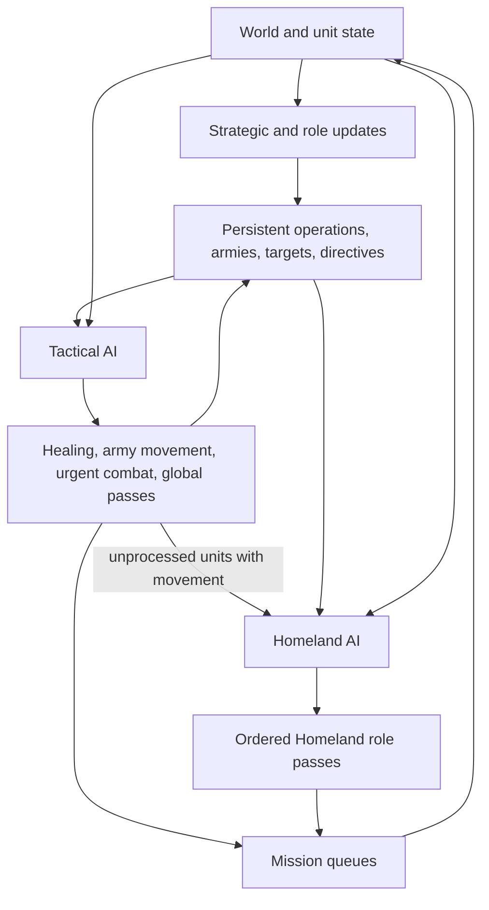

# Unit AI: Operation Lifecycle

The **operation lifecycle** is the shared per-turn process that turns persistent-operation state, Tactical targets, role objectives, and available movement into unit missions. A **persistent operation** is a `CvAIOperation` plan that retains an army, formation, muster point, target, and state across turns. This page covers shared completion and abort rules, control state, handoff, and diagnostics. See [operation stages](stages.md) for the state sequences and the [operations overview](overview.md) for military and civilian behavior.

The main implementation is in `civ5-dll/CvGameCoreDLL_Expansion2/CvPlayerAI.cpp`, `CvTacticalAI.cpp`, `CvHomelandAI.cpp`, `CvAIOperation.cpp`, `CvArmyAI.cpp`, and `CvUnit.cpp`.

## Operation lifecycle

For a normal AI player, `CvPlayerAI::AI_unitUpdate` runs Tactical AI before Homeland AI. Tactical AI refreshes targets, recruits combat and support units, heals urgent frontline units, advances persistent-operation armies through `CvAIOperation::DoTurn`, and completes its combat priorities. Homeland AI then rebuilds its candidate list from eligible units, refreshes role targets, and runs its ordered passes. The resulting missions change the state seen by later passes and by the next turn.

`CvAIOperation::DoTurn` maintains reserve membership, target validity, movement progress, army and operation state, and abort reason. Cleanup releases Army IDs and removes obsolete armies or operations. See [operation stages](stages.md) for stage sequences, [military organization](organization.md) for formation membership and release, and [civilian operation](civilian.md) for civilian-specific ownership.

## Completion, abort, and cleanup

An active operation normally ends in **Successful Finish** or **Aborted**. It can also reach cleanup when `DoTurn` returns false without either state. **Cleanup** through `CvAIOperation::Kill` records the result, then calls `Reset`: the army releases its surviving members and is deleted, followed by the operation. Releasing a member clears its Army ID.

Ordinary military deployment follows this sequence:

1. `Move` succeeds, then `CheckTransitionToNextStage` sets Successful Finish. The army retains its members.
2. The next **pre-unit sweep**, the cleanup pass before unit control, calls `ShouldAbort` and marks surviving members as recently deployed.
3. The sweep calls `Kill`, releasing the members and deleting the army and operation.

| Detection point | State | Member release | Object deletion |
| --- | --- | --- | --- |
| Request or initialization rejected | Preconditions fail, or initialization leaves Invalid or Aborted | Destruction releases any recruited members | Immediate direct deletion, bypassing `Kill` |
| `ShouldAbort` before or after movement inside `Move` | Successful Finish or Aborted; `DoTurn` returns false | `ReleaseAllUnits` immediately | `Kill` later in the same Tactical operation-movement pass |
| Deployment detected after successful `Move` | Successful Finish | At `Kill` in the next pre-unit sweep | During that sweep |
| Pre-unit sweep finds a terminal state | Successful Finish or Aborted | At `Kill` in this sweep | During this sweep |
| `DoTurn` returns false without a terminal state | Current state retained until cleanup | At `Kill` in the same Tactical pass | During that pass |

Whenever `ShouldAbort` observes Successful Finish, it marks surviving members as recently deployed before release. A request rejected before initialization has no abort reason. Initialization itself can set a specific reason, such as `AI_ABORT_NO_UNITS`, before direct deletion.

After initialization, common abort triggers include:

- The operation exceeds 42 turns. Never-ending carrier groups skip this timeout.
- Target validation cannot keep or replace the current target.
- Tactical movement cannot find a usable path or rejects an unsafe route.
- Member loss removes a critical civilian or carrier, leaves no army, or violates the post-Recruiting formation-strength rule.
- Military or Diplomacy AI cancels the operation because war state, target validity, threat, or diplomatic intent changed.

Ordinary military operations finish when the army center is within 3 plots of its goal and the furthest member is strictly less than 6 plots away. While the owner is at peace with the designated enemy, more than two army members being visible to that enemy also counts as deployment. Completion requires deployment, not city capture or elimination of the threat. The operation's target and retarget rules are documented in [military target lifecycle](campaign.md#target-lifecycle).

Each family supplies its successful completion rule and additional abort checks:

| Operation family | Finishes successfully when | Family-specific terminal behavior |
| --- | --- | --- |
| City attack (land, naval, combined), pillage, naval superiority, city defense, rapid response | The ordinary military deployment condition above is met. | Target ownership, threat, and retarget behavior differ by family. See [military target lifecycle](campaign.md#target-lifecycle). |
| Found city | The settler is on the target plot, can found there, can move, and issues the founding mission. | Invalid founding legality or path retargets the settler; no valid replacement target aborts. |
| Merchant delegation | The merchant reaches any plot owned by the target city-state owner and issues a legal city-state purchase or trade mission. | It can move to an adjacent trade-valid plot and retry; no valid mission plot aborts. |
| Diplomat delegation | The diplomat reaches any plot owned by the target city-state owner and issues a legal trade mission. | It can move to an adjacent trade-valid plot and retry; no valid mission plot aborts. |
| Concert tour | The musician reaches any plot owned by the target owner and issues a legal one-shot tourism mission. | It can move to an adjacent tourism-valid plot and retry; no valid mission plot aborts. |
| Nuclear | A recruited nuclear unit can move, can legally strike the target, and issues the nuclear mission. | It has no Gathering or Moving phase. If setup cannot fire, its next Tactical operation-movement pass has no air-army movement handler, so `DoTurn` returns false and cleanup records `AI_ABORT_KILLED`. |
| Carrier group | Never through ordinary deployment. | It stays in Moving and retargets until the carrier is projected to die next turn, its carrier slot is lost, no deployment or fallback target remains, or another abort rule applies. It has no normal timeout. |

Civilian missions require remaining movement. Arrival alone leaves the operation at At Target until it can perform its mission or an abort check ends it.

`CvAIOperation::Kill` records `AI_ABORT_SUCCESS` for Successful Finish, preserves a specific abort reason, or uses `AI_ABORT_KILLED` when an active operation reaches cleanup without either one. Operations rejected during creation bypass `Kill`.

## Control state

| Concept | Purpose |
| --- | --- |
| **TurnProcessed** | Per-turn flag that prevents a later controller from claiming the unit. A special action can set it while movement remains. |
| **Move tags** | Tactical and Homeland categories that record the controller's current-turn claim for diagnostics. A Homeland tag clears the Tactical tag. |
| **Army membership** | An Army ID and formation slot that bind a unit to persistent-operation movement. Homeland recruitment excludes a unit while its Army ID is set. |
| **Mission queue** | Executable movement, attack, build, or special missions. The final review can continue a valid unfinished mission and clears a contradictory queue. |
| **Working lists** | Separate Tactical and Homeland candidate lists. Each controller removes a unit when it calls `UnitProcessed`. |

Move tags record work this turn. Persistent operations, Army IDs, directives, and saved targets hold durable intent. **Activity state** is also durable: missions set a stance such as sleep, heal, sentry, intercept, or an unfinished mission. `CvUnit::doTurn` applies the matching wake checks so a controller can claim the unit again when appropriate.

| Activity  | Wake behavior                                                  |
| --------- | -------------------------------------------------------------- |
| Awake     | Available for orders.                                          |
| Hold      | Wakes on the next turn.                                        |
| Sleep     | Wakes only when projected to die next turn.                    |
| Heal      | Wakes after damage last turn or at full health.                |
| Sentry    | Wakes for a visible enemy, or sufficient danger or damage.     |
| Intercept | AI units wake every turn so interception duty is reconsidered. |
| Mission   | Wakes when its unfinished queue completes, fails, or clears.   |

**Automation** is the human-side entry to Homeland work. `CvHomelandAI::FindAutomatedUnits` gathers automated human units instead of the AI recruitment list, and role passes accept a matching [UnitAI role](../concepts.md#unitai-roles) or automate type. Automation ends when the unit enters combat, receives a manual order, or finds no work.

## Tactical-to-Homeland handoff

Tactical AI retains a unit only while a later pass can use it. Routine Homeland recruitment accepts movable, unprocessed military units with no Army ID.

| Unit kind | Owner this turn | Later handling |
| --- | --- | --- |
| Persistent-operation army member | Persistent operation through Tactical AI | Moves with its army until cleanup releases its Army ID. |
| Independent combat, ranged, or combat-support unit | Tactical AI | Homeland AI receives it when Tactical leaves it unprocessed with movement. |
| Explorer | Homeland AI | Tactical eligibility excludes land and sea explorer roles. |
| Ordinary civilian | Homeland AI | A role action, safety response, or escorted civilian operation supplies its work. |
| Combat-ready aircraft | Tactical AI | Homeland can rebase aircraft Tactical AI retains. |
| Carrier or nuclear operation member | Persistent operation | Specialized operation logic provides target and formation behavior. |
| Automated human unit | Homeland automation | Normal AI operations and ordinary Tactical recruitment leave it to automation. |

Tactical AI claims persistent-operation armies and combat urgency first. Homeland then runs its ordered passes, including [civilian role work](civilian.md#homeland-role-order). Its remaining military work is:

| Homeland pass | Remaining military work |
| --- | --- |
| Conservative heal | Preserve wounded units before routine positioning. |
| Aircraft rebase | Move aircraft to a suitable city or carrier. |
| Safety | Move exposed units from danger after civilian role passes. |
| Upgrade and opportunity attack | Upgrade eligible units or take a safe local attack without leaving an essential garrison. |
| Garrison, heal, sentry, and patrol | Fill city needs and position remaining land and naval units. |
| Final review | Continue a valid mission or move idle units toward friendly cities or water. |

The Army ID condition governs routine Homeland recruitment. The upgrade pass is the exception: it temporarily removes an army member, upgrades it, then restores the replacement to its formation slot. [Membership and release](organization.md#membership-and-release) documents the membership changes.

The final Homeland review can also skip the unit or apply stranded naval-unit handling.

## Diagnostics

Trace a unit in this order: move tag, Army ID, `TurnProcessed`, remaining movement, then mission queue. For an army member, correlate the same turn in Tactical and operation logs.

| Log | Use it for |
| --- | --- |
| `PlayerTacticalAILog.csv` | Recruitment, zones, targets, and tactical assignments. |
| `PlayerHomelandAILog.csv` | Role passes and fallbacks. |
| `OperationalAILog.csv` | Operation states, armies, targets, transitions, and aborts. |
