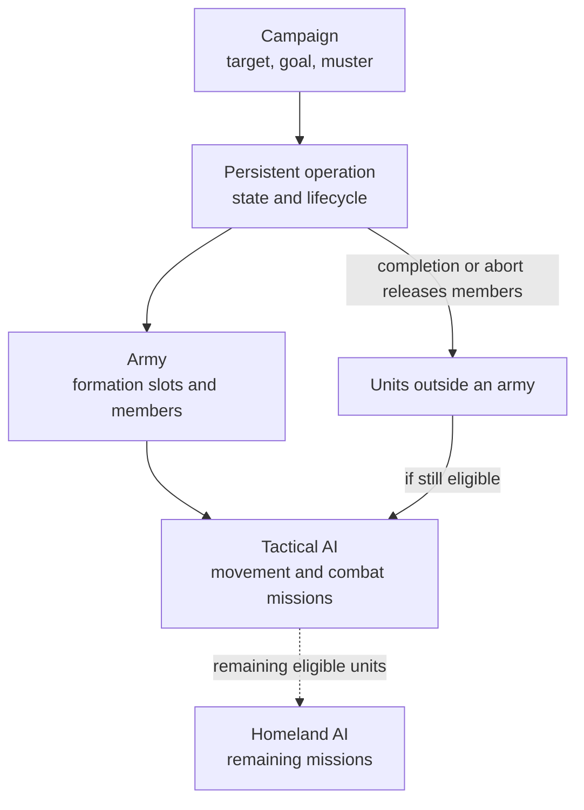

# Unit AI: Operations Overview

**Operations** connect multi-turn plans to this turn's missions. Start with [military campaign](campaign.md) and [military organization](organization.md) for armies, or [civilian operation](civilian.md) for civilians. The parent [Unit AI overview](../overview.md) shows the surrounding systems.

A **military operation** is a persistent `CvAIOperation`: it stores campaign state across turns, while its army stores formation membership.

The relevant code is in `civ5-dll/CvGameCoreDLL_Expansion2`, primarily `CvMilitaryAI.cpp`, `CvAIOperation.cpp`, `CvArmyAI.cpp`, `CvTacticalAI.cpp`, `CvTacticalAnalysisMap.cpp`, `CvHomelandAI.cpp`, and `CvUnit.cpp`.

## From campaign to missions

The operation's [stages](stages.md) track progress; [tactics](../tactics/overview.md) chooses missions from the current map and operation state. Homeland then [rebuilds its own eligible-unit list](lifecycle.md#tactical-to-homeland-handoff).

## Find the owning guide

| Page | Responsibility |
| --- | --- |
| [Operation lifecycle](lifecycle.md) | Shared per-turn process, completion and abort, control state, Tactical-to-Homeland handoff, and diagnostics. |
| [Operation stages](stages.md) | Stage sequences for standard military, escorted civilian, nuclear, and carrier-group operations. |
| [Military campaign](campaign.md) | Operation families, targets, muster, retargeting, nuclear attacks, and cleanup. |
| [Military organization](organization.md) | Ownership, recruitment, membership, and release. |
| [Civilian operation](civilian.md) | Civilian persistent operations, Homeland role passes, and missions. |
| [Military tactics](../tactics/overview.md) | Current-turn movement, postures, and combat priorities. |
| [Tactical simulation](../simulation/overview.md) | Coordinated combat planning, scoring, acceptance, and replay. |
| [Pathfinding](../pathfinding.md) | Movement policy, reachable plots, and danger costs. |

## Implementation map

| Focus | Main entry points | Guide |
| --- | --- | --- |
| Campaign creation, targets, and completion | `CvDiplomacyAI::DoUpdateWarTargets`, `CvMilitaryAI::UpdateAttackTargets`, `CvMilitaryAI::UpdateOperations`, operation `Init` methods | [Military campaign](campaign.md) |
| Army membership, recruitment, and mustering | `CvAIOperation::SetUpArmy`, `GrabUnitsFromTheReserves`, `CvArmyAI::AddUnit`, `CvArmyAI::RemoveUnit` | [Military organization](organization.md) |
| Stage transitions | `CvAIOperation::DoTurn`, operation `Move`, army state updates | [Operation stages](stages.md) |
| Shared completion, abort, and control state | `CvAIOperation::Kill`, `ShouldAbort`, `CvUnit::doTurn`, `CvHomelandAI::AssignHomelandMoves` | [Operation lifecycle](lifecycle.md) |
| Civilian operation setup and missions | `CvAIOperationCivilian::Init`, `CvTacticalAI::PlotArmyMovesEscort`, `CvHomelandAI::AssignHomelandMoves` | [Civilian operation](civilian.md) |
| Per-turn army and unit missions | `CvTacticalAI::Update`, `ProcessDominanceZones`, `PlotArmyMovesCombat`, `CvHomelandAI::AssignHomelandMoves` | [Military tactics](../tactics/overview.md) and [military tactical simulation](../simulation/overview.md) |

For logs and claim diagnosis, see [operation diagnostics](lifecycle.md#diagnostics).
