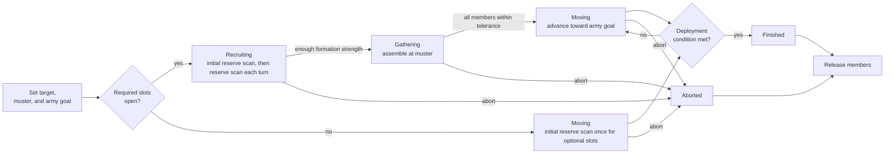
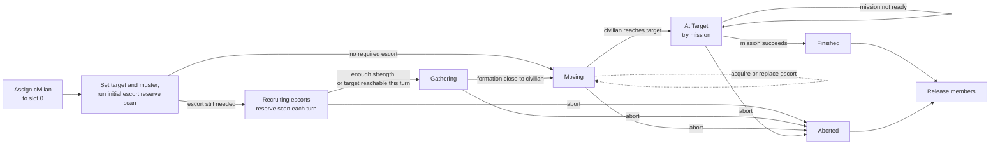
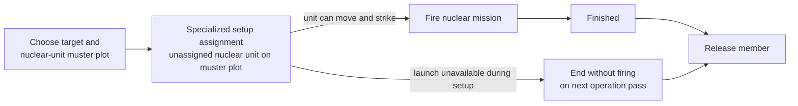
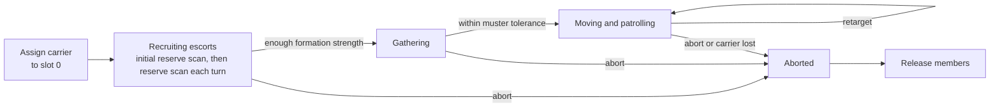

# Unit AI: Operation Stages

**Operation stages** record a persistent operation's progress from setup to finish or abort. This guide follows the state sequences for standard military operations, escorted civilians, nuclear attacks, and carrier groups. [Military organization](organization.md) explains formation membership and recruitment; [operation lifecycle](lifecycle.md) explains shared completion, abort, and handoff rules. See the [operations overview](overview.md) for campaign targets and civilian mission behavior.

The relevant code is in `civ5-dll/CvGameCoreDLL_Expansion2`, primarily `CvAIOperation.cpp`, `CvArmyAI.cpp`, `CvTacticalAI.cpp`, `CvMilitaryAI.cpp`, `CvHomelandAI.cpp`, and `CvUnit.cpp`.

## Lifecycle overview

An **operation stage** records campaign progress. The army carries a matching movement state: waiting for reinforcements, gathering, moving, or at the destination. An **initial reserve scan** runs once when the army is created. **Recruiting** repeats the reserve scan each operation turn. **Direct assignments and replacements**, such as the initial civilian or a replacement escort, do not depend on Recruiting.

### Standard military operations

Land, naval, combined, pillage, defense, rapid-response, and naval-superiority operations use the same stage sequence.

Recruiting ends when the formation has enough strength, even if required slots remain open. Gathering ends when every member is within the operation's muster tolerance. Standard military operations finish at deployment range. They do not use the operation's At Target stage.

### Escorted civilian operations

Civilian operations assign their civilian before setup. They use an At Target stage because arriving and performing the civilian mission can be separate events.

While Moving, an unescorted civilian can acquire a suitable defender on its route, and a blocked escort can be replaced. These direct assignments do not return the operation to Recruiting.

### Nuclear attacks

Nuclear attacks use a specialized setup path and skip Gathering, Moving, and At Target.

The normal path recruits and fires during setup. Nuclear armies have no ordinary movement phase, so an operation that cannot launch does not wait and retry through Gathering or Moving.

### Carrier groups

Carrier groups use the standard Recruiting and Gathering transitions, but remain in Moving while they patrol and retarget.

Carrier groups have no successful Finished transition. They remain in Moving until an abort or carrier loss releases the formation. Carried aircraft are not formation members and rebase independently.

[Operation completion, abort, and cleanup](lifecycle.md#completion-abort-and-cleanup) defines the terminal checks shared by these lifecycles and summarizes each family's finish and abort conditions.
