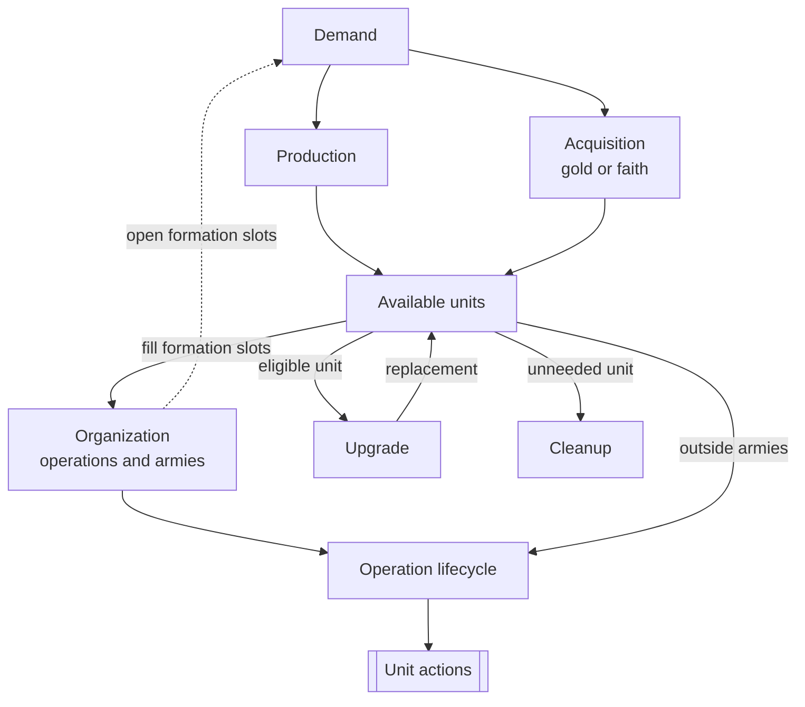

# Civilization V Unit AI: Overview

This guide orients contributors to the non-strategic unit AI in the **Vox Populi 5.2.7** baseline. The implementation is primarily in `civ5-dll/CvGameCoreDLL_Expansion2`.

## Relationships

World state, diplomacy, flavors, and the economy inform every stage.

Open formation slots feed demand again; cleanup frees supply and gold. A **persistent operation** is a `CvAIOperation`; its **formation slots** record the members it recruits and maintains. Free-unit grants and Great Person spawns follow separate game rules.

## The seven responsibilities

Follow the decision you want to change. [Concepts](concepts.md) defines shared inputs such as supply, danger, flavors, and UnitAI roles.

| Decision | Primary owner | Guide |
| --- | --- | --- |
| **Demand:** need a unit or role | Military AI and role-specific civilian systems | [Military production](production/military.md), [civilian production](production/civilian.md) |
| **Production:** choose a city's queue-head order | City Strategy AI and Unit Production AI | [Production](production/overview.md) |
| **Acquisition:** buy a unit with gold or faith | Economic, Religion, Military, and Tactical AI | [Acquisition](acquisition.md) |
| **Organization:** maintain operations, armies, and formation slots | Military AI, Operation AI, and Army AI | [Operations](operations/overview.md), [organization](operations/organization.md) |
| **Operation lifecycle:** assign this turn's work | Tactical, Homeland, and role-specific civilian AI | [Lifecycle](operations/lifecycle.md), [tactics](tactics/overview.md), [civilian operation](operations/civilian.md) |
| **Upgrade:** replace an eligible unit with a newer type | Homeland AI and unit upgrade code | [Upgrade and promotion](upgrade.md) |
| **Cleanup:** remove or gift an unneeded unit | Military, Economic, and Homeland AI | [Cleanup](cleanup.md) |

## Runtime order and conflicts

Earlier phases can spend gold, movement, or an eligible unit before later phases run.

| Phase | Key work | Later-state effect |
| --- | --- | --- |
| Economic AI | `CvEconomicAI::DoTurn`, including `DoHurry` | Ordinary purchases honor savings reservations and spend gold before Military AI. |
| Military AI | Updates state and persistent operations, attempts final-slot purchases, and runs [military disband](cleanup.md#military-disband) | Uses gold that remains after Economic AI. |
| Religion and player AI | `CvReligionAI::DoFaithPurchases` and related work | Faith uses a separate currency path. |
| Cities | `CheckForOperationUnits`, then `doProduction` | A city can buy or queue an operation unit before normal production completes. Units completed here can act later that turn. |
| Tactical AI | Recruits units, moves armies, considers emergency purchases, and handles zone combat | Claims eligible movement first. Purchased units usually arrive without movement unless their type can move after purchase. |
| Homeland AI | Starts with first-turn settler moves, then [city-state gifting](cleanup.md#city-state-gifting), uses remaining eligible units, and runs `PlotUpgradeMoves` late in `AssignHomelandMoves` | Upgrade savings protect future gold, while immediate upgrades use current gold. |

Tactical and Homeland AI rebuild separate `m_CurrentTurnUnits` lists. Army membership, remaining movement, and `TurnProcessed` coordinate their claims.

## Detailed guides

**Flavors** steer production weights, force sizing, and combat risk. Vox Deorum can replace personality-derived values with custom Lua-supplied flavors. See [flavors](concepts.md#flavors) for the mode, expiration, and entry points, and [military tactical flavors](flavors/overview.md) for how Tactical AI turns flavors into risk thresholds and score weights.

| Change | Guide |
| --- | --- |
| Multi-turn targets and stage transitions | [Campaign](operations/campaign.md), [stages](operations/stages.md) |
| Local targets, posture, or army movement | [Targets and postures](tactics/targets-and-postures.md), [movement](tactics/movement.md), [engagements](tactics/engagements.md) |
| Coordinated combat plans and ranking | [Simulation](simulation/overview.md), [scoring](simulation/scoring.md) |
| Aircraft control and coordinated air attacks | [Conventional air operations](tactics/air.md), [air search](simulation/air.md) |
| Tactical flavor resolution and score effects | [Flavors](flavors/overview.md), [flavor scoring](flavors/scoring.md) |
| Routes, reachable plots, or movement risk | [Pathfinding](pathfinding.md) |
