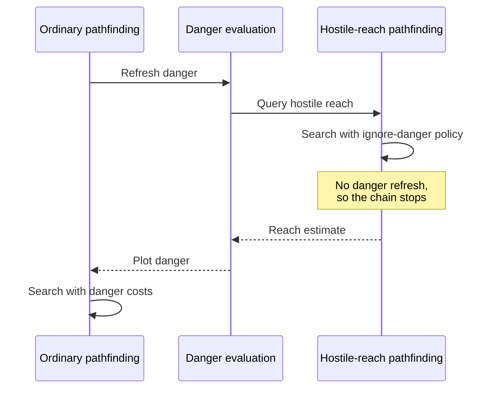

# Unit AI: Pathfinding

The shared pathfinder supplies routes and reachable plots to unit movement, danger evaluation, and [tactical simulation](simulation/overview.md). Its implementation is in `civ5-dll/CvGameCoreDLL_Expansion2/CvAStar.cpp`, with movement flags in `CvUnit.h` and node ordering in `CvAStarNode.h`. See the [unit AI overview](overview.md) for the surrounding systems.

## Pathfinding policy

The pathfinder in `CvAStar.cpp` serves combat search and other AI movement. Callers supply a path type, turn and movement limits, optional zone-of-control exceptions, and movement flags from `CvUnit.h`. These inputs define which routes and stopping plots are allowed and how risk affects their cost.

| Policy | Effect |
| --- | --- |
| Abort in danger | Rejects unsafe near-term stops and increases combat danger costs. Civilians use stricter limits. |
| Stop for a new enemy | Interrupts movement when an additional enemy becomes visible, allowing re-planning. |
| Safe embarkation | Allows embarkation only onto a zero-danger plot. |
| Ignore danger | Removes danger costs from searches that are themselves computing danger. |
| Approximate target | Accepts a plot near the target, optionally only in the unit's native domain. |
| Avoid enemy territory | Refuses enemy-owned plots unless the unit already stands there. |
| Maximize exploration | Prefers steps that reveal unseen plots. |
| Assume the map is revealed | Lets the AI recognize dead ends in unexplored terrain. |
| Selective zone-of-control exception | Ignores control from enemies the simulation has already planned to kill. |
| Hypothetical reachability | Can ignore control, enemies, or stacking to answer questions such as where an enemy could reach. |

Other flags cover no embarkation, no ocean, worker visibility, escorted-civilian stacking, and canal planning.

The open list orders nodes by total cost, then heuristic cost. `PrNodeIsBetter` in `CvAStarNode.h` breaks remaining ties by ascending Y, ascending X, then normal nodes before stop nodes at the same plot. Equal-cost choices are therefore reproducible across heap implementations.

### Reachable plots

A **reachable-plots query** runs pathfinding without a destination. It returns every plot reachable within the caller's turn and remaining-movement limits, subject to the supplied policy. Combat search uses these plots as movement candidates; danger evaluation and army contact checks use the same mechanism with their own policies.

When a simulated kill frees a plot, subsequent queries can ignore that dead unit's zone of control.

### Danger in path cost

For AI units, end-of-turn path cost penalizes risky water, foreign or unowned territory, poor terrain, and unknown plots. Its main cost is projected danger relative to current health. High-danger stops in the near future cost more; later stops matter less because they will be re-planned. Civilians and embarked units receive stronger penalties and can be rejected outright by the abort-in-danger policy.

### Recursion boundary

A **hostile-reach query** estimates enemy movement with the ignore-danger policy, breaking the recursion between danger evaluation, pathfinding, and tactical simulation:

Within one search, each plot's end-turn danger is computed once and reused across routes.
