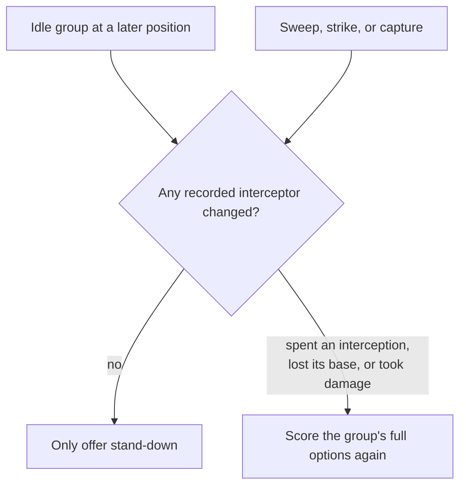

# Unit AI: Tactical Air Search

The default-off `VOX_TACTICAL_AIR_SEARCH` mod option lets bombers, fighters, and missiles join the coordinated search. This allows a plan to move a carrier, sweep an interceptor, and strike with aircraft in sequence with ground and naval attacks. With the option off, `ExecuteAttackWithUnits` uses the greedy `ExecuteAirSweep` and `ExecuteAirAttack` passes before combat search.

See the [simulation overview](overview.md) for the shared combat search and [conventional air operations](../tactics/air.md) for aircraft ownership and the option-off path.

| Source | Responsibility |
| --- | --- |
| `NewCustomModOptions.xml`, `CustomMods.h`, `CustomMods.cpp` | Declare the option. |
| `CvTacticalAirSearch.cpp` and `.h` | Air helpers, scorers, option cut, and per-position air and interceptor state. |
| `CvTacticalAI.h` | The position class's air members. |
| `CvTacticalAI.cpp` | Calls into air code during recruitment, expansion, and assignment application. |
| `CvTacticalSearchShared.h` | Search internals shared with air scorers. |
| `CvPlot.cpp` | `GetInterceptorValue` and `GetBestInterceptor`: eligibility and ranking shared by live combat and search. |

## Recruitment and actions

Aircraft use the `MS_AIR` strategy. They act from a base and have no end-of-turn plot score. A strike uses `A_RANGEATTACK`, or `A_RANGEKILL` for a certain kill; a sweep uses `A_AIRSWEEP`; standing down uses `A_FINISH_TEMP`.

Recruitment considers both the current base and eligible plots the carrying ship can reach this turn. If an aircraft needs that ship to move, the search recruits the ship too. Launch plots must fit the search area and its approach-to-target restrictions (`GetCargoLaunchPlots`). Once the ship moves in a simulated plan, its aircraft launch from the new plot, including for source-dependent combat modifiers.

`GetAirTargetPlots` uses the game's strike-validity check from the assumed launch plot through `CanAirUnitStrikeFrom`. Fighters are recruited even when no bomber or missile joins the attack. If an unseen target first needs a fighter sweep for reconnaissance, `ExecuteSpotterMove` performs it before search; the fighter has then spent its attack and stays out of the plan.

## Interception and uncertain damage

Each position tracks used interceptions, damage, and lost air bases, keyed by unit ID, which is unique across players. `GetBestInterceptorInPosition` selects among visible interceptors using the game's ranking rule, adjusted for what the plan has already done. Strike and sweep damage use both sides' projected HP. Every engagement spends an interception, even if interception fails.

The search keeps two damage records:

| Record | Purpose |
| --- | --- |
| Certain damage | Updates HP used for kill decisions. A planned kill requires enough damage and a strike with a sure landing. |
| Uncertain damage | Stores expected damage from strikes an interceptor may stop. It affects later damage rewards without allowing the search to assume the target is dead. |

`ScoreAttackDamage` caps damage at the HP expected to remain after earlier uncertain strikes, then weights it by the landing chance. Kill bonuses also account for landing chance and the chance the target is still alive, preventing repeated rewards for the same kill.

For example, a strike that would deal 40 damage to a unit with 30 HP, but has a 50% landing chance, receives credit for 15 expected damage. The search keeps the target alive so later actions cannot rely on that kill.

Sinking a ship or capturing a city removes its aircraft from the interceptor state. A ship sunk inside a city that holds still takes its cargo down, as the game kills a transport's cargo wherever it dies. Sinking an enemy ship also scores its visible aircraft cargo. Killing a city's garrison by air leaves the city hostile, targetable, and exerting zone of control. A later capture does not count that garrison again.

## Why a sweep can be worth choosing

A sweep earns a plan score for the damage it trades with its interceptor. Its main benefit may come from helping later strikes, so it also gets a separate **ranking bonus**: the best improvement in strike value available to each remaining aircraft, including the sweeper's interchangeable group mates and the sweeper's own remaining attack, scored from its state after the sweep. Sweep damage is calculated from the assumed launch plot, so a planned carrier move changes it. That improvement includes both a better landing chance and lower interception losses. Strike value comes from the strike scorer itself, so a missile gains nothing against a city with no unit in it.

`RankScore()` uses this bonus when pruning and ordering choices. The bonus never enters the final plan score, so the search must actually follow the sweep with useful actions to realize that value. `GetAirSweepPlots` offers one sweep per distinct interceptor covering an enemy plot in range, using the covered plot nearest the tactical target.

A missile at a base likely to be lost gets a strike bonus under the same danger rule as `ShouldRebase`. This encourages firing it before it is destroyed. Reusable aircraft get no such bonus because they can rebase. Fired missiles and aircraft predicted to die leave the available-unit list.

## Keeping the search bounded

### Aircraft groups and limits

Aircraft with the same owner, type, base, promotions, HP, moves, and attacks made are interchangeable. Only the lowest-ID available member proposes actions. Standing that member down also stands down the rest of the group in ID order. The expansion loop adds each combo move through `addAssignmentsWithAirGroups`, which applies the one or two rows and then this group rule, so the rule lives in one place.

| Limit | With air search enabled |
| --- | --- |
| Participants | 19 land units, sea units, and aircraft groups combined; each aircraft group counts once. A group that depends on carrier movement must fit together with its carrier. An idle group (below) counts like any other. |
| Positions | Up to 10,000 positions per search. |
| Assignments | The shared pool has 3,000 rows per expansion. Each aircraft leader keeps at most the per-unit choice limit plus a stand-down action, regardless of how many targets it can reach. |

`getPreferredAssignmentsForAirUnit` scores each candidate once into reusable scratch rows outside the pool, then copies only the retained choices into the pool. `getUnitsToDropWithAircraft` enforces the participant cap.

### Idle groups

An **idle group** has no worthwhile action at the root, usually because several full-strength interceptors cover every target. `dropSuperfluousUnits` classifies it during the importance pass:

| Root condition | Required value |
| --- | --- |
| Positive strike or sweep | None |
| Best strike under the root's remaining interceptors | Worse than a net loss of 10 damage points (`TACTSIM_AIR_HOPELESS_RANK`) |
| Base | On land; ship-based groups are never idle because carrier movement can reveal new targets. |

The pass gives its best strike rank to `getUnitsToDropWithAircraft`, avoiding duplicate scoring. That helper records the visible interceptors near each idle group's targets.

Earlier air actions can therefore clear the way for an idle group. The negative margin allows for targets that ground attacks soften first.

Carrier danger includes all aircraft aboard, even those outside the search, except cargo the plan has already spent.

Equivalent-position pruning compares interceptor state and damage records as well as the normal combat state (`airStateEquals`). These records survive expansion so later comparisons can still use them.

### Air caches

Ranking a sweep rescores other groups' strikes, so the search caches values for the lifetimes below.

| Cached value | Kept for | Notes |
| --- | --- | --- |
| Strike damage | One search | Stored in the attack cache that land ranged attacks use. Damage never depends on interceptors, so the landing chance is still computed on every call against the interceptors the position has left. |
| Interception damage | One search tree | Keyed by interceptor, attacker, target plot and the damage the position assumes for each. Expanding a root position clears it. |
| Interceptor value over a plot | One search tree | Keyed by interceptor, target plot, and the damage and interceptions the position assumes for the interceptor. Expanding a root position clears it. |
| Strike value and best interceptor per aircraft and target | One expansion | The position's own strike values, which every sweep it ranks compares against. Leaders fill it as they score their strike options. |
| Strike gain per aircraft and swept interceptor | One expansion | The targets the swept interceptor guards against the aircraft, with their strike values, and the aircraft's best gain for each amount of sweep damage. A sure sweep that damages only the interceptor leaves every other aircraft as it was, so sweeps that deal the same damage give the same gain. The sweeper's own gain, which depends on its state after the sweep, is always scored. |
| Target and interceptor candidates | One search | Which plots an aircraft can reach and which units could intercept there. The best interceptor is still chosen per position. |
| Carrier reach | One recruitment or search | Executed moves can change routes. |

`makeNextAssignments` marks each expansion with `BeginAirExpansion` and `EndAirExpansion`, and only marked expansions use the interception and strike-value caches. Callers outside a search, such as the simulator's command checks, compute these values directly because executed moves change the real units.

## Support and execution

Aircraft receive no support-placement moves: their final positions and strikes are omitted from support checkpoints. A plan with only aircraft needs no support search.

Replay issues `MISSION_RANGE_ATTACK`, which `CvUnit::PushMission` validates and converts to a move mission for aircraft. A sweep runs only if an interceptor is present. Replay skips aircraft that died earlier and leaves aircraft that did not act unprocessed so later patrol work can use them. Strike result checks still apply.

`PerformRangedOpportunityAttack` handles aircraft through its stationary, greedy branch. They reach the learned policy only through coordinated attack search.
