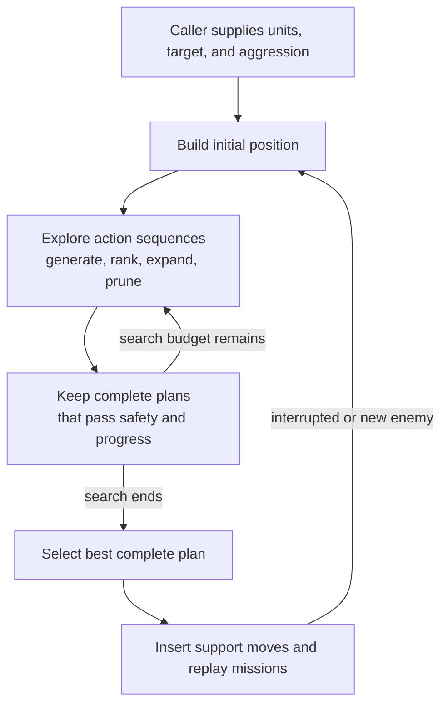
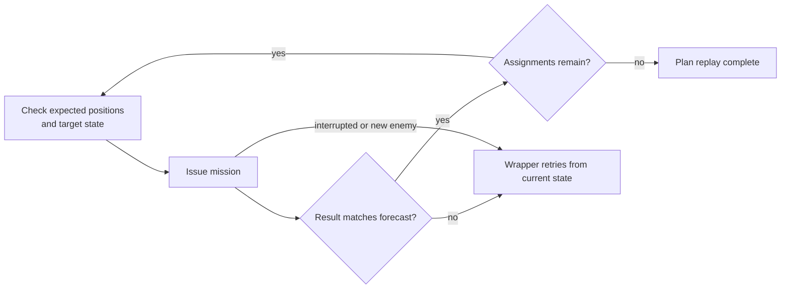

# Unit AI: Tactical Simulation

**Tactical simulation** chooses a coordinated plan for nearby units to carry out this turn. [Military tactics](../tactics/overview.md) supplies the units, target plot, and aggression level. The simulation tries sequences of actions, checks whether their final positions are acceptable, and replays the best complete plan as real missions.

[Coordinated combat search](#coordinated-combat-search) covers this process. [Scoring](scoring.md) explains how plans are ranked, and [air search](air.md) adds aircraft when enabled. [Pathfinding](../pathfinding.md) explains how the shared pathfinder supplies reachable plots and controls movement risk, both inside and outside combat search. Return to the [unit AI overview](../overview.md) for the surrounding systems.

The source files are under `civ5-dll/CvGameCoreDLL_Expansion2`:

| File | Responsibility |
| --- | --- |
| `CvTacticalAI.cpp` and `CvTacticalAI.h` | Search state, action scoring, plan acceptance, support placement, and replay. |
| `CvTacticalAirSearch.cpp` and `CvTacticalAirSearch.h` | The air search: air targets, launch plots, interception, air scoring and the option cut, and aircraft and carrier state. `CvTacticalAI.h` includes the header. |
| `CvTacticalSearchShared.h` | The search internals of `CvTacticalAI.cpp` that the air scorers use. Only the two tactical source files include it. |

## Coordinated combat search

A **position** (`CvTacticalPosition`) is a hypothetical battle state. It records unit locations, remaining moves, expected damage, killed enemies, freed plots, and the actions taken so far. An **assignment** (`STacticalAssignment`) records one unit's move, attack, special action, or decision to stop acting.

The search builds a tree of positions by adding assignments. Child positions reuse unchanged state from their parents, and a preallocated pool holds up to 6,000 positions per search. A unit committed by the selected plan becomes processed under the shared [operation lifecycle control state](../operations/lifecycle.md#control-state). A unit assigned a blocked fallback remains available to later Tactical passes.

### Search procedure

| Step | Behavior |
| --- | --- |
| Build initial position | Collect the target area, nearby enemies, and participating units. Remove duplicates, inactive units, and wrong-domain stacks outside cities. |
| Assign movement strategy | Default [UnitAI role](../concepts.md#unitai-roles) and attack range select first line, second line, third line, support, or embarked, defining preferred enemy distance. |
| Limit participants | Keep at most 13 units, ranked by their best single moves; block the rest for later passes. [Air search](air.md) raises this cap and the position-pool limit. |
| Propose actions | Query [reachable plots](../pathfinding.md#reachable-plots) and ranged targets. Try moving, staying, attacking, pillaging, other valid special actions, and a blocked fallback. Scores and provisional safety narrow choices; friendly blockers can trigger a limited swap or one-step chain. |
| Expand and prune | Start broad and best-first, then follow promising lines more deeply with fewer choices. Difficulty bounds branches, choices per unit, and complete positions. Discard equivalent siblings to avoid action permutations. |
| Reveal a new enemy | End that branch with a restart marker. |

If no acceptable complete plan exists, the wrapper can drop unusable units and retry. [Acceptance and replay](#acceptance-and-replay) describes when a plan succeeds and how retries work.

### Entry points and aggression

The caller chooses aggression:

| Work | Entry point | Aggression |
| --- | --- | --- |
| Independent-unit combat | `ExecuteDestroyEnemyUnits` → `ExecuteAttackWithUnits` | [Posture](../tactics/targets-and-postures.md#postures-and-local-combat) sets work order and aggression: Low for Attrition and Hedgehog, up to High for Steamroll. |
| City capture | `ExecuteCaptureCityMoves` → `ExecuteAttackWithUnits` | Medium with up to two non-ranged recruits; High with more. |
| Army gathering, zone reinforcement, camp clearing | `PositionUnitsAroundTarget` | Low |
| [Army contact](../tactics/engagements.md#army-contact) | `CheckForEnemiesNearArmy` | Medium |
| Mobile ranged opportunity | `PerformRangedOpportunityAttack` | Low. Uses search if movement or post-attack repositioning is possible; otherwise chooses a direct ranged attack. |
| Barbarian unit attack | `ExecuteAttackWithUnits` | Braveheart |

[Search engagements](../tactics/engagements.md) describes when each caller runs a search, which units it recruits, and which units it leaves out.

An enemy-unit target records the last aggression used against it. A later pass retries it only at a higher level.

Aggression changes provisional danger tolerance and a **melee trade veto**. When a melee attack takes counter-damage and the unit has a safe reachable alternative, the veto compares damage dealt with damage received. It scales damage dealt by the friendly-to-enemy force balance, the database damage weight, and the multiplier below. An unfavorable non-killing trade is rejected when either threshold is crossed:

| Level | Trade multiplier | Reject an unfavorable trade when… |
| --- | --- | --- |
| Low | 0.7× | Projected HP is below 40 or danger exceeds maximum HP. |
| Medium | 1.1× | Projected HP is below 20 or danger exceeds maximum HP. |
| High | 2.3× | Danger exceeds maximum HP. The HP threshold is -5. |
| Braveheart | 4.2× | Danger exceeds maximum HP. The HP threshold is 0. |

Within this veto block, every level except Braveheart also rejects an attack below three projected HP, even if it kills the target. The multipliers affect this decision only; they do not change ordinary attack scores. Ranged attacks without counter-damage skip the veto. Final-position safety checks still apply as described below. No current simulation entry point uses the None aggression level.

The RISK [military tactical flavor](../flavors/scoring.md#risk-thresholds) can allow one casualty for a large group and changes the HP threshold below which wounded units stop following preferred-line positioning scores. Higher RISK accepts more risk. Its default is ten times the leader's offense, preserving the stock thresholds. Final danger validation still applies.

### Acceptance and replay

A position completes when all starting enemies are dead or all units have exhausted their options. It then has to pass two checks:

1. **Safety:** final positions permit limited casualties, with one allowance per enemy killed and a bias toward protecting experienced units.
2. **Progress:** without a kill, restart, or great-person power use, the plan must improve more units' distance to their preferred line than it worsens. Ties consider movement toward the target, attacks in place, and healing.

Final safety does not become more permissive from Low through High. Every level checks adjacent-enemy death traps and the edge of known visibility. The visibility-edge check skips cities, allowing a lone siege unit to capture a city there. Braveheart bypasses the remaining extreme-danger block. Frontline land cities and friendly citadels also have specific exemptions, but a city projected to fall even with its garrison loses its frontline bonus and related exemptions.

After [support placement](#support-placement), `ExecuteUnitAssignments` replays the selected plan. Mission-bearing assignments follow this loop:

Initial-state, temporary-finish, wait, and double-move bookkeeping rows issue no mission; blocked aircraft rows also issue none. A restart marker returns to the wrapper.

Replay ignores ordinary danger stopping because planning has already evaluated danger. Failed pre-mission checks also return to the wrapper, which tries up to four times and can drop unusable units when planning finds no complete position.

What a replay leaves behind:

| Rule | Effect |
| --- | --- |
| A plan gives each unit an attack, a move, a finish (end the turn in place), or nothing. | A unit with nothing stays free for later passes. |
| Replay runs rows in order and stops at the first that fails, for example when a move reveals a hidden enemy. | Rows already run stay done. Rows after the failure never run. |
| Finishing units are marked processed only after the whole replay succeeds, and not when they should heal and still have moves. | A unit that only moved, or finished in a replay that stopped, stays available. |
| Each retry builds its positions from scratch on the current state. | A retry sees enemies the last attempt revealed. |

### Support placement

Great Generals, Great Admirals, and siege towers have a separate search after the combat plan is selected. `AddSupportMoves` follows the selected combat tree and inserts support moves before attacks so the relevant aura is present.

Attack recruitment admits civilian support that can reach within two plots of the target. Army contact searches retain it even without an attack target of its own. During support planning, a move must add useful coverage: generals help land attackers, admirals help naval attackers, and siege towers help city attacks. None of these bonuses apply to aircraft, so air strikes neither trigger support moves nor receive the hypothetical bonus. Waiting needs no new coverage. Support units still face final safety checks; a friendly defender's projected damage adds a support danger penalty only above two-thirds of its maximum HP.

The search uses attack **checkpoints** to decide when coverage matters. Each checkpoint retains the combat position's last attack, its plots, and attacker domain, even when finish or stay-put assignments follow it. The available support-unit count determines how waits are grouped before the next attack, and duplicate pruning compares combat states too.

A final attack bundled with another unit's stay-put action can score differently from the same actions in separate positions: final-position safety and placement rules run at different points.
