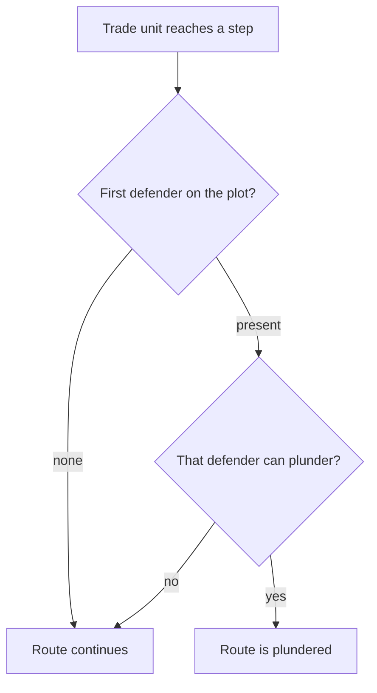

# Unit AI: Tactical Simulation Scoring

This guide describes how `CvTacticalAI.cpp`, under `civ5-dll/CvGameCoreDLL_Expansion2`, scores actions and ranks plans. See the [simulation overview](overview.md) for the search procedure and safety checks, and [air search](air.md) for aircraft scoring.

Scores rank useful damage, valuable actions, and good positioning. A high score still needs to pass the [acceptance checks](overview.md#acceptance-and-replay).

## Assignment score

An **assignment** combines damage, bonuses, and the change in plot score:

`assignment score = new plot score - old plot score + 10 * (damage delta + bonus)`

| Term | What it measures |
| --- | --- |
| Damage delta | `ScoreAttackDamage` credits damage dealt and subtracts damage received. Unit damage is capped at remaining HP; city damage permits limited overkill. Strengths read flanking, adjacency modifiers and auras from a neighborhood record of the planned board, where the plan has placed its units; general support, splash and repeat attacks are approximated. Healing, such as from pillaging, can also add value. |
| Bonus | A direct unit kill adds 15 and city capture adds 100, before the 10× weight. Other bonuses cover focus fire, kill effects, civilian captures, pillaging, and barbarian camps. Ranged attacks also favor the requested target and movement left to disengage. |
| Plot score | `ScorePlotForCombatUnitMove` combines ten times plot desirability, a danger adjustment, and small location and movement preferences. Only the change from the unit's previous plot score enters the assignment score. |

For example, dealing 30 damage, receiving 10, earning a 15-point kill bonus, and improving the plot score by 20 contributes `20 + 10 * (30 - 10 + 15) = 370`, before other contextual bonuses. Score components and the combined assignment score are clamped to the signed 16-bit range so large penalties cannot wrap into rewards.

### Scale of the scoring items

All values are in assignment score points, after the 10× weight where it applies, and come from `CvTacticalAI.cpp`.

| Item | Points | Enters plan ranking? |
| --- | --- | --- |
| City capture | 1,000 | Yes |
| Civilian capture | 1,500, or 200 for a worker | Yes |
| Empty barbarian camp | 1,000 | Yes |
| Direct unit kill | 150 | Yes |
| Damage dealt or received | 10 per HP | Yes |
| Moving onto an enemy citadel | 134 with moves left to pillage it, otherwise 67 | Yes |
| Moving into our frontline citadel or a frontline city | 67, or 33 for a melee unit with friends beside and no enemy adjacent | Yes |
| One tier of enemy-distance desirability | 40 to 60, such as 120 adjacent and 60 at two plots for first-line land units | Yes |
| Move-time danger | Minus half the danger, minus 1 per 20% of current HP it represents | Yes |
| **Trade intercept** | **15**, scaled by gold flavor and health | Yes |
| **Trade guard** | **10**, scaled by gold flavor and health | Yes |
| Staying near our cities | Up to 10 | Yes |
| Movement left | 1 per move | Yes |
| Turn-end danger | Danger as a percent of current HP, compressed above 225 and doubled with no friend beside | No: starting scores and the safety check |
| Staying beside a friend | 8 to 13 | No: starting scores and the safety check |
| Defensive terrain | 1 per 5% defense | No: starting scores and the safety check |

The last three come from `ScoreCombatUnitTurnEnd`. That function only sets each unit's starting plot score and checks the final plan. Plans are ranked by move-time scores, so it never ranks completed plans.

## Positioning and danger

With enemies present, the land desirability table peaks at 12:

| Movement strategy | Preferred distance from enemies                    |
| ----------------- | -------------------------------------------------- |
| First line        | Adjacent, or an advance onto a killed enemy's plot |
| Second line       | 2 plots                                            |
| Third line        | 3 plots                                            |

Naval units use a separate table. Without enemies, desirability follows distance to the tactical target. A unit more than four steps from the target earns 40 for each step closer and may not step away (`UpdatePlotDistanceToTarget` builds the distances). The target can be any plot, so positioning searches use the same pull toward their destination. City proximity and remaining movement add small preferences. Attacks include the score of the resulting location.

Intermediate moves receive provisional danger penalties. `ScoreCombatUnitTurnEnd` checks final positions against remaining HP, adjusts for experience, and penalizes isolation more heavily. Nearby friendlies, terrain, air cover, and citadels can improve the result. Unsafe plots can be rejected outright.

## Search order and final ranking

Search order and final ranking use different scores and checks:

| Stage | Score or check | Role |
| --- | --- | --- |
| Candidate generation | Assignment score | Prunes and orders candidate assignments. Rank-only bonuses for trade routes and air search affect this order separately. |
| Search queue | Generation (search depth), then last-round rank | Favors shallow generations early and deeper ones later. Within a generation, favors the last-round heuristic plus rank-only bonuses. |
| Completed plans | [Acceptance](overview.md#acceptance-and-replay) checks | Rejects unsafe or non-progressing plans. |
| Final ranking | Current total score | Ranks accepted plans, highest first. Ties use fewer assignments, then lower position ID. |

### Completed-plan score

`CvBasePosition::UpdateScore` accumulates damage and bonuses and replaces the acting unit's stored plot score. `getScoreTotal` then reads those current components:

`total score = 10 * (cumulative damage delta + cumulative bonuses) + sum of stored unit plot scores + trade gain`

The [trade gain](#how-plans-keep-the-score) and any completion-time plot-score changes enter ranking immediately. For example, changing the sole stored plot score from 20 to 30 produces a total of 30 when damage, bonuses, and trade gain are zero.

Leaving a unit unused earns no extra score. Completed plans with equal totals still prefer fewer assignments. The [24-map tuning study](../../../../../../vox-deorum-rl/docs/rollouts/snapshots/unused-unit-bonus-2026-11-14.md) compares unused-unit bonuses from 0 to 240.

### Last-round heuristic quirk

The queue's last-round heuristic adds unscaled damage and bonus, plus new plot score minus old plot score. It also subtracts the acting unit's previous stored plot score when one exists. When the old score equals that stored entry, the previous value is subtracted twice.

For the same 20-to-30 assignment, with zero damage and bonus, the last-round increment is `30 - 20 - 20 = -10`. This affects which branch the search explores next. Accepted completed plans use the current total described above.

## Trade routes

With the default-off `VOX_TACTICAL_TRADE_SEARCH` mod option, a plan earns a trade score for where it leaves our units when each trade unit makes its owner's next trade movement. The [scale table](#scale-of-the-scoring-items) shows where the two terms sit: above the small end-plot preferences, and below one tier of enemy-distance desirability. They decide between nearby plots without pulling a unit out of its line.

| Term | Base | When it applies |
| --- | --- | --- |
| Intercept | 15 per route | One of our units is the defender that native trade movement meets on a step of a visible enemy route, and that unit can plunder there. |
| Guard | 10 per route | Every endangered step of our own route is held by one of our combat units, not embarked, that every threat can see there. A step is endangered when a known enemy unit that could plunder there (seen at the step, not embarked, ocean rule) can move onto it. Moves that would capture a city are not counted, since the capture ends the route anyway. |

### Scaling

| Factor | Effect |
| --- | --- |
| Gold flavor | The player's `FLAVOR_GOLD`, read the way the [tactical flavors](../flavors/overview.md) read theirs, scales the whole trade score: half at 0, unchanged at 50, double at 100. |
| Health | Each unit counts with the square of its HP share after predicted damage. At half HP it earns a quarter, since a hurt unit holding a step takes more risk. |

### Interception and guarding

Native trade movement meets only the first defender on a plot, in the plot's unit order (`isBeforeUnitCycle`: lower player ID first, then sea before land). `GetTradeStepTaker` applies the same rule to planned unit positions and every other surviving unit on the step that we can see, of any player.

An enemy route goes to the defender met on its earliest step that has one, so a route pays once. An allied embarked unit with a lower player ID on our ship's plot therefore blocks interception, as it does in native movement.

An enemy that ends its turn on any endangered step of our route plunders it. A route is therefore only as safe as its least-held endangered step, and holding one of two endangered steps earns nothing. A step outside the search keeps its starting state in every plan, so a route that an unheld step there dooms stays doomed. The threats are read when the search starts, so plots revealed later change nothing. A stealthy guard that a threat cannot see does not hold the step, since that threat may share the plot, and an embarked unit cannot defend it. Killing the threat leaves no step endangered, which is worth the same as guarding.

The threat comes from the danger map's list of units that can move onto each plot in their own domain (`CvDangerPlots::GetPossibleCapturers`), melee or ranged. A ranged unit that can only shoot the step, a city and terrain damage do not count.

### How plans keep the score

| Part | Role |
| --- | --- |
| `TacticalAIHelpers::SetSearchTradeRoutes` | At the root, before the unit cap, picks the routes that have a step on the search's plots: our own, and visible routes of teams at war with us. It reads the threats to our steps from the danger map once, and sets the gold weight and the root's trade score. |
| `CvTacticalPosition::computeTradeScore` | Scores those routes for the whole position. |
| `addAssignment` | Recomputes the trade score after every assignment that touches a step plot, kills, heals, or damages an enemy whose death matters to the score, splash included, and adds the change to the plan's trade gain, which `UpdateScore` puts in the total. Moves, attacks that advance, kills of a threat and captures all count, whatever order units move in. |
| `ScorePlotForCombatUnitMove` and melee attack scoring | Give each move, and each attack by where it leaves the unit, its unit's own trade gain as a rank bonus. The rank bonus picks which moves each unit tries and orders the search, but never enters the plan score. |
| `isKillOrImprovedPosition` | Counts a higher trade score than the root's as progress, so a sideways move onto a step can pass. |

A route scores nothing once the plan captures its origin or destination, or a city on a sea route's path, since that capture cancels it. Invisibility is judged at the step plot, against the detection on the map when the search runs, for interceptors, guards and threats alike. Planned kills and moves of detectors keep that detection, as VP keeps a team's vision after the unit that gave it dies. Threats come from the danger map, which leaves out units that cannot attack, though such a unit could still walk onto a step and plunder. `TacticalAIHelpers::UpdateTradeSteps` rebuilds the step map only when a trade route changed since the last search.

Recomputing the whole trade score, rather than one route at a time, is cheap enough in practice. In simulator rollouts of three late-game turns, a search that met a trade route took about 10 to 40% longer, but the whole turn took no measurably longer, since tactical search is a small share of a turn. The `vox-deorum-rl` native profiling guide records the measurement.

## Tactical flavor adjustments

[Military tactical flavor scoring](../flavors/scoring.md) can scale selected damage, bonus, and end-of-turn terms, reduce the pull into enemy territory, reward guarding cities and holding friendly ground, and change the danger penalty through RISK. At neutral values of 50, with RISK unset, these adjustments leave the rules unchanged.
