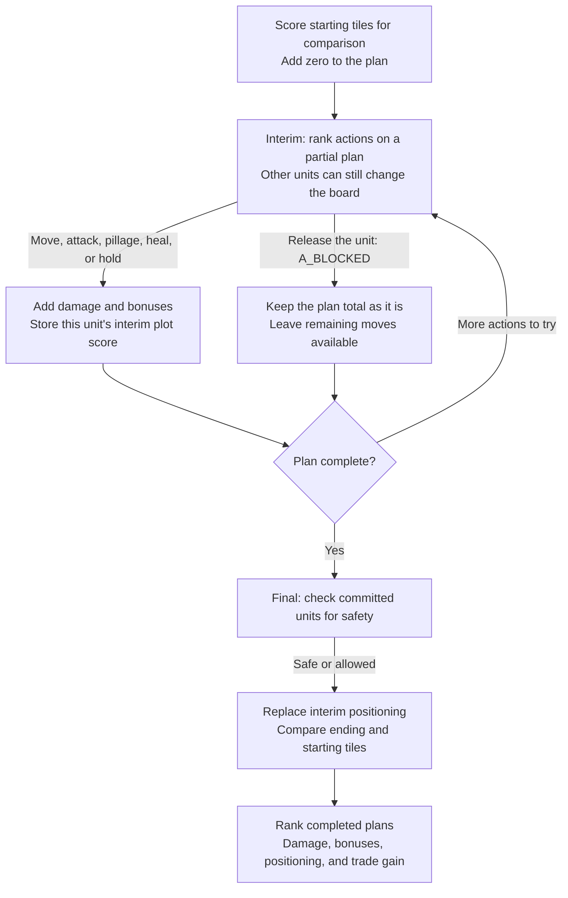
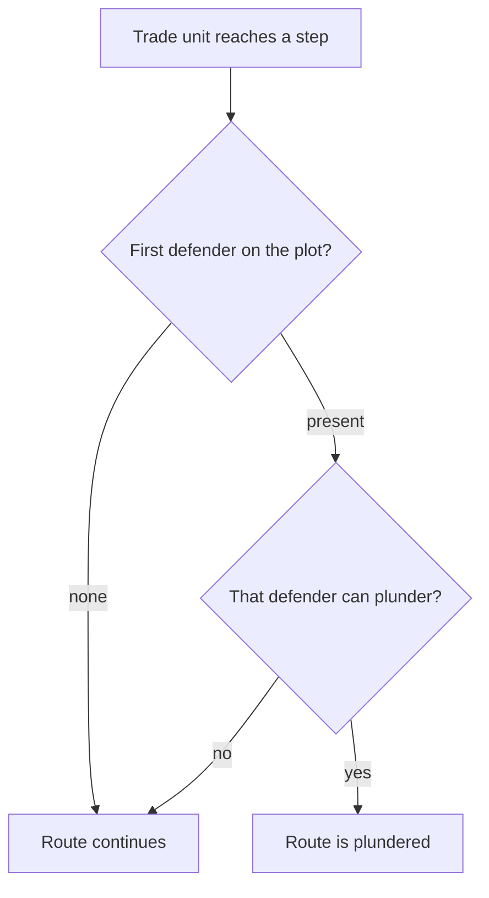

# Unit AI: Tactical Simulation Scoring

The [command loop](../commands/value.md) ranks fights. Tactical search then ranks plans for one fight or positioning task. Each plan is a sequence of unit actions, called **assignments** in `CvTacticalAI.cpp`. The search uses an **assignment score** to choose what to explore and a **plan total** to choose among completed plans.

This page covers land and naval combat. See the [simulation overview](overview.md) for the search procedure and [air search](air.md) for aircraft, which score strikes and sweeps without an end-of-turn plot score.

## Assignment score

The candidate score compares a proposed action with the unit's previous assignment, or with its starting plot score if it has not acted:

`assignment score = new plot score - old plot score + 10 * (damage delta + bonus)`

| Term | What it measures |
| --- | --- |
| Damage delta | Damage dealt minus damage received, plus credited healing. `ScoreAttackDamage` caps unit damage at remaining HP and allows limited city overkill. Combat strength uses the planned board for flanking, adjacency and auras; general support, splash and repeat attacks are approximated. |
| Bonus | Rewards for outcomes such as kills, captures and pillaging, or preferences such as focus fire. The table below shows their size after the 10× weight. |
| Plot score | `ScorePlotForCombatUnitMove` combines ten times plot desirability with danger and smaller preferences such as staying near a friendly city or saving moves. The candidate uses the change in plot score; the plan stores the new value. |

For example, an attack that deals 30 damage, takes 10, earns a kill and improves the plot score by 20 has a candidate score of `20 (plot change) + 10 × (30 dealt − 10 taken + 15 kill bonus) = 370`, before other bonuses. Score components and the combined assignment score are clamped to the signed 16-bit range so large penalties cannot wrap into rewards.

### What each action scores

| Action | Plot score | Damage or healing | Example bonuses |
| --- | --- | --- | --- |
| Move | Destination. Can gain points for closing on the target. | Damage on movement, if the unit has that ability. | Capturing a civilian or clearing a camp. |
| Melee attack | Current tile, or the target tile if the unit advances. | Damage dealt and taken. | Kill or city capture. |
| Ranged attack | Firing tile, evaluated after the shot. | Damage dealt. | Kill, shooting the requested target, or keeping moves to withdraw. |
| Pillage | Current tile after pillaging. | Healing or damage from pillaging. | Pillaging a damaging improvement or a tile with a strategic resource. |
| Heal in place (`A_HEAL`), for an eligible damaged unit with full moves | Current tile, with any frontline fortification credit. | HP restored, minus any expected damage from an adjacent enemy citadel. | Potential damage to adjacent enemies from a fortification ability. |
| Hold in place (`A_FINISH_TEMP`) | Current tile, with provisional danger and any frontline fortification credit. | Expected damage from an adjacent enemy citadel, if any. | Potential damage to adjacent enemies from a fortification ability. |
| Release the unit (`A_BLOCKED`) | Keeps the provisional value until the plan is complete. | Adds none. | Adds none. Remaining moves stay available for later tasks. |

The search offers a ranged unit a hold or heal only if no shot qualifies in the local search. A Withdraw search also offers the hold or heal alongside a qualifying shot, so staying still competes with a parting shot. The starting assignment (`A_INITIAL`) supplies a plot reference for comparing candidates without adding points.

### Why a hold has an interim score

`A_FINISH_TEMP` means the search has proposed that **this unit** stay where it is. Other units can still kill a threat or move next to it. When proposing the hold, the search uses the lighter `EM_INTERMEDIATE` danger penalty and runs a quick safety check that can allow for friendly help. Using the full end-of-turn check at this point could reject a hold that another unit makes safe later in the plan.

Once the plan is complete, `EM_FINAL` checks which enemies remain and which friendly units will end their turns nearby. It can double the danger penalty for an isolated unit even when the underlying danger is unchanged. If the unit's position is accepted, the search appends `A_FINISH`. A unit released with moves left can still withdraw, so its plot score affects ranking without imposing an end-turn safety check.

### Scale of the scoring items

These values come from `CvTacticalAI.cpp` and include the 10× weight where it applies.

| Item | Points | Enters plan ranking? |
| --- | --- | --- |
| City capture | 1,000 | Yes |
| Civilian capture | 1,500, or 200 for a worker | Yes |
| Empty barbarian camp | 1,000 | Yes |
| Direct unit kill | 150 | Yes |
| Damage and credited healing | +10 per HP dealt or restored; −10 per HP taken | Yes |
| Enemy citadel | Moving onto it: 134 with moves left to pillage it, otherwise 67. Ending the turn there: one-third of its improvement damage. | Interim and final plot scores |
| Our frontline citadel or a frontline city | Base 67, or 33 for a melee unit with friends beside and no enemy adjacent | Interim and final plot scores, using the rules for each stage |
| One tier of enemy-distance desirability | 40 to 60, such as 120 adjacent and 60 at two plots for first-line land units | Yes |
| Move-time danger | Minus half the danger, minus 1 per 20% of current HP it represents | Interim plot score |
| Trade intercept | 15, scaled by gold flavor and health | As plan trade gain |
| Trade guard | 10, scaled by gold flavor and health | As plan trade gain |
| Staying near our cities | Up to 10 | Yes |
| Movement left | 1 per full move while exploring; at completion, reduces only the added danger of a move | Interim and completed plan scores |
| Turn-end danger | Danger as a percent of current HP, compressed above 225 and doubled with no friend beside | Starting reference and final plot score |
| Staying beside a friend | 8 to 13 | Starting reference and final plot score |
| Defensive terrain | 1 per 5% defense | Starting reference and final plot score |

## Positioning and danger

With enemies present, the land desirability table peaks at 12:

| Movement strategy | Preferred distance from enemies                    |
| ----------------- | -------------------------------------------------- |
| First line        | Adjacent, or an advance onto a killed enemy's plot |
| Second line       | 2 plots                                            |
| Third line        | 3 plots                                            |

Naval units use a separate table. Without enemies, desirability follows distance to the tactical target. When target distance matters, a unit more than four steps away earns 40 interim points per step closer, up to that four-step boundary, and cannot move farther away. `UpdatePlotDistanceToTarget` builds these distances for both combat and positioning tasks.

A Withdraw search replaces the enemy-distance table with its own two rows, uses plain enemy distance for every unit and scores the pull home in the plot score, so its target distance is off. See [Withdraw search](../commands/withdrawal.md#withdraw-search).

Intermediate moves receive provisional danger penalties. `ScoreCombatUnitTurnEnd` checks final positions against remaining HP, adjusts for experience, and penalizes isolation more heavily. Nearby friendlies, terrain, air cover, and citadels can improve the result. Formation and isolation count committed defenders by domain. A land unit and a ship sharing one tile, including a city, each count when the scorer uses both domains. Embarked units give no adjacent cover. Unsafe plots can be rejected outright.

## Search order and final ranking

Search order and final ranking use different scores and checks:

| Stage | Score or check | Role |
| --- | --- | --- |
| Candidate generation | Assignment score | Prunes and orders candidate assignments. Rank-only bonuses for trade routes and air search affect this order separately. |
| Search queue | Generation (search depth), then last-round rank | Favors shallow generations early and deeper ones later. Within a generation, favors the last-round heuristic plus rank-only bonuses. |
| Completed plans | [Acceptance](overview.md#acceptance-and-replay) checks | Rejects unsafe or non-progressing plans. |
| Final ranking | Total with changes in final positioning | Ranks accepted plans, highest first. Ties use fewer assignments, then lower position ID. |

### Completed-plan score

`CvBasePosition::UpdateScore` accumulates damage and bonuses and keeps one provisional plot score per unit. At completion, each unit's positioning change replaces its provisional value. The search also scores friendly units outside the search on or next to a changed tile. `getScoreTotal` includes the [trade gain](#how-plans-keep-the-score):

`total score = 10 × (cumulative damage delta + cumulative bonuses) + sum of unit positioning changes + trade gain`

`positioning change = F − S + A × m / (1 + m)`

| Term | What it measures |
| --- | --- |
| `F`, `S` | Plot values with friendly units in their ending and starting positions, respectively. Both use the enemies that survived the plan and the unit's health after its actions. |
| `A` | Added danger: the ending tile's danger penalty minus the starting tile's penalty, floored at zero. Danger is already part of both plot values. |
| `m` | Usable moves left when released, including fractional moves. For a committed turn end, `m` is zero. The movement credit is rounded down to whole score points. |

| What the unit does | Ends its turn | Releases with one move | Releases with two moves |
| --- | ---: | ---: | ---: |
| Stays on its starting tile as a neighbor leaves, adding 30 danger | −30 | −15 | −10 |
| Moves to a tile worth 30 points less, all from added danger | −30 | −15 | −10 |
| Moves to a tile worth 30 points more, with no added danger | +30 | +30 | +30 |

In each layout, nearby defenders that commit to staying provide formation and cover. Units released with moves do not provide that cover in either layout. A unit sharing a tile with the game's chosen defender pays only the share of danger that defender cannot absorb. A civilian pays a capture penalty only if a surviving enemy can enter its tile. Great Generals, Great Admirals and other support units keep the value of getting closer when the army gathers. Cities use their own danger rules.

A shot from the starting tile still earns damage and bonuses. If the friendly layout is unchanged, the shot adds no positioning gain. The safety check can still reject a committed finish. Aircraft and special power actions have no positioning gain, and the separate support search keeps its own placement rules.

### Last-round heuristic quirk

The queue's last-round heuristic adds unscaled damage and bonus, plus new plot score minus old plot score. It also subtracts the acting unit's previous stored plot score when one exists. When the old score equals that stored entry, the previous value is subtracted twice.

For a plot score that goes from 20 to 30 with zero damage and bonus, the last-round increment is `30 (new) − 20 (old) − 20 (stored) = −10`. This affects which branch the search explores next. Accepted plans rank by their plan total.

## Trade routes

With the default-off `VOX_TACTICAL_TRADE_SEARCH` mod option, a plan earns a trade score for where it leaves our units when each trade unit makes its owner's next trade movement. The [scale table](#scale-of-the-scoring-items) shows where the two terms sit: above the small end-plot preferences, and below one tier of enemy-distance desirability. They decide between nearby plots without pulling a unit out of its line.

| Term | Base | When it applies |
| --- | --- | --- |
| Intercept | 15 per route | One of our units is the defender that native trade movement meets on a step of a visible enemy route, and that unit can plunder there. |
| Guard | 10 per route | Every endangered step of our own route is held by one of our combat units, not embarked, that every threat can see there. A step is endangered when a known enemy unit that could plunder there (seen at the step, not embarked, ocean rule) can move onto it. Moves that would capture a city are not counted, since the capture ends the route anyway. |

### Scaling

| Factor | Effect |
| --- | --- |
| Gold flavor | The player's `FLAVOR_GOLD`, read the way the [tactical flavors](../flavors/overview.md) read theirs, scales the whole trade score: half at 0, unchanged at 50, double at 100. |
| Health | Each unit counts with the square of its HP share after predicted damage. At half HP it earns a quarter, since a hurt unit holding a step takes more risk. |

### Interception and guarding

Native trade movement meets only the first defender on a plot, in the plot's unit order (`isBeforeUnitCycle`: lower player ID first, then sea before land). `GetTradeStepTaker` applies the same rule to planned unit positions and every other surviving unit on the step that we can see, of any player.

An enemy route goes to the defender met on its earliest step that has one, so a route pays once. An allied embarked unit with a lower player ID on our ship's plot therefore blocks interception, as it does in native movement.

An enemy that ends its turn on any endangered step of our route plunders it. A route is therefore only as safe as its least-held endangered step, and holding one of two endangered steps earns nothing. A step outside the search keeps its starting state in every plan, so a route that an unheld step there dooms stays doomed. The threats are read when the search starts, so plots revealed later change nothing. A stealthy guard that a threat cannot see does not hold the step, since that threat may share the plot, and an embarked unit cannot defend it. Killing the threat leaves no step endangered, which is worth the same as guarding.

The threat comes from the danger map's list of units that can move onto each plot in their own domain (`CvDangerPlots::GetPossibleCapturers`), melee or ranged. A ranged unit that can only shoot the step, a city and terrain damage do not count.

### How plans keep the score

| Part | Role |
| --- | --- |
| `TacticalAIHelpers::SetSearchTradeRoutes` | At the root, before the unit cap, picks the routes that have a step on the search's plots: our own, and visible routes of teams at war with us. It reads the threats to our steps from the danger map once, and sets the gold weight and the root's trade score. |
| `CvTacticalPosition::computeTradeScore` | Scores those routes for the whole position. |
| `addAssignment` | Recomputes the trade score after a scored assignment that touches a route step, kills, heals, or damages a unit whose death matters to the score, splash included. The change goes into the plan's trade gain. Moves, attacks that advance, kills of a threat and captures all count, whatever order units move in. |
| `ScorePlotForCombatUnitMove` and melee attack scoring | Give each move, and each attack by where it leaves the unit, its unit's own trade gain as a rank bonus. The rank bonus picks which moves each unit tries and orders the search, but never enters the plan score. |
| `isKillOrImprovedPosition` | Counts a higher trade score than the root's as progress, so a sideways move onto a step can pass. |

A route scores nothing once the plan captures its origin or destination, or a city on a sea route's path, since that capture cancels it. Invisibility is judged at the step plot, against the detection on the map when the search runs, for interceptors, guards and threats alike. Planned kills and moves of detectors keep that detection, as VP keeps a team's vision after the unit that gave it dies. Threats come from the danger map, which leaves out units that cannot attack, though such a unit could still walk onto a step and plunder. `TacticalAIHelpers::UpdateTradeSteps` rebuilds the step map only when a trade route changed since the last search.

Recomputing the whole trade score, rather than one route at a time, is cheap enough in practice. In simulator rollouts of three late-game turns, a search that met a trade route took about 10 to 40% longer, but the whole turn took no measurably longer, since tactical search is a small share of a turn. The `vox-deorum-rl` native profiling guide records the measurement.

## Tactical flavor adjustments

[Military tactical flavor scoring](../flavors/scoring.md) can scale selected damage, bonus, and end-of-turn terms, reduce the pull into enemy territory, reward guarding cities and holding friendly ground, and change the danger penalty through RISK. At neutral values of 50, with RISK unset, these adjustments leave the rules unchanged.
