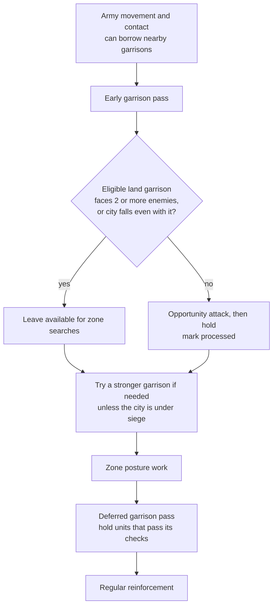

# Unit AI: Search Engagements

A **search engagement** is one call to the [coordinated combat search](../simulation/overview.md#coordinated-combat-search) with a list of units, a target plot, and an aggression level. Tactical AI never plans all of its units together. Each engagement starts from a target that one pass has already chosen, and only the units that pass collected for that target take part. Later passes can reuse units that still have movement and remain unprocessed; processed or exhausted units are unavailable.

The callers and recruitment rules live in `civ5-dll/CvGameCoreDLL_Expansion2/CvTacticalAI.cpp`. See the [tactics overview](overview.md) for the complete turn order.

## When an engagement runs

| Caller | When it runs | Participants | Aggression |
| --- | --- | --- | --- |
| Zone unit attack (`ExecuteDestroyEnemyUnits`) | A posture routine picks the next enemy unit from its [zone targets](targets-and-postures.md#zone-targets) that has not been tried at this aggression yet. Cities in range fire first, and a kill ends the attack. The search runs only if [striking-distance recruitment](#who-a-zone-attack-recruits) finds a unit and the recruits are expected to deal damage. | Striking-distance recruits. | From the [posture](targets-and-postures.md#postures-and-local-combat). |
| City capture (`ExecuteCaptureCityMoves`) | A posture routine tries each enemy city target. It skips a city whose land and water zones are each missing or enemy-dominated, unless it is in danger of falling; a city the recruits cannot bring down within 13 turns of its healing; and a city down to its last hit point when no recruit is a melee unit to take it. | Striking-distance recruits for the city plot. | Medium with up to two non-ranged recruits, High with more. |
| [Army contact](#army-contact) (`CheckForEnemiesNearArmy`) | Enemy units can attack an operation army moving in `PlotArmyMovesCombat`. | The contact group: army members and our units that can attack the threatening enemies. | Medium |
| Positioning (`PositionUnitsAroundTarget`) | Army gathering, zone reinforcement, and barbarian camp clearing. Reinforcement runs only when the zone would hold at least two friendly units. | The caller's own unit list. | Low |
| Barbarian attack | The [barbarian ladder](overview.md#barbarian-priorities) uses the zone unit attack and city capture paths. | Striking-distance recruits. | Braveheart for unit attacks. City capture keeps its melee-count rule. |
| Ranged opportunity | Many passes, described in [ranged opportunity searches](#ranged-opportunity-searches). | One unit. | Low |

## Who a zone attack recruits

`FindUnitsWithinStrikingDistance` builds the participant list for zone unit attacks and city capture from the [current-turn pool](overview.md#independent-units-and-priorities). A unit qualifies when all of these hold:

- It is still usable by Tactical AI, so not processed by an earlier pass this turn.
- It is not a barbarian guarding a camp, a unit that cannot capture when the target is a city, a defense fighter, or a unit covering a friendly civilian.
- It is no farther than four times its base moves from the target. Units that can change port, and aircraft under the air search, are checked by their own range instead.
- It can act on the target this turn:
  - A ranged unit can strike from where it stands, or reach a plot in range this turn without embarking. It must also be expected to deal meaningful damage, or it is left out.
  - A melee unit can get adjacent this turn.
  - A civilian support unit, such as a Great General, can get within two plots this turn.
- A melee or support unit within two plots of the target joins even when it cannot act, so the search can move it out of the way.

The search keeps at most 13 of the recruits and blocks the rest. Blocked and unused units stay available to later passes.

### Expected damage

`ComputeTotalExpectedDamage` estimates what the recruits can deal to the target this turn. Zone unit attacks run only when it is above 0, and city capture uses it for the siege check below.

- One quick combat estimate per recruit from the plot it stands on. No pathfinding.
- Suicidal attacks are skipped.
- Against a unit, at most three melee units that cannot move after attacking count.
- Against a city, each estimate follows the damage of the units before it and tracks the garrison, so one unit's share depends on the others.
- The total is optimistic: it includes ranged units that can only fire next turn and units within two plots that cannot reach. City strikes are not part of it.

**Siege check.** When the expected damage is below the city's remaining HP, `ExecuteCaptureCityMoves` attacks only if `(damage − heal) × 13` reaches the remaining HP. `heal` is `CITY_HIT_POINTS_HEALED_PER_TURN` (8 in Vox Populi), or 0 when the city is blockaded on land and water, plus the city's population under Vox Populi.

## Army contact

**Army contact** is the search `CheckForEnemiesNearArmy` runs for a land, naval, or combined operation army. Escort armies never run it. It runs during [operation army movement](movement.md#operation-army-movement), before garrisons and every zone, once per army per turn. Armies go in the order their operations were created. It does not use the [tactical target](targets-and-postures.md#tactical-targets) list.

1. **Contact group.** An army member joins when it can act, has at least half its hit points, and either has a target in range or can be attacked where it stands. Civilian members only need to meet the first two conditions. For each enemy unit that can attack a member, every unit of ours that can attack that enemy joins too, whether it belongs to a zone, a garrison, or another army.
2. **Trigger and target.** Only enemy units that can attack the group count, so an army that could attack but faces no threat does not fight. The target is the threatening enemy plot nearest the group's center of mass.
3. **Trim and veto.** Units seven or more plots from the center of mass are dropped. The fight is skipped when the zone of the city nearest the target is enemy territory and enemy-dominated.
4. **Search.** One search at Medium aggression with the `ArmyContact` search intent.

The fight runs before any zone, so a passing army can consume actions or process units a zone would have used. Helpers keep their existing formation membership.

## Units that engagements leave out

Tactical AI runs only for players whose units the AI controls. A human player's units never enter a tactical search. For that player only Homeland AI runs, and it moves automated units such as auto-explorers and workers.

These units of an AI player are never recruited into the current-turn pool, so no tactical search includes them:

| Unit | Why |
| --- | --- |
| Unit whose current role is explorer, carrier, or nuclear | Tactical AI never recruits these roles. The exclusion follows the unit's current UnitAI role, not its type. Economic AI moves units on and off exploration duty as recon needs change, so a scout taken off exploration is recruited like any combat unit, while a borrowed unit on exploration duty is not. |
| Delayed-death unit | It is about to be removed. |
| Aircraft that should rebase | Homeland AI owns it this turn (see [air operations](air.md)). |

These units are in the pool but are skipped by [striking-distance recruitment](#who-a-zone-attack-recruits), so zone attacks and city capture leave them out. Other searches can still include them:

| Unit | Why zone attacks skip it | Searches it can still enter |
| --- | --- | --- |
| Operation army member | It moves with its army. | Army contact and army gathering. |
| Garrison already processed by the [early garrison pass](#garrisons) | It has taken its opportunity attack and holds the city. | Army contact earlier in the turn, or its own opportunity search before being processed. |
| Unit processed by an earlier pass | Healing, an earlier engagement, or another move already used its turn. | Only the ones that ran before. |
| Unit with nothing in reach | No target-driven pass selects it. | Reinforcement positioning, ranged opportunity searches, and Homeland AI's opportunity attacks. |
| Ranged unit not expected to deal meaningful damage | The damage check leaves it out. | Positioning and ranged opportunity searches. |
| Defense fighter: an aircraft whose unit type's default UnitAI role is air defense, such as a fighter | It is reserved for interception and sweeps, so it is never recruited as a striker. | Sweep recruitment picks sweep-capable fighters for the same attack. In stock play they sweep greedily before the search. Under the air search they join it. |
| Unit covering a friendly civilian | It stays with the civilian. | None while it covers. |

Land garrisons left unprocessed by the early pass can join zone attacks and city capture. [Garrison timing](#garrisons) controls that choice.

## Garrisons

Garrisons enter the current-turn pool like other independent units. `PlotGarrisonMoves` runs after army movement and before zone combat, with a second hold pass before regular reinforcement.

### Garrison pass order

The early pass handles border, blockaded, or exposed cities. Interior garrisons skip it and stay available. All searches still require usable, unprocessed units; upgraded, army-assigned, explorer, and dying units have their own gates.

### Attacks, replacements, and holding

| Work | Rule |
| --- | --- |
| City fire | Each friendly city target tries its best ranged shot first, as a safety net. |
| Threat count | Count enemies adjacent to the city, plus enemies two plots away that can reach it this turn. A city falls only when projected damage is lethal and a surviving enemy can capture it. |
| Early opportunity attack | For a garrison not deferred to zone work, allow movement only with fewer than two threats and more than one owned city. With movement off, ranged units shoot or step out and back; melee units avoid a killing advance out of the city. Then issue a skip mission and mark processed. |
| Replacement | When the city needs a stronger garrison, prefer ranged land units. Avoid replacement during siege when a garrison is already present. A deferred old garrison can move to a free plot while remaining unprocessed; the incoming garrison takes an opportunity attack and is processed. |
| Naval units in these cities | Upgrade when possible; otherwise take an opportunity attack with movement allowed. Those that do not upgrade remain available to later passes. |

### Deferred hold

`PlotDeferredGarrisonMoves` runs after zone work and before regular reinforcement:

| Check or action | Rule |
| --- | --- |
| Unit | A valid land garrison, unprocessed, with no Army ID, neither an explorer nor delayed-death unit. |
| City | A positive combined land and water border score, plus a border-city, blockaded, or exposed status. |
| Hold | Issue a skip mission and call `UnitProcessed`, keeping regular reinforcement from claiming it. No extra shot or `finishMoves` is issued, preserving healing. |

Hedgehog's immediate reinforcement runs during zone work, before the deferred hold. A garrison that its city needs is protected from ordinary withdrawal unless the city would fall anyway. See [tactical movement](movement.md#tactical-reinforcement) for the later reinforcement pass.

## Ranged opportunity searches

A **ranged opportunity search** is a one-unit search on the unit's own plot. `PerformRangedOpportunityAttack` runs it, and `PerformOpportunityAttack` passes ranged units to it. It applies these rules:

- The unit must be able to attack at range, move, and not be dying.
- Movement is turned off for aircraft and for a land garrison whose city needs a garrison: one under siege, or exposed to an enemy outside the early expansion phase.
- With movement allowed, the search may end the unit anywhere. With movement off, a unit that can move after attacking still runs the search, but must end on its starting plot, so it can step out, shoot, and step back. Any other unit takes the best single stationary shot at a unit, without a search.

It runs without first checking that an enemy is in range, so many calls find nothing to shoot. Movement is off unless the caller allows it.

| Caller | Who it covers | Movement |
| --- | --- | --- |
| Garrison pass | Garrisons, new garrisons, and naval units in threatened cities. | See [garrisons](#garrisons). |
| Homeland opportunity attacks (`CvHomelandAI::PlotOpportunityAttacks`) | Every remaining non-air combat unit that Tactical AI handed over. | Allowed, except for a land garrison its city needs. |
| Withdraw posture | A unit after a successful withdrawal. | Off |
| Move to a plot (`ExecuteMoveToPlot`) | A unit that is already at its destination, or reaches it this turn with moves left. Gathering, garrison, and other moves use it. | Off |
| Safety and healing | A retreating ranged unit, and a fast unit firing before it flees to heal. | Off, keeping the moves it needs to flee. |
| Escort, blockade, and trade plunder | A naval escort beside an embarked unit, a blockading ship, and a trade raider after their moves. | Off for escorts and raiders, allowed for blockades. |
| Cover | A defender pinned in place to shield a retreating unit. | Off |
| Barbarians | Camp defenders and roaming units. | Off for camp defenders, allowed for roaming. |

The search uses Low aggression and the `RangedOpportunity` search intent for [flavor defaults](../flavors/overview.md).
