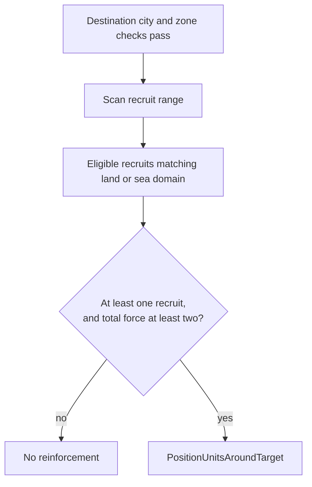

# Unit AI: Tactical Movement

Tactical AI moves operation armies, redistributes available units around city zones, and pulls units out of Withdraw zones. Army movement and reinforcement use `PositionUnitsAroundTarget` in `civ5-dll/CvGameCoreDLL_Expansion2/CvTacticalAI.cpp`; withdrawal uses plain path moves. See the [tactics overview](overview.md) for their place in the turn and [operation stages](../operations/stages.md) for persistent army progress.

## Operation army movement

`PlotOperationalArmyMoves` calls each persistent operation's `DoTurn` during the global high-priority pass of `ProcessDominanceZones`, after frontline healing and before garrison work and the per-zone posture loop. Land, naval, and combined armies use `PlotArmyMovesCombat`; escorted civilian armies use the escort path. Recruiting and gathering armies move around their muster point, while moving armies follow their army goal.

Operation state and the current turn target control army behavior; [zone posture](targets-and-postures.md#postures-and-local-combat) controls independent-unit behavior. The table below records the routine, behavior, and simulation aggression for army movement. `PositionUnitsAroundTarget` is also used by non-army positioning passes.

| Army phase or condition | C++ routine | Behavior | Simulation and aggression |
| --- | --- | --- | --- |
| No reachable step path | `PlotArmyMovesCombat` | Record `AI_ABORT_LOST_PATH` for the operation. | None |
| Enemy units can attack the army | `CheckForEnemiesNearArmy`, called by `PlotArmyMovesCombat` | Fight with the army and nearby friendly attackers, as described in [army contact](engagements.md#army-contact). A fight holds the army at its center of mass this turn; a vetoed fight lets the operation continue. | Medium |
| Gather, advance, or hold formation | `ExecuteGatherMoves` → `PositionUnitsAroundTarget` | Move formation members toward the muster point, operation target, or current turn target, subject to reachable-plot and danger checks. | Initial simulation: Low. Subsequent positioning does not simulate. |
| Unprocessed army member still in danger | `PositionUnitsAroundTarget` | Try to move the member to a safe healing plot or, failing that, the safest reachable plot. Finish its turn. | No new combat simulation |
| Pre-move army maintenance | `CvArmyAI::UpdateCheckpointTurnsAndRemoveBadUnits` | Release members that are unfit to continue before moving the army. | None |
| Escort replacement | `SwitchEscort` | Temporarily swap a blocked escort for a suitable nearby defender. | None |

`CvArmyAI::RemoveUnit` can return a surviving, movable member to the current-turn independent-unit pool. It receives posture work only if its zone has not already been processed. [Military organization](../operations/organization.md#membership-and-release) lists the removal triggers and operation effects.

## Tactical reinforcement

`PlotReinforcementMoves` redistributes available units around a zone's city. `ProcessDominanceZones` calls it for every zone after all posture attacks and deferred garrison work, before global middle-priority moves. Hedgehog also calls it immediately after its own attacks, so it can claim units before later zones fight and before deferred garrisons are held. That zone is considered again in the regular reinforcement pass. Coastal cities have separate land and water zone calls.

### Destination and recruitment

The destination and its recruits must clear these checks before positioning begins.

| Destination check | Requirement |
| --- | --- |
| City and withdrawal | The destination must have a city and must not be withdrawing. |
| Another team's city | The zone must contain enemies. |
| Zone dominance | A zone dominant in both overall and ranged strength is skipped unless it lacks melee strength; in that case ranged recruits are excluded. |
| Enemy-dominated zone | An enemy-dominated zone also needs a neighboring zone owned by the player. |

| Recruitment rule | Effect |
| --- | --- |
| Scan | The city's mixed-army pathfinder scans within the `GetRecruitRange` limit, including units already in the destination zone. |
| Visibility and territory | The scan permits unrevealed plots and foreign territory; individual movement paths are checked later. |
| Eligibility and domain | A recruit must pass the normal Tactical eligibility checks and match the zone's land or sea domain. |
| Units in other contested zones | They generally stay there. Exceptions are withdrawing zones, embarked units, and land units in cities that are not in danger of falling. |
| Excluded units | Units needing healing, Great Generals and Admirals, civilian sappers, siege units entering enemy-dominated zones, and units with attack targets more than four plots from the destination city. |
| Friendly-civilian cover | A unit covering a friendly civilian stays and is processed. |
| Minimum force | At least one eligible recruit is required, and existing units plus incoming recruits must total at least two. Count recruits already in the zone only once. |

This plot scan has no Army ID exclusion. An eligible army member left unprocessed by operation movement can participate. Tactical reinforcement preserves formation membership; [army reserve recruitment](../operations/organization.md#recruitment) fills formation slots at setup and during Recruiting. Ordinary operations stop reserve scans on entering Gathering; later losses can leave slots open or cause an abort, while direct assignment paths have their own rules.

### Execution

`PositionUnitsAroundTarget` executes the reinforcement:

1. Try to reveal the destination with a spotter, then run coordinated search at Low aggression with the Reinforce intent. Nearby combat can therefore occur during reinforcement.
2. Move remaining distant units toward the city, aiming within two plots, with ordinary combat units before siege and civilian support. Approach moves check paths, embarkation safety, and danger at the first-turn path endpoint. Attack-capable units other than city-bombard units tolerate danger up to half their current hit points; other units require zero danger. Units sent through the approach move are marked processed, even when the move fails.
3. Leave nearby unprocessed independent units available for later work after a successful search. Remaining army members receive safety handling and finish their turn.

Army gathering and movement use this same positioning routine with the Gather intent. [Army contact](engagements.md#army-contact) can first borrow nearby attackers for a fight without adding them to the army. These routines compete with other passes for available units and can search enemies already considered elsewhere that turn.

## Tactical withdrawal

`PlotWithdrawMoves` runs during the zone loop for each Withdraw zone that extracted a target. It does not search: each unit takes its own path move.

| Step | Rule |
| --- | --- |
| Units | Our usable units standing in the zone. Skipped: healthy units just deployed from an operation, a held garrison unless its city falls anyway, and, outside our territory, land units on our citadels and units on our plots not next to enemy land. |
| Order | Ranged and slow units first, melee last. |
| Destination | Per unit, the center of the neighboring city zone of the unit's domain with the best hospitality per travel turn. Without one, our nearest city by path (the capital for minor civs). |
| Move | `MoveToEmptySpaceNearTarget` on a safe path (`MOVEFLAG_AI_ABORT_IN_DANGER`). The path may not end a turn within the next two turns on a plot whose danger is above 1.5 times the unit's HP for a combat unit on its own terrain, or above half its HP for an embarked or civilian unit. |
| After the move | A ranged opportunity shot with movement off, then the unit is processed. |
| No safe route | Pillage in place when worthwhile, then move to the safest reachable plot. |
