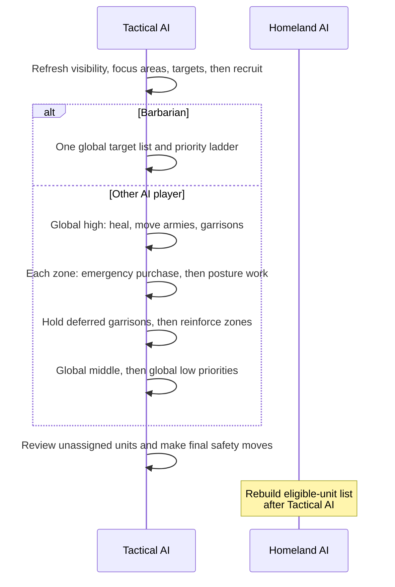

# Unit AI: Military Tactics

**Military tactics** turns the visible map into this turn's military missions. It moves persistent-operation armies first, assigns local combat and support to **independent units**, then leaves eligible units for Homeland AI. An independent unit is a movable, unprocessed combat-capable unit with no Army ID.

For persistent state, see [campaign targets and muster](../operations/campaign.md), [army membership](../operations/organization.md), and [operation stages](../operations/stages.md). [Operation lifecycle](../operations/lifecycle.md) owns shared claims and the Tactical-to-Homeland handoff; [shared concepts](../concepts.md#dominance-zones) defines dominance zones.

The relevant code is in `civ5-dll/CvGameCoreDLL_Expansion2`, primarily `CvTacticalAI.cpp`, `CvTacticalAnalysisMap.cpp`, `CvAIOperation.cpp`, `CvHomelandAI.cpp`, and `CvUnit.cpp`. Start at the [unit AI overview](../overview.md) for the surrounding systems.

| Guide | Responsibility |
| --- | --- |
| [Targets and postures](targets-and-postures.md) | Target collection, local combat policy, and zone order. |
| [Movement](movement.md) | Operation army movement, tactical reinforcement, and withdrawal. |
| [Engagements](engagements.md) | When combat searches run, who joins, and garrison and opportunity searches. |
| [Air operations](air.md) | Aircraft ownership, conventional strikes, interception, patrol, and rebasing. |
| [Operational loop](operational-loop.md) | The flagged replacement for zone combat: settings, flavor blend, aggression from RISK, value and weights files, and copies of native functions. |
| [Simulation](../simulation/overview.md) | Coordinated plans, scoring, acceptance, and replay. |
| [Pathfinding](../pathfinding.md) | Reachable plots, movement policy, and danger costs. |

## Tactical turn order

`CvTacticalAI::Update` prepares the turn; `ProcessDominanceZones` dispatches the passes below. Earlier passes claim units before later ones.

Hedgehog also reinforces during its own posture work, before the regular reinforcement pass. See [tactical reinforcement](movement.md#tactical-reinforcement).

## Independent units and priorities

Routine Tactical recruitment accepts movable, unprocessed combat, ranged, air, and combat-support units with no Army ID. It excludes delayed-death units, explorers, carrier-role ships, and nuclear-role units. Tactical AI does not process human units; Homeland AI handles automated human units.

| Priority | Main work |
| --- | --- |
| Global high | In order: heal frontline units, move operation armies, then [garrison work](engagements.md#garrisons) in threatened cities. |
| Zone combat | Emergency purchase, then posture-directed local work. |
| Reinforcement | Hold deferred garrisons, then [reinforce eligible city zones](movement.md#tactical-reinforcement) with remaining units. |
| Global middle | Air patrol, camps and goody huts, civilian attacks, bastions, safety, healing, pillage, trade plunder, and blockade. |
| Global low | Guard improvements, escort embarked units, and move exposed remaining units. |
| Review | Final safety move. Every city that has not fired yet shoots at a target it picks itself. Then eligible units pass to Homeland AI. |

## Barbarian priorities

Barbarians skip dominance zones and process one global target list through this priority ladder.

| Priority | Work |
| --- | --- |
| 1 | Camp defense: garrison and hold every camp. |
| 2 | Theft from an adjacent city, or takeover of a weakened city-state. |
| 3 | Unit attacks through the tactical simulation at braveheart aggression, then vulnerable-city capture. |
| 4 | Civilian attacks. |
| 5 | Immediate pillage: improved resources first, then other improvements. |
| 6 | Trade-route plunder, land then sea. |
| 7 | Roaming toward the best target in range. |
| 8 | Safety: a barbarian that reaches this pass did not attack, so it flees. |

A camp defender stays assigned. Ranged defenders fire from camp; melee defenders act only when they can return in the same turn. An empty camp recalls the nearest available land unit within five turns. Roaming range follows the game handicap's land and sea target ranges. Land units can enter an undefended civilian or improvement to pillage but do not linger beside combat targets; sea units do not pillage. Captured civilians return toward a camp.

## Specialized execution

| Move | Trigger and selection | Search |
| --- | --- | --- |
| **Amphibious landing** | After city capture, `ExecuteLandingOperation` assigns nearby embarked units to reachable coastal plots. It favors survival, target proximity, ranged hills, legal landmass access, positive attacks, and clustered landings. | Greedy assignment |
| **Paradrop** | Immediate pillage tries in-range paratroopers before ground units against enemy citadels and improved resources. No other pass plans a drop. | Outside tactical simulation |
| **Support move** | After a combat plan succeeds, Great Generals, Great Admirals, and siege towers can move before attacks to supply their aura. | Separate [support-placement search](../simulation/overview.md#support-placement) |

## Implementation trace

Operation `DoTurn` and `Move` record progress and stage transitions; assignment helpers issue missions; `CvHomelandAI` claims eligible leftovers. For cross-system logs, see [operation diagnostics](../operations/lifecycle.md#diagnostics).
