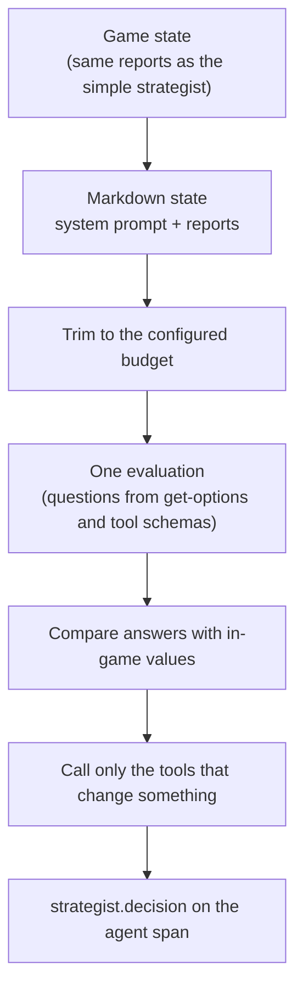

# Evaluator strategist

The evaluator strategist plays a seat without a conversation. Each decision is one [evaluation](../../models/evaluators.md) call: it shows the model the game state, asks a fixed list of questions (which grand strategy, how much of each flavor, which technology next, and so on), and turns the answers straight into action tool calls.

The code is in `src/strategist/agents/evaluator-strategist.ts` and `src/strategist/agents/evaluator-questions.ts`.

## Using it

- Set the seat's `strategist` to `evaluator-strategist` and give it a model in the seat's `llms`. It is not offered in setup.
- It works in Flavor mode only. Strategy mode fails with an error.
- It decides every time the player loop runs it, but only sends the parts of the decision that change something.

## What it reads

The state is one Markdown text, built by `buildStrategistEvaluationState`:

1. **System prompt.** Evaluation calls have no separate system slot, so the text starts with the agent's `getSystem` prompt. It reuses the simple strategist's explanation of the game, without the lines about calling tools, and adds a short section on what the answers decide.
2. **Reports.** The same Markdown the simple strategist sees, from `renderStrategistReports` in `src/strategist/strategy-parameters.ts`: situation, your civilization, options, current strategies, victory progress, players, cities, military, events since the last decision, and the turn context.

The shared [trim ladder](evaluator-trimming.md) shortens oversized state to the configured budget and adds a note describing the cuts.

## What it asks

`buildStrategistQuestions` builds the questions from the `get-options` report and the MCP tool schemas. A question with nothing to choose from is left out.

| Question | Type | One per | Levels or options |
| --- | --- | --- | --- |
| `grand_strategy` | choice | Decision | The offered grand strategies |
| `flavor_<Name>` | score | Offered flavor | The `set-flavors` scale: 0 forbid, 30 enough, 50 balanced, 70 prioritize, 100 emergency focus |
| `research` | choice | Decision | The offered technologies |
| `policy` | choice | Decision | The offered policies and branches |
| `persona_<Axis>` | score | Axis in the `set-persona` schema | 1 minimal, 3 low, 5 balanced, 7 high, 10 extreme |
| `relationship_public_<ID>` | score | Met major civilization | -100 coldest, -50 cold, 0 neutral, 50 warm, 100 warmest |
| `relationship_private_<ID>` | score | Met major civilization | -100 deep enmity, -50 enmity, 0 indifferent, 50 goodwill, 100 a lot of goodwill |

It fails with a clear error if the MCP server does not provide the `set-flavors`, `set-persona`, or `set-relationship` schema.

## What it does with the answers

`strategistActionsFromAnswers` compares the answers with the current values in the `get-options` report.

**Score to value.** Each score becomes the probability-weighted average of its level values. For example, a public stance answered coldest 2%, cold 1%, neutral 51%, warm 38%, warmest 8% becomes +25.

**When a value counts as changed:**

| Value | Changed when |
| --- | --- |
| Flavors, relationships | It moves more than 2 points (`scoreDeadband`) from the in-game value, or there is no in-game value yet. This absorbs noise between turns. |
| Persona | It differs at all (values are whole numbers). |
| Grand strategy, research | The choice differs from the game's. |
| Policy | The name differs, ignoring the kind in parentheses, so `Sovereignty (Policy)` matches `Sovereignty (Continuing Tradition Branch)`. |

**Calls, in order:**

1. `set-flavors` with only the changed flavors, plus the grand strategy if it changed. If neither changed, `keep-status-quo` instead, which re-applies the current flavors so the in-game AI does not take over.
2. `set-persona` with only the changed axes, or nothing.
3. `set-relationship` for each civilization with a changed side. Both sides are sent, and a side that did not change keeps its current value.
4. `set-research` and `set-policy`, each only if the choice changed.

Every call carries the same fixed rationale, without probabilities, because `get-options` feeds rationales back into later decisions. Calls go through `context.callTool`. A failed call is logged and skipped, so one rejected action does not cancel the rest.

## Telemetry

| Where | What |
| --- | --- |
| `evaluate` span | Raw state, questions, answers, and confidence |
| Agent span, `strategist.decision` | JSON with each question's current value, proposed value, and whether it was sent, plus each call and its status (applied, failed, or dropped) |
| Agent span, `strategist.trim` | Which trim steps ran. See [Evaluator trimming](evaluator-trimming.md#telemetry). |

The record shapes are in `src/types/evaluation.ts`. `labelEvaluation` in `src/utils/models/evaluation-record.ts` labels raw answers for display, and the dashboard's strategist turn view shows them (see [Web UI](../../platform/ui.md)).

## Tests

| Area                         | Files in `vox-agents/tests/mock/`         |
| ---------------------------- | ----------------------------------------- |
| Questions and state building | `strategist/evaluator-questions.test.ts`  |
| Decisions and calls          | `strategist/evaluator-strategist.test.ts` |
