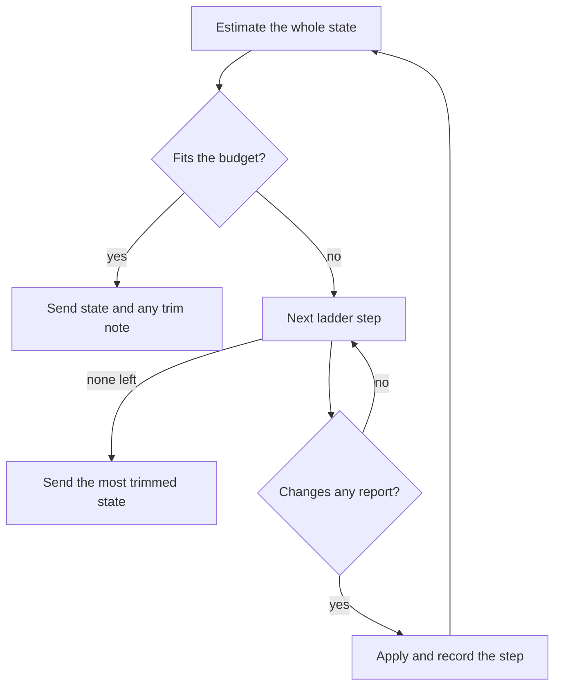

# Evaluator trimming

Evaluator models can receive more game state than their input limit allows, even after low-value events are removed. The trim ladder cuts event tiers and report details in order until the state fits. It is shared by the [evaluator strategist](evaluator-strategist.md) and [strategist triage](../../models/tiers-and-triage.md#strategist-triage) through `evaluateStrategistState` in `src/strategist/agents/evaluator-questions.ts`.

## The budget

`evaluatorTrimConfig.budgetShare` in `src/strategist/agents/evaluator-trim-config.ts` sets the fraction of the model's input limit available to state. This leaves headroom for differences between the local token estimate and provider counting. Models without a configured input limit receive untrimmed state.

## How the ladder walks

`trimToFit` in `src/strategist/agents/evaluator-trimming.ts` works on copies of events, players, cities, and military reports. Cuts are cumulative, no-op steps are skipped without another size check, and the walk stops at the first fit. Each check renders the whole state, including sections the ladder cannot trim.

If every step is exhausted, the most trimmed state is sent anyway. A provider overflow then reaches the caller's [event-window fallback](player-loop.md#event-windows), which can retry with fewer events.

## The ladder

`evaluatorTrimConfig.ladder` defines the order and contents. Early cuts remove IDs, coordinates, tactical detail, and information summarized elsewhere. Later cuts affect inputs closer to war, diplomacy, and victory decisions. Event cuts follow the shared importance order defined in `src/utils/prompts/event-importance.ts`.

## Never trimmed

| Section | What stays |
| --- | --- |
| System prompt, Situation, Your Civilization, Options, Strategies, Victory Progress, turn context | Sent in full. These are outside the trimmable reports. |
| Players | Every civilization and our own city-state relationship. Opinion lists may be compressed. |
| Cities | Every city; actions remove fields. |
| Military | Every tactical zone; actions remove sections or zone fields. |
| Events | Diplomacy and turning points survive the ladder. The outer overflow fallback may drop diplomacy and, as a final attempt, retain only the current turn's turning points. |

## Opinion compression

`compressOpinions` keeps the configured number of factors with the largest absolute weights, in their original order, and combines the rest into one line with their summed weight. Unweighted summary lines always stay. Lists with no weights or too few factors to shorten are unchanged.

For example, keeping three factors from weights -51, -30, -12, -8, -6, and -4 retains the first three and merges the remaining three as -18. Any unweighted summary is retained too.

## Editing the ladder

Each step has a telemetry ID, a short note for the model, and one action:

| Action | Effect |
| --- | --- |
| `events` | Drop one named event tier; see [event windows](player-loop.md#event-windows) for the order. Unlisted or malformed types count as noise. |
| `cityFields` | Delete fields from every city. |
| `militaryKeys` | Delete top-level military sections. |
| `militaryZoneFields` | Delete fields from tactical zones. |
| `cityStateRelationships` | Remove other civilizations' city-state relationships while retaining ours. |
| `opinions` | Keep the largest weighted opinion factors plus a merged remainder. |

Retune or add steps in `evaluator-trim-config.ts`; the action implementations live in `evaluator-trimming.ts`. Keep IDs stable for telemetry, write short notes, preserve the event tier order, and respect the retained sections above.

## The closing note

When any step runs, `buildStrategistEvaluationState` appends a note describing the cuts and, when applicable, the number of dropped events. The budget checks cover the rendered state before this note is appended.

## Telemetry

`evaluateStrategistState` writes `strategist.trim` on the active agent span, or the turn span for triage. The JSON contains applied step IDs, `droppedEvents`, and `fits`. An untrimmed attempt writes an empty string so a retry clears an earlier trim record. `StrategistTrim` in `src/types/evaluation.ts` defines the shape.

`sanitizeAIError` in `src/utils/logger.ts` redacts evaluation state and questions from error logs.

## Tests

`tests/mock/strategist/evaluator-trimming.test.ts` covers the ladder, no-op steps, retained reports, and opinion compression. `evaluator-questions.test.ts` covers state building and telemetry. The event-importance and logger-sanitize suites under `tests/mock/utils/` cover shared event tiers and redaction.
