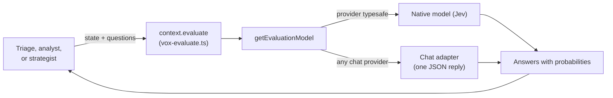

# Evaluators

An evaluator answers a fixed set of typed questions about one piece of state, in a single model call, with a probability for every possible answer. There is no conversation and no tool calling. That makes evaluators cheap and their answers easy to use in code.

Vox Agents uses evaluators for three jobs:

| Job | What it decides | Read more |
| --- | --- | --- |
| Triage | Which model tier runs an agent's turn, and whether a strategist decides at all | [Tiers and triage](tiers-and-triage.md) |
| Diplomatic analyst | Whether to relay a diplomat's report, and how | [Support agents](../agents/support-agents.md#analysts) |
| Evaluator strategist | A strategist seat's whole decision | [Evaluator strategist](../agents/strategists/evaluator-strategist.md) |

All three go through `context.evaluate`, so they share concurrency limits, retries, telemetry, and token counting with normal agent runs.

## Questions and answers

Evaluation follows the AI SDK's `experimental_evaluate` contract. Each question has one of three types:

| Type | The question lists | The answer gives |
| --- | --- | --- |
| `choice` | Named options, each with an optional description | The most likely option, plus each option's probability |
| `score` | Two or more ordered levels, each with a description | Each level's probability, plus their weighted position (for example 2.5, between the third and fourth levels) |
| `boolean` | Optional descriptions of true and false | The probability of true |

Tips for writing questions:

- A score is not rounded to a level. Callers map it onto their own values, so a score halfway between two levels can land halfway between their values.
- Give each level a short label as well as its value (for example `50: warm`). The model rates against the labels.

## Backends

`getEvaluationModel` in `src/utils/models/evaluation.ts` builds an evaluator from any model config.

| Backend | When | How it works |
| --- | --- | --- |
| Native (TypeSafe's Jev, `typesafe/jev-latest`) | The provider is `typesafe`. Needs `TYPESAFE_AI_API_KEY`. | Answers questions directly. It cannot chat, so chat model pickers hide it. |
| Chat adapter (`createLanguageModelEvaluator`) | Any other provider | Sends the state and questions in one prompt, asks for a JSON reply with a probability for every option or level, and cleans the reply into valid answers. Helpers are in `src/utils/models/evaluation-questions.ts`. |

Anything that works with Jev also works with a chat model, without a TypeSafe key.

## Configuration

Evaluators live in the same `llms` registry as chat models, with the same alias rules, at the seat or global level.

| Key | Used by | With no assignment |
| --- | --- | --- |
| `<agent>.evaluator` | Triage for that one agent | Falls back to `evaluator` |
| `evaluator` | Triage for every agent that has it on | Triage is skipped, never sent to `default`. A warning appears at session start if triage was turned on. |
| `<agent>` | Agents that answer by evaluation (`diplomatic-analyst`, `evaluator-strategist`) | Runs on `default` through the chat adapter |

Settings has an Evaluator dropdown for the shared alias. See [Setup wizard](configuration.md#the-setup-wizard) for the Judge AI mapping.

**Input limit.** The `maxInputTokens` model option caps the state size in estimated tokens (`inputTokenLimit` in `src/utils/models/models.ts`).

- The default is 30,000 for TypeSafe (below Jev's 32k cap) and no limit for other models.
- A larger state is refused with a context-length error before the provider is called, so callers can trim and retry.

## The evaluate call

`context.evaluate(model, state, { questions })` runs in `src/infra/vox-evaluate.ts`.

- It must run inside an active run, and cancelling the run cancels it.
- The state can be a string or any JSON-serializable object.
- It opens an `evaluate` span under the run, named after the requesting agent. The span records the model, state, questions, answers, confidence, and tokens.
- Its tokens count toward the run and seat totals.

## Agents that answer by evaluation

An agent can answer with evaluation alone by implementing `executeEvaluation` instead of using the chat loop. The engine still prepares the system prompt and messages, picks the model, updates the in-game model label, and opens the agent span. It then hands the prepared state and the model to the hook. An empty system prompt still means "nothing to do this time".

## Tests

All under `vox-agents/tests/mock/`:

| Area | Files |
| --- | --- |
| Both backends | `utils/evaluation-questions.test.ts`, `utils/evaluation.test.ts` |
| The evaluate call | `context/vox-context-evaluate.test.ts` |
| Answer labeling | `utils/evaluation-record.test.ts` |

Tests for the evaluator strategist and trimming are listed on their own pages.
