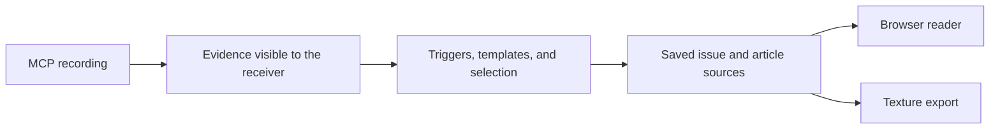

# Newspaper

The newspaper turns recorded Civilization V events into issues for one player, called the **receiver**. At each scheduled **check**, the editor reads through a game turn called the **cutoff**. An article keeps its sources and, when known, its own observation turn. For example, a report on a change in military posture on turn 186 can appear in the turn 190 issue.

With [workspace dependencies](../../setup.md) installed, run `npm run newspaper:preview -w vox-agents` from the repository root. Open **Mockups** to browse designs or **Recorded** to generate issues from an MCP knowledge database. The [replay guide](replay.md) covers setup, evidence inspection, and command-line audits.

MCP defines the evidence query and visibility rules in `mcp-server/src/newspaper/`. Offline replay and the `get-newspaper-evidence` MCP tool use the same dated query. Vox Agents runs the editor in `vox-agents/src/newspaper/`, with the JSON catalogue in `vox-agents/newspaper/`.

| To work on | Start here |
| --- | --- |
| Decide what makes news | [Trigger rules](triggers/overview.md), [facts](triggers/facts.md), [constants and shortcuts](triggers/constants.md), and [worked examples](triggers/examples.md) |
| Cover wars and settlements | [Diplomatic incidents and pair history](triggers/war-and-peace.md) |
| Choose what prints | [Templates, selection, presentation, and votes](editorial.md) |
| Draft story variants | [Writing rules](writing.md) and the [Writing Desk](../platform/ui.md#writing-desk) |
| Change the issue's appearance | [Designs](designs.md) and [reader and export contracts](renderer.md) |
| Validate a catalogue edit | [Compare replays](evaluation.md) |
| Check game delivery | [Open the packaged sample in Civilization V](live-integration.md) |

The [roadmap](../../../plans/newspaper/implementation.md) tracks automatic publication during play and model editing.
