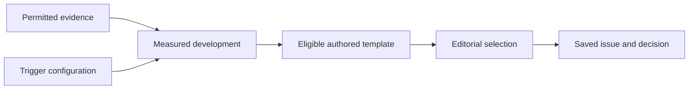

# Newspaper trigger reference

Triggers turn permitted recording evidence into measured developments that authored templates can report. This page is for developers tuning coverage or adding a story family. Read [editorial decisions](editorial.md) for selection, votes, and presentation, and [replay](replay.md) for generating and inspecting issues.

## Where to work

| Location | Responsibility |
| --- | --- |
| `vox-agents/newspaper/triggers/` | Trigger IDs, detector choice, conditions, thresholds, scales, tags, and detector tuning |
| `vox-agents/newspaper/templates/` | Authored headlines, paragraphs, placeholders, typed links, weights, and composites |
| `vox-agents/src/newspaper/editorial/config.ts` | Configuration schema, overlay merging, and catalogue validation |
| `vox-agents/src/newspaper/editorial/triggers.ts` | Detector dispatch, bounded importance, and legacy war, peace, and city-contrast handling |
| `vox-agents/src/newspaper/editorial/developments.ts` | Non-war dispatch, pace, and shared draft construction |
| `vox-agents/src/newspaper/editorial/development-facts.ts` | Numeric measurements, identity parsing, history, persistence, city continuity, and route parsing |
| `vox-agents/src/newspaper/editorial/city-developments.ts` | City population, food, status, wonders, and great works |
| `vox-agents/src/newspaper/editorial/national-developments.ts` | National output, budget, happiness, trade, golden age, majority religion, and technology-lead comparisons |
| `vox-agents/src/newspaper/editorial/event-developments.ts` | Contact, deals, eras, research, policies, ideology, religion milestones, and confirmed city-majority changes |
| `mcp-server/src/newspaper/projection.ts` | Permitted historical fields and events |
| `mcp-server/src/newspaper/queries.ts` | Recorded snapshots, comparison history, event windows, and city retirement |



## Shared controls

A **trigger definition** is an editable catalogue entry with a stable `id`. Its `detector` names supported TypeScript behavior. Several entries may reuse one detector with different tuning.

| Control | Meaning |
| --- | --- |
| `id` | Identity referenced by template `triggerIds`; preserve it when tuning existing coverage. |
| `enabled` | Set to `false` to disable this trigger. Omission enables it. |
| `detector` | Supported evidence interpretation. Adding a new detector requires source changes. |
| `stage` | Selects a detector's branch, such as population `milestone`, `boom`, or `decline`. Use only the stages that detector handles. |
| `condition` | Optional eligibility condition; a missing or unknown fact cannot satisfy it. |
| `threshold` | Minimum measured magnitude that creates a development. Units depend on the detector. |
| `scale` | Magnitude that reaches maximum importance; increasing it reduces the importance of the same development. Existing war and peace handling retains its original maximum-importance calculation. |
| `tags` | Topic and scope labels shared with templates, page membership, variety, and feedback. |
| `tuning` | Detector-specific controls described in the catalogue below. |

Importance is `min(importanceMax, importanceMax × magnitude / scale)`. Built-in `importanceMax` is 100. Selection also considers series memory, novelty, variety, template weight, and votes, so passing a trigger threshold does not guarantee publication.

Conditions support `always`, `eq`, `gte`, `lte`, `contains`, `technology`, and `all`/`any`/`not` composition. Trigger conditions read the receiver's projected national facts and context. Variant conditions can also read that development's placeholders. Missing technology history remains unknown under negation.

| Tuning control | Units and fallback when omitted |
| --- | --- |
| `window` | History lookback, 15 Standard turns. Increasing it does not fetch more history. CLI `--comparison` uses recorded turns: on Marathon, the default five-Standard-turn publication interval spans 15 recorded turns, so the default `--comparison 10` can miss the baseline. Use `--comparison 45` to supply a 15-Standard-turn detector window at Marathon's three recorded turns per Standard turn. |
| `maxGap` | Maximum gap for persistence and freshness checks, 5 Standard turns. It does not constrain every ordinary two-snapshot comparison. |
| `persistence` | Span of qualifying observations for food and budget transitions, 2 Standard turns; at least two qualifying observations are required. |
| `absolute`, `relative` | Absolute change and proportional change, checked together for ordinary output changes; `relative: 0.25` means 25%. Other detector meanings appear below. |
| `reserve` | Detector-specific reserve duration or secondary amount threshold; units appear below. |
| `share` | Partner's positive foreign-route gold share as a fraction; the concentration boundary defaults to 0.5, or 50%. |
| `milestones`, `identities` | Explicit replacement lists of numeric boundaries or recorded identity names. |

Standard-turn durations multiply by the recorded game-speed multiplier. Food reserve duration is measured directly as `FoodStored / -FoodPerTurn` in recorded turns. Treasury reserve duration uses the same ratio for gold, but its configured boundary is in Standard turns. With no pace context, detectors assume Standard speed.

## Evidence and continuity

Each development carries the original `PlayerSummaries`, `CityInformations`, or `GameEvents` references, a dated period, placeholders, a stable fingerprint, and series keys. Inspect these in the replay reader or an article's audit before changing its threshold or prose.

| Rule | Effect on coverage |
| --- | --- |
| Historical visibility | MCP projects every observation using recorded access. Later contact or insight cannot reveal an earlier hidden measurement. |
| Known identity | Recorded civilization and team metadata identifies permitted subjects. It supplies no hidden metrics, and player IDs need not equal team IDs. |
| Missing observation | Missing fields remain unknown. Gold, gold per turn, food per turn, and happiness values permit signed measurements; other numeric detector fields reject negatives. Trade-route `FromGold: -1` means no gold yield while retaining the observed route and partner. |
| Snapshot comparison | A new measurement needs a dated comparable baseline. Seeing a city or civilization for the first time establishes an observation, rather than proving a recent change. |
| City continuity | Owner and coordinates must remain comparable. Visible capture and raze records retire stale city rows; unresolved lifecycle information can suppress city comparisons. |
| Event period | Events belong to the interval after the previous completed check through the cutoff. Skipped checks advance this boundary too. |
| Reporting limits | Reports describe observed changes. Known technology comparisons do not establish a global ranking, and a new visible wonder does not by itself prove recent construction. |

Recorded enum fields can contain localized names: for example, `TechID`, `ReligionID`, or `PolicyID` may be text after recording enrichment. Curated lists and authored labels must match the recording's values; detectors do not query the live game to translate them.

## Catalogue

The topic files under `triggers/` contain the shipped defaults. The following tables explain their conditions and units; templates in the matching topic files show the placeholders used in prose.

Shipped triggers have `threshold: 1`, except `trade-concentration`, whose zero threshold preserves small crossings of its concentration boundary. Each row gives its `scale` and the magnitude compared with that threshold. History controls use the shared fallbacks above unless the row supplies a different value. Configuration validation rejects unknown trigger fields, unsupported stage names, and tuning fields that do not apply to that detector.

### Cities

All city developments here concern the receiver's cities and require comparable same-owner observations.

| Trigger ID and detector | Condition and default controls | Magnitude; scale |
| --- | --- | --- |
| `city-population-milestone`, `cityPopulation` | `stage: milestone`: crosses any `milestones: [5, 10, 20]` upward; `window: 15`. | Highest crossed milestone; 20 |
| `city-population-boom`, `cityPopulation` | `stage: boom`: gains at least `absolute: 2` population and `relative: 0.2` of baseline population; `window: 10`. | Population gained; 5 |
| `city-population-decline`, `cityPopulation` | `stage: decline`: population falls; `window: 10`. | Population lost; 3 |
| `city-food-shortage`, `cityFood` | Negative `FoodPerTurn` becomes persistent, or a sustained shortage crosses below `reserve: 3` recorded turns of food. Requires `FoodStored`; `persistence: 2`, `maxGap: 5`, `window: 15`. | Absolute food deficit per turn; 5 |
| `city-recovery`, `cityRecovery` | Population grows from a baseline that is lower than the preceding available observation; `window: 15`. All three observations need continuity. | Population regained since baseline; 4 |
| `city-resistance`, `cityStatus` | `stage: resistance`: `ResistanceTurns` changes from positive to zero. | 1; 1 |
| `city-administration`, `cityStatus` | `stage: administration`: an explicit `IsPuppet` or `IsOccupied` flag changes. | Number of changed flags; 2 |
| `city-razing`, `cityStatus` | `stage: razing`: `RazingTurns` changes from zero to positive. Reports observed active razing, without claiming the city was destroyed. | 1; 1 |

### Domestic economy

| Trigger ID and detector | Condition and default controls | Magnitude; scale |
| --- | --- | --- |
| `budget-deficit`, `economyBudget` | `stage: deficit`: `GoldPerTurn` becomes negative and persists; `persistence: 2`, `maxGap: 5`, `window: 15`. | Absolute current income; 20 |
| `budget-recovery`, `economyBudget` | `stage: recovery`: previously negative `GoldPerTurn` becomes nonnegative and persists with the same controls. | Absolute current income, or 1 at zero; 20 |
| `treasury-reserve`, `economyBudget` | `stage: reserve`: a deficit leaves less than `reserve: 5` Standard turns of treasury, after a nonnegative budget or previously adequate reserve. Also reports positive treasury becoming nonpositive while the deficit continues; `window: 15`. | 1; 1 |
| `income-shift`, `economyIncome` | `GoldPerTurn` rises or falls by at least `absolute: 10` and `relative: 0.25` of the absolute baseline; `window: 10`. | Absolute income change; 40 |
| `happiness-shift`, `happiness` | `HappinessPercentage` moves by `absolute: 10` percentage points or crosses a `milestones: [35, 50]` boundary in either direction; `window: 10`. These are configurable VP defaults and may differ in mod variants. | Absolute percentage-point change; 20 |

### Trade

Snapshot detectors read complete outgoing foreign-route observations. Every route partner must resolve unambiguously from recorded identity metadata. Domestic routes and unassigned slots are excluded. Route counts include foreign routes with zero or sentinel gold; concentration uses only positive foreign-route gold.

| Trigger ID and detector | Condition and default controls | Magnitude; scale |
| --- | --- | --- |
| `trade-partner`, `tradePartners` | A partner is present now and absent from the complete baseline. An empty known baseline is valid. | 1; 1 |
| `trade-contraction`, `tradeContraction` | Foreign route count falls by at least `absolute: 2` and `relative: 0.25`, or positive foreign-route gold falls by at least `reserve: 10` gold per turn and the same proportional amount; `window: 10`. | Greater of route-count loss and gold-per-turn loss; 25 |
| `trade-concentration`, `tradeConcentration` | A partner crosses above or back to/below `share: 0.5`, or its share moves by at least `relative: 0.2`, meaning 20 percentage points. Both observations need positive total foreign-route gold; `threshold: 0`, `window: 15`. | Absolute share change in percentage points; 35 |
| `trade-plunder`, `tradePlunder` | `PlayerPlunderedTradeRoute` names the receiver as route origin or destination owner. Groups the interval's events into one account; event count and gold total use the same distinct source table/ID records. | Number of distinct source events; 1 |

### Diplomacy

| Trigger ID and detector | Condition and default controls | Magnitude; scale |
| --- | --- | --- |
| `first-contact`, `firstContact` | `TeamMeet` involves the receiver's team and an identifiable other team. Repeated representations of that team's meeting share one report. | 1; 1 |
| `deal`, `deal` | A receiver deal has permitted structured terms naming a consequential treaty or material gold transfer. Gold needs `absolute: 50` and `relative: 0.25` of treasury; gold per turn needs `reserve: 10` and the same fraction of absolute income. Economic comparisons need a national observation no more than `maxGap: 5` Standard turns before the event. | Number of qualifying structured terms; 4 |

Consequential treaty types are `OpenBorders`, `DefensivePact`, `ResearchAgreement`, `DeclarationOfFriendship`, `Vassalage`, and `VassalageRevoke`. One deal can contain both treaty and economic terms. Each source deal is assessed separately; deals with the same partner compete within one exchange series. Unavailable private terms suppress this detector; the presence of a `DealMade` event alone is insufficient. MCP's [deal-term visibility rules](replay.md#source-and-http-ownership) remain the authority.

### Science

| Trigger ID and detector | Condition and default controls | Magnitude; scale |
| --- | --- | --- |
| `new-era`, `era` | A permitted `TeamSetEra` event for a domestic or known foreign team. Same-turn national observations may supply its era label. Multiple events for one team in the interval retain the latest era and all supporting references. | 1; 1 |
| `significant-technology`, `technology` | Receiver-team `TeamTechResearched` with positive `ChangeAmount`, or `TeamSetHasTech` with true `HasTech`, matches `identities`. Duplicate acquisition representations share one report. | 1; 1 |
| `science-shift`, `scienceOutput` | Domestic science per turn changes by at least `absolute: 10` and `relative: 0.25`; `window: 10`. | Absolute science-per-turn change; 40 |
| `technology-lead`, `technologyLead` | The leader set by technology count changes among at least two known major civilizations, including the receiver. Every known major needs usable current and earlier counts. `maxGap: 3` limits observation age; `absolute: 1` limits the spread between compared observation dates; `window: 15`. All durations are Standard turns. | 1; 1 |

The technology allowlist ships with Writing, Philosophy, Education, Printing Press, Scientific Theory, Industrialization, Electricity, Radio, Computers, Internet, and Future Tech. `tuning.identities` replaces that list. Match recorded localized names; callers supplying `technologyIdentities` can also match stable technology types. Unknown numeric IDs alone cannot provide an authored technology name. Numeric era events use a same-turn recorded era label where available, otherwise the generic “a new era.” Era and curated technology reports share a research series for the same civilization, so one issue selects at most one of those angles.

### Culture and politics

| Trigger ID and detector | Condition and default controls | Magnitude; scale |
| --- | --- | --- |
| `policy-direction`, `policy` | Receiver `PlayerAdoptPolicy` and `PlayerAdoptPolicyBranch` events have recorded text identities; bundles the interval's adoptions. | Number of distinct policy/branch identities; 3 |
| `ideology-switch`, `ideology` | Receiver `IdeologySwitched` event names different old and new branches. Multiple events retain the latest switch's names and date, with all source references. | 1; 1 |
| `domestic-culture`, `cultureOutput` | Domestic culture per turn changes by at least `absolute: 5` and `relative: 0.25`; `window: 10`. | Absolute culture-per-turn change; 40 |
| `foreign-culture`, `foreignCulture` | Same change requirements for known foreign national observations; `window: 10`. | Absolute culture-per-turn change; 100 |
| `tourism-shift`, `tourismOutput` | Domestic or permitted foreign tourism per turn changes by at least `absolute: 5` and `relative: 0.25`; `window: 10`. | Absolute tourism-per-turn change; 40 |
| `new-wonder`, `wonder` | A named wonder appears in a comparable domestic or known foreign city's `Wonders` list; `window: 15`. | Number of added wonder names; 1 |
| `great-works`, `greatWorks` | A domestic city's known `GreatWorkCount` increases; `window: 15`. Reports collection growth without inferring creation or transfer. | Increase in count; 3 |
| `golden-age`, `goldenAge` | Explicit recorded domestic status changes between active and inactive. Unknown or unrecognized status text is suppressed. | 1; 1 |

### Religion

| Trigger ID and detector | Condition and default controls | Magnitude; scale |
| --- | --- | --- |
| `religion-pantheon`, `religionMilestone` | `stage: PantheonFounded`; domestic or permitted foreign event. Can use a generic pantheon label. | 1; 1 |
| `religion-founded`, `religionMilestone` | `stage: ReligionFounded` with a recorded religion name. | 1; 1 |
| `religion-enhanced`, `religionMilestone` | `stage: ReligionEnhanced` with a recorded religion name. | 1; 1 |
| `religion-reformed`, `religionMilestone` | `stage: ReligionReformed` with a recorded religion name. | 1; 1 |
| `city-conversions`, `cityReligion` | `CityConvertsReligion` names a different majority from a known earlier city snapshot or preceding event at the same coordinates and owner. Bundles confirmed changes by owner; `window: 15` bounds snapshot lookback. | Number of distinct changed cities; 4 |
| `national-religion`, `nationalReligion` | Domestic `MajorityReligion` changes between known text identities in comparable national observations. | 1; 1 |

Religion milestones cover permitted domestic and foreign subjects. Reports that cover both scopes derive their `domestic` or `international` tag from the subject, including religion milestones, eras, tourism, and wonders.

`CityConvertsReligion` also fires for follower-count changes. A first event without an earlier majority establishes a baseline; repeated events naming that same majority do not count as conversions. Capture or uncertain lifecycle evidence prevents a comparison from proving a majority change; same-turn ordering uses timestamps, with ties treated conservatively. A reversal requires an observed return to a previously seen majority within the available sequence.

### Existing war and peace

`incoming-war` uses `incomingWar` for declarations against the receiver's team and retains urgent breaking-front-page priority. `peace` uses `peace` for a recorded peace involving that team. Both keep `threshold: 1` and `scale: 1`, partner identity, and `eventTurn`. Their behavior and authored templates are unchanged. Additional war coverage remains outside this catalogue expansion.

### Available placeholders

Developments from `developments.ts` have `fromTurn` and `toTurn`, derived from their sources. National and event reports usually supply `partnerId` and `partner`, even when the partner is the receiver; city reports supply `cityId` and `city`. Use those IDs in typed links. The source detector remains the full contract for each branch.

| Family | Useful factual placeholders |
| --- | --- |
| City population | `population`, `growth`; population triggers also have `previousPopulation`, and milestones have `milestone`. Recovery retains `recoveryGrowth`, `recoveryFromTurn`, `recoveryToTurn`. |
| City food and status | Food: `food`, `stored`, `reserveTurns`, `stage`. Status: `status`, with `remaining` for resistance and razing. |
| Budget and happiness | Budget transitions: `income`, `stage`; treasury: `gold`, `income`, `reserveTurns`. Happiness: `happiness`, `previousHappiness`, `direction`, `stage`. |
| Output changes | `output`, `previousOutput`, `change`, `direction`. Culture metrics also supply `culture`, `previousCulture`, `cultureChange`, `cultureFromTurn`, `cultureToTurn`; other output metrics supply only the generic names. |
| Trade | Partner/share: `gold`, `share`, `previousShare`, `tradeFromTurn`, `tradeToTurn`. Contraction: `routes`, `previousRoutes`, `gold`, `previousGold`. Plunder: `plunderEvents`, `plunderGold`. |
| Diplomacy | Contact: `partners`, `eventTurn`. Deal: `terms`, `significantTerms`, `eventTurn`. |
| Science | Era: `era`, `eventTurn`. Technology: `technology`, `eventTurn`. Lead: `leaders`, `previousLeaders`, `technologies`, `knownMajors`. |
| Culture and religion | Policies: `policies`; ideology: `previousIdeology`, `ideology`; wonders: `wonders`; great works: `works`, `previousWorks`, `addedWorks`; golden age: `stage`. Religion milestones: `religion`, `eventTurn`; conversions: `conversions` (distinct changed cities), `changes` (majority transitions), `religions` (observed new majorities), `reversals` (cities returning to an earlier majority); national majority: `religion`, `previousReligion`. |

## Repeats and persistence

Published fingerprints prevent the same development from being selected again. Series keys connect later developments about the same subject and reserve each series for at most one selected item in an issue. Series history affects scoring; it does not create new evidence. A composite must explicitly name its component templates, share a subject, and have overlapping evidence periods.

Budget and food persistence comes from observed history, with an earlier opposite state and qualifying observations spanning `persistence` without excessive gaps. The first qualifying observation must become old enough during the current reporting interval. A continuing unchanged deficit therefore does not become another transition report on every check. City food also has a separate low-reserve crossing after a sustained shortage. Population recovery needs an observed decline into the baseline, followed by growth.

Event groups combine duplicate representations of one researched technology, repeated first-contact records for one team, policies adopted in one check, and confirmed city-majority changes by owner. Technology, era, contact, and religion milestone fingerprints use the development's identity so later representations cannot republish an already published milestone; an era's identity is its team and recorded new-era value. Other events stay within their reporting interval; confirmed majority reversals can supply later developments.

Completed checks atomically save their reporting boundary and publication state in the separate replay output. A skipped check saves its boundary and decay without retaining a queue of discarded candidates. Resume restores the saved configuration snapshot, preferences, series, and article history. Start a fresh run to compare catalogue edits. The offline checkpoint does not implement live game-save persistence.

## Tune existing coverage

Use an overlay directory instead of editing the built-ins when comparing alternatives. Its structure mirrors `vox-agents/newspaper/`; supply only the topic files and entries being changed. Pass it with CLI `--config`, or browser setting `editorialConfigDirectory`.

Defaults merge as objects. Entries and authored variants merge by `id` across files; an empty keyed array keeps the inherited entries. Arrays without IDs, including tags, body paragraphs, and curated values, replace the inherited array. Flat `triggers.json`, `templates.json`, and `designs.json` overlays remain supported; grouped topic files apply after them. Removing an entry from an overlay leaves the inherited entry present.

Disable a trigger by overriding its ID with `enabled: false`. To suppress an authored template or variant instead, give it `weight.base: 0` and replace `weight.adjustments` with an empty array; otherwise inherited positive adjustments could re-enable it. Disabling one template leaves other templates and explicit composites available when their own inputs remain eligible.

For example, make population-boom coverage less frequent by adding a `city-population-boom` entry to `.tmp/newspaper-tuning/triggers/cities.json`, changing only these controls:

| Control | Built-in | Example override |
| --- | --- | --- |
| `tuning.absolute` | 2 population | 3 population |
| `tuning.relative` | 0.2, or 20% | 0.25, or 25% |

With this override, population 10 to 12 fails the absolute requirement; 10 to 13 passes both requirements because the gain is 3, or 30% of the baseline. Leave `scale` unchanged to preserve the importance of qualifying gains. Run the same recording with `--config .tmp/newspaper-tuning` and a new `--output` directory, then compare audits and prose.

### Existing overlays and saved runs

`trade-concentration`, `foreign-culture`, `deal`, and `city-recovery` retain their trigger IDs. Their familiar trade, culture, and recovery placeholders remain available, including those used by `trade-and-exchange` and `trade-and-culture`. The new materiality and continuity rules still apply: `deal` now requires consequential structured terms, for example.

Recovery's `settlement-recovery` template now lives in `templates/cities.json`; overlay merging uses IDs across files, so an override in `templates/recovery.json` still finds it. The shipped `city-contrast` trigger, `provincial-contrast` template, and `provincial-recovery` composite have been removed. `cityContrast` remains a supported detector for custom catalogues and saved configurations. Restoring that angle in a fresh overlay requires complete trigger and template definitions, including any composite dependencies; a partial override cannot inherit an entry that no longer ships.

Saved issues keep their authored content and decisions. Resume restores its original configuration snapshot, while future checks run the installed detector code. A fresh run uses the current built-ins plus the supplied overlay. Check older overrides against `config.ts` when upgrading, especially removed IDs, changed variant IDs, and unsupported tuning fields.

## Add coverage

1. Decide whether an existing detector already measures the development. If so, add a trigger entry with a unique ID, its detector's tuning, threshold, scale, and tags. A new ID permits a separate angle without changing templates that use the original ID.
2. Add a template referencing that ID in `triggerIds`. Give it positive template and variant weights, a headline, body paragraphs, and only placeholders that detector supplies. Mark a brief with `short: true` when appropriate.
3. Add typed links using supported destinations and the detector's IDs. Link placeholder names also need corresponding `links` entries. A missing factual placeholder makes the variant ineligible.
4. Reuse page tags or update `pages.json` when the story needs different placement. For a combined story, use explicit `compositeOf` references and compatible subjects and periods.
5. When evidence interpretation is new, extend the detector schema and implementation. If a required fact is absent from projected evidence, update MCP's historical projection and its visibility tests first. Retain original source references and test missing observations, continuity, first observations, repeat behavior, and the intended boundary.
6. Generate a fresh replay and read the resulting article beside its source evidence. Confirm the condition, magnitude, chosen template, and competing candidates in the audit.

## Verify changes

Run these from the repository root. MCP builds first because Vox Agents imports its compiled evidence contracts and queries.

```sh
npm run build -w mcp-server
npm run test:mock -w vox-agents -- tests/mock/newspaper
npm run type-check -w vox-agents
npm run build:newspaper -w vox-agents
```

For projection changes, also run `npm run test:mock -w mcp-server -- tests/newspaper`. Use the [replay CLI workflow](replay.md#generate-examples-from-the-command-line) with the same source, receiver, turn range, frequency, and comparison window for each catalogue variant, and a new output directory each time. Omit `--render-turns` for a quick prose-and-audit pass. Automated checks establish contracts and boundaries; human reading establishes whether the coverage is useful and well paced.
