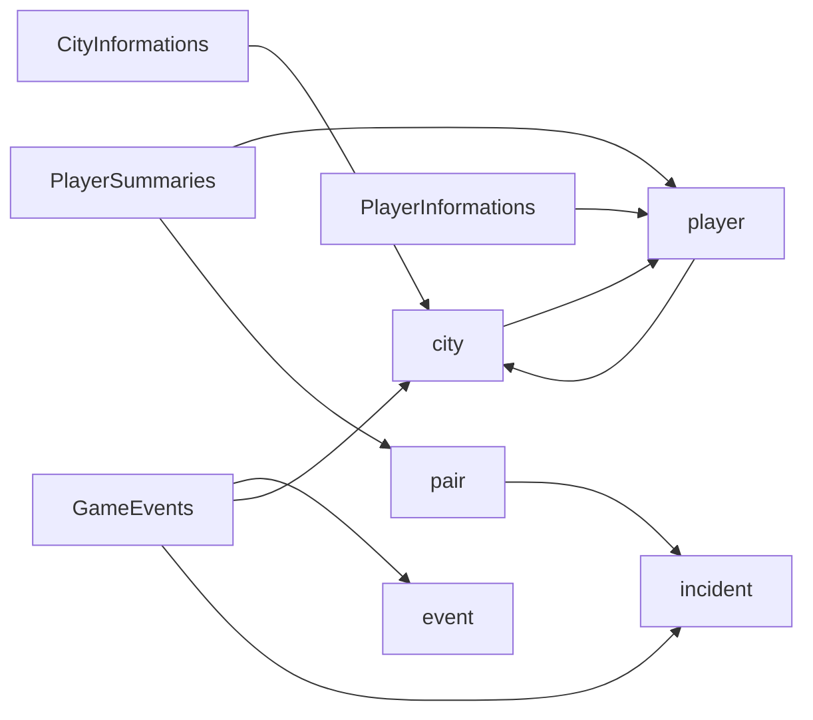

# Newspaper trigger facts

**Status: target design, documented ahead of the code.** [Plan 6](../../../../plans/newspaper/implementation/06-trigger-rules.md) lists the build order.

The **fact model** is the set of objects a [trigger rule](overview.md) can read: cities, players, events, pairs and incidents. This page is the reference for developers writing rules. It lists every fact, says where each one comes from, and explains how to read the past.

Facts come in two kinds. **Stored facts** are columns that the MCP server recorded. **Inferred facts** are worked out from stored columns and events, such as a city's distance to the receiver or its former owner. Inference favors useful coverage: a fact is offered whenever the databases support a reasonable reading.

| Subject | One per | Section |
| --- | --- | --- |
| `city` | City the receiver can see | [City](#city) |
| `player` | Known major civilization or city-state | [Player](#player) |
| `event` | Permitted event in the reporting period | [Event](#event) |
| `pair` | Two known players with a recorded relationship | [Pair](#pair) |
| `incident` | Inferred war or peace incident | [Incident](#incident) |

The **receiver** is the player the newspaper is written for. Every fact reflects what the receiver was allowed to see on the turn it was recorded.

## Naming

| Rule | Example |
| --- | --- |
| A stored column keeps its name in camelCase. | `FoodPerTurn` becomes `city.foodPerTurn` |
| A yes-or-no column is true or false. | `city.isPuppet` |
| A stored value that is empty reads as `null`, which is different from [hidden](#hidden-and-missing-facts). | `city.majorityReligion` is `null` for a city with no majority religion |
| A list column is a JavaScript array. | `city.wonders.includes('Petra')` |
| A fact that names another subject returns that subject. | `city.owner.era`, `player.capital.population` |
| Names recorded as text stay as recorded. | `player.era == 'Medieval Era'` |

## Globals

Every expression can read these, whatever its subject.

| Name | Contains |
| --- | --- |
| `self` | The receiver, as a `player` |
| `players` | Every known player, including `self` |
| `cities` | Every city the receiver can see |
| `events` | Every permitted event in the trigger's window, oldest first |
| `turn` | The cutoff turn of this check |
| `game` | `speed` (the recorded game speed name), `speedMultiplier`, `mapSize`, `startEra`, `maxTurns` |
| `distance(a, b)` | Hex distance between two cities, plots or events. See [distance](constants.md#distance). |

The **reporting period** runs from the previous newspaper check to the cutoff turn. A trigger's **window** is its `window` field, or the reporting period when the field is omitted. Inferred facts such as `owner` and `distance` describe the cutoff turn, including when an `event` rule reads them.

## City

`city` is one row of `CityInformations` at the cutoff turn, plus inferred facts.

### Stored city facts

| Access | Facts |
| --- | --- |
| Basic (any city the receiver can see) | `id`, `name`, `x`, `y`, `population`, `majorityReligion`, `defenseStrength`, `hitPoints`, `maxHitPoints`, `isCapital`, `isPuppet`, `isOccupied`, `isCoastal`, `wonders`, `razingTurns`, `resistanceTurns` |
| Detailed (the receiver's own cities and cities it has full insight into) | `foodStored`, `foodPerTurn`, `productionStored`, `productionPerTurn`, `currentProduction`, `productionTurnsLeft`, `goldPerTurn`, `sciencePerTurn`, `culturePerTurn`, `faithPerTurn`, `tourismPerTurn`, `happinessDelta`, `buildingCount`, `importantBuildings`, `greatWorkCount` |

### Inferred city facts

| Fact | Meaning | Inferred from |
| --- | --- | --- |
| `owner` | The owning `player` | The recorded owner label matched to a civilization name. A city-state's cities carry the shared label `City-States`, so the city name is matched to the city-state's name, then to capture and founding events at its plot. |
| `own` | The receiver owns it | `owner` is `self` |
| `foreign` | Someone else owns it | `owner` is another player |
| `distance.own` | Hex distance to the nearest city of the receiver; 0 for the receiver's own cities | City coordinates |
| `distance.capital` | Hex distance to the receiver's capital | City coordinates and `self.capital` |
| `nearestOwn` | The receiver's `city` closest to this one | City coordinates |
| `founded` | Turn the city was founded | A `PlayerCityFounded` event at its plot; otherwise the turn it was first observed, when that falls after the recording began |
| `captured` | The latest capture: `turn`, `from` (player), `by` (player), `conquest` (true or false) | `CityCaptureComplete` and `CityFlipped` events at its plot |
| `formerOwner` | The `player` who owned it before the current owner | `captured.from`; otherwise the owner in the oldest snapshot when it differs |
| `trained` | Units completed inside the window, each with `turn`, `unit` (the unit name), `withGold`, `withFaith` | `CityTrained` events. Each is matched by unit ID to the `UnitCreated` event of the same turn, which carries the unit type, and the type is resolved to its name. |
| `built` | Buildings and wonders completed inside the window, each with `turn` and `building` | `CityConstructed` events and additions to `wonders` |
| `conversions` | Religion changes inside the window, each with `turn` and `religion` | `CityConvertsReligion` events at its plot and changes to `majorityReligion` |
| `events` | Every permitted event inside the window that names this city or its plot | Event city IDs and coordinates |
| `is.<name>` | A [shortcut](constants.md#shortcuts), such as `city.is.neighbor` | The catalogue |

Annexation has no recorded event. A rule reads it from the stored flags: `city.before.isPuppet && !city.isPuppet && city.isOccupied`.

## Player

`player` joins a player's identity from `PlayerInformations` with its `PlayerSummaries` row at the cutoff turn.

### Stored player facts

| Group | Facts |
| --- | --- |
| Identity | `id` (the player ID), `name` (from `Civilization`), `leader`, `teamId`, `major` (from `IsMajor`), `cityState` (the opposite of `major`), `human` (from `IsHuman`) |
| Standing | `score`, `era`, `votes`, `technologies` (count), `currentResearch`, `policyBranches`, `nextPolicyTurns` |
| Size | `cityCount`, `population`, `territory` |
| Economy | `gold`, `goldPerTurn`, `happinessPercentage`, `goldenAge`, `resources`, `outgoingTradeRoutes`, `incomingTradeRoutes` |
| Output | `sciencePerTurn`, `culturePerTurn`, `faithPerTurn`, `tourismPerTurn` |
| Military | `militaryUnits`, `militarySupply`, `militaryStrength` |
| Religion | `foundedReligion`, `majorityReligion` |
| Diplomacy | `majorAlly`, `relationships`, `diplomaticDeals` |

The stored column `Cities` is exposed as `cityCount`, because `player.cities` is the list of that player's visible cities. City-states record only identity, `majorAlly`, `cityCount`, `population`, `gold`, `goldPerTurn`, `technologies`, `resources` and `relationships`.

### Inferred player facts

| Fact | Meaning | Inferred from |
| --- | --- | --- |
| `self` | This player is the receiver | Identity |
| `cities` | The player's cities that the receiver can see | `city.owner` |
| `capital` | The player's capital `city` | The city with `isCapital` among `cities` |
| `distance` | Smallest hex distance between any city of this player and any city of the receiver; 0 for the receiver | City coordinates |
| `atWar` | In at least one known war | `relationships` |
| `wars` | The players it is known to be at war with | `relationships` |
| `enemy` | At war with the receiver | `relationships` |
| `friend` | Declared friendship with the receiver | `relationships` |
| `ally` | Defensive pact with the receiver, or a city-state allied to the receiver | `relationships`, `majorAlly` |
| `vassal`, `master` | The receiver's vassal, or the receiver's master | `relationships` |
| `relation(other)` | The relationship with any other player: `war`, `friend`, `pact`, `vassalOf`, `masterOf`, `warScore` | `relationships`, through the helpers in `mcp-server/src/diplomacy/relationships.ts` |
| `rank(field)` | Position among known major civilizations for a numeric fact, 1 being the highest. Equal values share a position, so two leaders both rank 1. Players whose value is hidden are left out. On a snapshot, every player is compared at that snapshot's turn. | The named fact across `players` |
| `events` | Every permitted event inside the window that names this player or its team | Event player and team IDs |
| `is.<name>` | A [shortcut](constants.md#shortcuts), such as `player.is.rival` | The catalogue |

## Event

`event` is one permitted row of `GameEvents`.

| Fact | Meaning |
| --- | --- |
| `type` | The recorded event type, such as `CityCaptureComplete` |
| `turn` | The turn it was recorded |
| Payload fields | Each permitted payload field in camelCase. A player ID field also offers the player: `oldOwnerId` comes with `oldOwner`. A city ID field comes with the `city`, a unit type with `unit` (the unit name), and a building type with `building` (the building name). |
| `player` | The main acting player, when the event has one |
| `city` | The city the event concerns, matched by city ID or by plot |
| `plot` | `x` and `y`, when the event has a location |
| `distance.own` | Hex distance from `plot` to the nearest city of the receiver |

A player ID of -1 means "nobody", and the matching player fact is then missing. The examples rely on these payload names:

| Event | Names offered |
| --- | --- |
| `CityCaptureComplete` | `oldOwner`, `newOwner`, `isCapital`, `city` |
| `PlayerCityFounded` | `player`, `plot`, `city` (the city now at that plot) |
| `SetAlly` | `minorPlayer`, `oldAllyPlayer`, `newAllyPlayer` |
| `PlayerGoldenAge` | `player`, `starting` |
| `GreatPersonExpended` | `player`, `unit` (from `GreatPersonType`), `plot` |

The event types a rule may name are the ones in `newspaperEventConfigs` in `mcp-server/src/newspaper/projection.ts`. [Evidence the facts rely on](#evidence-the-facts-rely-on) lists the additions this design needs.

## Pair

`pair` describes two known players and how they stand with each other. Pairs are unordered; `a` is the player with the lower ID.

| Fact | Meaning |
| --- | --- |
| `a`, `b` | The two players |
| `involvesSelf` | The receiver is one of them |
| `other` | The player who is not the receiver, when `involvesSelf` |
| `majors` | Both are major civilizations |
| `atWar` | They are observed at war |
| `warScore` | Recorded war score from -100 to 100, from `a`'s perspective, or from the receiver's when `involvesSelf` |
| `warTurns` | Recorded turns since the war was first observed; 0 when at peace |
| `peaceTurns` | Recorded turns since a known settlement or an observed change from war to peace |
| `lastWarScore` | The last `warScore` recorded before the latest peace |
| `friends`, `pact` | Declared friendship, defensive pact |

## Incident

`incident` is one inferred war or peace event with everyone it drew in. [War and peace](war-and-peace.md) explains the inference.

| Fact | Meaning |
| --- | --- |
| `kind` | `war` or `peace` |
| `turn` | The turn of the recorded calls |
| `initiator`, `target` | The players of the likely first call |
| `pair` | The `pair` of `initiator` and `target` |
| `participants` | Every major player drawn in, each with `player`, `side` (`initiator` or `target`) and `reason` (`root`, `pact`, `vassal`, `master`, `cityStateAlly`, `inherited`) |
| `cityStates` | City-states drawn in |
| `role` | The receiver's part: `initiator`, `target`, `joined` or `none` |
| `reason` | Why the receiver takes part, using the same values as a participant's `reason` |
| `resumed` | For war: the two had fought before and were known to be at peace |
| `observed` | For war: the fighting was seen in relationship snapshots, with no recorded declaration |
| `partial` | For peace: one of the two settling players still has another recent war open |
| `concessions` | For peace: the kinds of visible concessions, empty when none are visible |
| `capitulation` | For peace: a new capitulated vassal relationship followed |

## Reading the past

`city`, `player` and `pair` offer the same accessors. `city` is used below.

| Accessor | Reads | Example |
| --- | --- | --- |
| `city.population` | The value at the cutoff turn | `city.population >= largeCity` |
| `city.before` | The snapshot at the start of the trigger's `window` | `city.population < city.before.population` |
| `city.previous` | The snapshot at the previous newspaper check | `!city.previous.isOccupied` |
| `city.at(span)` | The snapshot that many recorded turns ago, up to `long` | `city.at(long).owner.id != city.owner.id` |
| `city.history` | Every snapshot inside the window, oldest first | `city.history.every(s => s.foodPerTurn < 0)` |

A snapshot offers the stored facts, plus `owner` for a city, `rank(field)` and `relation(other)` for a player, and `atWar` and `warScore` for a pair. The databases record a row only when something changed, so a snapshot "at" a turn is the latest row at or before it.

| Helper | Meaning | Example |
| --- | --- | --- |
| `held(subject, test, span)` | The test was true on every turn of the span, reading each turn from the latest row at or before it. A turn with no observation of the subject makes it false. | `held(city, s => s.foodPerTurn < 0, short)` |
| `crossed(now, before, boundary)` | The value rose from below the boundary to it or above | `crossed(city.population, city.before.population, metropolis)` |
| `dropped(now, before, boundary)` | The value fell from the boundary or above to below it | `dropped(player.happinessPercentage, player.before.happinessPercentage, 50)` |
| `pct(now, before)` | Relative change, where 0.25 is a 25% rise | `pct(player.sciencePerTurn, player.before.sciencePerTurn) >= 0.25` |
| `changed(subject, field)` | The fact differs from its value in `before` | `changed(city, 'majorityReligion')` |

Spans passed to `at` and `held` are in recorded turns. A [named span](constants.md#spans) is already converted for the game speed; a bare number such as `2` means 2 recorded turns at any speed.

Standard JavaScript is available on lists: `some`, `every`, `filter`, `map`, `includes`, `length` and sorting.

## Hidden and missing facts

Reading a fact the receiver could not see, or a snapshot that does not exist, ends the rule for that subject, and the audit names the fact.

| Situation | Effect | Example |
| --- | --- | --- |
| A detailed fact on a city seen only from outside | The rule stops for that city | `city.foodPerTurn` on a foreign city without full insight |
| No snapshot at the start of the window | The rule stops | `city.before` for a city first seen two turns ago |
| A player the receiver has not met | The player is absent from `players` | An unmet civilization never appears as a subject |
| A relationship with no recorded entry | `relation(other)` reports nothing as true | A missing entry does not count as peace or war |
| An inferred fact with nothing to infer from | The fact is hidden | `city.formerOwner` for a city with one known owner |

Use `subject.knows(field)` to branch on availability without stopping the rule: `city.knows('foodPerTurn') ? city.foodPerTurn > 0 : true`. Use `city.founded` or `city.captured` to tell a new city from one newly observed.

A first observation therefore establishes a baseline. A city seen for the first time cannot report growth until a later check has an earlier snapshot to compare.

## Evidence the facts rely on

MCP's `newspaper/projection.ts` decides what the newspaper may read. These additions are required before the matching facts work.

| Addition | Needed by |
| --- | --- |
| `IsCapital` in the city projection | `city.isCapital`, `player.capital`, `distance.capital` |
| City owner resolved to a player ID | `city.owner` for city-states that hold several cities |
| Event city identifier joined to a visible dated `CityInformations` row for position | `event.plot` and distance facts for events that name a city but carry no location; an event without a usable city identifier stays unknown |
| `CityTrained` with `WithGold` and `WithFaith`, and the unit name taken from the matching `UnitCreated` event | `city.trained` |
| `MilitaryStrength` in the player projection, for the receiver and for players it has insight into | Army comparisons |
| `CityConstructed` with the building name | `city.built` |
| `PlayerCityFounded` | `city.founded`, forward-settle rules |
| `IsCapital` on `CityCaptureComplete` | Rules about a captured capital, since the city may stop being a capital once it falls |
| `CityPuppeted`, `CityRazed` | City status rules on the turn they happen |
| `SetPopulation` with old and new population | The turn of a population change through `city.events`, for the changes the game reports this way. Snapshots cover the rest. |
| `CapitalChanged` | Capital moves |
| `CombatResult` with plot, and `UnitKilledInCombat` (which has no plot) | Battles near the receiver's cities, unit losses by player |
| `PlayerGoldenAge` with its recorded starting or ending status | Golden age rules. A recording that does not carry the status leaves the fact hidden. |
| `GreatPersonExpended`, `MinorFriendsChanged` | National and city-state rules |
| Snapshots and events reaching back to the longest `window` of any enabled trigger, or `long` when that is further, plus each subject's last row before that point | `before`, `at`, `history`, `events`, `city.trained` and similar facts |

Every addition passes through the same visibility filter as existing evidence: an event or field the receiver could not see on that turn stays hidden.

## Add a fact

1. Check that the evidence exists in MCP's projection. When it does not, extend `newspaperEventConfigs` or the city and player field lists, and add a visibility test under `mcp-server/tests/newspaper/`.
2. Add the fact to the builder for its subject under `vox-agents/src/newspaper/editorial/facts/`. Keep the original source rows attached, so the audit and the reader's source inspection still work.
3. Decide what "hidden" means for it and return hidden when the inputs are missing.
4. Add a row to the table on this page with its meaning and what it is inferred from.
5. Add a focused test under `vox-agents/tests/mock/newspaper/` with a present value, a hidden value and a first observation.
