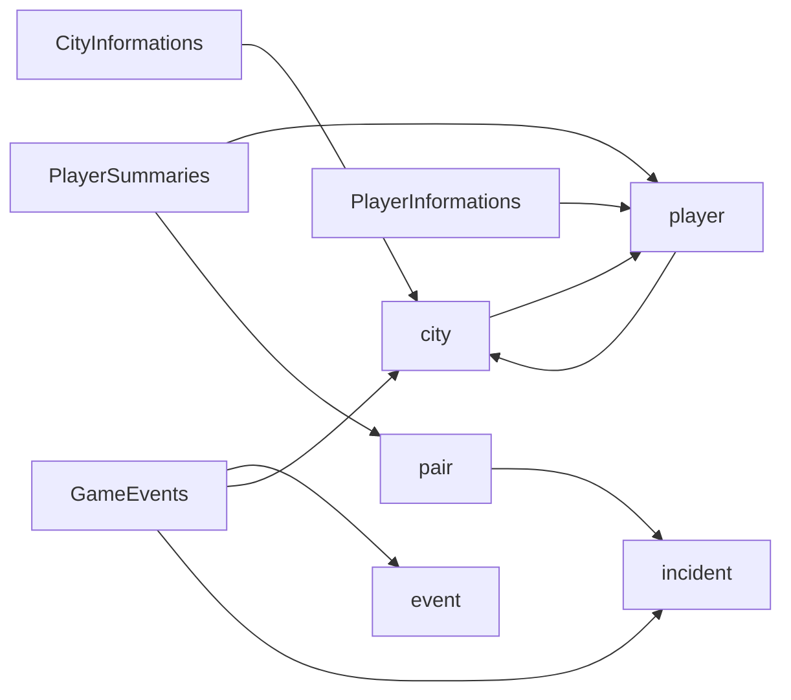

# Newspaper trigger facts

City, player, event, pair and incident facts live in `editorial/facts/`. Rules read current and historical values and use [shortcuts](constants.md#shortcuts) on those subjects. See the [stock examples](examples.md) for rules and templates that use them.

The **fact model** is the set of objects a [trigger rule](overview.md) can read: cities, players, events, pairs and incidents. This page is the reference for developers writing rules. It lists every fact, says where each one comes from, and explains how to read the past.

Facts come in two kinds. **Stored facts** are columns that the MCP server recorded. **Inferred facts** are worked out from stored columns and events, such as a city's distance to the receiver or its former owner. Inference favors useful coverage: a fact is offered whenever the databases support a reasonable reading.

| Subject | One per | Section |
| --- | --- | --- |
| `city` | City the receiver can see | [City](#city) |
| `player` | Known major civilization or city-state | [Player](#player) |
| `event` | Permitted event in the reporting period | [Event](#event) |
| `pair` | Two known players with a recorded relationship | [Pair](#pair) |
| `incident` | Inferred war or peace incident | [Incident](#incident) |

The **receiver** is the player the newspaper is written for. Every fact reflects what the receiver was allowed to see on the turn it was recorded.

## Naming

| Rule | Example |
| --- | --- |
| A stored column keeps its name in camelCase. | `FoodPerTurn` becomes `city.foodPerTurn` |
| A yes-or-no column is true or false. | `city.isPuppet` |
| A stored value that is empty reads as `null`, which is different from [hidden](#hidden-and-missing-facts). | `city.majorityReligion` is `null` for a city with no majority religion |
| A list column is a JavaScript array. | `city.wonders.includes('Petra')` |
| A fact that names another subject returns that subject. | `city.owner.era`, `player.capital.population` |
| Names recorded as text stay as recorded. | `player.era == 'Medieval Era'` |

## Globals

Every expression can read these, whatever its subject.

| Name | Contains |
| --- | --- |
| `self` | The receiver, as a `player` |
| `players` | Every known player, including `self` |
| `cities` | Every city the receiver can see |
| `events` | Every permitted event in the trigger's window, oldest first |
| `turn` | The cutoff turn of this check |
| `game` | `speed` (the recorded game speed name), `speedMultiplier`, `mapSize`, `startEra`, `maxTurns`, and `congress` when league observations exist |
| `press` | Publication memory: `issues` (published issue count) and `lastIssueTurn` (turn of the latest issue, or `null`) |
| `printed(ruleId, subject?)` | `{turn, count}` for published articles a rule supported, or `null` when none. The optional `subject` limits the count to one city, player or pair. See [publication memory](overview.md#publication-memory). |
| `distance(a, b)` | Hex distance between players, cities, plots or events. See [distance](constants.md#distance). |

The **reporting period** runs from the previous newspaper check to the cutoff turn. A trigger's **window** is its `window` field, or the reporting period when the field is omitted. Inferred facts such as `owner` and `distance` describe the cutoff turn, including when an `event` rule reads them.

## City

`city` is one row of `CityInformations` at the cutoff turn, plus inferred facts.

### Stored city facts

| Access | Facts |
| --- | --- |
| Basic (any city the receiver can see) | `id`, `name`, `x`, `y`, `population`, `majorityReligion`, `defenseStrength`, `hitPoints`, `maxHitPoints`, `isCapital`, `isPuppet`, `isOccupied`, `isCoastal`, `wonders`, `razingTurns`, `resistanceTurns` |
| Detailed (the receiver's own cities and cities it has full insight into) | `foodStored`, `foodPerTurn`, `productionStored`, `productionPerTurn`, `currentProduction`, `productionTurnsLeft`, `goldPerTurn`, `sciencePerTurn`, `culturePerTurn`, `faithPerTurn`, `tourismPerTurn`, `happinessDelta`, `unhappiness`, `buildingCount`, `importantBuildings`, `greatWorkCount` |

`city.happinessDelta` is the net local happiness in that snapshot. Negative values indicate local unhappiness, positive values indicate a surplus, and zero is balanced. Reading it requires a detailed city observation. To compare happiness across time, read it on two snapshots.

`city.unhappiness` breaks local unhappiness into causes from a detailed city observation. An empty `UnhappinessSources` object means all causes read 0. Older observations without the object leave the breakdown unknown. The strategist's city report still gives only net `HappinessDelta`.

| Key | Cause |
| --- | --- |
| `culture` | Boredom from culture |
| `gold` | Poverty from gold |
| `science` | Illiteracy from science |
| `distress` | Distress from food |
| `religion` | Religious unrest |
| `isolation` | Isolation |
| `famine` | Famine |
| `pillaged` | Pillaged tiles |
| `buildings` | Buildings |
| `specialists` | Specialists |
| `top` | The name of the largest recorded positive cause, or `null` if there is none |

Compare these readings with each other and against small thresholds. The list omits occupation and empire-wide unhappiness. The game also applies a population cap and handles resistance, razing and puppets separately, so the readings can differ from the net `happinessDelta`. A missing or malformed observation is hidden. `top` breaks ties by the order above.

`player.complaintShare(causes)` takes a list of cause names and returns the fraction of that player's visible cities whose leading cause is on the list. Only cities with a readable, non-null `unhappiness.top` count toward the total. The share is 0 when none qualify or the city list is unavailable.

### Inferred city facts

| Fact | Meaning | Inferred from |
| --- | --- | --- |
| `owner` | The owning `player` | The recorded owner label matched to a civilization name. A city-state's cities carry the shared label `City-States`, so the city name is matched to the city-state's name, then to capture and founding events at its plot. |
| `own` | The receiver owns it | `owner` is `self` |
| `foreign` | Someone else owns it | `owner` is another player |
| `distance.own` | Hex distance to the nearest city of the receiver; 0 for the receiver's own cities | City coordinates |
| `distance.capital` | Hex distance to the receiver's capital | City coordinates and `self.capital` |
| `nearestOwn` | The receiver's `city` closest to this one | City coordinates |
| `founded` | Recorded founding turn, or an estimate from first sighting | A `PlayerCityFounded` or `UnitCityFounded` event at its plot; otherwise the first observation after the recording began, when the city's history is continuous |
| `captured` | The latest capture: `turn`, `from` (player), `by` (player), `conquest` (true or false) | `CityCaptureComplete` and `CityFlipped` events at its plot |
| `formerOwner` | The `player` who owned it before the current owner | `captured.from`; otherwise the most recent different owner in the same city's continuous observations |
| `trained` | Units completed inside the window, with `turn`, `unit` (the unit type), `withGold`, `withFaith`, and sometimes `port` | `CityTrained` and same-turn `UnitCreated` events, joined by owner and unit ID. |
| `built` | Buildings and wonders completed inside the window, each with `turn` and `building` | `CityConstructed` events and additions to `wonders` |
| `conversions` | Religion changes inside the window, each with `turn` and `religion` | `CityConvertsReligion` events at its plot and changes to `majorityReligion` |
| `events` | Every permitted event inside the window that names this city or its plot | Event city IDs and coordinates |
| `ourSpyPresent` | The receiver's spy is stationed in this city | The receiver's `PlayerSummaries.Spies` roster, matched by location to a unique recorded city and owner. A readable roster that shows no spy gives `false`; missing or ambiguous evidence is hidden. |
| `is.<name>` | A [shortcut](constants.md#shortcuts), such as `city.is.neighbor` | The catalogue |

Annexation has no recorded event. A rule reads it from the stored flags: `city.before.isPuppet && !city.isPuppet && city.isOccupied`. The shipped `neighbor-puppet-annexed` rule combines them with `city.is.neighbor` and an unchanged owner.

For the receiver's own training events, `port` gives the city name from a dated observation. It requires a unique earlier creation of the same owner's unit on the same turn and both purchase flags to be explicitly false. The launch probe also checks the unit type against a short list of naval types. The report cites the training, creation and city records. Foreign training, purchases and custom ship names are outside the launch probe.

## Player

`player` joins a player's identity from `PlayerInformations` with its `PlayerSummaries` row at the cutoff turn.

### Stored player facts

| Group | Facts |
| --- | --- |
| Identity | `id` (the player ID), `name` (from `Civilization`), `leader`, `teamId`, `major` (from `IsMajor`), `cityState` (the opposite of `major`), `human` (from `IsHuman`) |
| Standing | `score`, `era`, `votes`, `technologies` (count), `currentResearch`, `policyBranches`, `nextPolicyTurns` |
| Size | `cityCount`, `population`, `territory` |
| Economy | `gold`, `goldPerTurn`, `happinessPercentage`, `goldenAge`, `resources`, `outgoingTradeRoutes`, `incomingTradeRoutes` |
| Output | `sciencePerTurn`, `culturePerTurn`, `faithPerTurn`, `tourismPerTurn` |
| Military | `militaryUnits`, `militarySupply`, `militaryStrength` |
| Religion | `foundedReligion`, `majorityReligion` |
| Diplomacy | `majorAlly`, `relationships`, `diplomaticDeals` |

The stored column `Cities` is exposed as `cityCount`, because `player.cities` is the list of that player's visible cities. The table lists possible fields. A receiver with full access to its own national summary can read its votes, resources, unit count, supply and deals. Foreign summaries use a smaller field list. City-states may have identity, ally, city count, population, gold, income, technologies, resources and relationships, subject to the same projection. A dated national observation establishes which identities are visible, including a known city-state with no readable national values.

Read `self.happinessPercentage` for the receiver's national happiness. Vox Populi records it as a whole number on a 0–100 scale, with 50 corresponding to parity between happy and unhappy citizens. It can be missing from the evidence. This national measure and the net local value `city.happinessDelta` are both used by the [stock examples](examples.md) to choose a story's tone.

### Tactical observations

`self.tacticalZones` lists the receiver's private observations from the cutoff turn. Each entry has a `zoneID`, a `city` label when recorded, `domain`, `posture`, and `units` counted by civilization and unit type. It cites the latest insertion for that zone. Zone zero holds unassigned units and is omitted. If the recording has no eligible rows, the fact is unknown. Spy and vassal access do not expose another seat's zones.

The newspaper names the city only if it has a matching readable city observation. It lists counts for known civilizations, known city-states and barbarians. These checks control which labels can be shown; the labels and counts themselves come from the zone record.

A `Withdraw` posture is the AI's assessment during that turn. The recorder can read zones several times in one turn and only saves occupied zones, so an earlier sighting can remain after its units leave. A sea zone can include land units. Use `militaryStrength` or `militaryUnits` for available national context.

To read the zones for a city at the cutoff, use `city.tacticalZones()`. It matches both the city name and the absolute zone ID, so land and sea zones can match the same city. It returns an empty list if the known zones do not match, or `undefined` if the city's identity or the receiver's observations are unavailable.

### Inferred player facts

| Fact | Meaning | Inferred from |
| --- | --- | --- |
| `self` | This player is the receiver | Identity |
| `cities` | The player's cities that the receiver can see | `city.owner` |
| `capital` | The player's capital `city` | The city with `isCapital` among `cities` |
| `distance` | Smallest hex distance between any city of this player and any city of the receiver; 0 for the receiver | City coordinates |
| `outgoingTradeRouteCount` | Number of route records at this snapshot. An empty map gives 0; a missing or malformed map is hidden. | `outgoingTradeRoutes` |
| `ideology` | The player's ideology name, or `null` when the record shows no matching branch. Hidden when branch data is unavailable. | Keys of `policyBranches` and the catalogue's `ideologies` list |
| `atWar` | In at least one known war | `relationships` |
| `wars` | The players it is known to be at war with | `relationships` |
| `enemy` | At war with the receiver | `relationships` |
| `friend` | Declared friendship with the receiver | `relationships` |
| `ally` | Defensive pact with the receiver, or a city-state allied to the receiver | `relationships`, `majorAlly` |
| `vassal`, `master` | The receiver's vassal, or the receiver's master | `relationships` |
| `relation(other)` | The relationship with any other player: `war`, `friend`, `pact`, `vassalOf`, `masterOf`, `warScore`, `denouncedThem`, `denouncedByThem`, `openBordersTo`, `openBordersFrom`, `proximity`, `warWeariness`, `influence`, `protected` | `relationships`, through the helpers in `mcp-server/src/diplomacy/relationships.ts` |
| `rank(field)` | Position among known majors with a visible number on that date. Equal numbers share a position. If only our score is visible, our score ranks 1 in a comparison of one. For a world-leader story, check how many rivals have readable scores. | The named fact across `players` |
| `events` | Every permitted event inside the window that names this player or its team | Event player and team IDs |
| `ourDiplomatThere` | The receiver has a diplomat posted to this foreign major's capital | The receiver's spy roster, counting diplomats and vassal diplomats schmoozing at the recorded capital. A readable roster that shows none gives `false`; missing or ambiguous evidence is hidden. |
| `theirDiplomatHere` | This foreign major has a diplomat at the receiver's capital | That player's spy roster, read separately from our own. A readable roster that shows none gives `false`; missing or ambiguous evidence is hidden. |
| `is.<name>` | A [shortcut](constants.md#shortcuts), such as `player.is.rival` | The catalogue |

The two diplomat facts apply to known foreign majors. Policy and deal insight comes from the receiver's outgoing diplomat.

### Relationship direction and access

`denouncedThem` and `openBordersTo` describe what the subject did toward the other player. `denouncedByThem` and `openBordersFrom` describe what the other player did toward the subject. A positive observation from either side of a same-turn pair wins a disagreement. A `false` reading requires the full major entry of the player who took the action, so a missing direction stays unknown.

`proximity` reads the subject's observation first and gives the game's label, such as `Close`. `warWeariness` is the subject's own reading and appears only under full access to a major at war with another major. For a major and a city-state, `influence` and `protected` describe the major's influence and whether it is protecting the city-state. Each entry in `relationships` shows what its own summary recorded. Use `relation(other)` to combine those observations and `relation(other).knows('openBordersFrom')` to check whether the reverse grant is known.

### Policy names

Both helpers return `true` on an exact match and cite the national row that supplied `player.policyBranches`. They return `undefined` when the name cannot be established, including when the branch map is missing or unreadable.

| Helper | What matches |
| --- | --- |
| `player.hasBranch('Fealty')` | A readable branch key, including one with only a policy count. |
| `player.hasPolicy('Secularism')` | A recorded policy name. A branch count alone cannot establish a policy name. |

### Technology milestones

`self.hasTechnology('Printing Press')` reads the receiving team's latest recorded change for that technology through the cutoff, including events before the trigger window. Use the display name from the recording. The check returns `true` for a gain and `false` for a loss, and cites the event. Gains include research, grants, and theft.

The check returns `undefined` for rival players, earlier snapshots, or names it has no record of. This includes any starting technologies that were never logged. Use an era fallback when the result is unknown.

### Covert presence and roster points

The newspaper matches roles and locations in the recorded spy rosters. It reads supported state labels and can also recognize a spy gathering intelligence or a diplomat schmoozing across game languages: Vox Populi only records a nonnegative network balance for those two states. An empty roster or a clear miss establishes absence. A missing roster, ambiguous match or unrecognized state without that balance leaves presence unknown.

Access to recorded detail also uses roster points as a proxy. Another major's city detail needs a matching stationed spy with at least **500** current points at both the city observation and the cutoff. Foreign policy text needs the receiver's outgoing diplomat at the target capital with at least **200** points. Deal terms need **800** points. Spending points can lower the recorded balance while the game still grants its bonus, so a story can be withheld when the game would allow it.

The cutoff roster supplies the current view. An event reads the latest roster from an earlier turn, so an arrival after the event cannot open its details. Older events do not become readable later.

## Congress

`game.congress` describes the World Congress or United Nations from the newest recorded diplomatic victory observation. It is absent when the recording has no usable observation, for example when diplomatic victory was disabled. Recorded vote outcomes remain available through `ResolutionResult` events.

| Fact | Meaning |
| --- | --- |
| `available` | The league exists in the newest observation. An observation with `available` false reads as a known empty agenda. |
| `observedTurn` | Recorded turn of the newest observation. It can be before the cutoff. |
| `league` | Recorded league name, when present. |
| `votingNow` | True only when the newest observation is at the cutoff and records a vote in progress. An older record never claims current voting. |
| `expectedSessionTurn` | Estimated next session turn from the newest recorded countdown. Omitted when that date has passed or the observation has no countdown. |
| `diplomaticVictoryVotesNeeded` | Votes needed for diplomatic victory. |
| `proposals` | Current proposals. Each has `name` and `isEnact`, plus `proposer` and `description` when recorded. |
| `activeResolutions` | Current resolutions. Each has `name`, plus `description` and `enactedTurn` when recorded. |
| `newProposals` | Proposals first seen in this reporting period. Each has the proposal fields plus `observedTurn`. |

The recorder can skip turns between observations. `proposals` and `activeResolutions` come from the newest observation, which can predate the cutoff. `newProposals` compares proposal direction and name with the last known agenda, even across gaps. With no earlier agenda, it counts every proposal in the first agenda as new. A proposal leaving the agenda doesn't establish how the vote went.

`newProposals[].observedTurn` is an approximate date. Each new proposal cites the `VictoryProgress` rows used to identify it.

`activeResolution(prefix)` returns the first entry in `game.congress.activeResolutions` whose name starts with the prefix. It returns `undefined` when the Congress fact or its list is unreadable or missing, the league is unavailable, or no name matches. Use the result directly as a condition, or use optional chaining to read its name. To check a qualifier across multiple matches, search the list with `some`.

## Event

`event` is one permitted row of `GameEvents`.

| Fact | Meaning |
| --- | --- |
| `type` | The recorded event type, such as `CityCaptureComplete` |
| `id` | The recorded event's row ID |
| `turn` | The recorded turn, or the receiver's next turn for a delayed defender report. The source citation keeps the original date. |
| Payload fields | Each permitted field in camelCase. An ID may also offer a link: `oldOwnerId` comes with `oldOwner` when the player can be resolved. |
| Recorded names | `tech`, `policy`, `branch`, `oldBranch`, `newBranch`, `religion`, `unit` and `building` hold the names as recorded. A numeric ID alone does not supply a name. |
| `person`, `kind` | A named great person's own name and what happened: `born`, `expended` (used for an action) or `died` |
| `player` | The main acting player, or the only linked member of an acting team |
| `players` | Linked members of an acting team (`teamId`), known at the event date and the cutoff |
| `city` | The city the event concerns, matched by city ID or by plot |
| `plot` | `x` and `y`, when the event has a location |
| `distance.own` | Hex distance from `plot` to the nearest city of the receiver |

A player ID of -1 means "nobody", and the matching player fact is then missing. Some events reach the receiver because it was involved, even when another party was unknown. On those events, a rule sees a foreign player's ID only if the receiver knew that player at the time. A known member can establish a team ID without revealing its other members. The examples rely on these payload names:

| Event | Names offered |
| --- | --- |
| `CityCaptureComplete` | `oldOwner`, `newOwner`, `isCapital`, `isConquest`, `city` |
| `PlayerCityFounded` | `player`, `plot`, `city` (the city now at that plot) |
| `SetAlly` | `minorPlayer`, `oldAllyPlayer`, `newAllyPlayer` |
| `PlayerGoldenAge` | `player`, `starting` |
| `TeamTechResearched` | `teamId`, `players`, `player` for a single linked member, `tech`. A witnessed event also carries `changeAmount`; a negative value means the team lost the technology. A gain can come from research, a grant or theft. |
| `EspionageResult` | `perspective` (`source` or `target`), `spyResult`, `cityName` when recorded, and links to the parties when their identity is available. The source may also get an inferred `tech` name. |
| `ElectionResultSuccess`, `ElectionResultFailure` | `player`, signed `influenceChange`, and `cityState` when the capital's label resolves. Failure applies only to a player with a recorded spy in the election. |
| `PlayerAdoptPolicyBranch` | `player`, `branch` |
| `UnitCreated` | `player`, `unit`, `plot`. A named great person adds `person` and `kind: 'born'`. Unwitnessed births supply only the owner and name. |
| `GreatPersonExpended` | `player`, `unit`, `plot`. A named great person adds `person` and `kind: 'expended'`. |
| `UnitPrekill` | `player` (the owner), `unit`, `plot`, `person`, `kind: 'died'` and `attackingPlayer` when the final removal records a known attacker |
| `ResolutionResult` | Public vote outcome: `isEnact` (true for enactment, false for repeal), `passed`, `resolutionType` (recorded name or numeric type), and the raw `decision`. The `proposerName` and `proposerPlayerId` are available when recorded. `player` links to a proposer with the usual dated contact. |

The event types a rule may name are the ones in `newspaperEventConfigs` in `mcp-server/src/newspaper/projection.ts`. [Evidence the facts rely on](#evidence-the-facts-rely-on) describes how those rows are projected.

Operation reports are private to the spy's owner and the city defender. The defender can report a detected operation from its next recorded turn if it still appears to hold the city. Only `Identified` and `Killed` reveal the source. `Detected` and `KilledNotIdentified` leave the source anonymous; `Undetected` produces no defender report. The recording does not confirm that the game delivered a notification.

Only the spy's owner can infer a technology name. The query looks for one named positive gain by the owner's team in the next ten event IDs on the same turn and requires that only one operation matches that gain. A killed spy can still have completed the operation. The gain may come from ordinary research or another grant, so use wording such as "may have obtained" and leave the technology unnamed when the match is unclear. Election influence is private to the affected player and is measured in influence points.

## Pair

`pair` describes two known players and how they stand with each other. Pairs are unordered; `a` is the player with the lower ID. Rules run once for each pair with a recorded relationship.

| Fact | Meaning |
| --- | --- |
| `a`, `b` | The two players |
| `id` | Both player IDs in order, for example `2/7` |
| `involvesSelf` | The receiver is one of them |
| `other` | The player who is not the receiver, when `involvesSelf` |
| `majors` | Both are major civilizations |
| `atWar` | They are observed at war |
| `warScore` | Recorded war score from -100 to 100, from `a`'s perspective, or from the receiver's when `involvesSelf` |
| `warTurns` | Recorded turns since the war was first observed; 0 when at peace |
| `peaceTurns` | Recorded turns since a known settlement or an observed change from war to peace |
| `lastWarScore` | The last `warScore` recorded before the latest peace |
| `friends`, `pact` | Declared friendship, defensive pact |
| `is.<name>` | A [shortcut](constants.md#shortcuts), such as `pair.is.foreignWar` |

## Incident

`incident` is one inferred war or peace event with everyone it drew in. Incident rules run on incidents from the reporting period. [War and peace](war-and-peace.md) explains the inference.

| Fact | Meaning |
| --- | --- |
| `kind` | `war` or `peace` |
| `id` | The inferred incident's identifier, shared by stories about that declaration or settlement |
| `turn` | The turn of the recorded calls |
| `initiator`, `target` | The players of the likely first call |
| `pair` | The `pair` of `initiator` and `target` |
| `participants` | Every major player drawn in, each with `player`, `side` (`initiator` or `target`) and `reason` (`root`, `pact`, `vassal`, `master`, `cityStateAlly`, `inherited`) |
| `cityStates` | City-states drawn in |
| `role` | The receiver's part: `initiator`, `target`, `joined` or `none` |
| `reason` | Why the receiver takes part, using the same values as a participant's `reason` |
| `resumed` | For war: the two had fought before and were known to be at peace |
| `observed` | For war: the fighting was seen in relationship snapshots, with no recorded declaration. The direction of the attack and each party's participation role may then be unknown. |
| `partial` | For peace: one of the two settling players still has another recent war open |
| `concessions` | For peace: the kinds of visible concessions, empty when none are visible |
| `capitulation` | For peace: a new capitulated vassal relationship followed |

## Reading the past

`city`, `player` and `pair` offer the same accessors. `city` is used below.

| Accessor | Reads | Example |
| --- | --- | --- |
| `city.population` | The value at the cutoff turn | `city.population >= largeCity` |
| `city.before` | The snapshot at the start of the trigger's `window` | `city.population < city.before.population` |
| `city.previous` | The snapshot at the previous newspaper check | `!city.previous.isOccupied` |
| `city.at(span)` | The snapshot that many recorded turns ago, up to `long` | `city.at(long).owner.id != city.owner.id` |
| `city.history` | Every snapshot inside the window, oldest first | `city.history.every(s => s.foodPerTurn < 0)` |

A snapshot offers the stored facts, plus `owner` for a city, `rank(field)` and `relation(other)` for a player, and `atWar` and `warScore` for a pair. The databases record a row only when something changed, so a snapshot "at" a turn is the latest row at or before it.

For a pair, `pair.before`, `pair.previous` and `pair.at(span)` keep the flags and elapsed turns across a transition into or out of war, but a war score from another war or across an unobserved gap is unavailable. `pair.history` holds only the current phase. A run begun late cannot recover an older war score or start date outside its loaded history.

| Helper | Meaning | Example |
| --- | --- | --- |
| `held(subject, test, span)` | The test was true on every turn of the span. For a pair, every turn from the cutoff minus the span through the cutoff inclusive needs an actual recorded sample, so an observed gap makes it false. If the span starts before the loaded snapshot history, the result is hidden. | `held(city, s => s.foodPerTurn < 0, short)` |
| `crossed(now, before, boundary)` | The value rose from below the boundary to it or above | `crossed(city.population, city.before.population, metropolis)` |
| `dropped(now, before, boundary)` | The value fell from the boundary or above to below it | `dropped(player.happinessPercentage, player.before.happinessPercentage, 50)` |
| `pct(now, before)` | Relative change, where 0.25 is a 25% rise | `pct(player.sciencePerTurn, player.before.sciencePerTurn) >= 0.25` |
| `changed(subject, field)` | The fact differs from its value in `before` | `changed(city, 'majorityReligion')` |

Spans passed to `at` and `held` are in recorded turns. A [named span](constants.md#spans) is already converted for the game speed; a bare number such as `2` means 2 recorded turns at any speed.

Standard JavaScript is available on lists: `some`, `every`, `filter`, `map`, `includes` and `length`. Sort a copy, such as `[...cities].sort((a, b) => b.population - a.population)`. A zero baseline makes `pct` unknown.

## Hidden and missing facts

Reading a fact the receiver could not see, or a snapshot that does not exist, ends the rule for that subject, and the audit names the fact.

| Situation | Effect | Example |
| --- | --- | --- |
| A detailed fact on a city seen only from outside | The rule stops for that city | `city.foodPerTurn` on a foreign city without full insight |
| No snapshot at the start of the window | The rule stops | `city.before` for a city first seen two turns ago |
| A player the receiver has not met | The player is absent from `players` | An unmet civilization never appears as a subject |
| Two known players with no recorded relationship entry | `relation(other)` reports nothing as true | A missing entry does not count as peace or war. If the other player was not known at the requested turn, the relation is hidden. |
| An unreadable or conflicting war report | The war flag and score are hidden | A newspaper can still report another war it can establish |
| An inferred fact with nothing to infer from | The fact is hidden | `city.formerOwner` for a city with one known owner |

Use `subject.knows(field)` to branch on availability without stopping the rule: `city.knows('foodPerTurn') ? city.foodPerTurn > 0 : true`. To write a story about a witnessed founding, use a founding event. A receiver that first saw a rival city on turn 8 may get a `founded` estimate of 8 even if the rival founded it earlier.

A first observation therefore establishes a baseline. A city seen for the first time cannot report growth until a later check has an earlier snapshot to compare. The first-observation estimate for `founded` needs a history that reaches the start of the receiver's recorded observations. With a shorter history, look for a dated founding event.

## Evidence the facts rely on

The shared evidence query reads recorded rows for one receiver. It returns cutoff snapshots, optional comparison snapshots, private [tactical observations](#tactical-observations), derived diplomacy and events after `previousCheckTurn` through the cutoff. Projection applies recorded visibility and each event's contact and insight rules. Espionage operations and elections use the recorded participant IDs for access. City snapshots include the recorded `IsCapital`. A readable player row includes recorded `MilitaryStrength` for the receiver or at access level 2.

World news can report a technology gain or a named great person's birth without a witness. The receiver must have met the owner by the event turn, including every member of a team that gained a technology. The unwitnessed record carries only the owner ID and name of the technology or person. For example, a paper can report that Hypatia appeared in Persia without revealing her city or unit type.

Uses and deaths require recorded visibility. Only the final removal can report a death, and a use that turn suppresses that death so an expenditure yields one story. Recorded same-turn conversions, including gifts, do not count as births or deaths. Named stories require the game to have supplied a personal name when it recorded the event. The strategist's `get-events` omits personal names.

Optional `historyFromTurn` sets the baseline to the earlier of that turn and `previousCheckTurn`. Use `-1` to include turn 0. History contains readable baseline rows, visible final observations per subject and turn after the baseline, and permitted events through the cutoff, including the reporting period. Gaps mark when an established observation becomes unavailable. A capture or razing the receiver witnessed ends a city observation when its plot and date establish removal. The gap can be visible even when the identity of a party is hidden. Missing coordinates or tied timestamps can leave a stale snapshot and are reported as lifecycle limitations.

| Join | Required evidence |
| --- | --- |
| City owner | A unique recorded civilization match, the barbarian slot, or for city-states a readable founding or capture at the plot or a unique city-state name match. Conflicting or ambiguous ownership remains unknown. |
| Event position | A unique earlier readable city row matching the event's city ID and owner, with no intervening change that invalidates it. Trade routes keep separate endpoints; `CapitalChanged` uses the new capital for `CityX` and `CityY`. |
| Trained unit | One visible same-turn `UnitCreated` with matching player and unit IDs and a recorded unit type name. A launch uses a unique creation before the training. |

Each item cites its recorded source; `relatedSources` cites the readable rows used in joins. The expression result collects the rows behind the facts it reads. For example, a trained unit name can cite the training event, the unit creation and the city observation that locates it. A player's static name is tied to the dated national observation that made the player visible. Public game settings have no dated observation. Hidden records can block a join. Map dimensions and wrapping stay private.

The allowlist covers founding, capture (including `IsCapital`), other city changes, production, combat, diplomacy and national events. Both founding hooks can support city ownership. `CombatResult` carries a plot; `UnitKilledInCombat` has none. With a recognized status flag, `PlayerGoldenAge` projects a positive award or extension as `Starting: true`, a start flag without a numeric change as true, and an end flag with zero change as false. Otherwise `Starting` is absent.

## Add a fact

1. Check that the evidence exists in MCP's projection. When it does not, extend `newspaperEventConfigs` or the city and player field lists, and add a visibility test under `mcp-server/tests/newspaper/`.
2. Add the fact to the builder for its subject under `vox-agents/src/newspaper/editorial/facts/`. Keep the original source rows attached, so the audit and the reader's source inspection still work.
3. Decide what "hidden" means for it and return hidden when the inputs are missing.
4. Add a row to the table on this page with its meaning and what it is inferred from.
5. Add a focused test under `vox-agents/tests/mock/newspaper/editorial/facts/` with a present value, a hidden value and a first observation.
