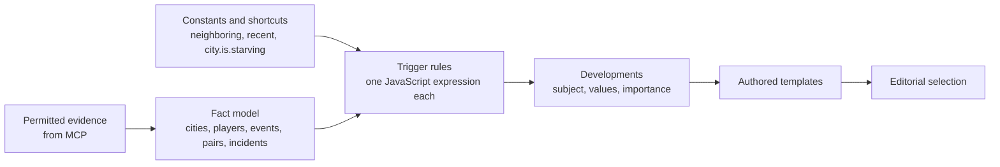
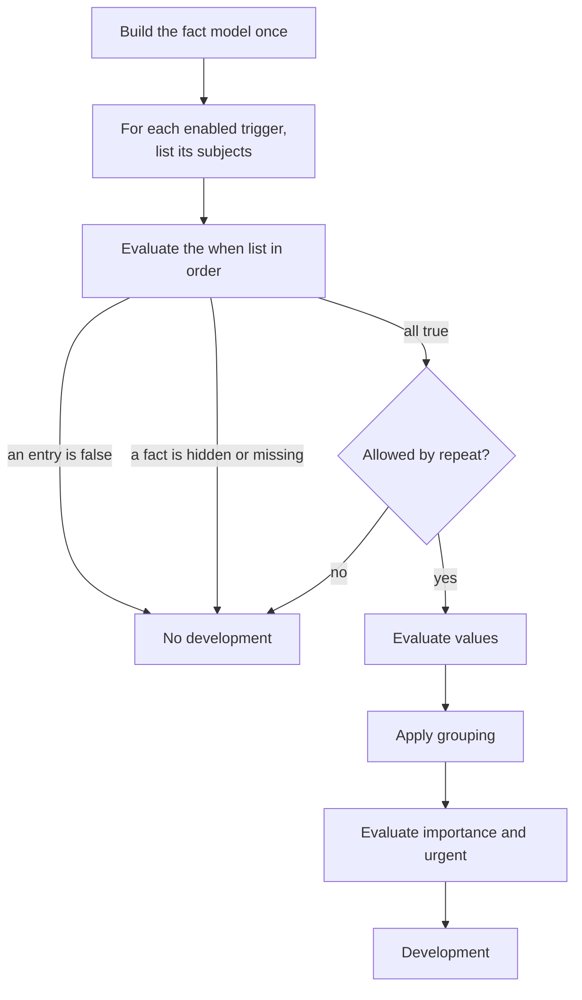

# Newspaper trigger overview

Trigger rules test visible facts, keep repeat memory, and record an audit for each subject. The stock catalogue pairs rules under `vox-agents/newspaper/triggers/` with authored stories under `templates/`. Both use the same QuickJS expressions and [named constants](constants.md).

A **trigger** is a rule that spots one kind of development in the recorded game, such as "a neighboring foreign city changed from puppet to occupied". This page is for developers who add or tune newspaper coverage. It explains what a trigger entry contains, how a check evaluates it, and how to add one.

A rule is a JavaScript expression over a **fact model**: cities, players, events, pairs, incidents and relationships built from the MCP server databases. Code supplies the facts, including inferred ones such as distance or a city's former owner. The catalogue supplies the rules. A new rule therefore needs a new catalogue entry and no new code, as long as the facts exist. Authored templates turn its developments into stories; the stock catalogue pairs each rule with one.



| Page | Covers |
| --- | --- |
| This page | Trigger entries, evaluation, importance, repeats, grouping, authoring workflow |
| [Facts](facts.md) | Every subject, its stored and inferred facts, time access, hidden facts, helpers |
| [Constants and shortcuts](constants.md) | Distance measurement, named distances, spans, sizes, type lists, shortcuts |
| [Examples](examples.md) | Stock triggers and a copyable overlay for the neutral settler story |
| [War and peace](war-and-peace.md) | How declarations and settlements become `incident` and `pair` facts |

[Editorial decisions](../editorial.md) covers what happens after a development exists: templates, selection, votes and presentation. [Replay](../replay.md) covers generating and inspecting issues.

## A first example

The shipped `settler-departure` rule reports when one of our cities has shrunk, trained settlers, and still brings in more food than it uses.

| Field | Value | Reads as |
| --- | --- | --- |
| `id` | `settler-departure` | The name templates use |
| `subject` | `city` | Run the rule once for every city the receiver can see |
| `window` | `recent` | Compare with the city 5 Standard turns ago |
| `when` | `city.own` | One of the receiver's cities |
| | `city.population < city.before.population` | Smaller than at the start of the window |
| | `city.trained.some(t => settlers.includes(t.unit))` | Trained a settler inside the window |
| | `city.foodPerTurn > 0` | Food is still positive |
| `values` | `lost`: `city.before.population - city.population` | Supplies a placeholder for this ungrouped rule |
| `importance` | `30 + 10 * lost` | 40 for one lost population, 50 for two |

`recent` and `settlers` are [constants](constants.md). `city.before` and `city.trained` are [facts](facts.md#city).

## Trigger entries

Entries live in JSON files under `vox-agents/newspaper/triggers/`. Files group entries by topic, such as `cities`, `nation`, and `foreign`, for editing convenience; the file name has no effect on behavior.

| Field | Required | Meaning | Example |
| --- | --- | --- | --- |
| `id` | Yes | Stable identity that templates name. Keep it when tuning. | `settler-departure` |
| `subject` | Yes | What the rule runs once for: `city`, `player`, `pair`, `event`, `incident` or `world`. See [subjects](#subjects). | `city` |
| `event` | For `subject: event` | The event type, or list of types, the rule runs on. | `CityCaptureComplete` |
| `window` | No | How far back the rule looks: `before`, `history`, the `events` global and facts such as `city.trained`. A named span or a number of Standard turns. When omitted, the window is the **reporting period**, which starts at the previous newspaper check. | `recent` |
| `when` | Yes | The rule. One expression, or a list of expressions that must all be true. | The four entries in the [first example](#a-first-example) |
| `values` | No | Named expressions. Non-null scalar results become placeholders for ungrouped developments. | `lost: city.before.population - city.population` |
| `importance` | No | A number or expression, kept within 0 to 100. Defaults to 50. | `30 + 10 * lost` |
| `urgent` | No | Expression. When true, the development may lead a breaking front page. | `city.distance.own <= adjacent` |
| `group` | No | Merges several matches into one development. See [grouping](#grouping). | `by: city.owner.id`, `min: 2` |
| `repeat` | No | When the same subject may fire again: `rearm` (default), `once`, or a span. See [repeats](#repeats). | `medium` |
| `tags` | No | Topic and scope labels shared with templates, pages, variety and feedback. | `cities`, `international` |
| `enabled` | No | Set to `false` to switch the trigger off. | `false` |

Expressions in `values`, `importance` and `urgent` can read earlier `values` by name, as `importance` reads `lost` in the first example. A trigger with `group` is the exception: its `importance` and `urgent` read the [group's names](#grouping).

### Subjects

| `subject` | The rule runs once for | Main name in the expression |
| --- | --- | --- |
| `city` | Each city the receiver can see at the cutoff turn | `city` |
| `player` | Each known major civilization and city-state, including the receiver | `player` |
| `pair` | Each pair of known players with a recorded relationship | `pair` |
| `event` | Each permitted event of the listed types inside the reporting period, whatever the `window` | `event` |
| `incident` | Each inferred war or peace incident inside the reporting period | `incident` |
| `world` | Once per check, for rules that compare many subjects | The globals only |

Every expression can also read the globals `self` (the receiver), `players`, `cities`, `events`, `turn` and `game`. A `city` rule can therefore compare its city against `self.capital`, and a `world` rule can scan `players` for a new leader.

## How a check evaluates triggers



| Step | What happens | Recorded in the audit |
| --- | --- | --- |
| Build facts | `vox-agents/src/newspaper/editorial/facts/` turns the evidence window into the fact model, once per check. | The evidence request and cutoff |
| List subjects | Each trigger receives the subjects of its kind. | Subject count |
| Evaluate `when` | Entries run in order and stop at the first that is false. Put cheap, selective entries such as `city.foreign` first. | The index of the failing entry |
| Hidden or missing facts | Reading a fact the receiver cannot see, or a snapshot that does not exist, ends the rule for that subject. See [hidden facts](facts.md#hidden-and-missing-facts). | `hidden` and the fact name |
| Check `repeat` | A subject that already fired may be held back. | The repeat state |
| Evaluate `values` | Once per matching subject. | Every value |
| Apply grouping | A trigger with `group` merges its matches. See [grouping](#grouping). | The key and the matches |
| Evaluate `importance` and `urgent` | Once per development, after grouping, so they can read `count`. | Both results |
| Create the development | It carries the trigger ID, subject, values, importance, tags, period and the source rows behind each fact that the rule read. | Source references |

A `when` entry passes when JavaScript treats its result as true, so `city.majorityReligion` passes for a city that has a majority religion. The rule evaluator uses the runner's error details to skip a failed match and records the field, expression, error or hidden fact in the audit.

A stock check evaluates every enabled rule and stores this audit even when no story or design is eligible, so a quiet check still records its audit.

The shared runner uses QuickJS directly through `quickjs-wasi`. `prepareEditorialExpressions` in `editorial/config/expressions.ts` validates the expression fields of a merged catalogue and the shortcut sources from `constants.json` before any facts are needed. Syntax errors name the choice, field and original expression. `getEditorialExpressions` in `config/load.ts` compiles a catalogue once; replay snapshots store the catalogue data, not bytecode or expression slots.

For each check, `editorial/shared/expressions.ts` evaluates the batch in a fresh sandbox. The caller supplies JSON globals, subject bindings and scaled constants and receives results in the same order. Rules have no filesystem, network, clock or random source. If an expression exceeds its execution allowance, the runner keeps completed results and skips that expression for the rest of the check. Other expressions can still run. After eight distinct expressions overrun, the runner skips the remainder of the batch. The rule evaluator batches each rule's fields per subject, then hands matched developments to template matching.

## Importance

`importance` places a development on a scale from 0 to 100. Selection later combines it with series memory, novelty, variety, template weight and votes, so a high importance raises the chance of publication without guaranteeing it.

| Pattern | Expression | Result |
| --- | --- | --- |
| Fixed | `60` | Always 60 |
| Grows with size | `30 + 10 * lost` | 40 at `lost` 1, 70 at `lost` 4, capped at 100 from `lost` 7 |
| Closer matters more | `80 - 4 * city.distance.own` | 64 at distance 4, 52 at distance 7, 20 at distance 15 |
| Boost for our own affairs | `city.own ? 70 : 40` | 70 for the receiver's city, 40 otherwise |

Results below 0 become 0 and results above 100 become 100.

## Repeats

`repeat` decides when a subject that already produced a development for this trigger may produce another.

| `repeat` | Fires again | Use for |
| --- | --- | --- |
| `rearm` (default) | After a check where the rule was false for that subject | States that come and go, such as a starving city |
| `once` | Never, for that subject in this game | Milestones, such as a city's first wonder |
| A span, such as `medium` | At the first check after that many Standard turns where the rule is true, even when it stayed true throughout | Long-running situations worth a follow-up |

Each event is its own subject, so an `event` rule fires once per event without any `repeat` setting. The publication fingerprint prevents the same development from being selected twice. Follow-up links and votes belong to a particular rule and subject: a trade story about a city stays separate from a political story about that city. Publication state schema 6 keeps the repeat state, so resuming a run preserves it. A skipped check still advances it.

## Grouping

`group` merges matches that share a key into one development, so three converted cities become one story.

| `group` field | Meaning | Example |
| --- | --- | --- |
| `by` | Expression evaluated per match. Matches with equal results merge. | `city.majorityReligion` |
| `min` | Smallest number of matches that creates the grouped development. Fewer matches produce nothing. Defaults to 2. | `3` |

A grouped development offers `count`, `key` and `matches`, the list of matched subjects with their own `values`. The trigger's `importance` and `urgent` run once for the group and read these three names and the globals, as in `40 + 10 * count`. With one group, prose can print `{{count}}` and a non-null `{{key}}`. A template combining several grouped rules names the contributing rule, for example `{{triggerValues.conversions.count}}`. The [placeholder guide](../editorial.md#placeholders-and-facts) explains how to read each group's members.

## Expressions and authored choices

Every condition is a JavaScript expression evaluated by the shared QuickJS runner. The runner has no filesystem, network, clock or random source.

| Place | Reads |
| --- | --- |
| Trigger `when`, `values`, `importance`, `urgent` and `group.by` | Its subject, earlier values and the globals |
| Template and variant `when`, and their weight adjustments | Visible facts and globals, plus the candidate's `values`, `triggerValues[ruleId]`, `subject`, `period` and `group` |
| Page `when`; design and layout `when` and weight adjustments | Visible facts and globals, without candidate bindings |

Omitting `when` makes a choice unconditional. Templates, variants, designs and layouts also need a positive final weight. See [authoring choices](../editorial.md#authoring-choices) for weight adjustments and placeholders.

A template names one or more triggers in `triggers`. Every named trigger must fire for the same subject with overlapping evidence periods. Since one rule can state a conjunction directly, a combined story is usually a single trigger. [Editorial decisions](../editorial.md#catalogue-and-eligibility) describes template matching.

## Where to work

| Location | Responsibility |
| --- | --- |
| `vox-agents/newspaper/triggers/` | Trigger entries |
| `vox-agents/newspaper/constants.json` | Named constants, type lists and shortcuts |
| `vox-agents/newspaper/templates/` | Authored headlines, paragraphs, placeholders, typed links and weights, grouped by topic like triggers |
| `vox-agents/newspaper/probes/` | Optional catalogue of synthetic story and design probes |
| `vox-agents/src/newspaper/editorial/config/` | Catalogue schema and validation in `schema.ts`, constant validation and span scaling in `constants.ts`; file loading, overlays and catalogue compilation in `load.ts` and `expressions.ts` |
| `vox-agents/src/newspaper/editorial/facts/` | Builds the fact model, including distance and inferred facts |
| `vox-agents/src/newspaper/editorial/diplomacy/` | War and peace inference; its incident and pair facts reach rules through the fact model |
| `vox-agents/src/newspaper/editorial/rules/` | Rule evaluation, repeats, grouping and the audit |
| `vox-agents/src/newspaper/editorial/selection/` | Template matching, heuristic choice, feedback and series memory |
| `vox-agents/src/newspaper/editorial/presentation/` | Page, design and layout eligibility, issue assembly and validation |
| `vox-agents/src/newspaper/editorial/shared/` | The QuickJS runner, choice eligibility and weights |
| `mcp-server/src/newspaper/projection.ts` | Which historical fields and events the newspaper may read |
| `mcp-server/src/newspaper/queries.ts` | Recorded snapshots, comparison history and event windows |

The legacy detectors are retired; new coverage belongs in `rules/`.

## Add a trigger

1. Write the story in one sentence, then pick the subject it is about. "A nearby city-state ally flipped to a rival" is about an event; "our capital is no longer our largest city" is about the world.
2. Find the facts in [facts.md](facts.md) and the thresholds in [constants.md](constants.md). Prefer a named constant or shortcut over a bare number, so later tuning happens in one place.
3. Add the entry to a file under `triggers/`. Order `when` from the most selective entry to the least.
4. To publish a story, add a template whose `triggers` list names the trigger ID and whose variant has a positive weight. Identity placeholders come from visible facts. An ungrouped rule supplies scalar placeholders from `values`; a grouped rule exposes `{{key}}` and `{{count}}` in prose. See [authoring choices](../editorial.md#authoring-choices) and the [settler overlay](examples.md#a-city-shrinks-after-sending-settlers).
5. Generate a fresh replay. For a published story, read the article beside its audit. For a skipped subject, the audit shows which condition stopped the rule.
6. When a needed fact is absent, add it to the fact model. When the evidence behind it is absent, extend MCP's projection first. Both are code changes; see [adding a fact](facts.md#add-a-fact).

Facts are inferred from what the databases hold, and useful coverage matters more than certainty. A rule may rely on an inferred fact such as `city.formerOwner` without proving it; wording in the template can carry any doubt worth mentioning.

## Tune with an overlay

Use an overlay directory to compare alternatives without editing the built-in catalogue. Its structure mirrors `vox-agents/newspaper/`; supply only the files and entries being changed. Pass it with CLI `--config` or the browser setting `editorialConfigDirectory`.

| To change | Overlay content |
| --- | --- |
| A named constant | `constants.json` with the same group and name, for example `{"distances":{"neighboring":9}}` |
| A type list | `{"types":{"settlers":["Settler","Pioneer"]}}`. The overlay list replaces the built-in list of that name. |
| A shortcut source | `{"shortcuts":{"city":{"neighbor":"city.foreign && city.distance.own <= adjacent"}}}`. Only that source changes. |
| One trigger | An entry with the same `id` and only the changed fields |
| Switch a trigger off | An entry with the same `id` and `enabled: false` |

Constants in an overlay merge group by group and name by name. A type list is one value, so the overlay list replaces the built-in list instead of adding names to it. Shortcut sources merge by subject and name. Trigger entries merge by `id` across files. In a trigger entry, a list such as `when` or `tags` replaces the inherited list. Resuming a saved run restores its saved catalogue, so start a fresh run with a new `--output` directory to see the effect of an overlay.

## Probe catalogue behavior

The developer overlay in `vox-agents/newspaper/probes/` mirrors the catalogue paths for constants, triggers, templates, designs and pages. Its empty `pages.json` leaves the stock pages in place. To try it in a fresh CLI replay, pass `--config vox-agents/newspaper/probes` from the repository root. The stock catalogue and installer omit these probes.

`vox-agents/tests/mock/newspaper/editorial/probes.test.ts` loads the overlay and runs the editor on synthetic evidence. Story probes check for the template ID in the published records when the rule matches and check that it is absent otherwise. Design probes offer only the design under test and check `issue.publication` when it qualifies. For example, the treasury story appears at 100 gold and stays out at 99. The People's Daily design qualifies for the synthetic receiver named Probe Republic.

## Verify changes

Run these from the repository root. MCP builds first because Vox Agents imports its compiled evidence contracts and queries.

```sh
npm run build -w mcp-server
npm run test:mock -w vox-agents -- tests/mock/newspaper
npm run type-check -w vox-agents
npm run build:newspaper -w vox-agents
```

For projection changes, also run `npm run test:mock -w mcp-server -- tests/newspaper`. Use the [replay CLI workflow](../replay.md#generate-examples-from-the-command-line) with the same source, receiver and turn range for each catalogue variant. Automated checks establish that rules evaluate; human reading establishes whether the coverage is useful and well paced.
