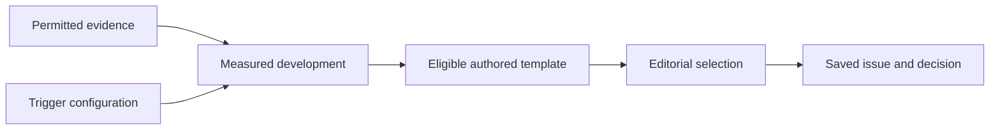

# Newspaper trigger overview

Triggers turn permitted recording evidence into measured developments and inferred accounts that authored templates can report. This page is for developers tuning coverage or adding a story family. It defines shared controls, units, evidence and repeat rules, overlays, and the workflow for adding coverage. Each [trigger category](#trigger-categories) has its own page and catalogue file. Read [editorial decisions](../editorial.md) for selection, votes, and presentation, [war and peace coverage](war-and-peace.md) for conflict inference and progress, and [replay](../replay.md) for generating and inspecting issues.

## Where to work

| Location | Responsibility |
| --- | --- |
| `vox-agents/newspaper/triggers/` | Trigger IDs, detector choice, conditions, thresholds, scales, tags, and detector tuning |
| `vox-agents/newspaper/templates/` | Authored headlines, paragraphs, placeholders, typed links, weights, and composites |
| `vox-agents/src/newspaper/editorial/config.ts` | Configuration schema, overlay merging, and catalogue validation |
| `vox-agents/src/newspaper/editorial/triggers.ts` | Detector dispatch and bounded importance |
| `vox-agents/src/newspaper/editorial/developments.ts` | Non-war dispatch, pace, and shared draft construction |
| `vox-agents/src/newspaper/editorial/development-facts.ts` | Numeric measurements, identity parsing, history, persistence, city continuity, and route parsing |
| `vox-agents/src/newspaper/editorial/city-developments.ts` | City population, food, status, wonders, and great works |
| `vox-agents/src/newspaper/editorial/national-developments.ts` | National output, budget, happiness, trade, golden age, majority religion, and technology-lead comparisons |
| `vox-agents/src/newspaper/editorial/event-developments.ts` | Contact, deals, eras, research, policies, ideology, religion milestones, and confirmed city-majority changes |
| `mcp-server/src/newspaper/projection.ts` | Permitted historical fields and events |
| `mcp-server/src/newspaper/queries.ts` | Recorded snapshots, comparison history, event windows, and city retirement |
| `mcp-server/src/diplomacy/relationships.ts` | Shared relationship parsing and checks for war, friendship, alliances, and defensive pacts |



## Trigger categories

The topic files under `triggers/` contain the shipped defaults. Each category page explains its conditions and units; templates in the matching topic files show the placeholders used in prose.

| Category | Catalogue file | Focus |
| --- | --- | --- |
| [Cities](cities.md) | `triggers/cities.json` | Population, food, recovery, and city status |
| [Domestic economy](economy.md) | `triggers/economy.json` | Budget transitions, income, and happiness |
| [Trade](trade.md) | `triggers/trade.json` | Partners, contraction, concentration, and plunder |
| [Diplomacy](diplomacy.md) | `triggers/diplomacy.json` | First contact and structured deals |
| [Science](science.md) | `triggers/science.json` | Eras, technologies, output, and technology leadership |
| [Culture and politics](culture.md) | `triggers/culture.json` | Policies, ideology, culture, tourism, wonders, great works, and golden ages |
| [Religion](religion.md) | `triggers/religion.json` | Milestones, city conversions, and national majority |
| [Recovery](recovery.md) | `triggers/recovery.json` | Cross-category recovery coverage; the shipped file is empty |
| [War](war.md) | `triggers/war.json` | Declarations, obligations, city-state war, and score progress |
| [Peace](peace.md) | `triggers/peace.json` | Settlements, concessions, and enduring peace |

The [war and peace guide](war-and-peace.md) covers incident grouping, obligations, progress tuning, placeholders, and inference limits across the war and peace catalogues.

Shipped triggers have `threshold: 1`, except `trade-concentration`, whose zero threshold preserves small crossings of its concentration boundary. War and peace detectors require `threshold: 1`; tune their stages with `enabled` and supported `tuning` fields. Each category page gives the `scale` and the magnitude compared with that threshold. History controls use the shared fallbacks below unless a category page supplies a different value. Configuration validation rejects unknown trigger fields, unsupported stage names, and tuning fields that do not apply to that detector and stage.

## Shared controls

A **trigger definition** is an editable catalogue entry with a stable `id`. Its `detector` names supported TypeScript behavior. Several entries may reuse one detector with different tuning.

| Control | Meaning |
| --- | --- |
| `id` | Identity referenced by template `triggerIds`; preserve it when tuning existing coverage. |
| `enabled` | Set to `false` to disable this trigger. Omission enables it. |
| `detector` | Supported evidence interpretation. Adding a new detector requires source changes. |
| `stage` | Selects a detector's branch, such as population `milestone`, `boom`, or `decline`. Use only the stages that detector handles. |
| `condition` | Optional eligibility condition; a missing or unknown fact cannot satisfy it. |
| `threshold` | Minimum measured magnitude that creates a development. Units depend on the detector. |
| `scale` | Magnitude that reaches maximum importance; increasing it reduces the importance of the same development. |
| `tags` | Topic and scope labels shared with templates, page membership, variety, and feedback. |
| `tuning` | Detector-specific controls described in the category page for its catalogue file. |

Importance is `min(importanceMax, importanceMax × magnitude / scale)`. Built-in `importanceMax` is 100. Selection also considers series memory, novelty, variety, template weight, and votes, so passing a trigger threshold does not guarantee publication.

Conditions support `always`, `eq`, `gte`, `lte`, `contains`, `technology`, and `all`/`any`/`not` composition. Trigger conditions read the receiver's projected national facts and context. Variant conditions can also read that development's placeholders. Missing technology history remains unknown under negation.

| Tuning control | Units and fallback when omitted |
| --- | --- |
| `window` | History lookback, 15 Standard turns. Increasing it does not fetch more history. CLI `--comparison` uses recorded turns: on Marathon, the default five-Standard-turn publication interval spans 15 recorded turns, so the default `--comparison 10` can miss the baseline. Use `--comparison 45` to supply a 15-Standard-turn detector window at Marathon's three recorded turns per Standard turn. |
| `maxGap` | Maximum gap for persistence and freshness checks, 5 Standard turns. It does not constrain every ordinary two-snapshot comparison. |
| `persistence` | Span of qualifying observations for food and budget transitions, 2 Standard turns; at least two qualifying observations are required. |
| `absolute`, `relative` | Absolute change and proportional change, checked together for ordinary output changes; `relative: 0.25` means 25%. Other detector meanings appear on the category pages. |
| `reserve` | Detector-specific reserve duration or secondary amount threshold; units appear on the category pages. |
| `share` | Partner's positive foreign-route gold share as a fraction; the concentration boundary defaults to 0.5, or 50%. |
| `milestones`, `identities` | Explicit replacement lists of numeric boundaries or recorded identity names. |

Standard-turn durations multiply by the recorded game-speed multiplier. Food reserve duration is measured directly as `FoodStored / -FoodPerTurn` in recorded turns. Treasury reserve duration uses the same ratio for gold, but its configured boundary is in Standard turns. With no pace context, detectors assume Standard speed.

## Evidence and continuity

Each development carries the original `PlayerSummaries`, `CityInformations`, or `GameEvents` references, a dated period, placeholders, a stable fingerprint, and series keys. Inspect these in the replay reader or an article's audit before changing its threshold or prose.

| Rule | Effect on coverage |
| --- | --- |
| Historical visibility | MCP projects every observation using recorded access. Later contact or insight cannot reveal an earlier hidden measurement. |
| Known identity | Recorded civilization and team metadata identifies permitted subjects. It supplies no hidden metrics, and player IDs need not equal team IDs. |
| Missing observation | Missing fields remain unknown. Gold, gold per turn, food per turn, and happiness values permit signed measurements; other numeric detector fields reject negatives. |
| Snapshot comparison | A new measurement needs a dated comparable baseline. Seeing a city or civilization for the first time establishes an observation, rather than proving a recent change. |
| City continuity | Owner and coordinates must remain comparable. Visible capture and raze records retire stale city rows; unresolved lifecycle information can suppress city comparisons. |
| Event period | Events belong to the interval after the previous completed check through the cutoff. Skipped checks advance this boundary too. |
| Reporting limits | Reports describe observed changes. See [science](science.md#evidence-and-repeats), [culture](culture.md#evidence-and-repeats), and the [war and peace limits](war-and-peace.md#interpret-uncertainty-proportionately) for claims those recordings cannot establish. |

Recorded enum fields can contain localized names: for example, `TechID`, `ReligionID`, or `PolicyID` may be text after recording enrichment. Curated lists and authored labels must match the recording's values; detectors do not query the live game to translate them.

Reports that cover both scopes derive their `domestic` or `international` tag from the subject, including religion milestones, eras, tourism, and wonders.

## Shared placeholders

Developments from `developments.ts` have `fromTurn` and `toTurn`, derived from their sources. National and event reports usually supply `partnerId` and `partner`, even when the partner is the receiver; city reports supply `cityId` and `city`. Use those IDs in typed links. The source detector remains the full contract for each branch. Each category page lists its family-specific placeholders.

Output changes supply `output`, `previousOutput`, `change`, and `direction`. Culture metrics add more fields; see [culture](culture.md#placeholders).

## Repeats and persistence

Published fingerprints prevent the same development from being selected again. Series keys connect later developments about the same subject and reserve each series for at most one selected item in an issue. Series history affects scoring; it does not create new evidence. A composite must explicitly name its component templates, share a subject, and have overlapping evidence periods.

Budget and food transitions use observed history, with an earlier opposite state and qualifying observations spanning `persistence` without excessive gaps. The first qualifying observation must become old enough during the current reporting interval. [Economy](economy.md#evidence-and-repeats) and [cities](cities.md#evidence-and-repeats) give the sequences that qualify for their transitions.

Event groups combine duplicate representations of one researched technology, repeated first-contact records for one team, policies adopted in one check, and confirmed city-majority changes by owner. Technology, era, contact, and religion milestone fingerprints use the development's identity so later representations cannot republish an already published milestone; an era's identity is its team and recorded new-era value. Other events stay within their reporting interval; confirmed majority reversals can supply later developments.

Completed checks atomically save their reporting boundary and publication state in the separate replay output. A skipped check saves its boundary and decay without retaining a queue of discarded candidates. Resume restores the saved configuration snapshot, preferences, series, and article history. Start a fresh run to compare catalogue edits. The offline checkpoint does not implement live game-save persistence.

## Tune existing coverage

Use an overlay directory instead of editing the built-ins when comparing alternatives. Its structure mirrors `vox-agents/newspaper/`; supply only the topic files and entries being changed. Pass it with CLI `--config`, or browser setting `editorialConfigDirectory`.

Defaults merge as objects. Entries and authored variants merge by `id` across files; an empty keyed array keeps the inherited entries. Arrays without IDs, including tags, body paragraphs, and curated values, replace the inherited array. Flat `triggers.json`, `templates.json`, and `designs.json` overlays remain supported; grouped topic files apply after them. Removing an entry from an overlay leaves the inherited entry present.

Disable a trigger by overriding its ID with `enabled: false`. To suppress an authored template or variant instead, give it `weight.base: 0` and replace `weight.adjustments` with an empty array; otherwise inherited positive adjustments could re-enable it. Disabling one template leaves other templates and explicit composites available when their own inputs remain eligible.

For example, make population-boom coverage less frequent by adding a `city-population-boom` entry to `.tmp/newspaper-tuning/triggers/cities.json`, changing only these controls:

| Control           | Built-in     | Example override |
| ----------------- | ------------ | ---------------- |
| `tuning.absolute` | 2 population | 3 population     |
| `tuning.relative` | 0.2, or 20%  | 0.25, or 25%     |

With this override, population 10 to 12 fails the absolute requirement; 10 to 13 passes both requirements because the gain is 3, or 30% of the baseline. Leave `scale` unchanged to preserve the importance of qualifying gains. Run the same recording with `--config .tmp/newspaper-tuning` and a new `--output` directory, then compare audits and prose.

### Existing overlays and saved runs

`trade-concentration`, `foreign-culture`, and `deal` retain their trigger IDs. Their familiar trade and culture placeholders remain available, including those used by `trade-and-exchange` and `trade-and-culture`. The new materiality and continuity rules still apply: `deal` now requires consequential structured terms, for example.

Recovery compatibility, including the retained recovery IDs and the removed city-contrast coverage, is described on [recovery](recovery.md#saved-runs-and-removed-coverage).

There is no compatibility mapping for the former `incomingWar` or `peace` detector IDs. Update overlays to the current detector and trigger IDs. Publication checkpoints also require state schema 3; older checkpoints fail validation and must be regenerated. Resume restores a valid run's saved catalogue, while a fresh run uses current built-ins and any supplied overlay.

Saved issues keep their authored content and decisions. Resume restores its original configuration snapshot, while future checks run the installed detector code. A fresh run uses the current built-ins plus the supplied overlay. Check older overrides against `config.ts` when upgrading, especially removed IDs, changed variant IDs, and unsupported tuning fields.

## Add coverage

1. Decide whether an existing detector already measures the development. If so, add a trigger entry to the category file with a unique ID, its detector's tuning, threshold, scale, and tags. A new ID permits a separate angle without changing templates that use the original ID.
2. Add a template referencing that ID in `triggerIds`. Give it positive template and variant weights, a headline, body paragraphs, and only placeholders that detector supplies. Mark a brief with `short: true` when appropriate.
3. Add typed links using supported destinations and the detector's IDs. Link placeholder names also need corresponding `links` entries. A missing factual placeholder makes the variant ineligible.
4. Reuse page tags or update `pages.json` when the story needs different placement. For a combined story, use explicit `compositeOf` references and compatible subjects and periods.
5. When evidence interpretation is new, extend the detector schema and implementation. If a required fact is absent from projected evidence, update MCP's historical projection and its visibility tests first. Retain original source references and test missing observations, continuity, first observations, repeat behavior, and the intended boundary.
6. Generate a fresh replay and read the resulting article beside its source evidence. Confirm the condition, magnitude, chosen template, and competing candidates in the audit.

## Verify changes

Run these from the repository root. MCP builds first because Vox Agents imports its compiled evidence contracts and queries.

```sh
npm run build -w mcp-server
npm run test:mock -w vox-agents -- tests/mock/newspaper
npm run type-check -w vox-agents
npm run build:newspaper -w vox-agents
```

For projection changes, also run `npm run test:mock -w mcp-server -- tests/newspaper`. Use the [replay CLI workflow](../replay.md#generate-examples-from-the-command-line) with the same source, receiver, turn range, frequency, and comparison window for each catalogue variant, and a new output directory each time. Omit `--render-turns` for a quick prose-and-audit pass. Automated checks establish contracts and boundaries; human reading establishes whether the coverage is useful and well paced.
