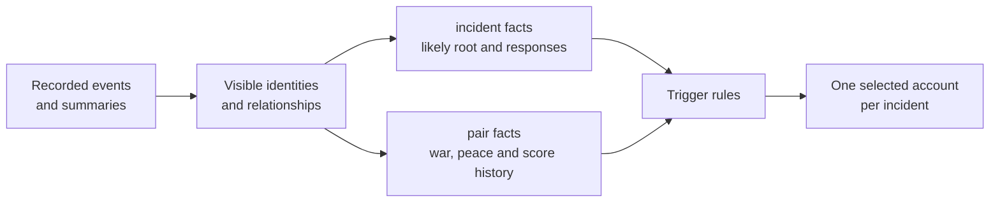

# War and peace coverage

**Status: the inference is implemented; its incident and pair facts reach rules in stage 6.** Every check updates pair memory and the inference audit, including a skipped check. The stock catalogue has no war or peace rules and no templates. [Plan 6](../../../../plans/newspaper/implementation/06-trigger-rules.md) lists the build order.

Wars and settlements reach the newspaper as two kinds of [facts](facts.md): an **incident**, one declaration or settlement with everyone it drew in, and a **pair**, the standing between two players over time. This page is for developers writing war and peace rules or extending the inference. Code infers the facts; once stage 6 exposes them, the stories are ordinary [trigger rules](overview.md) with `subject: incident` or `subject: pair`.

The inference uses the recorded `DeclareWar` and `MakePeace` events plus MCP-projected relationship snapshots. Battle reports and city captures are separate rules over `event` and `city` subjects.

| Fact | Answers | Typical story |
| --- | --- | --- |
| `incident` | Who started it, who was pulled in and why, what part the receiver plays | "We are dragged into war by our defensive pact" |
| `pair` | Are these two at war, for how long, and how is it going | "The war with Rome grinds to a standstill" |

## From observations to one incident

A single declaration can produce many event records as defensive pacts, vassals and city-state allies join. The inference groups them into one incident.

| Step | Rule | Example |
| --- | --- | --- |
| Find a likely root | The first unmatched call in a turn with a distinct, resolvable origin and target | Shaka declares on Brazil |
| Attach responses | Later same-turn calls join when a fresh master, vassal, pact or city-state alliance connects them to the root | India joins through its defensive pact with Brazil; the Iroquois join as Shaka's capitulated vassal |
| Keep independent wars apart | Sharing a turn, an initiator or an enemy alone does not combine calls | Two unrelated declarations in one turn stay two incidents |
| Summarize city-states | City-state participation is collected in `incident.cityStates` | A separate attack on a city-state is its own incident |

In one recording, the declaration in the table above produced 60 declaration records in a single turn. The grouping turns them into one incident with Shaka, Brazil and India as major participants and a list of city-states.

Recursive event payloads sometimes repeat the original initiator while naming a different target, or name the initiator's own team. Those records support grouping without establishing another opponent pair.

## Incident facts in rules

The [incident fact table](facts.md#incident) lists every field. Once stage 6 exposes the facts, these rules show the angles they support.

| Story | `when` |
| --- | --- |
| We declared war | `incident.kind == 'war' && incident.role == 'initiator'` |
| War was declared on us | `incident.kind == 'war' && incident.role == 'target'` |
| We were pulled in by a pact | `incident.kind == 'war' && incident.role == 'joined' && incident.reason == 'pact'` |
| We followed our master | `incident.kind == 'war' && incident.role == 'joined' && incident.reason == 'vassal'` |
| A foreign war begins nearby | `incident.kind == 'war' && incident.role == 'none' && incident.initiator.is.nearby` |
| An old war flares up again | `incident.kind == 'war' && incident.resumed` |
| A war we did not see begin | `incident.kind == 'war' && incident.observed` |
| We made peace | `incident.kind == 'peace' && incident.role != 'none'` |
| Peace on one front only | `incident.kind == 'peace' && incident.partial` |
| Peace with visible concessions | `incident.kind == 'peace' && incident.concessions.length > 0` |
| A capitulation | `incident.kind == 'peace' && incident.capitulation` |

Every development from one incident will share a conflict key, so selection publishes at most one account of it per issue once stage 6 supplies the facts. Set `urgent` to `incident.kind == 'war' && incident.role == 'target'` to let an attack on the receiver lead a breaking front page.

| Useful `values` | Expression |
| --- | --- |
| `initiator`, `target` | `incident.initiator.name`, `incident.target.name` |
| `participants` | `incident.participants.map(p => p.player.name).join(', ')` |
| `cityStates` | `incident.cityStates.slice(0, 3).map(p => p.name).join(', ')` |
| `concessions` | `incident.concessions.join(', ')` |

## Pair facts in rules

A pair tracks the observed war or peace state between two visible players. Stage 6 exposes pair facts to rules. **War score** is the recorded balance of damage between two major civilizations, from -100 to 100. `pair.warScore` is given from the receiver's perspective when the receiver is one of the two. It is separate from national score, and allied scores are not added together.

| Story | `window` | `when` |
| --- | --- | --- |
| We gain an advantage | `short` | `pair.involvesSelf`, `crossed(pair.warScore, pair.before.warScore, 25)`, `held(pair, s => s.warScore >= 25, 2)` |
| A commanding position | `short` | `crossed(pair.warScore, pair.before.warScore, 60)`, `held(pair, s => s.warScore >= 60, 2)` |
| A swing | `short` | `Math.abs(pair.warScore - pair.before.warScore) >= 25` |
| A reversal | `15` | `pair.before.warScore <= -25 && pair.warScore >= 25` |
| A return to balance | `medium` | `pair.history.some(s => Math.abs(s.warScore) >= 25)`, `held(pair, s => Math.abs(s.warScore) <= 10, recent)` |
| A stalemate | `medium` | `held(pair, s => Math.abs(s.warScore - pair.warScore) <= 5, medium)` |
| Enduring peace | | `!pair.atWar && pair.peaceTurns >= medium`, with `repeat: once` |

Checks of the advantage rule at a cutoff of turn 100 on Standard speed, with a boundary of 25 points and a confirmation span of 2 recorded turns (turns 98 to 100):

| Score at turn 90 (`before`) | Score at turn 98 | Score at turn 99 | Score at turn 100 (now) | Result |
| --- | --- | --- | --- | --- |
| 10 | 27 | 27 | 30 | Fires: crossed 25 and held |
| 10 | 18 | 18 | 30 | Waits: crossed, but the score was below 25 at turns 98 and 99 |
| 40 | 42 | 42 | 45 | Silent: already above 25 at the start of the window |
| Hidden | 27 | 27 | 30 | Stops: no baseline to compare |

Peace and renewed war reset `warTurns`, `peaceTurns` and the score history, so a new war never inherits an old war's trend. The final score of the war that ended stays readable as `pair.lastWarScore`. An initially peaceful relationship has no known settlement, so `peaceTurns` is hidden for it and it cannot produce a peace anniversary.

## Reuse relationship helpers

`mcp-server/src/diplomacy/relationships.ts` owns the relationship parser and the checks for war, friendship, alliances and defensive pacts. `player.relation(other)`, the player flags such as `enemy` and `friend`, and every `pair` fact are built on it. Use these helpers when adding a relationship fact, so every rule reads relationships the same way.

Major summaries record lists of relationship labels; city-state summaries record a relationship string with additional measurements. Newspaper projection resolves names to unique, dated, visible player identities and drops private measurements such as war weariness and city-state influence.

| Observation | Becomes |
| --- | --- |
| Explicit war label | `atWar` true, with `warScore` when recorded |
| Friendship or city-state ally label | `friend`, `ally` |
| Master or vassal label | `vassal`, `master`, and whether it is voluntary or capitulated |
| Missing or empty relationship entry | Nothing is set; the pair's state is hidden |
| Ambiguous name | The identity stays unresolved and the entry is dropped |
| Unmet player named in a city-state row | Omitted from the receiver's facts |

## How sure the facts are

The recordings leave some questions open. Facts give the most useful reading, and template wording carries any doubt worth showing the reader.

| Limit in the recordings | Effect on facts |
| --- | --- |
| An attack on a vassal redirects to its master before the declaration is recorded. | `incident.target` is the master; the intended vassal target is unknown. |
| Declarations record the originating player, target team and an aggressor flag. Peace records origin, target and a pacifier flag that the newspaper does not read. Neither records the acting team or the cause. | `initiator`, `target` and each participant's `reason` are inferred from order and relationships. |
| The aggressor flag does not prove who chose the war, and peace has no proposer. | No fact names a winner or a proposer. Use `incident.pair.lastWarScore` to describe how a war stood when it ended. |
| The edges of a cascade are not marked. | Responses without relationship support stay separate incidents. |
| Deal terms can be absent or hidden by visibility. | `incident.concessions` lists only visible kinds of terms. |
| City-state war lists are incomplete, and nothing links two wars as one conflict. | `incident.partial` means a settling player has another recent known war open. That war may be unrelated. |

A same-turn deal after the peace calls, with matching parties and visible terms, supplies `concessions`. A new capitulated relationship within `recent` turns sets `capitulation`.

## Where to work

| Source | Responsibility |
| --- | --- |
| `mcp-server/src/diplomacy/relationships.ts` | Shared relationship parsing and checks, also used by Archivist features |
| `mcp-server/src/newspaper/projection.ts` | Visibility, identity resolution and permitted relationship fields |
| `editorial/diplomacy/diplomacy-facts.ts` | Dated relationship lookup, pair identity and game-speed conversion |
| `editorial/diplomacy/diplomacy-incidents.ts` | Likely roots, obligations, cascade grouping and settlement context |
| `editorial/diplomacy/war-peace.ts` | Pair history, score samples and the inference audit; stage 6 hands the `incident` and `pair` facts to rules |
| `contracts/diplomacy.ts` | Pair memory and inference audit contracts |

The relative `editorial/` and `contracts/` paths are under `vox-agents/src/newspaper/`.

To extend coverage:

1. For a new angle on existing facts, add a trigger under `vox-agents/newspaper/triggers/` and a template. No code changes. War and peace rules wait for stage 6 facts.
2. For a new fact, such as a new participation reason, add it to the inference and to the [incident](facts.md#incident) or [pair](facts.md#pair) table. Put relationship interpretation in the shared helpers when it is useful beyond the newspaper.
3. Test the inference with independent wars, recursive responses, missing observations and a skipped check, then read the inference audit in replay.

Skipped checks still advance pair history, so once stage 6 exposes the facts to rules, a later rule sees the scores from the skipped period. A pair that went unobserved for several turns has a gap there, and `held` is false across it. The inference audit is saved with each editorial decision and stays out of the article's prose.
