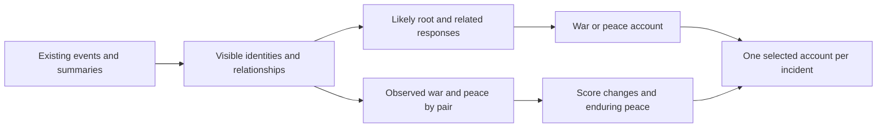

# War and peace coverage

This guide is for developers tuning newspaper coverage of conflicts and settlements. It uses the existing recorded `DeclareWar` and `MakePeace` events plus MCP-projected relationship snapshots; it adds no DLL events. War and peace have separate trigger and template files. Battle reports and city captures belong to later military coverage. See [the trigger reference](triggers.md) for catalogue overlays and [editorial decisions](editorial.md) for selection and persistence.

## From observations to one account

A declaration can produce many event records as defensive pacts, vassals, and city-state allies join. The editor uses same-turn event order and observed relationships to infer an **incident**, then offers one main account of it.

The incident and the pair history serve different purposes. An incident explains a likely common cause. Pair history tracks the observed war or peace state between two visible players; score progress requires two major powers. Recursive event payloads sometimes repeat the original initiator while naming a different target, or even appear to name the initiator's own team. Those records can support grouping without establishing another opponent pair.

The first unmatched call with a distinct, resolvable origin and target supplies a likely root; the recording cannot prove that it was the original player action. Fresh master, vassal, pact, and city-state alliance relationships help connect subsequent responses. Same-turn observations can corroborate a connection; older observations provide background. Sharing a turn, initiator, or enemy alone does not combine independent wars.

One recording has 60 declarations in a turn, beginning with Shaka against Brazil and then India. Brazil and India have a defensive pact, and the Iroquois are Shaka's capitulated vassal, which supports a likely cascade. The event payload has no acting-team or cause field, so this relationship evidence cannot prove which declaration initiated it. City-state participation can be summarized; a separate attack on a city-state can receive its own account.

## Reuse relationship helpers

`mcp-server/src/diplomacy/relationships.ts` owns the pure relationship parser and checks for war, friendship, alliances, and defensive pacts. These helpers are available to other features and have no database or live-service dependency. Use them instead of searching relationship strings independently in each detector.

Major summaries record arrays of relationship labels; city-state summaries record a relationship string with additional measurements. The parser extracts relationship meaning and war score. Newspaper projection resolves names to unique, dated, visible player identities and drops private measurements such as war weariness and city-state influence.

| Observation | Interpretation |
| --- | --- |
| Explicit war label | War; retain a recorded war score when present. |
| Friendship or city-state ally label | A known relationship usable by other detectors. |
| Master or vassal label | Direction and voluntary or capitulated status. |
| Missing or empty relationship entry | Unknown; it does not establish peace. |
| Ambiguous name | Leave the identity unresolved. |
| Unmet player named in a city-state row | Omit that relationship from the reader's evidence. |

Derived diplomacy evidence lives beside raw snapshot values. It includes a baseline before the requested window, observations within the window, and its own interpretation gaps. Each observation retains its original source reference. Diplomacy gaps do not suppress unrelated city comparisons.

## War and peace angles

Every incident separates the likely original initiator from the reader's reason for participating. A reader can be drawn into a war through a defensive pact even when the initiating declaration names someone else. The same distinctions apply to foreign powers.

| Category | Angles |
| --- | --- |
| War declarations | Initiated by us, imposed on us, foreign declarations, or a broader opening account when direction is unclear. |
| Obligations | Following a master, vassals joining, defensive-pact participation, and wars inherited with a new voluntary vassal. |
| City-state wars | Direct attacks, participation in a wider war, and a later alliance change when the city-state's new ally is already at war with an opponent and the city-state's own relationship changes from peace to war. |
| War continuity | Resumed hostilities or newly observed fighting whose opening was not recorded. |
| Peace agreements | Our settlements, foreign settlements, master-led peace, and included vassals. |
| City-state peace | A direct settlement or participation in a wider settlement. |
| Peace outcomes | Partial peace, visible concessions, capitulation, quiet on known fronts, and enduring peace. |

An incident presents unique participants and at most three named city-state examples. Minor-versus-minor responses do not produce separate headlines. A shared incident conflict key prevents participant angles from occupying several slots in the same issue; pair series retain longer-term continuity.

If the city-state alliance-change angle is disabled or its condition does not match, eligible war continuity can still fall back to a generic observed or resumed account.

Peace terms are available only under the existing deal visibility rules. A same-turn deal after the peace calls, with matching parties and visible terms, can explain concessions. A new capitulated relationship within five Standard turns can support a capitulation account. MCP's `MakePeace` projection contains only the originating player and target team; it omits the acting team, cause, and pacifier flag, so the event alone cannot identify a proposer or winner. A new voluntary-vassal relationship followed by evidence that its master is already at war can support an inherited-war account.

### Catalogue IDs

Each trigger has a matching template named with the trigger ID followed by `-account`. The detector selects the behavior, and `stage` selects the angle. Scope and participation placeholders distinguish our involvement from foreign reporting without duplicating the entire catalogue.

| Detector | Trigger ID | Stage |
| --- | --- | --- |
| `warTransition` | `war-declaration` | `declaration` |
| `warTransition` | `war-following-master` | `followingMaster` |
| `warTransition` | `war-vassals-joining` | `vassalsJoining` |
| `warTransition` | `war-defensive-pact` | `defensivePact` |
| `warTransition` | `war-inherited-wars` | `inheritedWars` |
| `warTransition` | `war-city-state-attack` | `cityStateAttack` |
| `warTransition` | `war-city-state-joining` | `cityStateJoining` |
| `warTransition` | `war-alliance-change` | `allianceChange` |
| `warTransition` | `war-resumed` | `resumed` |
| `warTransition` | `war-observed` | `observed` |
| `peaceTransition` | `peace-agreement` | `agreement` |
| `peaceTransition` | `peace-master-led` | `masterLed` |
| `peaceTransition` | `peace-vassals-included` | `vassalsIncluded` |
| `peaceTransition` | `peace-city-state-agreement` | `cityStateAgreement` |
| `peaceTransition` | `peace-city-states-included` | `cityStatesIncluded` |
| `peaceTransition` | `peace-partial` | `partial` |
| `peaceTransition` | `peace-concessions` | `concessions` |
| `peaceTransition` | `peace-capitulation` | `capitulation` |
| `peaceTransition` | `peace-quiet-fronts` | `quietFronts` |
| `enduringPeace` | `peace-enduring` | `enduring` |
| `warProgress` | `war-progress-reversal` | `reversal` |
| `warProgress` | `war-progress-commanding` | `commanding` |
| `warProgress` | `war-progress-advantage` | `advantage` |
| `warProgress` | `war-progress-swing` | `swing` |
| `warProgress` | `war-progress-balance` | `balance` |
| `warProgress` | `war-progress-stagnation` | `stagnation` |

## Score-based progress

War score measures the recorded balance of damage between two major powers, from a fixed player's perspective. Its range is -100 to 100. It is separate from national score, and allied scores are not added together.

All durations below use Standard-equivalent turns and scale with recorded game speed. A first observation establishes a baseline. Repeated appearances of the same source row count once.

| Development | Default condition |
| --- | --- |
| Advantage | Cross into the +25 or -25 band from an earlier retained observation outside that signed band, then confirm with at least two observations spanning 2 Standard turns. |
| Commanding position | Cross into the +60 or -60 band from an earlier retained observation outside that signed band, then confirm with at least two observations spanning 2 Standard turns. |
| Swing | Change by at least 25 points within 10 turns. |
| Reversal | Move between the opposing +25 and -25 bands within 15 turns. |
| Return to balance | After an advantage, remain within -10 to +10 for 5 turns. |
| Stagnation | The newest contiguous stable score tail has at least 4 observations spanning 20 turns, with a range of at most 10 points. Older volatile scores do not delay a new stable period. |

Keep 30 turns of score history, allow gaps of at most 10 turns, and require a latest observation no older than 5 turns. Missing observations break continuity where a claim needs sustained evidence.

At most one progress angle is offered per pair per check, in this order: reversal, commanding position, advantage, swing, balance, stagnation. Normal progress publication has a 10-turn cooldown. A new reversal or commanding position can bypass it. Advantage rearms after the score magnitude falls below 15; a commanding position rearms below 50. Balance can rearm after the score leaves its band. Stagnation starts a new episode after a new war or meaningful score movement beyond its configured range from the last published score; quiet drift keeps the same episode and does not publish it again. A renewed episode must accumulate a full persistence interval and cannot reuse observations from before its start. Peace and renewed war reset score continuity.

Enduring peace is offered once after 25 Standard turns following a known settlement or a change from observed war to peace, with a recent relationship observation. A gap longer than `enduringPeace.maxGap` (10 Standard turns by default) restarts the observed duration. Once reported, the same peace does not publish again. An initially peaceful relationship supplies a baseline, so it cannot produce a settlement anniversary. Foreign enduring-peace coverage is disabled by default.

### Tuning names and scope

Set these fields in a trigger's `tuning` object. War-progress thresholds and durations are stage-specific except where noted. Disabling a stage suppresses its article, but its numeric tuning can still affect shared calculations. For example, `advantage.absolute` also sets the prior-advantage threshold used by balance.

| Field | Scope and meaning |
| --- | --- |
| `absolute` | Stage-specific score boundary, swing size, balance band, or stagnation range. |
| `persistence` | Stage-specific confirmation span or duration. Enduring peace uses its own observed peace duration. |
| `window` | `advantage.window` retains score samples for every progress stage (30 Standard turns by default). `swing.window` and `reversal.window` set those stages' lookbacks. |
| `maxGap`, `freshness` | Progress sample continuity and freshness come from `war-progress-advantage` for every progress stage, even when that stage is disabled. Incident relationships use `war-declaration.freshness` (5 Standard turns by default), also effective when its trigger is disabled. Enduring peace has its own freshness and `maxGap`. |
| `cooldown` | Available to advantage, swing, balance, and stagnation. Reversal and commanding always bypass cooldown and reject a `cooldown` setting. |
| `rearm` | Advantage and commanding stages separately set the score magnitude below which that stage can qualify again. |
| `minimumSamples` | Distinct score observations required for stagnation. |
| `foreign` | Stage-specific eligibility for foreign pairs. Progress triggers default to `true`; enduring peace defaults to `false`. If a stage is disabled, fails its condition, or excludes a foreign pair, the detector continues to lower-priority eligible progress stages. |

For example, raise `war-progress-advantage`'s `absolute` from 25 to 35 to require a larger lead, and its `persistence` from 2 to 4 to require longer confirmation. Keep `rearm` below the new boundary so a small fluctuation around that boundary does not create repeated stories. Only the tuning fields listed for a stage are accepted; configuration validation rejects unused stage settings. The catalogue's `threshold` is fixed at 1 for diplomacy triggers. Enabled progress stages cannot request a lookback or persistence span beyond retained history.

| Trigger stage | Accepted tuning fields |
| --- | --- |
| `war-declaration` | `freshness` for shared incident relationship lookups; no other war or peace stage accepts this field. |
| `advantage` | `absolute`, `persistence`, `rearm`, `cooldown`, `foreign`, and shared history `window`, `maxGap`, `freshness`. |
| `commanding` | `absolute`, `persistence`, `rearm`, `foreign`. |
| `reversal` | `absolute`, `persistence`, `window`, `foreign`. |
| `swing` | `absolute`, `window`, `cooldown`, `foreign`. |
| `balance` | `absolute`, `persistence`, `cooldown`, `foreign`. |
| `stagnation` | `absolute`, `persistence`, `minimumSamples`, `cooldown`, `foreign`. |
| `enduringPeace` | `persistence`, `freshness`, `maxGap`, `foreign`. |

## Interpret uncertainty proportionately

| Limit in existing recordings | Reporting approach |
| --- | --- |
| An attack on a vassal redirects to its master before the declaration hook. | Describe the recorded conflict and likely obligations; the original intended vassal target cannot be recovered. |
| MCP exposes `OriginatingPlayerID`, `TargetTeamID`, and `IsAggressor` for declarations; peace exposes only origin and target. Neither projection records the acting team or cause. | Treat root and participant assignments as inferences. Recursive records may repeat an origin, name its own team as target, or omit the vassal that acted. |
| `IsAggressor` is not proof of the original decision, and `MakePeace` does not expose its pacifier flag. | Avoid assigning intent, proposer, or winner without other evidence. |
| Cascade boundaries are not explicit. | Use event order and relationship support to group likely responses, preserving separate unsupported roots. |
| Deal terms can be absent or redacted by recording visibility. | Report only visible terms; do not invent concessions or a winner. |
| City-state war rosters are incomplete. | Describe peace on known fronts; do not claim the entire world is at peace. |

These limits narrow particular claims while leaving room for useful stories. Recorded quantities stay unchanged. Inferred causes use natural qualifications where useful, and technical explanations belong in the inspector.

## Tune and extend coverage

| Source | Responsibility |
| --- | --- |
| `mcp-server/src/diplomacy/relationships.ts` | Shared public relationship parsing and predicates, also used by Archivist features. |
| `mcp-server/src/newspaper/projection.ts` | Visibility, identity resolution, and permitted relationship fields. |
| `editorial/diplomacy-facts.ts` | Dated relationship lookup, pair identity, and game-speed conversion. |
| `editorial/diplomacy-incidents.ts` | Likely roots, obligations, cascade grouping, and settlement context. |
| `editorial/war-progress.ts` | Score developments, precedence, and repeat controls. |
| `editorial/war-peace.ts` | Pair observations, incident angles, and configured trigger creation. |
| `contracts/diplomacy.ts` | Pair memory and inference audit contracts. |

The relative `editorial/` and `contracts/` paths are under `vox-agents/src/newspaper/`.

### Authored placeholders

The JSON variants hold ordinary declaration and settlement wording. Named participant clauses and city-state lists are assembled from the incident's variable membership in `war-peace.ts`.

| Placeholder | Contents |
| --- | --- |
| `firstParty`, `secondParty` | Parties in the inferred root pair, ordered from recorded origin to target. |
| `rootInitiator`, `rootTarget` | Recorded origin and target of the likely root call; unavailable initiation remains unknown. |
| `direction` | `initiated`, `imposed`, `foreign`, or `unknown`; declaration variants use this as a condition. |
| `scope`, `stage` | Domestic or international relevance and the configured angle. |
| `participants`, `participantCount` | Reported major participant names and incident membership count. |
| `participantDetails` | Optional prose explaining supported master, vassal, pact, or settlement participation. |
| `cityStates` | Optional formatted city-state sentence, capped at three named examples. |
| `cityStateNames` | Plain list of the named city-state participants, capped at three; available to authored variants that need their own wording. |
| `cityState`, `newAlly` | Names used by the later alliance-change angle. |
| `concessionTypes` | Types of visible concessions, without invented amounts or hidden terms. |
| `partner`, `eventTurn` | Counterpart label and, for incident templates, the recorded incident turn. |
| `perspective`, `score`, `previousScore`, `scoreChange`, `advantageSide`, `peaceTurns` | War-progress and enduring-peace templates' named parties, current and comparison score, score change, leading side where applicable, and observed peace duration. |

Optional lists use empty text when there is nothing to name. Keep optional sentences in their own paragraph so an empty list does not leave a fragment. Stage-specific progress and enduring-peace templates show their score and duration placeholders directly.

1. Start with `triggers/war.json` or `triggers/peace.json`. Reuse the detector and stage for an existing angle, and preserve its ID when adjusting its thresholds or enabling it.
2. Edit the matching template file for wording, links, and weights. Use only placeholders supplied by that stage.
3. Add new relationship interpretation to the shared helpers when it will be useful beyond the newspaper. Keep visibility decisions in MCP projection and narrative grouping in the editor.
4. Test a new angle with independent wars, recursive responses, missing observations, and a skipped check before reading the resulting prose in replay.

Disable an inherited trigger explicitly with `enabled: false`. Resuming a current run preserves its saved configuration; start a fresh run to compare catalogue edits. Older detector IDs have no compatibility mapping; update overlays to current IDs.

The publication-state checkpoint uses schema 3 for pair history, score samples, and repeat controls. This is separate from IssueDocument schema 2 and offline replay SQLite `user_version` 2. Checkpoints without the required state schema fail validation and must be regenerated. Skipped checks still advance observations, while publication cooldowns reflect published stories. Inference audit details are saved with each editorial decision and remain outside the article's prose.
