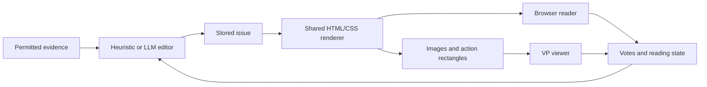

# Newspaper implementation roadmap

**Status: draft for review.** This roadmap is for developers implementing the [newspaper specification](spec.md). It establishes the shared rendering architecture and divides implementation into five plans. Each plan has its own deliverable and verification gate.

## Goal and success criteria

Build one publication renderer that serves the offline browser reader and produces the images displayed inside Civilization V. Use it to evaluate recorded-game newspapers before connecting the editorial loop to live play and game saves.

Success means both editors produce useful, evidence-backed issues with continuing series; votes influence later coverage; browser and game readers use the same publication designs; and published issues remain readable after saving, loading, or losing the service connection.

## Architecture decisions

| Area | Direction |
| --- | --- |
| Shared renderer | Plain TypeScript and HTML/CSS, built with the existing Vite toolchain. Start from the local prototypes and promote the required assets into tracked production files. |
| Browser reader | Run the renderer interactively, with browser controls for replay, archive browsing, and inspection outside the publication. |
| Image export | Use `playwright-core` with an installed Microsoft Edge browser, then Chrome if available. Render locally, capture images and action rectangles, and convert the images to DDS with a pinned `texconv` executable. |
| Installation | Reuse the installed browser. Never download a browser automatically. Ship compiled reader assets, the runtime automation library, and the converter with its license. Measure the complete incremental installation cost in Plan 1. |
| Game reader | A Lua/XML viewer displays bounded image strips and places controls at the exported rectangles. Scrolling, section switching, link activation, and vote indicators respond locally. |
| Text interaction | Browser text remains selectable and accessible. The game reader uses rasterized text; browser text selection and accessibility parity are outside its requirements. |
| Durable content | Store structured articles, links, editorial memory, and presentation choices. Images and interaction maps are derived cache entries. Retain a basic native text view for missing caches while rendering is unavailable. |
| Runtime ownership | Newspaper editing and rendering live in Vox Agents. MCP owns game-data collection, historical queries, and its queryable live publication copy. Standalone evaluation reads MCP's database directly and keeps publication output in a separate local database. The game save owns the live publication history. |

The [Playwright browser documentation](https://playwright.dev/docs/browsers#google-chrome--microsoft-edge) supports using installed Edge and Chrome. Its [screenshot](https://playwright.dev/docs/screenshots) and [page evaluation](https://playwright.dev/docs/evaluating) APIs provide the two export outputs. [DirectXTex's converter](https://github.com/microsoft/DirectXTex/wiki/Texconv) supports DDS output and legacy headers. VD's added footprint includes the browser library, fonts, art, the converter, and other runtime dependencies.

The renderer consumes a completed issue. It never selects stories, changes series importance, or asks an LLM to rewrite an archived article.

## Current state

The [research index](research/research.md) covers the recorded data, historical visibility limitations, and existing UI primitives. `docs/plans/newspaper/prototypes/html/reader.js` and `reader.css` already demonstrate section tabs, votes, links, local fonts, and several visual identities. The prototypes are gitignored and cannot be runtime dependencies of a shipped feature.

`vox-agents/src/web/server.ts` hosts the current Vue application and mounts API routes directly. `vox-agents/package.json` builds its backend and that UI. A separate reader build can be added without coupling the publication to dashboard state or theme styles. `scripts/utilities/build-installer.cmd` already prunes development dependencies before `scripts/installer.iss` packages the application.

The [texture experiment](../../developers/civ5-mod/runtime-texture-experiment.md) established loading newly created 256-by-256 DXT1 DDS files in a DX11 session. Newspaper-sized text, image strips, control alignment, cache loss, and reopening need their own proof. Existing Lua code does not establish a safe external-file existence check.

## Implementation order

| Plan | Deliverable | Completion gate |
| --- | --- | --- |
| [1. Shared renderer and game proof](implementation/01-renderer.md) | A fixture issue works in the browser and through the DDS viewer, with matching links, scrolling, tabs, and votes. | Readable text and correct interaction at representative sizes, safe missing-file behavior, and measured installation/runtime cost. |
| [2. Historical queries](implementation/02-replay.md) | Queries against MCP's dated records supply newspaper inputs; standalone evaluation reads the database directly. | Cutoff and field filtering work in both access paths, with inspectable source references. |
| [3. Heuristic newspaper](implementation/03-heuristic-editor.md) | Configured triggers and authored templates produce stored issues, series, pages, and feedback-sensitive selections. | A complete read, vote, continue, and resume workflow produces useful coverage without an LLM. |
| [4. Offline evaluation and LLM editor](implementation/04-offline-evaluation.md) | Complete the offline archive and design coverage; compare both editors on the same recordings. | Demonstrate continuity, merging, useful short pieces, fallback, and design evolution; review the reading experience. |
| [5. Live publication and persistence](implementation/05-live-integration.md) | Human-only collection, background publication, save restoration, and the finished game reader. | Old saves restore the correct history and preferences; delayed work cannot cross timelines; reading survives service loss. |

The early game proof uses fixtures. Live generation and save integration remain after the offline editorial evaluation. Evidence research can proceed once Plan 1's issue and action contracts are stable, but the renderer proof should finish before investing in a large design catalogue.

Run the save-capacity proof from Plan 5's first step alongside Plans 1 and 2, once `IssueDocument` has a draft shape. It needs only fixture archives, and its measured limits constrain the issue and decision-record formats that Plans 1 and 3 fix. The rest of Plan 5 still waits for the offline evaluation.

## Shared contracts and boundaries

| Contract | Established in | Used by |
| --- | --- | --- |
| `IssueDocument`, typed article links, design references, `ReaderAction` | Plan 1 | Both editors, both readers, archive storage. |
| `RenderProfile`, `RenderBundle`, asset IDs and action rectangles | Plan 1 | Browser exporter and Lua viewer. |
| Historical query inputs/results, existing subject IDs and source references | Plan 2 | Triggers and both editors through MCP or direct database access. |
| Editorial configuration, `PublicationState`, publication check outcome | Plan 3 | Replay, both editors, save-backed persistence. |
| Validated LLM proposals and comparison-run records | Plan 4 | Evaluation and live LLM editing. |
| Save checkpoint, live collection boundary, and render bundle requests | Plan 5 | Scheduler, game archive, game viewer, and MCP reconciliation. |

These names are proposed implementation contracts. The individual plans specify their contents and ownership. Keep stored publication data independent of absolute filesystem paths, browser instances, and live game objects.

## Risks and decisions still requiring evidence

- Full-size DDS quality and the game viewer's coordinate transform determine the supported render profiles. Start with the demonstrated DX11 environment and record the exact VP build.
- The initial size target is **at most 30 MiB of added installed production files**, including dependencies and bundled assets. This is a proposed engineering budget. Measure it before expanding the design catalogue; report any overrun with its cause.
- Installed browsers can be absent, blocked by local policy, or updated independently. Detect capability when rendering is requested and preserve reading when export cannot run.
- Historical records may be incomplete. Initial evaluation uses a suitable recording and skips comparisons whose required data is unreliable.
- Save volume and texture-cache retention need measurement, starting with the early save-capacity proof. A portable save must retain readable text even when local images are missing. Persistence preserves the saved design and layout choices; regenerated images may differ slightly from the originals.
- The live trade and espionage field policy needs a concrete field/strength matrix before new collection is implemented. Plan 2 uses existing recorded access; Plan 5 adds explicit new reporting grants.

## Verification and scope

Use Vitest for behavior and contract checks, including browser-driven checks launched from Vitest where needed. Each plan names its focused commands and manual acceptance cases. Run root `npm run build:all` and `npm run test:all` at integration gates. Game checks require the appropriate mod deployment and, only when DLL code changes, the documented DLL build/deployment command.

Deferred work includes graphs, generated illustrations, audio/video, immediate special editions, strategist publications, propaganda mechanics, and a new embedded browser inside Civ V. Richer art and additional designs should fit the same renderer after the initial footprint has been measured.
