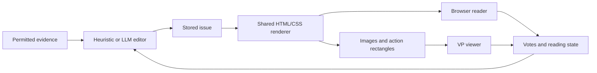

# Newspaper implementation roadmap

**Status: the stock trigger mechanics are accepted.** Plan 6 still has front reports and ship launches to cover. Plan 1's game demo is accepted, Plan 2 is complete, and Plan 3 supplies heuristic editing, browser voting, and durable offline replay. Plans 4a to 4c give the newspaper its substance before Plan 7 adds LLM editing: styles, story types mined from saved games, and drafted variants. Broader game renderer checks and Plan 5 live integration remain pending.

This roadmap tracks implementation of the [newspaper specification](spec.md).

## Goal and success criteria

Build one publication renderer that serves the offline browser reader and produces the images displayed inside Civilization V. Use it to evaluate recorded-game newspapers before connecting the editorial loop to live play and MCP storage.

Success means both editors produce useful, evidence-backed issues with continuing series; votes influence later coverage; browser and game readers share publication designs; and loading a save restores the referenced archive from MCP. A missing renderer falls back to native text, and a service disconnect leaves the already open issue readable.

## Architecture decisions

| Area | Direction |
| --- | --- |
| Shared renderer | Plain TypeScript and HTML/CSS, built with the existing Vite toolchain. Start from the local prototypes and promote the required assets into tracked production files. |
| Browser reader | Run the renderer interactively, with browser controls for replay, archive browsing, and inspection outside the publication. |
| Image export | Use `playwright-core` with an installed Microsoft Edge browser, then Chrome if available. Render locally, capture images and action rectangles, and convert the images to DDS with a pinned `texconv` executable. |
| Installation | Reuse the installed browser. Never download a browser automatically. Ship compiled reader assets, the runtime automation library, and the converter with its license. Measure the complete incremental installation cost in Plan 1. |
| Game reader | A Lua/XML viewer displays bounded image strips and places controls at the exported rectangles. Scrolling, section switching, link activation, and vote indicators respond locally. |
| Text interaction | Browser text remains selectable and accessible. The game reader uses rasterized text; browser text selection and accessibility parity are outside its requirements. |
| Durable content | Store structured articles, links, editorial memory, and presentation choices. Images and interaction maps are derived cache entries. Retain a basic native text view for missing caches while rendering is unavailable. |
| Runtime ownership | MCP records game data. Offline and live checks use the same historical query on MCP's per-game SQLite database. Vox Agents edits and renders, keeping the latest live issue in memory. Standalone evaluation writes publication output to a separate database. |

The [Playwright browser documentation](https://playwright.dev/docs/browsers#google-chrome--microsoft-edge) supports using installed Edge and Chrome. Its [screenshot](https://playwright.dev/docs/screenshots) and [page evaluation](https://playwright.dev/docs/evaluating) APIs provide the two export outputs. [DirectXTex's converter](https://github.com/microsoft/DirectXTex/wiki/Texconv) supports DDS output and legacy headers. VD's added footprint includes the browser library, fonts, art, the converter, and other runtime dependencies.

The renderer consumes a completed issue. It never selects stories, changes series importance, or asks an LLM to rewrite an archived article.

## Current state

The [research index](research/research.md) covers the recorded data, historical visibility limitations, and existing UI primitives. The fixture renderer now lives in `vox-agents/newspaper/`, with tracked assets, a separate DOM-aware type check, and a Vite build to `dist-newspaper`. The local prototypes remain design references and are gitignored.

`vox-agents/src/newspaper/` contains publication, presentation, archive, reader, render and replay contracts. `editorial/` owns configured evidence detection, authored writing, story selection, series history, feedback, and presentation choices. `replay/` reads source recordings without changing them and stores checks, immutable issues, decisions, votes, and preferences in a separate versioned SQLite output database. The [editorial guide](../../developers/vox-agents/newspaper/editorial.md) and [replay guide](../../developers/vox-agents/newspaper/replay.md) describe those boundaries and workflows.

The normal VD server hosts the reader, export service, and replay routes; the Debug page can open the sample issue in the loaded game. Browser publication code lives under `newspaper/src/reader/`, the application shell under `newspaper/src/app/`, and the Lua/XML viewer under `civ5-mod/UI/Newspaper/`. `scripts/packaging/build-installer.cmd` prunes development dependencies before `scripts/installer.iss` packages compiled code, reader assets, the sample, and the runtime JSON catalogue.

Manual testing confirmed the demo's links, scrolling, and general newspaper UI in Civilization V. The viewer checks cache confinement and DDS validity through `Game.IsNewspaperTextureAvailable`, and uses native text when textures are unavailable. [Plan 1](implementation/01-renderer.md) retains delivery controls and broader layout, interaction, cache-loss, and installation checks. The [renderer guide](../../developers/vox-agents/newspaper/renderer.md) records the implemented behavior, demo acceptance, and local measurements.

MCP owns historical evidence queries and recorded-access filtering under `mcp-server/src/newspaper/`, with shared history reads under `src/knowledge/`. A historical Netherlands replay verified Vox Agents' cutoff controls, source inspection, heuristic publication, feedback, resume, and browser reading across 89 checks and 81 issues. The current stock catalogue has 14 rules and 15 authored templates. Designs and prose can print shared terms from `constants.json`, and published issues store the resolved masthead title and motto. The owner accepted the mechanics; Plans 4a to 4c take up story types, voice and wording. The [covert presence and access facts](../../developers/vox-agents/newspaper/triggers/facts.md#covert-presence-and-roster-points) come from recorded spy and diplomat rosters. Further rule and design capabilities use the optional [probe catalogue](../../developers/vox-agents/newspaper/triggers/overview.md#probe-catalogue-behavior) and synthetic evidence tests.

## Keeping plans current

After implementing a work unit, fold its verified behavior, ownership, commands, and measured constraints into the relevant developer or player documentation. Rewrite the affected sections as a coherent reference, then remove executed instructions from the stage plan and link to that reference. Keep the main roadmap's current state, contracts, and folder ownership accurate in the same change. Stage plans should contain only remaining work and acceptance gates. Keep unverified manual checks explicitly pending, and distinguish implementation completion from acceptance. Do not retain an execution log or revision history unless requested.

## Implementation order

| Plan | Deliverable | Completion gate |
| --- | --- | --- |
| [1. Shared renderer and game proof](implementation/01-renderer.md) | A fixture issue works in the browser and through the DDS viewer, with matching links, scrolling, tabs, and votes. | Readable text and correct interaction at representative sizes, safe missing-file behavior, and measured installation/runtime cost. |
| [2. Historical queries](implementation/02-replay.md) | Queries against MCP's dated records supply newspaper inputs; standalone evaluation reads the database directly. | Cutoff and field filtering work in both access paths, with inspectable source references. |
| [3. Heuristic newspaper](implementation/03-heuristic-editor.md) | Configured triggers and authored templates produce stored issues, series, pages, and selections shaped by votes. | Read, vote, continue, and resume without an LLM. Open: archive filters and series links in the browser. |
| [6. Trigger rules](implementation/06-trigger-rules.md) | Expressions over a fact model replace the fixed detectors. Probes cover world news, city unhappiness, mastheads, genre, publication memory and chance. | The stock news mechanics are accepted. Passive espionage and agent presence are implemented. Open: derive private operation and election reports, front observations and ship launches from existing rows. Strategist reports keep their current behavior. |
| [4a. Narrative and design styles](implementation/04a-styles.md) | A style catalogue of voices, stances and genres, weighted by civilization, technology and the story, plus candidate designs. | The owner accepts a sample sheet, and replay shows the mix following the facts. |
| [4b. Story mining](implementation/04b-story-mining.md) | The archivist's stories mode has LLMs pitch stories from random turns of LLM-controlled players in saved games, one model per run; pitches are clustered and sorted into story types, then into trigger rules and template stubs. Runs alongside 4a. | The owner picks story types from the backlog, and the supported ones exist in the catalogue. |
| [4c. Variant drafting](implementation/04c-variant-drafting.md) | LLM-drafted variants for chosen template and style combinations, checked automatically and sampled by the owner. Needs 4a and 4b. | Accepted variants are merged, with a coverage table per template. |
| [7. LLM editors and offline comparison](implementation/07-llm-editors.md) | Add constrained model editing using the same evidence, styles, and series rules as authored editing. | Compare editors on the same inputs and demonstrate fallback and continuity when switching modes. |
| [5. Live publication](implementation/05-live-integration.md) | Run the existing newspaper check every few completed turns in a human game. | A new issue shows an icon, and both the icon and the top menu open the latest issue in the game reader. |

The [trigger guide](../../developers/vox-agents/newspaper/triggers/overview.md) describes the rule engine and catalogue used in replay. Use generated issues for broader browser and game renderer acceptance before expanding the design catalogue. Plan 5 can use the authored editor; evaluate LLM editing offline before enabling it in live play.

## Shared contracts and boundaries

Keep contracts in the existing workspaces: MCP owns evidence and browser-safe archive protocol schemas; Vox Agents owns articles, editorial state, and rendering.

| Contract | Owner | Established in |
| --- | --- | --- |
| `IssueDocument`, typed article links; `ReaderAction` and `ReaderState` | Vox Agents `contracts/issue.ts` and `contracts/reader.ts` | Plan 3; issue schema 2 stores the presentation for generated issues and renderer fixtures. |
| `RenderProfile`, `RenderBundle`, geometry and format versions | Vox Agents `contracts/render.ts` | Plan 1; structural schemas live with their inferred types. |
| Browser export bridge, measurements and capture interfaces | Vox Agents `renderer/bridge.ts` | Plan 1; separate from persisted render data. |
| Evidence requests, results and source references | MCP `newspaper/evidence.ts` | Plan 2; both query access paths use these schemas. |
| Replay settings and HTTP responses | Vox Agents `contracts/replay.ts` | Plan 2, reusing MCP evidence contracts. |
| Trigger catalogue, developments and decisions | Vox Agents `editorial/config/`, `editorial/rules/`, `contracts/triggers.ts` and `editorial/check.ts` | Plan 6 evaluates rules; Plan 3's selection and presentation consume their developments. |
| Editorial state, series, preferences and decisions; stored presentation | Vox Agents `contracts/publication.ts` and `contracts/design.ts` | Plan 3 implements offline storage. Plan 5 reuses editorial state during play. |
| Archive indexes and queries; responses containing issue documents | MCP `newspaper/protocol.ts`; Vox Agents `contracts/archive.ts` respectively | Plan 3. |
| Style catalogue (voice, stance, genre) and the resolved style IDs | Vox Agents `editorial/config/` and the runtime catalogue under `vox-agents/newspaper/` | Plan 4a defines the styles; Plan 7 supplies the relevant guidance to the model. |
| Story pitches, clusters and backlog | The archivist's `story_pitches` table in the episode database; cluster and backlog reports in `.tmp/newspaper-mining/` | Plan 4b. Development output, never shipped. |
| LLM proposals, editor decisions, and comparison records | Vox Agents `editorial/proposal.ts`, `contracts/publication.ts`, and `replay/evaluation.ts` | Plan 7. |

Paths in the table are relative to `vox-agents/src/newspaper/` or `mcp-server/src/` as labelled. Infer TypeScript types from shared runtime schemas. Keep private helper types beside their implementation. Shared contracts must be browser-safe and independent of Node, DOM, renderer runtime, absolute paths, and live game objects. MCP never imports Vox Agents; browser code may import only browser-safe MCP contract modules.

## Folder ownership

Each folder groups a sustained responsibility. Move existing files and all consumers together, without forwarding modules or barrel files added solely to preserve the old layout.

| Location | Responsibility and stage |
| --- | --- |
| `vox-agents/src/newspaper/contracts/` | Serialized content and boundary schemas across readers, editors and adapters. |
| `vox-agents/src/newspaper/renderer/` | Layout, assets, stored presentation resolution, reader state, bridge interfaces and renderer capability checks. Serialized render data belongs to `contracts/render.ts`. |
| `vox-agents/src/newspaper/export/` | Browser worker, capture, DDS conversion, cache, server-mounted HTTP routes and export queue. |
| `vox-agents/src/newspaper/editorial/` | Configuration, detection, selection, series, feedback, presentation and validation. Plan 4a adds styles; Plan 7 adds the constrained LLM adapter and fallback through `check.ts`. |
| `vox-agents/src/newspaper/replay/` | Read-only recording connection, serialized publication session, archive and feedback routes, and transactional offline output storage. Plan 7 adds editorial comparisons. |
| `vox-agents/src/newspaper/live/` | Periodic checks and the latest issue for the current game and seat in Plan 5. |
| `vox-agents/src/newspaper/{application,game-delivery}.ts` | Lazy shared renderer, sample orchestration and acknowledged MCP delivery. The VD server owns startup and shutdown. |
| `vox-agents/newspaper/src/reader/` and `src/app/` | Reader DOM/layout and the browser application respectively, including replay controls and source inspection. Plan 3 completes archive navigation. The export entry stays at `src/export-bridge.ts`. |
| `vox-agents/newspaper/` | `constants.json`, `defaults.json`, `pages.json`, and files in `designs/`, `templates/`, and `triggers/` supply runtime editorial choices. Plan 4a adds `styles.json` to this catalogue and the installer. |
| `vox-agents/src/archivist/` | Plan 4b adds the stories mode: turn sampling, pitch storage, clustering and backlog. A development tool, never shipped. |
| `vox-agents/newspaper/probes/` | Optional overlay for validating new catalogue capabilities with synthetic evidence in Vox Agents' mock tests. |
| `mcp-server/src/newspaper/` | Evidence contracts, queries and field projection in Plan 2; archive protocol types in Plan 3. `projection.ts` owns reporting policy. |
| `mcp-server/src/knowledge/` | Shared history reads in `history.ts`. |
| `civ5-mod/UI/Newspaper/` | Viewer, XML, data helpers and mock. Plan 5 adds the unread icon and menu entry. |

Replay supplies evidence and state to the editorial check and persists its result through the offline store. Plan 5 runs the same check against MCP's active database and sends the latest issue through the existing game delivery path. Configurable design IDs select renderer families, with the chosen colors, fonts, and ornaments stored in the issue's presentation snapshot.

## Risks and decisions still requiring evidence

- Broader DDS quality and interaction checks need generated issues at representative paper widths and zoom levels. The demo's exact test environment was not recorded. Retain the demonstrated DX11 texture support as the baseline, and record the VP build and display settings for further game checks.
- The initial size target is **at most 30 MiB of added installed production files**, including dependencies and bundled assets. This is a proposed engineering budget. Measure it before expanding the design catalogue; report any overrun with its cause.
- Installed browsers can be absent, blocked by local policy, or updated independently. Detect capability when rendering is requested and preserve reading when export cannot run.
- Historical records may be incomplete. Initial evaluation uses a suitable recording and skips comparisons whose required data is unreliable.
- Measure texture-cache retention with generated issues. Regenerated images use the stored design and layout choices and may differ slightly from the originals.
- MCP and replay share the visibility rules for private tactical observations and ship launches. Verify those rules in the human seat when [in-game delivery](implementation/05-live-integration.md) is ready.

## Verification and scope

Use Vitest for behavior and contract checks, including browser-driven checks launched from Vitest where needed. Each plan names its focused commands and manual acceptance cases. Run root `npm run build:all` and `npm run test:all` at integration gates. Game checks require the appropriate mod deployment and, only when DLL code changes, the documented DLL build/deployment command.

Keep Vox Agents tests under `tests/mock/newspaper/`, grouped by the same responsibilities as the implementation, and MCP newspaper tests under `tests/newspaper/`. When implementing moves, update imports, HTML entry points, mod registration, generated fixture destinations and packaging together. Update the affected component's `AGENTS.md` and the corresponding [newspaper developer guide](../../developers/vox-agents/newspaper/overview.md) in that code change. Future stages describe target structure until their changes land.

Deferred work includes graphs, generated illustrations, audio/video, immediate special editions, strategist publications, propaganda mechanics, and a new embedded browser inside Civ V. Richer art and additional designs should fit the same renderer after the initial footprint has been measured.
