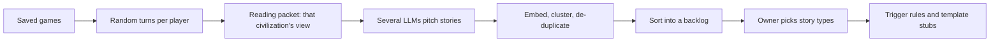

# Plan 4b: story mining from saved games

**Status: draft.** Second of three streams. It starts from interesting stories and works backwards to triggers. [Plan 4a](04a-styles.md) settles styles in parallel, and [Plan 4c](04c-variant-drafting.md) writes the variants for the stories accepted here.

## Goal and success criteria

Have several LLMs read random moments from saved games as if they edited that civilization's paper, and collect every story they would run. Cluster the pitches, remove duplicates, and sort what remains into story types the catalogue can support.

This stream wants many ideas. A pitch that misreads the data is still useful if the story type is good, so nothing checks pitches against the evidence.

Done means:

- One command produces pitches, clusters and a sorted backlog from the saved games in `mcp-server/archive/`.
- The owner has reviewed the backlog and marked the story types to build.
- Each accepted story type that existing facts can support has a trigger rule and a template stub in the catalogue. The others are listed with the fact they need.

## Current state

| Need | What exists | Source |
| --- | --- | --- |
| Find games and players in an archive | `scanArchive` classifies each game's knowledge and telemetry databases and lists players. | `archivist/pipeline/scanner.ts` |
| One civilization's view at a turn | Replay's evidence query returns what a receiving player may see at a cutoff: national and city snapshots, comparison history and events. It works for any player and needs no telemetry. | `newspaper/replay/database.ts`, MCP `newspaper/queries.ts` |
| Facts over that evidence | The fact model that trigger rules read. | `newspaper/editorial/facts/` |
| Run an agent offline with a chosen model | The archivist builds a bare `VoxContext` with a model override and accepts a comma-separated model list. | `archivist/pipeline/telepathist-prep.ts`, `archivist/console.ts` |
| Embeddings and similarity | `generateEmbeddings` and `cosineSimilarity`. | `archivist/pipeline/embeddings.ts`, `archivist/utils/similarity.ts` |
| Clustering | Nothing. The archivist only has diversity selection. | |
| Story pitches | Nothing. | |

The archivist's own turn summaries are a poor fit as input: they exist only for LLM-controlled players, are keyed by turn so two models cannot read the same turn, and describe the strategist's decisions more than the world. This plan reuses the archivist's scanning, model handling and embedding code, and takes the reading material from the newspaper's evidence path. Paths are relative to `vox-agents/src/`.

The `self-play` archive folder currently holds 38 database files, counting telemetry siblings. The other experiment folders have none at the top level.

## Approach

Add a mining command beside the replay command, with its code in `newspaper/mining/`. Each (game, player) pair gets a few random turns, and each sampled turn goes to one model from the list in rotation. So a player in a game is read by different models at different moments, and no moment is read twice.

| Alternative | Why this plan does not use it |
| --- | --- |
| Whole-world input from the archivist extractor | The owner chose the civilization's own view, which keeps pitches close to what a paper could print. |
| Diversity-sampled turns, like archivist landmarks | Random turns are simpler and avoid favoring unusual game states over ordinary ones, where everyday stories live. |
| Every model reads every sample | Multiplies cost for mostly repeated ideas. Rotation already mixes models across eras and civilizations. |

## Steps

1. **Sample.** Walk the archive with `scanArchive`. For each major civilization in each game, pick `--turns-per-player` random turns (default 3) from a seeded generator, spread across the game's length so early and late play both appear. Skip a player after its last recorded summary, since recordings keep stale summaries after elimination. Assign models in rotation.
2. **Build the reading packet.** For each sample, open the recording read-only and query evidence for that player at that cutoff, with events from the last five Standard turns and the ten-turn comparison history that replay uses. Render it as compact text: the civilization and its era, its cities, the civilizations it knows and its relations with them, notable changes over the window, and the event list. Reuse the fact model for derived values instead of recomputing them.
3. **Ask for pitches.** Add a `story-scout` agent with a prompt in `prompts/`. It tells the model it edits this civilization's paper and asks for 5 to 10 stories of any kind it would want to run, including small, odd and funny ones. Each pitch has:

   | Field | Content |
   | --- | --- |
   | `headline` | A working headline. |
   | `pitch` | One or two sentences on the story and why a reader would care. |
   | `genre`, `stance` | Free text. These feed Plan 4a's brainstorm. |
   | `subject` | City, civilization, pair of civilizations, event, or the whole world. |
   | `basis` | What in the packet prompted it. |
   | `wants` | Anything the model wished it knew to write the story. This points at missing facts. |

4. **Store pitches.** Write one JSON file per sample under `.tmp/newspaper-mining/<run>/pitches/`, with the game, player, civilization, turn, era and model. A rerun skips samples whose file exists, so an interrupted run resumes.
5. **Cluster and de-duplicate.** Embed `headline` plus `pitch`. Group greedily: a pitch joins the first cluster whose center is at least 0.8 similar (a starting value, tuned by reading the output), otherwise it starts a new one. Write `clusters.json` and a readable `clusters.md` with each cluster's size, how many models and eras produced it, and three sample pitches. Size and spread show which ideas are common and which are one model's quirk; both kinds are worth reading.
6. **Sort into a backlog.** A stronger model reads each cluster with the [trigger overview](../../../developers/vox-agents/newspaper/triggers/overview.md), the [facts reference](../../../developers/vox-agents/newspaper/triggers/facts.md) and the current catalogue IDs, names the story type and puts it in one bucket:

   | Bucket | Meaning | Next step |
   | --- | --- | --- |
   | Covered | A stock template already tells this story. | Note any new angle for Plan 4c. |
   | New angle | An existing rule fires; a new template is enough. | Template stub. |
   | New rule | Existing facts can express the trigger. | Rule and template stub. |
   | Needs a fact | The story needs something the fact model lacks. | List the fact and where it would come from. |
   | Style idea | The pitch is about tone or format. | Hand to Plan 4a. |
   | Drop | Not a newspaper story, or impossible to observe. | None. |

   Write `backlog.md` as one table sorted by cluster size. Expect mistakes in bucketing; the owner's review corrects them.
7. **Owner picks.** The owner marks story types to build and can merge or rename them. List the existing probe stories from `vox-agents/newspaper/probes/` in the same backlog, so the owner decides in one pass which of them become stock stories.
8. **Work backwards to triggers.** For each accepted story type in the "new angle" and "new rule" buckets, add the trigger rule and a template stub to the catalogue: the angle in one sentence, the named values the prose may use, tags, and one neutral report variant. Follow the [rule authoring guide](../../../developers/vox-agents/newspaper/triggers/overview.md) and check each rule in replay against a recording where the mined pitch came from. Record "needs a fact" story types in the roadmap as follow-up work. Plan 4c takes the stubs from here.

## Risks and open questions

- **Cost.** Samples ≈ games × major civilizations × turns per player. Run one game first to measure tokens per packet before the full archive.
- **Packet size.** A late-game packet can be large. Trim to the receiver's cities, known civilizations and the event window; drop comparison rows that did not change.
- **Sameness.** Models may converge on war and wonders. If clusters are narrow, add prompt variants that ask for a section, such as city life or trade, and rotate them like the models.
- **Which models.** The owner supplies the list. Any model reference the Vox Agents configuration accepts will work.
- **Embedder.** Clustering needs the configured `embedder` model. Without one, the run stops after step 4 and the pitches remain usable.

## Verification

- Mock tests under `tests/mock/newspaper/mining/`: the same seed gives the same samples; a small fixture recording produces a packet containing only that player's permitted evidence; controlled vectors cluster as expected; a rerun skips finished samples.
- Run `npm run build -w vox-agents` and `npm run test:mock -w vox-agents -- tests/mock/newspaper`.
- Run the command on one `self-play` game with two models and read the pitches, clusters and backlog by hand.

## Out of scope

Checking pitches for accuracy, writing finished prose (Plan 4c), new facts that need recording changes, and any change to the archivist's episode database.
