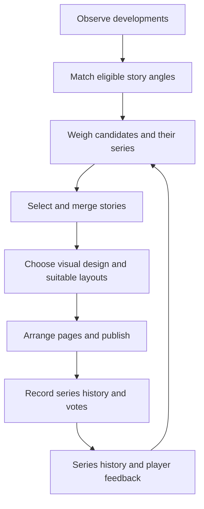
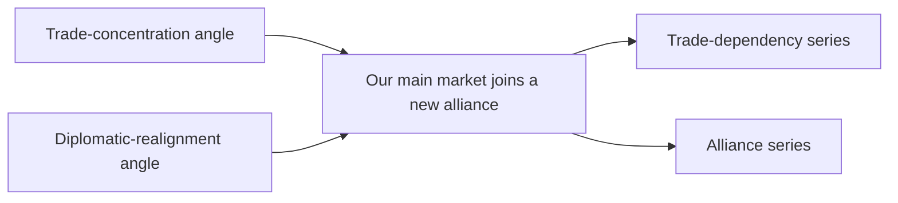
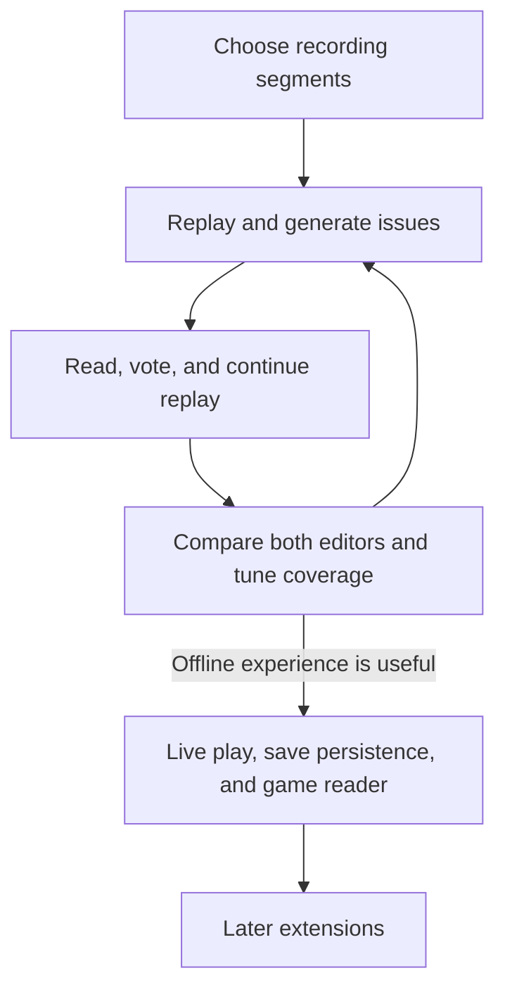

# Newspaper: feature specification

**Status:** conceptual draft for developers and designers. This document defines the intended experience. [Newspaper research](research.md) covers technology references, available data, and questions for technical design.

## 1. Goal

Give the player useful information, memorable stories, and practical hints by connecting developments scattered across cities, civilizations, screens, and notifications.

**Story series** are the backbone: related reports across issues help the player follow a changing world. Short standalone pieces add variety and can introduce future series.

| Player benefit | Example |
| --- | --- |
| Notice a meaningful change | A neighbor's cultural influence is growing. |
| Connect several developments | Cities recover at different speeds after a war. |
| Learn a mechanic and find a next step | One partner supplies most foreign trade income; review the routes. |
| Enjoy the wider world | A smaller civilization becomes a cultural center, even before it affects the player. |

The creative direction combines Victoria 3's historical atmosphere with SimCity 4's local character and occasional wit. Technology takes the publication from oral accounts through chronicles, papers, broadcasts, and digital news.

Reporting can extend existing visibility rules when a concrete source or gameplay rule explains the access, such as merchants bringing news from a trading partner's city. Judge each extension by its value for play and learning.

**Success:** the player enjoys skimming an issue, learns something useful, and finds a worthwhile opportunity or next step. Both scripted and LLM-assisted editions should achieve this.

## 2. The player experience

### 2.1 Reading an issue

Each civilization has its own publication, consistent identity, and archive. A discreet unread indicator announces a new issue. The player can open it when convenient.

| Reading layer | Contents and behavior |
| --- | --- |
| Front page | A lead story, selected series updates, and short pieces. Aim for roughly 3 to 6 items in 200 to 400 words; early or quiet issues can be much shorter. |
| Additional pages | International roundups, local reports, or longer analysis when worthwhile coverage needs the space. Group related developments and keep the most important news on the front page. |
| Opened item | Supporting facts, earlier installments, and links to relevant game screens. The narrative identifies the subject. |
| Supporting record | Reporting period, tags, sources, and editorial details. |
| Archive | Browse by date, civilization, city, or tag; follow links to earlier reports. |

Page count follows useful coverage and readability. A quiet issue may fit on one page; a busy late-game issue can expand. Each design expresses pages in its own medium, such as tablets, broadsheets, or digital sections.

Navigation uses named section tabs, such as **International News**, **Cultural News**, and **Commerce**. [Tags and news sections](#37-tags-and-news-sections) define the reading surface.

### 2.2 Giving feedback

Every item offers **upvote** and **downvote**. The player can change or clear a vote.

| Action | Effect on future coverage |
| --- | --- |
| Upvote | Increase selection weights for items sharing the series or tags. |
| Downvote | Reduce those weights. |
| Leave unrated | No effect. |

For example, upvoting a neighbor's cultural rise encourages that series and similar international or cultural stories. Downvoting repetitive trade reports reduces their prominence.

- Each vote is a small signal; coverage keeps a mix of subjects.
- Votes belong to the receiving civilization's campaign and remain in its archive.
- Stronger controls, such as topic muting, can come later.

### 2.3 Publication rhythm

| Rule | Starting behavior |
| --- | --- |
| Check interval | Every five completed turns at Standard speed, adjusted for game speed. |
| Publish decision | Publish when enough worthwhile material has accumulated. Quiet periods can produce shorter issues or skip an edition. |
| Player settings | Adjustable frequency and LLM use. |
| Generation | Runs in the background. |
| Service offline | Previously published issues remain readable. |

## 3. Stories, series, and editorial choices

### 3.1 The core concepts

| Concept | Role |
| --- | --- |
| **News trigger** | An observed event or comparison worth considering for coverage. |
| **Condition** | A requirement about the receiving civilization or game. Triggers, templates, story variants, visual designs, and layout variants share this vocabulary. |
| **News template** | A reusable story angle with required triggers, conditions, tags, writing mode, and weighted variants. Future templates can request graphs. |
| **Variant** | One way to tell a template's story, with its own conditions and weight. |
| **Visual design** | The civilization and era's presentation style: typography, imagery, reading style, and layout variants. It has conditions and a weight. |
| **Layout variant** | An arrangement within a design, such as a regular front page, breaking-news lead, or analysis page. Conditions and weights govern its use. |
| **News item** | A published piece built from templates or an ad hoc angle, carrying importance and one or more series keys. |
| **Series key** | A stable label for a concrete subject, such as a trade relationship, city, or neighbor's culture. |
| **Story series** | All items sharing a series key. Its importance grows with new items and fades with time. |
| **Short piece** | A brief item, often the first under its key, that adds variety between longer installments. |
| **Issue** | The editor's selection for a reporting period, in one visual design across an adaptive number of pages. |

The editorial loop connects observed developments to stories, then uses reader feedback in later issues:

**Shared conditions:** an element is available only while all its conditions hold. Put each requirement where it fits naturally.

| Condition family | Examples |
| --- | --- |
| Technology | Has researched a technology, or has yet to research it. A press-baron template requires Printing Press. |
| Policy | Has adopted a policy or opened a branch. |
| Civilization | Belongs to a named set. A variant in a civilization's own voice requires that civilization. |
| Era, religion, ideology | Is in an era or follows a religion or ideology. An ideological-pressure trigger requires an ideology. |
| Editorial context | An urgent event affects the reader, or enough history exists for a review. |
| Combined requirements | A bamboo-slip design requires Writing and an early era. |

### 3.2 The life of a story series

Every item has **importance** and one or more series keys. Templates derive keys from trigger subjects; an LLM editor assigns keys to ad hoc items the same way. The same subject must produce the same key in later issues.

| Stage | Rule | Example: trade dependency |
| --- | --- | --- |
| Start | The first published item under a key starts a series. Until another joins, it reads as a short piece. | One neighbor now supplies a large share of foreign trade earnings. |
| Grow | Each item adds its importance to every series it belongs to. Series importance raises the selection weight of candidates carrying that key. | The relationship deepens, or diplomatic changes give it new significance. |
| Fade | Importance declines over time without new items. A series can skip several issues and leave the front page. | The trade pattern stabilizes. |
| Return | A sufficiently important new development revives the same key and links to its history. | A disruption brings the dependency back into focus. |

An item with several keys is printed once, adds its importance to each series, and appears in each history:

Series follow the observed game; play determines their pace and direction. Their full histories remain in the archive. Short pieces about city specialties, notable comparisons, or less-covered neighbors fill the space around longer threads, including in quiet issues.

### 3.3 News triggers

A trigger identifies a development from an in-game event, a comparison with past data, or a comparison between places or civilizations.

- **Carries:** observation, affected subjects, time period, supporting facts, and tags.
- **Fires when:** its conditions hold and the development is observed.
- **Recurrence:** an ongoing development can become relevant again after a meaningful change or a useful interval.

| Example trigger | What it detects | Possible tags |
| --- | --- | --- |
| Happiness improves | National happiness rises meaningfully over a reporting period. | domestic, society |
| Local happiness falls | One or more cities' local happiness declines over a reporting period. | domestic, society, cities |
| Trade concentrates | One partner supplies an increasing share of route income. | economy, trade, international |
| Neighbor gains cultural weight | Comparable visible measures show growing cultural influence. | international, culture |
| Diplomatic relationships shift | Known alliances or relationships change. | international, diplomacy |
| A city recovers | Population or output recovers after disruption. | cities, recovery, economy |

Tune thresholds and comparison periods later. Triggers should detect changes significant enough to help explain the game.

### 3.4 News templates

A template defines what the reader should learn and how one or more triggers support that angle.

| Field | Defines |
| --- | --- |
| Story angle | What the reader should learn. |
| Required triggers | Needed developments and the relationships between their subjects and reporting periods. |
| Conditions | Requirements for the template to apply. |
| Writing mode | Scripted-capable or LLM-only. LLM-only templates require generation during play. |
| Tags | Topics of the resulting story. |
| Variants | Alternative headlines and article text, each with conditions and weight. |
| Series keys | Subjects derived from the triggers. |
| Importance | How much the item matters, scaled by the size of the change. |
| Future graph support | Optional measures, subjects, periods, and supporting observations. |

**Choosing a variant** uses two parts:

| Part | Rule | Example |
| --- | --- | --- |
| Conditions | Decide eligibility. | Requires Printing Press; only for Venice and Portugal. |
| Weight | A base value plus conditional adjustments determines relative likelihood. | Base 10; add 90 before Writing; add 50 for civilizations following Tradition. |

- Adjustments use shared conditions and can respond to evidence, the change's size or direction, and earlier coverage.
- Choose eligible variants in proportion to their weights, letting styles overlap during transitions and keeping prose varied.
- The same story angle can sound different across eras and civilizations.
- Authored variants are prepared ahead of time, often with LLM help, and can support either editor.
- The LLM editor can write new variants during play. Mark a template **LLM-only** when it needs bespoke interpretation, such as connecting several phases of city growth to earlier coverage. LLM help during authoring alone leaves it scripted-capable.

**Example: uneven prosperity**

| Step or medium | Treatment |
| --- | --- |
| Trigger combination | Improving national happiness + worsening local conditions during the same period. |
| Oral variant | A short account of the affected towns. |
| Printed variant | A provincial report. |
| Digital variant | A concise article with a comparison of cities over time. |

Other combinations can explain a peace dividend through peace and city recovery, or a developing dependency through trade concentration and a partner's changing relationships.

**Graphs are a later extension.** The initial catalogue should work without them.

| Graph requirement | Rule |
| --- | --- |
| Subjects | City population, trade income, cultural influence, or similar recorded measures. |
| Evidence | Preserve observations with clear subjects, dates, and units; leave gaps visible. Observations supply plotted values. |
| Scripted coverage | Summarize simple trends. |
| LLM-only coverage | Develop richer reviews of growth, decline, and recovery across issues. The LLM writes the interpretation. |

### 3.5 Visual designs

A visual design sets page shape, typography, ornament, imagery, and interaction style. Match the civilization and era's art styles through composition, lettering, illustration techniques, materials, and motifs. Gather references as each design is developed; a civilization's visual language changes over time.

| Civilization and period | Proposed visual references         |
| ----------------------- | ---------------------------------- |
| Babylonian              | Reliefs and cylinder-seal imagery. |
| Renaissance Venetian    | Woodcuts and print typography.     |
| Industrial British      | Engravings.                        |
| Contemporary Japanese   | Editorial illustration.            |

Further directions could include Chinese bamboo slips and a Korean short-video feed.

Story variants supply wording; layout variants arrange content within the visual identity. Every design keeps text, series, evidence, tags, votes, and archive browsing available, with votes and supporting links easy to find.

| Design setting | Rule | Example |
| --- | --- | --- |
| Conditions | Determine eligibility. | Requires Writing; only for China. |
| Weight | Base value plus conditional adjustments. | Base 10; add 90 in Classical and Medieval; subtract 10 after Printing Press. |
| Selection | Choose one eligible design per issue in proportion to positive weight. Zero weight removes it even when its conditions hold. | An eligible zero-weight design is skipped. |
| Transition | Research and circumstances shift weights. | Later editions can adopt another design. |

Several designs can coexist in one era, and civilizations can use different designs simultaneously.

Within the chosen design, select suitable front-page and subsequent-page layouts with the same conditions and weights.

| Editorial need | Layout behavior |
| --- | --- |
| Ordinary issue | Regular layouts across the required page count. |
| War declared against the reader | Breaking-news front page with a dominant headline and immediate consequences in the next published issue. Urgency sets prominence; weights choose among suitable layouts. |
| Review or analysis | Text analysis layouts are available from the start; population reviews can add graphs later. |
| Published issue | Preserve its design, layout choices, and page order in the archive. Later design changes preserve series and reading history. |

All layouts retain the civilization and era's art direction and support varying page counts. Immediate special editions outside regular publication checks are later work.

Visual design and story selection are separate choices: select from the same triggers, templates, series, and votes, then arrange the stories. The [newspaper design principles](design-principles.md) guide narrative, visual hierarchy, identity, and navigation.

### 3.6 Merging templates into a story

Merge matched angles when their subjects, periods, and evidence support one useful question. The trade-and-alliance example in [the series lifecycle](#32-the-life-of-a-story-series) combines economic and diplomatic evidence in one account.

| Aspect | Rule |
| --- | --- |
| Result | One coherent item with a shared question, supporting facts, and relevant tags. |
| Scripted editions | Use authored composite variants for common combinations. |
| LLM editions | Can propose and write additional combinations. |
| Series membership | Keep the contributing templates' series keys and advance each series. |
| Continuity | A series can use different templates over time; its key connects the items. |

### 3.7 Tags and news sections

**Tags** describe topics. Trigger tags describe the development; template tags describe the angle. A published item keeps the tags relevant to its final story.

| Purpose | Behavior |
| --- | --- |
| Organize reading | One story can appear in several sections, such as International News and Cultural News. |
| Balance an issue | Help maintain variety across topics. |
| Apply preferences | Carry votes into future selection weights. |
| Avoid duplication | An item in several sections still occupies one place in the issue and receives one vote. |

Start with a small shared vocabulary: domestic, international, cities, economy, trade, culture, science, society, religion, diplomacy, war, and recovery.

| Reader surface | Presentation rule |
| --- | --- |
| Sections | Named tabs, such as Military, Economics, and Foreign, adapted to the publication's voice. Tabs replace numbered-page navigation. |
| Article | Keep tags and metadata rows in the supporting record. Dates and attribution can appear in the narrative when they explain the story. |
| Earlier coverage | Reachable through story links; omit a standalone archive control from the reading surface. |
| Supporting record | Holds sources, observation periods, and editorial details. |

### 3.8 The editor: LLM or heuristics

The **editor** selects items, merges angles, balances series with short pieces, and arranges pages. Both modes receive the same triggers, series history, feedback, and eligible designs. Template eligibility also depends on writing mode and evidence.

**Selection weight** combines:

- The candidate's own importance.
- The importance of its series.
- Adjustments for novelty, variety within the issue, and votes.

Place the most useful stories on the front page and group further coverage on additional pages. Immediate threats, such as war declared against the reader, take front-page priority regardless of topic votes or accumulated series weight. Keep the front-page reading target short as page count grows.

| Mode | Editorial choices | Writing |
| --- | --- | --- |
| Heuristic editor | Selects the highest-weighted candidates and recognizes authored combinations. | Chooses authored variants by weight, including composites. |
| LLM editor | Uses weights as guidance, interprets developments within series history, connects angles, and assembles the issue. Can propose ad hoc templates from supplied triggers. | Uses authored variants or writes new ones suited to the story and design. |

| Situation | Required behavior |
| --- | --- |
| LLM interpretation | Allow editorial freedom within supplied evidence. Report facts from the triggers; algorithms supply factual comparisons and help maintain readability. |
| Ad hoc item | Assign importance and series keys; record its angle and supporting triggers. It can start or join a series, or remain a short piece. Useful ideas can later become authored templates. |
| LLM disabled or unavailable | Keep the core reading, series, and feedback experience through the heuristic editor. Skip LLM-only templates; eligible scripted templates can cover the same development. |
| Generation fails | Omit unfinished items and assemble from available content. |
| Mode changes | Carry series history and feedback across modes. An authored template producing the same key can continue an LLM-originated series. |

## 4. What to cover

### 4.1 Editorial priorities

| Priority | Editorial rule |
| --- | --- |
| Explain developments | Reveal trends, contrasts, connections, consequences, opportunities, or distinctive achievements. Use notifications as raw material and add context. |
| Help the player learn | Where useful, connect evidence to a mechanic and a concrete next step. For stalled growth, explain the observed food shortage and link to the city screen. Describe options and leave the decision to the player. |
| Cover home and abroad | Include domestic developments, neighbors, trading partners, and the wider known world. Weigh local importance, international significance, novelty, and player interests. |
| Keep a varied mix | Leave room for culture, provincial life, recovery, and smaller civilizations alongside war, the capital, and large neighbors. Follow the available stories. |

### 4.2 Candidate story families

These are ideas for triggers and templates. Choose a small initial set after checking available evidence.

| Family | Interesting question | Possible trigger combinations |
| --- | --- | --- |
| Provincial life | Which cities thrive or fall behind? | National growth + contrasting city trends. |
| Living conditions | Who benefits from improving national conditions? | Happiness change + local differences; needs data can explain causes. |
| Trade and dependency | Which relationships increasingly sustain the economy? | Route-income concentration + changes involving the partner. |
| Opportunity | Which useful capacity remains idle? | Unused trade capacity + persistent economic need. |
| Regional specialties | Where are new production, science, or culture centers forming? | Changing city shares + sustained growth or a milestone. |
| Faith and society | How is religious geography changing? | Visible majority changes across cities or borders. |
| Cultural exchange | Which neighbors gain influence or deepen cultural relationships? | Visible cultural trends + known contact or exchange. |
| International affairs | How are neighboring powers and diplomatic groups changing? | Comparable civilization trends + observed relationship changes. |
| City-states and Congress | Which smaller powers or coalition shifts deserve attention? | Known alliances + resources, proposals, or voting strength. |
| War and recovery | What are the continuing effects of conflict and peace? | Known conflict history + population, ownership, or output changes. |
| Infrastructure and resources | Where has expansion created a bottleneck? | Growth + connections, capacity, or resource constraints. |
| Retrospectives | What became of an earlier subject? | Earlier story + recovery, reversal, or a new consequence. |

International stories can stand on their own before they affect the player. When evidence is limited, describe the visible change and identify the observed period.

### 4.3 Voice

- Use era-appropriate language, local character, and restrained humor.
- Ground facts in game observations; make interpretation recognizable as interpretation.
- Preserve earlier issues' original text and link to them from follow-ups.

## 5. Evolution with technology

Designs and story variants evolve with the receiving civilization's research. The milestones follow the checked-in Vox Populi (VP) tree; the media are proposed feature design. Writing is Classical in VP; Radio represents mass media here.

| Milestone | VP era | Medium | Editorial character |
| --- | --- | --- | --- |
| Before Writing | Ancient / early Classical | Oral accounts | Brief settlement, encounter, and local-life reports; archived as remembered accounts. |
| Writing | Classical | Court chronicles, clay tablets, bamboo slips | Named places, recorded developments, short comparisons. |
| Education | Medieval | Scholarly chronicles | Correspondence, regional comparisons, longer follow-ups. |
| Printing Press | Renaissance | Gazettes and broadsheets | News sections, merchant reports, coverage of the known world. |
| Industrialization | Industrial | Mass-circulation papers | Provincial reporting, industrial change, statistical sidebars. |
| Radio | Modern | Broadcast bulletins | Concise summaries, national voice, prominent international and cultural news. |
| Computers | Atomic | Data desk | Clearer trends, longer comparisons, supporting charts. |
| Internet | Information | Digital editions and feeds | Connected coverage, linked histories, explorable comparisons; short posts or portrait story cards with prominent captions. |

| Transition rule | Behavior |
| --- | --- |
| Overlapping media | Several designs can remain eligible, such as clay tablets and bamboo slips, or Twitter-style posts and TikTok-style portrait feeds. Portrait feeds can use illustrated text cards. |
| Research milestone | Raises weights for its medium; older designs gradually thin out. Skipped stages need no special handling. |
| Late-era start | Uses appropriate designs immediately. |
| Always available | Evidence access, feedback, and archive browsing. |
| Later media work | Moving images and audio. |

Other technologies and institutions add subjects, variant conditions, and design conditions: trade and banking, navigation and overseas contact, railways, corporations, archaeology, Great Works, and international institutions. Existing templates can gain new angles as these become relevant.

## 6. Knowledge and memory

### 6.1 Reporting sources

Reporting rules should make play more enjoyable and useful. Modest information leakage beyond existing screens or visibility is acceptable when a source or mechanic explains what is revealed and why it helps. For example, an active trade route could report civilian growth in its destination city.

| Foreign reporting source | Starting access |
| --- | --- |
| Direct access | What the civilization sees or takes part in. |
| Trade routes | News from the other nation, usually the destination city. |
| Spies and diplomats | News from the foreign city where the agent is stationed, with detail increasing as the agent's strength grows. |

The technical design will define each source's facts and periods. Both editors receive evidence prepared under those rules, including deliberate visibility extensions.

| Evidence rule | Requirement |
| --- | --- |
| Factual support | Facts need recorded support. |
| Replay cutoff | Use only evidence available by the reporting cutoff. |
| Newly learned history | Can support a retrospective when the source justifies access. |
| Older intelligence | Carry its date. |
| Comparisons | Use compatible measures and enough history to support the claim. |

### 6.2 Persistence and loading

| Stored content | What to preserve |
| --- | --- |
| Articles | Text, tags, evidence summaries, reporting sources, contributing templates. |
| Editorial memory | Series keys and importance, votes. |
| Issue presentation | Visual design, layout variants, page order. |
| Future graphs | Plotted observations. |

| Location or action | Behavior |
| --- | --- |
| Game save | Holds the published archive and editorial memory. Old editions remain readable from the save. |
| MCP | Keeps a queryable copy for future generation. |
| Offline replay | Preserves the same publication history alongside replay outputs. |
| Load a campaign | Restore its publication history and preferences; resume generation from observations belonging to the loaded timeline. |
| Missing historical evidence | Build new comparisons from observations that remain valid. |

The newspaper works for a human civilization independently of an LLM strategist. Its initial role is to inform and entertain. Propaganda, censorship, press ownership, and happiness effects require separate design work.

## 7. Develop against recorded games first

### 7.1 Development sequence

Use the MCP server's existing per-game knowledge stores as **recordings** for this feature. The offline replay will reconstruct one civilization's observations at successive reporting cutoffs, a few turns apart. Each check must expose only evidence available by that point and the editor's publication history. [Replay data research](research-data.md) covers the stored histories and reconstruction gaps.

| Stage | Deliverable or activity |
| --- | --- |
| First offline deliverable | Readable issues and series history, with a simple local workflow to read, vote, and continue replay. Save editorial choices so series decisions can be inspected. |
| Initial coverage | Domestic city contrasts, trade relationships, and independent developments among known foreign civilizations. |
| Required examples | A series starting, continuing, fading, and returning; a merged-template installment; useful short pieces. |
| Editor comparison | Run heuristic and LLM editors on the same recording segments; compare coverage and continuity. |
| Tuning | Try publication intervals, variant and design weights, and feedback choices. Coverage depends on recorded fields and observation history. |
| Live integration | Connect the same editorial loop to live play, game saves, and the in-game reader after the offline experience is useful. |
| Later extensions | Graph rendering and graph-based reviews, richer artwork, audio, immediate special editions. Civilization- and era-specific art, layout variants, and adaptive pages are already part of the design direction. |

### 7.2 Evaluation checklist

| Area | Questions to answer |
| --- | --- |
| Usefulness | Does a busy late-game issue explain home and neighboring civilizations? Do hints teach a mechanic or suggest a worthwhile next step, especially for new players? |
| Reporting access | Does extra information have a concrete reporting reason and improve play? |
| Reading length | Does page count adapt to quiet and busy periods while important news stays easy to skim? |
| Series | Are developments easier to follow across turns? Do fading and returning subjects feel timely? |
| Story mix | Do merged templates reveal a useful connection in one coherent item? Do short pieces add variety? |
| Era and identity | Do the same triggers support convincing early and late variants? Do designs reflect their civilization and era, with suitable ordinary and breaking-news layouts? |
| Feedback and navigation | Do votes gradually change coverage while preserving variety? Do tags support useful sections and archive searches? |
| Editors and fallback | Can both modes sustain useful series, and how do their choices differ? Does losing or disabling generation leave a useful issue while skipping LLM-only templates? |
| Persistence | Do issues retain designs, layouts, and page order? Can replay resume with articles, series, and feedback intact? Does game saving and loading preserve the same continuity and readability? |

## 8. Choices for further iteration

These starting proposals guide the next examples and technical design.

| Choice | Starting proposal |
| --- | --- |
| Earliest experience | Oral accounts before Writing, then written chronicles. |
| Frequency and length | Check every five Standard-speed turns; roughly 3 to 6 front-page items in 200 to 400 words. Shorten, skip, or add pages as useful coverage warrants. |
| Series | Shared subject keys; importance grows with items, fades over time, and raises follow-up weight. |
| Conditions and variants | Shared condition vocabulary; eligible variants chosen in proportion to base weight plus conditional adjustments. |
| Visual designs | Civilization- and era-specific art; one weighted design per issue, with suitable ordinary, breaking-news, or analysis layouts. |
| Feedback | Campaign-scoped votes influence shared series and tags. Topic controls come later. |
| Foreign knowledge | Direct access, trade routes, spies, and diplomats; concrete rules can extend visibility for gameplay value. |
| Editors | LLM or heuristic selection using weights and template combinations. Mark LLM-only templates and skip them when generation is unavailable. |
| Graphs | Evidence-backed trends and comparisons after the initial text experience. |
| Language | English first; other languages once the catalogue settles. |
| Development | Recorded games first, then live integration and the game UI. |
| Template catalogue | Small initial set spanning domestic life, relationships, and independent foreign developments. |

**Next steps:**

1. Choose recording segments.
2. Sketch representative series, short pieces, template combinations, and visual designs.
3. Refine the editorial experience using those examples.
4. Choose data structures, live scheduling, save integration, and UI details.
